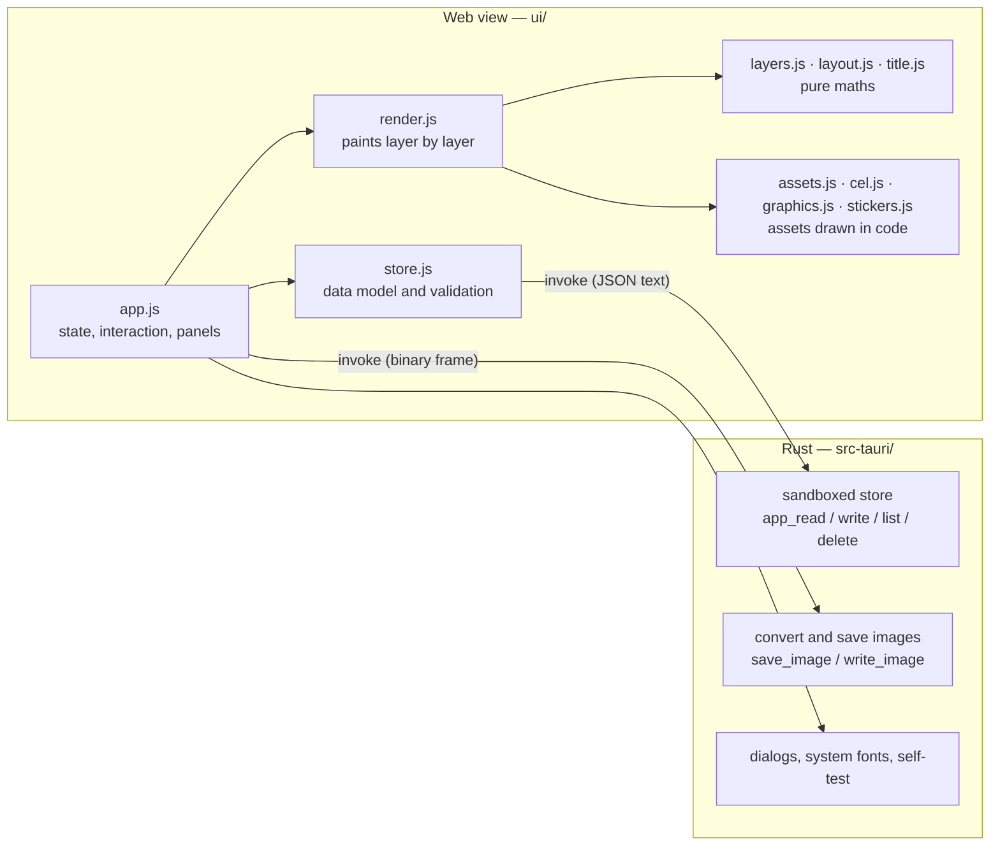

# SmedCover architecture

English · [中文](ARCHITECTURE.zh-CN.md)

For people who want to read or change the code. For how to use the app, see [README.md](README.md).

## 1. Overview

SmedCover is a Tauri 2 app in two halves:

- **The interface (`ui/`)** runs in the system web view and does all interaction and **all drawing**. Plain ES modules: no bundler, no framework, no runtime dependencies.
- **The Rust shell (`src-tauri/`)** only touches files and the network: it reads and writes app data, converts and saves images, shows system dialogs, lists system fonts and sends the AI request for a generated asset.



Why it is split this way:

- **What you see is what you export.** Preview and export run the same drawing code; only the pixel count differs.
- **The drawing code runs in a plain browser**, so development and automated checks do not need the desktop app.
- **The Rust side is small**, and so is its reach: the interface never gets an arbitrary file path. It can read and write the app data directory, and the places the user picks in a dialog.

## 2. Files

```
ui/
  index.html         markup and styles
  js/app.js          UI: state, the two modes, tabs, canvas interaction, layer panel, export, undo
  js/render.js       drawCover(): walks the layers and paints one cover; selection and hit-testing
  js/layers.js       layer model: placement across sizes, ordering, channels (pure)
  js/layout.js       geometry for any aspect ratio and template (pure)
  js/title.js        title parsing and fitting
  js/textfx.js       text effects: layered, masked and outlined
  js/outlines.js     cache of glyph outlines (fetched from the Rust side)
  js/photo.js        background photo and the cached gaussian blur
  js/assets.js       asset library: graphics, stickers, uploads
  js/cel.js          cel-shading kit and the first five channel graphics
  js/graphics.js     fifteen more channel graphics
  js/stickers.js     the sixty stickers, and the shared painters
  js/style.js        looks: a set of hooks per look, and the current look
  js/spec.js         stickers described as data: validation and interpreter (AI-generated assets)
  js/repaint.js      photo repaint: the three image services' requests and replies, repaint prompts, reading built-in styles
  repaint-styles/    built-in repaint styles, one `中文名_English name.md` each, plus the generated list index.json
  js/solid.js        3D objects described as data: validation, drawn with the channel graphics' renderer
  js/ai.js           AI generation: settings, requests for both API styles, the preset prompt (pure)
  js/store.js        data model, validation, persistence
  js/presets.js      starter profiles and size presets
  js/csv.js          CSV reader for batch export
  js/i18n.js         interface strings (zh / en)
  fonts/             bundled fonts and their licences
src-tauri/src/lib.rs all of the Rust side
tests/               unit tests for the DOM-free modules
```

`layers.js`, `layout.js`, the parsing half of `title.js`, `csv.js` and the validation half of
`store.js` never touch the DOM, so Node can test them directly.

## 3. Data model

Three pieces of data, all plain JSON. Everything read from disk goes through the `normalize*`
functions in `store.js`: a missing or invalid field falls back to its default, so old files and
hand-edited files cannot crash the app.

**Profile** (`profiles/<id>.json`)

```jsonc
{
  "id": "…", "name": "…",
  "brand": { "name": "PIXEL HARBOR", "unit": "CHANNEL" },
  "categories": [                       // called "channels" in the UI; the field name is kept for old files
    { "id": "vlog", "name": "Vlog", "sub": "DAILY VLOG", "code": "VLOG", "color": "#fcee0a",
      "graphic": { "kind": "graphic", "id": "camera", "labels": [], "stamp": "" } }
  ],
  "style": { "template": "stack", "theme": "dark", "imageShadow": true,
             "look": "cel", "lookParams": { "cyber": { "glow": 1.2 } }, "lookSeed": 7 },
  "fonts": { "body": "", "display": "" },
  "sizes": [ { "w": 1920, "h": 1080, "label": "16:9", "name": "", "on": true } ],
  "design": { "layers": [ … ] }         // the default design: the layers a new cover starts with
}
```

**Cover** (`session.json`, the current session)

```jsonc
{ "catId": "vlog", "title": "First line\n*second line*", "tag": "EP.01", "layers": [ … ] }
```

**Settings** (`settings.json`): language, current profile, export scale, format, JPEG quality, file
name pattern, adjustment scope.

Other files: `assets/<id>.json` (uploaded assets, as data URLs), `fonts/<name>.font` (imported
fonts), `session-photo` (the current background photo), `ai.json` (AI connection settings including the token; never exported with
profiles or projects).

A **project file** bundles the cover, its profile and the uploads it uses into one JSON, so it opens
unchanged on another computer.

## 4. The layer model (`layers.js`)

A cover is an array of layers, bottom first.

| Kind | Types | Notes |
|---|---|---|
| Bound layers | `bg` `accent` `graphic` `brand` `title` `tag` `catname` `frame` | Exactly one of each on every cover. Their content comes from elsewhere (the title text, the channel's graphic, …). They cannot be deleted; the `id` is the type name. |
| Free layers | `asset` `text` | Assets and text added by the user; can be deleted and duplicated. |

`normalizeLayers()` repairs a layer list: it drops unknown layers, puts back missing bound layers,
keeps the background at the bottom and makes ids unique.

### 4.1 Placement: one collage mapped to every size

Every layer has a `t`:

```jsonc
"t": {
  "all": { "x": 0.5, "y": 0.42, "s": 0.35, "r": 0, "kx": 1, "ky": 1 },
  "by":  { "1920x1080": { "dx": 0, "dy": -40, "s": 1.1, "r": 0, "kx": 1, "ky": 1 } }
}
```

- **`t.all` applies to every size.** Position is stored as a **fraction of the canvas**, so one value lands in a consistent place from 16:9 to 9:16.
  - Free layers: `x`, `y` are the position of the centre.
  - Bound layers: `x`, `y` are an **offset** from where the template puts the element; 0 by default.
  - `s` is the overall size, `kx` / `ky` stretch horizontally / vertically, `r` is degrees.
- **`t.by` is per-size fine-tuning**, keyed by size (`"1920x1080"`), in virtual pixels, applied on top of `t.all`.
- **The channel graphic** can also be tuned per channel, under `"1920x1080@<channel id>"`, because graphics differ a lot in shape.

`resolve()` combines the two into the final placement: positions add, scales and stretches multiply,
angles add. `adjust()` is the single entry point for every edit: dragging, handles, the wheel, arrow
keys and sliders all express a change as a patch, which is written to `t.all` or `t.by` depending on
the current scope.

### 4.2 Lettering colours

Layers made of words (`title`, `tag`, `catname`, `brand`, `text`) may carry `ink`, their own
lettering colour; the title may also carry `hi`, the colour of its highlighted words. Without them
the colour comes from the current look and the channel colour. Every look's lettering has to honour
the two fields.

### 4.3 Channels a layer belongs to

A free layer may carry `cats`, an array of channel ids. Without it the layer belongs to every
channel; with it, only to those listed. `appliesTo(layer, catId)` is the one place that decides, and
drawing, the layer list and re-ordering all use it. Validation removes ids of channels that no longer
exist, and a layer left with none is removed.

## 5. Layout (`layout.js`)

### 5.1 The virtual canvas

All geometry is computed on a "virtual canvas" whose short side is always 1080–1200 units, whatever
the real pixel size. `virtualSize(w, h)` gives it: 16:9 is 1920×1080, 4:3 is 1600×1200.

This lets type sizes, line weights and gaps be written as fixed numbers that keep their proportions
from 900×383 up to 8K. Drawing then needs one overall scale on the canvas.

### 5.2 Adjusting and swapping

A template's layout is not used directly: it first goes through `adjustLayout()`, which takes the
adjustments kept in the profile — how much the colour block takes (`size`), how far the dividing
edge leans (`slant`), the title box as fractions of what the template gives it (`tw`, `th`), and
whether the halves are swapped (`flip`). All are fractions of the picture, so one setting suits
every size. It serves both families of template, slanted and level, because it only reads and
rewrites the geometry of a finished layout and does not care how that layout was computed.

A swap is more than a mirror image: with the band on top, the brand row lands on it, the title's
box moves below it, and the channel name and tag are rearranged. The layout it returns therefore
carries a few flags (`brandOnAccent`, `railOnAccent`, `titleTop`, `flipped`) that drawing uses to
change colours and positions.

The diamond handles on the canvas get their positions from `layoutHandles()`; while one is dragged,
`dragLayout()` turns the pointer position back into an adjustment. A swapped layout is first
converted to unswapped coordinates, so the handles follow the pointer either way.

### 5.3 Templates

`layout(template, w, h)` returns all the geometry of a cover: the colour block polygon, the dividing
edge, the title box, the corner tag position, the channel name position, and the graphic's centre and
size.

- **Stack** has five hand-tuned anchors, for 9:16, 3:4, 1:1, 4:3 and 16:9. Other ratios are interpolated linearly between neighbouring anchors on the logarithm of the aspect ratio, so any size gets a sensible layout.
- **Banner** reuses the stack structure with the strip squeezed thin.
- **Split** is computed separately; its colour block is a slanted panel on the right.

Convention: the **first two points of the colour block polygon are the dividing edge**. All twelve
shapes of the colour block are generated from that edge.

## 6. Drawing (`render.js`)

`drawCover(canvas, options)` paints one cover:

1. Work out the virtual size, set the canvas's real pixel size and scale the context once.
2. Build an environment: template geometry, channel colour, light or dark theme, background photo and so on.
3. Walk the layers bottom to top, skipping hidden ones and ones that do not belong to the current channel; get the placement from `resolve()` and call `PAINT[type]`.
4. Each painted layer leaves a hit record (centre, half-width, half-height, angle) in `canvas._hits`.
5. If a selected layer is given, draw its outline and handles last.

Two helpers keep transforms consistent:

- **`placed()`** is for bound layers. Their paint function returns the rectangle it occupies; it is first run on a throw-away context to measure that rectangle, then painted for real, translated, rotated and scaled about the rectangle's centre. Scaling and rotation therefore always pivot on the content, and the result never depends on a previous frame.
- **`centred()`** is for assets and free text, which already draw around their own centre.

**Opacity**: a layer below 1 is painted onto a scratch canvas and blended in as a whole, so
overlapping strokes inside the layer do not show through each other.

**Preview and export share this code.** The main canvas is painted at the size of its display area,
thumbnails smaller, exports at size × scale.

### 6.1 Title (`title.js`)

Titles never wrap. `parseTitle()` splits the text into lines and, at asterisks, into plain and
highlighted runs. The type size is the largest at which the longest line fits the width and all lines
fit the height. Outline and shadow are several passes: the offset shadow, the ink outline, then the
fill.

### 6.2 Text effects (`textfx.js`, `outlines.js`)

The title, and text layers in the headline look, paint their letters through `paintRuns()`. The
effect is a property of the layer (`fx`); unset means "auto", which leaves it to the current look.
There are three kinds, differing in what they can change:

| Kind | How | What it can change |
|---|---|---|
| Layered | the same line painted several times in different colours and places | what is around the letters: outlines, shadows, echoes. Each look's own lettering is of this kind and can also be chosen by name |
| Masked | the letters are first painted alone on a spare canvas, which is worked on and then laid down | what is inside the letters: halftone, stripes, wear, an inner shadow, rows cut apart |
| Outlined | each letter's outline is fetched as points, which are moved before they are filled | the letterforms: arched, tapered, waved, or extruded with real depth |

**Where outlines come from** — a web view cannot read the outlines in a font file, so the Rust side
supplies them. The `text_outline` command parses the font with `ttf-parser`, flattens curves to
polylines and returns each glyph's outline and advance in units of one em. Fonts are found by name:
bundled fonts (read from the app's own assets), fonts the user imported, then installed fonts.
Variable fonts are traced at the weight asked for, and a character missing from the first font is
taken from the next.

**Asynchrony and drawing** — fetching takes a moment and drawing cannot wait. `outline()` answers at
once from a cache; the first time it returns nothing, sends for the outline, and the effect falls
back to ordinary lettering. When the outline arrives the interface is told to redraw. For an export,
`renderReady()` waits for every request and draws again, so the exported image has the effect.

**Extrusion** really sweeps every edge of the outline back into a wall: walls are split into lit and
shaded by the way they face, each group is filled as one shape, then the back face and the front.

### 6.3 Background photo and blur (`photo.js`)

Canvas filters are not available in the macOS web view, so the gaussian blur is done in script:
**three box blurs approximate one gaussian blur**, each box blur using a sliding window so its cost
does not depend on the radius.

The blur is applied to a reduced working copy of the photo and cached by photo and blur amount. After
that, moving or scaling the photo, or editing any other layer, costs a single image draw. Exports
recompute it from a higher-resolution copy.

### 6.4 Assets

- **Channel graphics** and **stickers** are all drawn in code — there are no image files — so they are sharp at any size and can take the channel colour. `cel.js` provides a cel-shading kit (flat tones, ink lines, pseudo-3D boxes and prisms); `graphics.js` adds more through `registerGraphics()`.
- **Uploads** are stored as data URLs in the app data directory and cached once decoded.
- `drawAsset()` is the single entry point and returns the asset's half-extents for hit-testing.

## 7. Looks (`style.js`)

The **content** of a cover — layers, placements, sticker and solid specs, the title text — carries no
style information, so switching look is only a different way of drawing: every asset, AI-generated
ones included, is redrawn and no data changes.

A look is a set of **hooks**. Each is optional, and what a look leaves out is drawn the default
(cel) way, so a new look can start as one hook and grow.

| Hook | Responsible for |
|---|---|
| `theme` | colours of the field, the grid and plain text |
| `background` | the background layer: field, grid, the photo and its tint |
| `accent` | the colour block: fill, screentone, how the dividing edge is drawn |
| `runs` | lettering made of runs — the title, and free text in the headline look |
| `wrap` | returns a stand-in context that channel graphics, solids and the small cover parts (brand row, tag, channel name, brackets) draw on |
| `sticker` | the five painters of flat stickers: `shape`, `blob`, `stroke`, `thin`, `word` |
| `tag` | the corner tag |
| `frame` | the frame layer, and any interface detail the look wants along the edges |
| `freeText` | free text layers in their plain and plate looks |
| `subject` | whatever is painted around the channel graphic and travels with it (a lock-on ring, say) |
| `seeded` | marks a look that places some things at random |
| `layout` | the geometry of a cover, for looks that are about arrangement; the result has the shape `layout()` in `layout.js` returns, and usually comes from `blockLayout()`, which gives level bands and upright panels |
| `titleSet` | lets the look set the title itself (vertically, say); returning nothing means the usual way |
| `faces` | faces to use for the whole cover. The font table is shared, so `drawCover()` puts it back when it is done |
| `titleFont` | the title's font stack, for looks with typographic opinions (editorial's serif) |
| `oneTheme` | marks a look with a single ground, so the interface hides the light / dark choice |
| `image` | the shadow or glow of an uploaded image |
| `post` | an overlay painted over the finished cover, such as scanlines and a vignette |
| `params` | tunable numbers, shown as sliders in the Style tab |
| `prompt` / `solidPrompt` | the *Style* section of the AI prompts |

The current look is module state in `style.js`, set by `drawCover()` from the profile before it
draws; the interface also sets it before painting asset tiles.

### 7.1 The stand-in context: a new look without touching the drawing code

Each of the twenty channel graphics is dozens of lines of direct canvas calls. Rewriting them one by
one for several looks is not realistic, so they draw on a stand-in: `wrap` returns a `Proxy` that
forwards every canvas call and steps in at two points.

- **When a colour is set**, it first works out the job that colour does in the cel style (ink, light face, mid face, dark face, colour) and substitutes the current look's colour for that job. Cyberpunk turns the three faces into three shades of dark glass and leaves colours alone.
- **When a line is stroked**, an ink line is drawn as a line of light instead: a wide faint halo, the coloured line, a thin pale core.

So the drawing code of the channel graphics and of AI-generated solids is unchanged.

Cyberpunk leaves the small cover parts (brand row, channel name) alone: the look *is* solid panels
with black lettering, which is what the cel style's ink on colour already gives. Its difference comes
from elsewhere: the colour block is a solid panel, highlighted words in the title become black on a
chamfered plate, every hard ink shadow of the cel style becomes a red and cyan "echo", and the whole
picture finally gets a colour split and a signal tear.

The glow is made by stroking a line several times at different widths, not with canvas shadow blur.
Shadow blur is slow per line, and web views disagree about its extent: the same value came out far
blurrier in the app's web view than in Chrome. The title's glow is layered strokes too, so it looks
the same everywhere.

### 7.2 Tools the looks share

Most new looks keep the construction and change the materials, so a few tools are shared:

- `mapped(ctx, rules)` — a general stand-in context that swaps colours by the job they do (ink, light face, mid face, dark face, colour) and can scale every line width.
- `painters(options)` — builds the five sticker painters from an outline colour, a line-width factor and a way of drawing the shadow.
- `grain()`, `wash()` — grain, and laying a colour over everything; for paper and film and for tinting photos. Grain is multiplied in on paper and overlaid on film: overlay hardly shows on a light ground.
- A photo loses its colour through the `grey` argument of `drawPhoto()`, which computes a grey copy pixel by pixel and caches it. The canvas "saturation" blend mode is not used: it is not dependable across web views.

Looks with a light and a dark ground (record sleeve, editorial) learn which one is current from the fourth argument of `setLook()`.

### 7.3 Tuning the picture

Three levels, from light to deep:

1. **Sliders** — a look's `params`, saved in the profile under `style.lookParams[look]`; no code.
2. **Constants** — in `style.js`, `CY` is the cyberpunk palette (field, black, three shades of glass, the red and cyan of the split, white); `echo()` sets the direction and distance of an echo; `tube()` the width and opacity of each layer of a line of light; `chamfer()` is the cut corner.
3. **Hooks** — change how a hook draws: the grid and the giant code in `background`, the interface detail in `frame`, the split, tear and scanlines in `post`, the layers of the lettering in `runs`.

To add a slider, add an entry to the look's `params` and read the value in a hook; the interface and
saving are automatic.

**Random, but holding still** — what a look places at random (the tears, the sweep line) takes its
values from `rand(k)`, which depends on `style.lookSeed` in the profile. While the seed stays the
same, every frame, every size, the preview and the export put things in the same relative places;
*Shuffle the random placement* simply picks another seed.

## 8. AI-generated assets (`ai.js`, `spec.js`)

### 8.1 Why the model returns data, not code

The built-in stickers are code, so the obvious idea is to have the model return drawing code too.
That was not done, for safety: the code would run in the web view, which can call commands that read
and write app data, save files and make network requests. Running code written by a remote model,
and steered by user input, would hand it all of that.

So the model returns a **sticker spec**: a JSON object listing drawing operations. It keeps every
benefit of the code form — drawn live, sharp at any size, able to follow the channel colour — while
nothing in it is ever executed.

```jsonc
{ "name": { "zh": "爱心", "en": "Heart" }, "color": "#ff3b4f",
  "ops": [
    { "op": "shape", "path": { "curve": [["M",0,82], ["C",-118,8,-74,-96,0,-36], ["C",74,-96,118,8,0,82]] }, "fill": "main" },
    { "op": "detail", "pts": [[-46,-34], [-56,-14]], "color": "white", "lw": 9 }
  ] }
```

- Same coordinate system as the built-in stickers: a 200×200 box centred on the origin.
- Five operations — `shape`, `blob`, `line`, `detail`, `text` — map directly onto the five painters in `stickers.js`; paths are polygon, circle, ellipse, rounded rectangle, star or curve, and a line may also be an arc.
- Any operation may carry `mirror`, which paints it a second time reflected left-to-right. The geometry is reflected, not the canvas, so shadows still fall to the lower right; a mirrored `blob` merges both halves into one silhouette.
- The colour `"main"` stands for the main colour, replaced by the channel colour when tinted.

**The style therefore does not depend on the model behaving: the interpreter guarantees it.** Heavy
ink lines, hard shadows and flat fills are added by the painters; the model only decides shapes and
colours.

### 8.2 Solid objects (`solid.js`)

There are two kinds of AI asset. Besides the flat sticker above there is the **solid**, the
counterpart of the built-in channel graphics:

```jsonc
{ "kind": "solid", "name": { "zh": "洗衣机", "en": "Washing machine" }, "color": "#00e5ff",
  "parts": [
    { "box": [300, 380, 260], "at": [0, 0, 0],    "tone": "white" },
    { "cyl": [110, 30], "axis": "z", "at": [0, 30, 145], "tone": "dark" }
  ],
  "marks": [ { "circle": [0, 30, 82], "z": 161, "fill": "shade", "line": 5 } ] }
```

- `parts` are boxes and cylinders, each with a centre and a tone (white, dark, main). They are turned into the same pieces the channel graphics use and handed to the same renderer, `drawPieces()`: sorted by depth, every face put into one of three tone bands by its orientation, screentone on the dark band, an ink line round every face.
- `marks` are flat details on the front of the object (circles, rectangles, lines), painted over all the pieces.
- The object is **scaled and centred automatically** from its projected extent, so the absolute size a model describes does not matter, only the proportions; the ground shadow is added from the same extent.
- When tinted, the main-toned parts, the screentone and the ground shadow all take the channel colour.

The renderer sorts whole parts, not pixels, so parts that pass deep through each other can come out
in the wrong order. The prompt therefore asks for parts that only touch or overlap slightly.

### 8.3 Validation

`normalizeSpec()` checks a reply item by item: operations must be on the list, numbers must be finite
and are clamped to their range, colours must be a palette name or a hex value, and the number of
operations, points and characters is capped. Anything unknown is refused rather than guessed at;
extra fields are dropped. If a model never used `"main"`, the colour it used most is promoted to the
main colour, so an asset can always follow the channel colour. `parseSpec()` finds the JSON inside a reply that may carry a code fence or
a polite sentence.

A spec that passes is stored as `assets/<id>.json` next to uploaded images. It is one of *My assets*
and travels with exported profiles and projects.

### 8.4 Requests and the prompt

`buildRequest()` produces the request for each API style:

| | OpenAI style | Anthropic style |
|---|---|---|
| URL | `{BASE_URL}/chat/completions` | `{BASE_URL}/v1/messages` |
| Authentication | `Authorization: Bearer` | `x-api-key`, or `Authorization: Bearer` |
| Other headers | none | `anthropic-version` |
| System prompt | a `system` message | the top-level `system` field |
| Length parameter | not sent | `max_tokens` (required) |

The OpenAI style deliberately sends no sampling or length parameters: models disagree on which they
accept, and one too many gets the request rejected. `readReply()` reads replies, error messages and
the "cut off" signal of both styles.

When a reply fails validation, `requestSpec()` sends the reply and the validation error back as the
next turns of the conversation so the model can correct it, up to three times. Connection errors
and cut-off replies are not retried: asking again would not change the outcome.

There are two preset prompts with the same structure: `systemPrompt(style)` for flat stickers and
`solidPrompt(style)` for solids. The former contains the style, the coordinate system, the colour
rules, the data format above, step-by-step guidance on designing a sticker, and six examples. Only
the *Style* section is taken from `STYLE_NOTES[style]`; the rest is style-neutral, so a new style
only adds one entry. The examples are themselves valid specs and the unit tests
validate each one, so the prompt and the interpreter cannot drift apart.

### 8.5 Photo repaint (`repaint.js`)

A repaint is one fixed step, not an agent: the photo and a style description go to an image model, a picture comes back. The three services each have their own interface; `buildImageRequest` builds each one's request and `readImageReply` finds the picture in each one's reply:

| Service | Request | The photo goes in | The result is in |
|---|---|---|---|
| OpenAI | `POST {base}/images/edits`, Bearer | `images: [{image_url: data URL}]`, `size` in the photo's shape | `data[0].b64_json` |
| Gemini | `POST {base}/models/{model}:generateContent`, `x-goog-api-key` | `inlineData` in `contents[0].parts` | `inlineData` in `candidates[0].content.parts` |
| Seedream | `POST {base}/images/generations`, Bearer | `image: data URL`, `size: "WxH"`, `response_format: "b64_json"` | `data[0].b64_json`, or `url` (fetched by `fetch_image`) |

Built-in styles are Markdown files in `ui/repaint-styles/`; the file name gives the Chinese and English names, and the English one the id. A bundled app cannot list a folder, so `scripts/repaint-styles.mjs` scans it before every build (`beforeBuildCommand`) and writes `index.json`; the interface reads the list at start and a style's file only when it is selected, opened or used (`styleText`, kept once read), with `<!-- -->` comments taken out.

`repaintPrompt` puts the prompt together: the style source (the current look's `repaint(colour)`, a built-in style's file, or the user's words), then "this is a cover background: no text or border, keep the shape", then any extra words. Following a look also asks to keep the composition, so the background layer's placement still fits; presets and custom text decide composition themselves. When the service refuses an optional setting (size, watermark…) with a 400, `refusedParam` finds its name in the message and the request goes again without it, at most three times. The connection test (`imageCheck` / `readImageCheck`) makes no picture: OpenAI and Gemini are asked about the model with a GET, Seedream is sent an empty prompt and its refusal read; `ai_request` can send a GET for this. The user's own styles are kept as `styles` in `image-ai.json`. A repaint always starts from the original, kept in `S.photoOriginal` (`session-photo-original` in the session, `photoOriginal` in project files).

## 9. Interaction (`app.js`)

### 9.1 State and refresh

All state is in one object `S`: the current profile, cover, settings, mode, selected size and layer,
and the undo history.

After changing data, code calls `touch({ profile, cover, panel, side, strip })`, which marks what
needs saving, schedules a redraw, rebuilds a column of the interface if asked, and records undo
history. Saving, redrawing and history are debounced, so a long drag does not write to disk
repeatedly.

There is no framework: each column is built with a small element helper, `el()`, and rebuilt whole
when needed.

### 9.2 Working on the canvas

- The pointer position is converted to virtual coordinates and tested against `canvas._hits`, top first. The point is rotated back into each layer's own frame, so rotated layers are hit accurately.
- For the selected layer the handles are checked first: corners resize, sides stretch, the top knob rotates. Handle size is computed in screen pixels, so handles look the same at any zoom.
- Corner brackets are never hit; the background can be dragged only when it holds a photo.

### 9.3 Redrawing one layer while dragging

While a layer is moved, resized or rotated, the others do not change. So when a drag starts,
`drawCover()` paints everything **under** the dragged layer into one image and everything **over** it
into another, and each frame then does three things: blit the first, repaint the dragged layer, blit
the second. The cache lives in the `o.live` object the interface passes in and is dropped when the
drag ends. Dragging on the canvas, the wheel and the placement sliders all go this way.

Measured in the engine the app uses (1900 px wide): a full redraw takes about 18 ms in the cel look
and 44 ms in cyberpunk; dragging a layer takes 5–11 ms in either.

A look's costly whole-picture effects (the colour split, so far) are left out of drag frames, under
`setFast()`, and return in the frame after the drag.

### 9.4 Undo

After each change (debounced by half a second) the profile and cover are serialised into one string
snapshot, pushed only if it differs from the last, up to 80 steps. Undo parses a snapshot back and
validates it again. Simple, at the cost of a full copy per step — fine at the current data size.

## 10. The Rust side (`src-tauri/src/lib.rs`)

### 10.1 Sandboxed store

`app_read`, `app_write`, `app_list` and `app_delete` take relative paths only. `resolve()` joins them
to the app data directory and refuses absolute paths and `..`, so the interface cannot reach files
outside it. Writes go to a temporary file that is then renamed, so quitting mid-write never leaves
half a file.

### 10.2 Export pipeline

```
canvas ──toBlob (async)──▶ PNG bytes ──binary frame──▶ Rust worker thread ──▶ PNG / JPEG / WebP file
```

1. The interface paints the cover on an off-screen canvas and encodes it to PNG with `toBlob`, **asynchronously**, so the window keeps responding.
2. The bytes go to Rust as Tauri's raw request body, **without base64**. The body is a small frame:

   ```
   [4-byte little-endian length][JSON metadata: folder, file name, format, quality][PNG bytes]
   ```

   The metadata travels in the body rather than in request headers because, in the real app, custom headers did not reach Rust.
3. `save_image` (with a save dialog) and `write_image` (into a folder already chosen) are async commands that run on a worker thread. PNG is written as is; JPEG is flattened onto a dark matte and encoded; WebP is encoded lossless.
4. The interface keeps at most two writes pending, and is already painting the next cover while it waits. A progress dialog shows the count; cancelling stops new work from being dispatched.

File names pass through `safe_name()`, which keeps only the last path component, so a name cannot be
used to write into another directory.

### 10.3 Glyph outlines

`text_outline`: see 6.2. A font file, once found by name, is cached, and installed fonts are scanned once.

### 10.4 AI requests

`ai_request` sends the request the interface built (URL, headers, JSON body) and hands back the
status and body as they are — error replies included, so the interface can show the provider's own
message. It is sent from Rust to get around the cross-origin limits of a web view.

- The request waits for its reply on the blocking thread pool, off the interface thread and off the async runtime's workers.
- Only `http://` and `https://` are accepted and at most 4 MB of a reply is read; 64 MB of one carrying a picture (a photo repaint, `image: true`). The timeout comes from the settings, 300 seconds by default.
- Proxy: the one given in the settings wins; otherwise `HTTPS_PROXY` / `HTTP_PROXY` / `ALL_PROXY` from the environment. **Addresses on this machine never go through the environment's proxy**, or a local model would be cut off by it.

`fetch_image` covers a repaint whose service answers with a link instead of the picture: it downloads it, checks that it is a picture (by `content-type`, else by its first bytes) and hands it over in base64.

### 10.5 Other commands

`pick_folder`, `save_text` (profiles, projects, the CSV template) and `list_system_fonts` (which
enumerates installed fonts with fontdb).

## 11. Browser fallback

The `files` object in `store.js` has two implementations: with Tauri it calls the commands above;
without it, it falls back to `localStorage`, and exports become browser downloads. So the interface
can be developed from a static server:

```bash
python3 -m http.server -d ui 4599
```

## 12. Fonts

The three bundled fonts are loaded with `@font-face` and render the same on every platform. Imported
fonts are stored as data URLs under `fonts/` and registered with `FontFace` at start-up. The first
frame waits for the fonts, otherwise the title would be fitted using the wrong glyph widths.

## 13. Tests

| Level | Command | Covers |
|---|---|---|
| Front-end unit tests | `npm test` | layout, layer placement and order, channels, CSV, data validation, file name pattern, size and naming of the asset packs, colour mapping and parameters of looks, validating and drawing sticker and solid specs, requests and replies in both API styles, both languages present for every string |
| Rust unit tests | `cd src-tauri && cargo test` | path sandbox, store round trip, frame parsing, encoding in the three formats, file name handling, requests against a local stand-in server, proxy rules |
| End-to-end self-test | `SMEDCOVER_SELFTEST=<folder> <executable>` | the full export path between the real web view and Rust |

In self-test mode the app keeps its data in the given folder, exports a few covers in all three
formats and one more in every other look, writes `report.json` and quits. With `SMEDCOVER_SELFTEST_AI=<stand-in server URL>` it also
generates one asset in each API style and draws it on a cover. It catches problems that only show up in the real app, such
as the header issue above.

## 14. Trade-offs and known limits

- **Layers are cached only while dragging.** Typing a title or moving a look slider still redraws everything, about 44 ms each time in cyberpunk.
- **Drawing runs on the interface thread.** Painting a 4× cover briefly stalls the window. Conversion and writing are already on a worker thread.
- **No bundler.** Modules are loaded directly by the web view: simple, but nothing is minified or tree-shaken. At the current size start-up time is negligible.
- **Undo keeps full snapshots.** Simple and robust; it would need to become incremental if the data grows.
- **All thumbnails are redrawn every time.** With many sizes this is the main cost.
- **Bundled fonts are not subset.** They account for most of the installer.
- **Only run on macOS so far.** The Windows and Linux build configuration is written but not verified.

## 15. Where to start for common changes

| To… | Change |
|---|---|
| add a channel graphic | write the draw function in `graphics.js` and `registerGraphics()` it; `assets.js` needs nothing |
| add a sticker | `stickers.js` |
| add a colour block shape | `ACCENT_SHAPES` in `layers.js`, `paintAccent()` and `edgePoints()` in `render.js`, a name in `i18n.js` |
| add a template | `TEMPLATES` and `layout()` in `layout.js`, a name in `i18n.js` |
| add a property to a layer | `PROPS` and `normalizeLayer()` in `layers.js`, `PAINT` in `render.js`, `typeControls()` in `app.js` |
| add an export format | `encode()` in `lib.rs`, `EXT` and the format picker in `app.js` |
| add a drawing operation for AI assets | validation and `drawSpec()` in `spec.js`, the prompt and examples in `ai.js` |
| add a kind of part to solids | validation and `pieces()` in `solid.js`, `solidPrompt()` and its examples in `ai.js` |
| add a look | an entry in `LOOKS` in `style.js`, starting with a hook or two |
| add an interface string | `i18n.js`, in both languages; a test checks that both are present |
