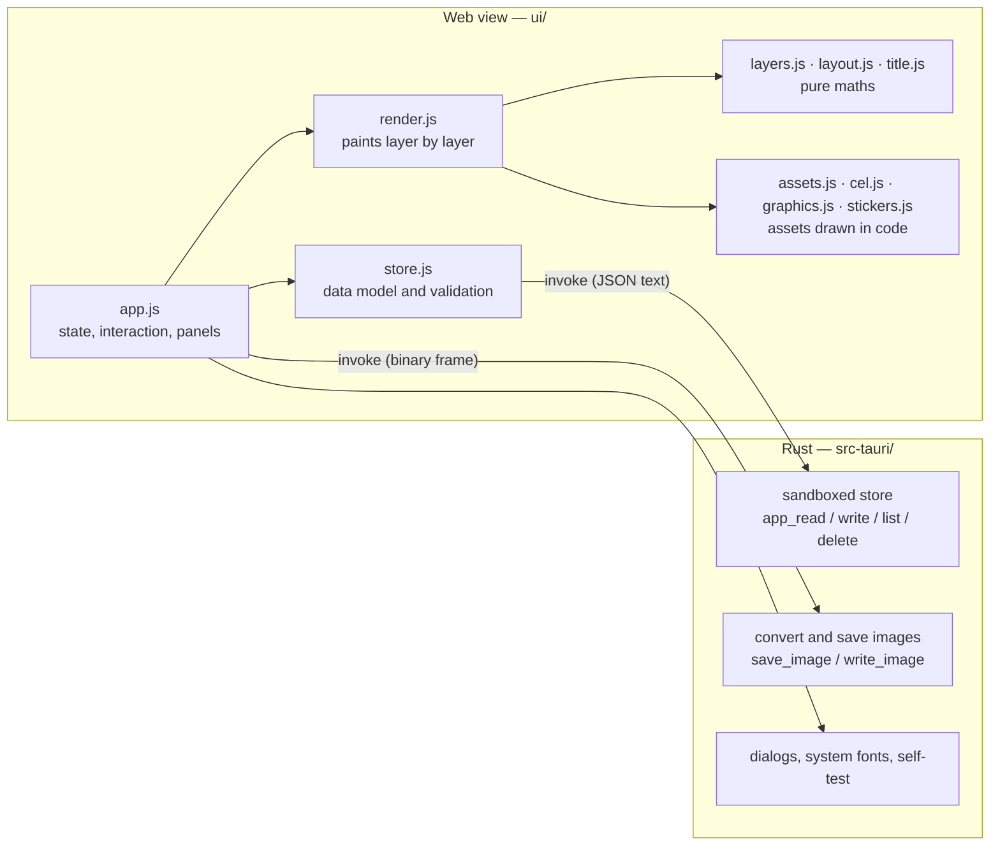

# SmedCover architecture

English · [中文](ARCHITECTURE.zh-CN.md)

For people who want to read or change the code. For how to use the app, see [README.md](README.md).

## 1. Overview

SmedCover is a Tauri 2 app in two halves:

- **The interface (`ui/`)** runs in the system web view and does all interaction and **all drawing**. Plain ES modules: no bundler, no framework, no runtime dependencies.
- **The Rust shell (`src-tauri/`)** only touches files and the network: it reads and writes app data, converts and saves images, shows system dialogs, lists system fonts and sends the AI request for a generated asset.



Why it is split this way:

- **What you see is what you export.** Preview and export run the same drawing code; only the pixel count differs.
- **The drawing code runs in a plain browser**, so development and automated checks do not need the desktop app.
- **The Rust side is small**, and so is its reach: the interface never gets an arbitrary file path. It can read and write the app data directory, and the places the user picks in a dialog.

## 2. Files

```
ui/
  index.html         markup and styles
  js/app.js          UI: state, the two modes, tabs, canvas interaction, layer panel, export, undo
  js/render.js       drawCover(): walks the layers and paints one cover; selection and hit-testing
  js/layers.js       layer model: placement across sizes, ordering (pure)
  js/layout.js       geometry for any aspect ratio and template (pure)
  js/title.js        title parsing and fitting
  js/stack3d.js      the layer panel's 3D view: the stack's projection, fitting, labels and drawing (pure maths but for the drawing)
  js/platforms.js    the platforms covers are made for, as data: the ratios each wants, feed widths, what the apps lay over a cover; the sizes' names (platformsFor)
  js/check.js        the cover standards' rules, pure (the tests hold the layouts to them; meetStandards in layout.js)
  js/deal.js         Surprise me's rules, all in one place: every number it deals by (RULES), what suits each look (FAMILIES, RECIPES), the chances the user may set over them (oddsOf, rebalance), a hand dealt onto a cover (dealCover), pure
  js/textfx.js       text effects: layered, masked, outlined and letter by letter
  js/ransom.js       the ransom note: each letter in a face, on a paper, at an angle of its own
  js/outlines.js     cache of glyph outlines (fetched from the Rust side)
  js/photo.js        background photo and the cached gaussian blur
  js/assets.js       asset library: graphics, stickers, uploads
  js/cel.js          cel-shading kit and the first five channel graphics
  js/graphics.js     fifteen more channel graphics
  js/stickers.js     the 72 stickers (twelve of them frames), and the shared painters
  js/style.js        looks: a set of hooks per look, and the current look
  js/spec.js         stickers described as data: validation and interpreter (AI-generated assets)
  (src-tauri/src/subject.rs: the photo's subject mask, from Vision)
  js/repaint.js      photo repaint: the three image services' requests and replies, repaint prompts, reading built-in styles
  repaint-styles/    built-in repaint styles, one `<id>.md` each (names and notes in a header), plus the generated list index.json
  js/solid.js        3D objects described as data: validation, drawn with the channel graphics' renderer
  js/ai.js           AI generation: settings, requests for both API styles, the preset prompt (pure)
  js/store.js        data model, validation, persistence
  js/presets.js      starter profiles and size presets (one for each ratio a platform wants)
  js/csv.js          CSV reader for batch export
  js/i18n.js         interface strings (zh / en)
  fonts/             bundled fonts and their licences
src-tauri/src/lib.rs all of the Rust side
tests/               unit tests for the DOM-free modules
```

`layers.js`, `layout.js`, the parsing half of `title.js`, `csv.js` and the validation half of
`store.js` never touch the DOM, so Node can test them directly.

## 3. Data model

Three pieces of data, all plain JSON. Everything read from disk goes through the `normalize*`
functions in `store.js`: a missing or invalid field falls back to its default, so old files and
hand-edited files cannot crash the app.

**Profile** (`profiles/<id>.json`)

```jsonc
{
  "id": "…", "name": "…",
  "brand": { "name": "PIXEL HARBOR", "unit": "CHANNEL" },
  "categories": [                       // called "channels" in the UI; the field name is kept for old files
    { "id": "vlog", "name": "Vlog", "sub": "DAILY VLOG", "code": "VLOG", "color": "#fcee0a",
      "graphic": { "kind": "graphic", "id": "camera", "labels": [], "stamp": "" } }
  ],
  "style": { "template": "stack", "theme": "dark",
             "look": "cel", "lookParams": { "cyber": { "glow": 1.2 } }, "lookSeed": 7,
             "lookArt": { "jelly": { "kind": "sticker", "id": "star" } } },   // optional: what a look's figure is drawn from in the channel graphic's place
  "fonts": { "body": "", "display": "" },
  "sizes": [ { "w": 1920, "h": 1080, "label": "16:9", "name": "", "on": true } ],
  "design": { "layers": [ … ] }         // the default design: the layers a new cover starts with
}
```

**Cover** (`covers/<profile id>/<channel id>.json`, one for each channel of each profile)

```jsonc
{ "catId": "vlog", "title": "First line\n*second line*", "tag": "EP.01", "layers": [ … ],
  "scene": { "court": { "ball": { "all": [0.1, -0.05], "by": { "1080x1920": [0.02, 0] } } } } }   // optional: scene objects dragged (see 7.5)
```

`S.covers` holds the current profile's channel covers (keyed by channel id) and `S.cover` the one shown; both change only through `setCover()`. Switching profile reads the new one's covers (`loadCovers()`); switching channel (`switchChannel()`) commits the undo step first, then shows that channel's cover — made by `channelCover()` from the profile's design, with a default title, if it has none. Saving (`persistCover`) is debounced per profile and channel. The channel each profile was last on is kept in the settings' `channels` (`{profile id: channel id}`) and read by `channelOf()`. Deleting a profile deletes its `covers/<profile id>/`. *Copy from another channel* (`copyDialog`, `copyInto`) takes the source cover through `coverOf()` (the one in memory for the current profile, else the file, else a new one from the design), `copyPreview()` draws it whole with its own profile at the size on the canvas, and `layers.js`'s pure `copyFreeLayers(into, from)` copies the layers the user added to it (`isAdded`: free layers and copies of layout layers, see 4): deep copies under new ids, a passive layer's `of` turned to its photo's copy, a cut-out's `weave` to the copies of the lettering it weaves with (a layout layer's id kept, as every cover has it; any other dropped); each copy goes above the nearest layout layer below it in the source, over the layers added there already, in the order they had. The dialog counts them by kind, the copies as *Layout copies*. The cover is then checked by `channelCover()` as one read is, and the whole is one undo step.

Earlier data: there used to be one cover, `session.json`, shared by every channel, whose layers could be kept to some channels with `cats`. While the current profile has no channel covers yet, `migrateSession()` splits it: one copy per channel, `channelCover()` keeping only the layers on that channel and dropping `cats`, the title and tag copied to each; the old file is renamed `session.migrated.json`, and `session-photo*` is first turned into a photo layer by `upgradeCover`, then deleted.

**Settings** (`settings.json`): language, current profile, the channel each profile was last on
(`channels`), export scale, format, JPEG quality, file name pattern, adjustment scope, and the user's own
Surprise me chances of each look's optional parts (`recipes`: {look: {params}}, only what was changed, checked by `normalizeRecipes`; see `deal.js`),
and what Surprise me keeps (`surprise`: the parts to leave alone, `locks`; the chances set in Surprise me's
chances, `odds`, only what was set; see `normalizeSurprise`).

Other files: `assets/<id>.json` (My assets: images as data URLs, AI assets as specs; either may carry `folder`, the id of its folder), `asset-folders.json` (the folders of My assets, `[{id, name}]`, checked by `normalizeFolders`; an asset whose folder is gone counts as unfiled), `fonts/<name>.font` (imported
fonts), `photos/<pid>` (pictures, originals and masks; see 6.3), `photo-library.json` (Bitmaps: `[{pid, name, kind, at}]`, `kind` being `upload`, `ai` or `repaint`, newest first, checked by `normalizeLibrary`), `ai.json` (AI connection settings including the token; never exported with
profiles or projects).

A **profile file** (`.smedprofile.json`, version 3): `{app, kind: "profile", version, profile, assets, fonts}`; a whole backup adds `covers` (`{channel id: cover}`), `photos` (`{pid: {src, original, mask}}`) and `channel` (the one it was on). `exportProfile()` writes it, `profileActions.import()` reads it: always a new profile (a new id, the same channel ids), its covers checked by `channelCover()` and written under `covers/<new id>/`, the pictures into the photo store and the library.

A **project file** (`.smedcover.json`, version 4; its way in — the top bar's Project and Cmd+S — is gone for now, the code in `projectActions` stays): `{app, kind: "project", version, profileName, profile, catId, cover, photos, assets, fonts}`. Opening one (`projectActions.open()`): with a profile of that id here, it goes to that profile and channel `catId`; without, `askProjectProfile()` asks whether to import it as a new profile or put it into the current one; version 3 and before have no `profile` and open on the channel on the canvas. `commitHistory()` runs first, so it can be undone.

Both carry the user's assets they use (`embedAssets`) and imported fonts (`embedFonts`: those a layer's `font` names that are in `S.importedFonts`; `adoptFonts` installs the ones this computer lacks, into `fonts/`).

## 4. The layer model (`layers.js`)

A cover is an array of layers, bottom first.

| Kind | Types | Notes |
|---|---|---|
| Layout layers (`bound` in the code) | `bg` `accent` `graphic` `catname` `tag` `brand` `logo` `subtitle` `title` `frame` (their default order, bottom first: `BOUND_TYPES`) | Exactly one of each on every cover. Their content comes from elsewhere (the title text, the channel's graphic, …). They cannot be deleted; the `id` is the type name. All but `bg` and `frame` can be copied (`COPYABLE`). |
| Free layers | `asset` `text` `photo` `solid` | Assets, text, photos and blocks of colour added by the user; can be deleted and duplicated. An asset may carry `ink` (a vector asset's colour of the user's, over its own and the channel's) and `crop` (as a photo's, see 6.3); a block carries `color` and is the canvas's size at scale 1. |
| Copies of layout layers | a type of `COPYABLE`, with `copy: true` | Made by duplicating a layout layer; the user's, as a free layer is: can be deleted, renamed and duplicated. |

`normalizeLayers()` repairs a layer list: it drops unknown layers, puts back missing layout layers,
keeps the background at the bottom and makes ids unique. A layer the user added (`isAdded()`: a free
layer or a copy) may carry `name`, the name the user gave it in the layer list (`layerName()` prefers it;
without one the name comes from the type and content, a copy's from its type: "Title copy",
`layer.copyOf`). The interface's buttons do not follow the cover's look.

**Copies of layout layers**: `duplicate()` copies a free layer, or a layout layer of `COPYABLE` as a copy
of it: a layer of the same type with `copy: true` and an id of its own (`normalizeLayer()` gives one that
reads a layout layer's id, or none, a new one, so a copy is never taken for the original; a layout
layer's `off` is not read on it, and `duplicate()` brings in a copy of a part left out). It shows what the
original shows — the title's words, the subtitle, the tag, the brand row, the logo, the channel name, the
channel graphic, the colour block — in a style and a place of its own, placed as layout layers are (an
offset from where the template puts the element, `resolve()`) and nudged by 0.03 when made. It is the
user's: `isAdded()` (free layers and copies) is what can be deleted (`isRemovable(layer)`, which takes the
layer now), renamed, carried by *Copy from another channel* and dropped by *Clear*; `isLayout()` (a layout
type, not a copy) is what the layout's order (`layoutOrder()`, `orderLayout()`), *Layout parts*
(`partsBox()`), *Hide layout* (`layoutLayers()`) and *Reset every layer's placement* go by. The layer list
shows a copy with the layout icon where a free layer shows what it is, then the user's. Whatever looks for
the layout's own title, subtitle, logo or graphic looks by id (a layout layer's id is its type), not by
type: `subtitlePlan()`, `partsOf()`, `env.hasBrand` and `env.logo` in `render.js`, `titleLayer()`,
`graphicTop()` and `keepClear()` in `style.js`, `dealCover()` putting the title on top. A copy
of the subtitle shows where the subtitle goes while the subtitle itself is hidden or left out
(`subtitlePlan(…, hidden)`, the title making no room for it), and a copy of the logo where the logo goes
while the logo is hidden (`PAINT.logo` takes `logoBox()` itself).

The default order changed once (it was `bg accent graphic brand title tag catname frame`; files from before the
brand logo and the subtitle get `logo` and `subtitle` put in above `brand` as they are read, as any missing
layout layer is put back after the nearest one before it):
`reorderLayout()` puts a design or cover still in the old default order into the new one, each layer the
user added (a copy too) going with the layout layer it lay directly above. The app does it once per profile, in `loadCovers()`
(the profile then keeps `layerOrder: 2`), since someone may later put the old order back on purpose.
In the same way a new cover comes with the tag `EP.01`, and the covers made before that and never touched
(the placeholder title, no tag) are given it once (`tagged: true`), so a tag emptied later stays empty; and
a placeholder subtitle (`subbed: true`).

**Layout parts left out**: a layout layer but the ground may carry `off: true` (Cover → *Layout parts*,
`partsBox()`): it is then hidden, and the editor leaves it out of the layer list, the 3D view and *Hide
layout*; ticked again it is back as it was. *Clear* keeps what the cover leaves out and what it has. A new
design leaves out `DEFAULT_OFF` (the channel name and graphic): `normalizeLayers()` puts those in left out
when it puts back missing layout layers, which for a new profile is all of them; a profile's design and its
covers still on the placeholder title were made to leave them out once (`lean: true`, in `loadCovers()`).
The same rows put the layout layers in order: a row dropped on another calls `orderLayout(layers, types)`
(bottom-first types, the ground first; each layer the user added going with the layout layer it lies directly above;
`reorderLayout()` is it for the old default order) on the cover and on the profile's design, so the new
order is the default from then on (new channels' covers, *Clear*); the covers other channels have keep theirs.

**The brand logo**: `brand.logo` in the profile is the id of an asset of the user's (uploaded in Setup →
Brand, so it travels with an exported profile: `usedUserAssets()` names it). The `logo` layer draws it at
the right end of the brand row (`logoBox()` in `render.js`: right-aligned `LOGO`-sized, centred on the row,
72 units in from the edge or a look's `logoInset`); the brand row's rail, or its number tag, stands to its
left, and a look's own things in that corner move aside (`besideLogo()` in `style.js`; `env.logo` is the box,
null when the layer is hidden or there is no logo). `brand.counter` (false by default) says whether the brand
row shows the channel's number after `brand.unit`, and the number tag on a colour panel.

**The subtitle**: its words are the cover's (`cover.subtitle`, beside `title` and `tag`); the `subtitle` layer
is a headline like the title (`HEADLINES`: its effect, colours, outline and shadow, plate, font, look
effects; no clipping mask). Before the layers are painted `subtitlePlan()` in `render.js` works out where it
goes (`env.sub`, null when it is hidden, left out or empty), in the faces the title is set in:
`subtitleFit()` in `title.js` sizes it from the title as it would be alone (`subtitleSize()` in `layout.js`:
0.4 of it, kept between `SUB.min` and `SUB.max` of the shorter side), and the title keeps `reserve` free
at the foot of its box (`drawTitle`'s and `titleBlock`'s `reserve`), the two centred together, the
subtitle a gap under the last line. Where the reserve would set the title below what reads in the feed
(`titleFloor()`), the subtitle is made smaller first, down to `SUB.min`; and it is never more than
`SUB.most` of the title as finally set. `ink` is the block its words fill. A look that sets the title its
own way may place it too (`subtitleFit` on the look): the woodblock look, with the title in columns, gives
it a column left of the title's and hands the title a narrower box (`titleBox`). Looks' backgrounds keep
clear of both (`titleArea()` in `style.js` takes the subtitle's `ink` in). A hidden subtitle is still placed
(`env.subHidden`, the title making no room for it), so the 3D view can show it.

**The title as lettering**: the title has what a text layer has. It may be clipped (below), and carry look
effects (`FX_TYPES` includes it; `effectsFor` and `layerEffects` offer it what a text layer is offered); its
properties edit `cover.title`, which the Cover tab edits too.

**Clipping masks**: a free layer (and the title) may carry `clip: true`, and then shows only within the shape of the
layer below. The layer it is clipped to is its *base*: the first layer down not itself clipped
(`clipBase()`), never the ground (which covers the canvas, so a clip onto it is none: -1);
`clipEnd(layers, i)` gives the last layer clipped onto layer i. Several in a row may share a base.

### 4.1 Placement: one collage mapped to every size

Every layer has a `t`:

```jsonc
"t": {
  "all": { "x": 0.5, "y": 0.42, "s": 0.35, "r": 0, "kx": 1, "ky": 1 },
  "by":  { "1920x1080": { "dx": 0, "dy": -40, "s": 1.1, "r": 0, "kx": 1, "ky": 1 } }
}
```

- **`t.all` applies to every size.** Position is stored as a **fraction of the canvas**, so one value lands in a consistent place from 16:9 to 9:16.
  - Free layers: `x`, `y` are the position of the centre.
  - Layout layers (and their copies): `x`, `y` are an **offset** from where the template puts the element; 0 by default.
  - `s` is the overall size, `kx` / `ky` stretch horizontally / vertically, `r` is degrees.
- **`t.by` is per-size fine-tuning**, keyed by size (`"1920x1080"`), in virtual pixels, applied on top of `t.all`.
- **The channel graphic** can also be tuned per channel, under `"1920x1080@<channel id>"`, because graphics differ a lot in shape.

`resolve()` combines the two into the final placement: positions add, scales and stretches multiply,
angles add. `adjust()` is the single entry point for every edit: dragging, handles, the wheel and arrow
keys all express a change as a patch (the properties panel has no placement sliders, only *Reset placement*), which is written to `t.all` or `t.by` depending on
the current scope.

### 4.2 Lettering colours and headline layers

Layers made of words (`title`, `tag`, `catname`, `brand`, `text`) may carry `ink`, their own
lettering colour. The title and text layers (`HEADLINES`) are one kind of thing: both may also carry
`hi` (the highlighted words' colour), `stroke` and `shadow` (outline and shadow strengths), `plate`
and `plateInk` (a plate and its colour), `hiPlate` and `hiPlateInk` (plates under the highlighted words
alone, drawn in the look's way and coloured by `headline()`, the words on them then in what reads
there; a look that boxes the highlighted words itself — cyberpunk, net art — is told so by `o.hiPlate`
and does not) — or instead `hiMark` (`HI_MARKS`: a ring drawn round them, a marker's band, an offset
block; `drawMark()` in `render.js`, under the letters or over them as the kind is, seeded per run so it
holds still; through a band or on a block the words keep the lettering's colour, and the looks are told
by `o.hiPlate` as under plates), `fx`, `fxAmt`, `fxSeed` (the seed *Reshuffle* deals, for a `seeded` effect, see 6.2), `bend`, `bendAmt`, `warp` and `reshape`; a text layer only adds `text`.
The user's own layers (text, asset, photo, solid) may also carry `lookFx`, look effects (see 7.4).
Without a colour the look and the channel colour decide; on a plate, an unset lettering colour is the
one that reads against the plate. `headline()` in `render.js` turns these rules into one set of
colours shared by the title and text layers, from which every look's lettering takes its colours; on a
plate it also hands the highlight as `hi` (RGB) to looks that colour letters themselves, so they do
not paint in the channel colour on a plate of the channel colour.

A text layer's earlier `color` (white, channel colour, ink, custom) is converted in
`normalizeLayer()`: white becomes automatic; ink and custom become `ink`; the channel colour stays
as `color: "accent"` until a colour (or automatic) is chosen; on a plate the old colour becomes
`plateInk`, and without `stroke` / `shadow` fields both are 0, as before.

### 4.3 Channels a layer belonged to, in earlier data

A free layer used to be able to carry `cats`, an array of channel ids, and then showed only on those
channels. Now that each channel has a cover of its own the field matters only when earlier data is
read: `normalizeLayers()` still checks it (removing channels that no longer exist, and a layer left
with none), and `channelCover()` keeps a channel's layers by `appliesTo(layer, catId)` and drops it.
A profile's default design may still hold it, and is treated the same way for a new channel cover.

## 5. Layout (`layout.js`)

### 5.1 The virtual canvas

All geometry is computed on a "virtual canvas" whose short side is always 1080–1200 units, whatever
the real pixel size. `virtualSize(w, h)` gives it: 16:9 is 1920×1080, 4:3 is 1600×1200.

This lets type sizes, line weights and gaps be written as fixed numbers that keep their proportions
from 900×383 up to 8K. Drawing then needs one overall scale on the canvas.

### 5.2 Adjusting and swapping

A template's layout is not used directly: it first goes through `adjustLayout()`, which takes the
adjustments kept in the profile — how much the colour block takes (`size`), how far the dividing
edge leans (`slant`), the title box as fractions of what the template gives it (`tw`, `th`), and
whether the halves are swapped (`flip`). All are fractions of the picture, so one setting suits
every size. It serves both families of template, slanted and level, because it only reads and
rewrites the geometry of a finished layout and does not care how that layout was computed.

A swap is more than a mirror image: with the band on top, the brand row lands on it, the title's
box moves below it, and the channel name and tag are rearranged. The layout it returns therefore
carries a few flags (`brandOnAccent`, `railOnAccent`, `titleTop`, `flipped`) that drawing uses to
change colours and positions.

Then `meetStandards()` holds the result to the cover standards (docs/cover-check.zh-CN.md), whatever the
look; a colour block the user resized or tilted stays where they put it (so a drag of its handles is not
undone on the next frame). On a cover the apps lay badges over (16:9, 4:3: `badged()`) nothing with words
in it, nor the graphic, reaches them (`FOOT` in `platforms.js`, 84% down): the channel name puts its
sub-name beside it and moves up, and a colour block too shallow to hold it there grows (taking the tag,
the graphic and the title's foot up with it). On every cover the words keep out of the bottom 14%, where the
apps show plays and views (`wordsFoot()`: the badges' line on a badged cover, else `WORDS_FOOT` in `platforms.js`,
86% down): the channel name, the tag and the title's box stay above it. The title's box keeps room for two lines at the type size
the narrowest feed showing that ratio needs (`feedOf()`; 14 px in the feed), the block giving way while it
still holds the name, and with a subtitle (`parts.subtitle`) room for its line too. On *Stack* with the block along the foot the graphic, the cover's picture until a photo comes, takes at least 12% of
the canvas (`ART_HALF`, half the box a graphic is drawn in); on a landscape cover it first slides right, and
what it would still cover gives way: the title's box (narrower, or on other covers shorter), the channel
name's width. The tag stays clear of the name, the title of the tag. It is told which of the parts that
take room the cover has (`partsOf()` in `render.js`: not left out, a graphic only for a channel that has
one, a subtitle and a tag only with words), and gives the room of one left out to the others: with no tag the
title gives way to none; with no channel name the block along the foot slims
down as far as the tag on its edge (if there is one) stays above the words' foot and the block keeps `BAND_MIN` (16%) of the height,
or on *Split* (or a swapped *Stack*) the tag drops to the name's place, the title's box growing either way;
with no graphic the title gives way to nothing, and *Split*'s panel narrows to `SIDE_BARE` of the width
(13% on a portrait cover to 25% on a 16:9 one), the title's column taking the room. A test runs every look,
template, ratio and swap through it, with every part and with the new cover's; another holds the new
cover's title box, with its subtitle, to A1.

The diamond handles on the canvas get their positions from `layoutHandles()`; while one is dragged,
`dragLayout()` turns the pointer position back into an adjustment. A swapped layout is first
converted to unswapped coordinates, so the handles follow the pointer either way.

### 5.3 Templates

`layout(template, w, h)` returns all the geometry of a cover: the colour block polygon, the dividing
edge, the title box, the corner tag position, the channel name position, and the graphic's centre and
size.

- **Stack** has five hand-tuned anchors, for 9:16, 3:4, 1:1, 4:3 and 16:9. Other ratios are interpolated linearly between neighbouring anchors on the logarithm of the aspect ratio, so any size gets a sensible layout.
- **Banner** reuses the stack structure with the strip squeezed thin.
- **Split** is computed separately; its colour block is a slanted panel on the right.

Convention: the **first two points of the colour block polygon are the dividing edge**. All twelve
shapes of the colour block are generated from that edge.

## 6. Drawing (`render.js`)

`drawCover(canvas, options)` paints one cover:

1. Work out the virtual size, set the canvas's real pixel size and scale the context once.
2. Build an environment: template geometry, channel colour, light or dark theme, background photo and so on.
3. Walk the layers bottom to top, skipping hidden ones and ones that do not belong to the current channel; get the placement from `resolve()` and call `PAINT[type]`.
4. Each painted layer leaves a hit record (centre, half-width, half-height, angle) in `canvas._hits`.
5. If a selected layer is given, draw its outline and handles last.

Two helpers keep transforms consistent:

- **`placed()`** is for bound layers. Their paint function returns the rectangle it occupies; it is first run on a throw-away context to measure that rectangle, then painted for real, translated, rotated and scaled about the rectangle's centre. Scaling and rotation therefore always pivot on the content, and the result never depends on a previous frame.
- **`centred()`** is for assets and free text, which already draw around their own centre.

**Opacity**: a layer below 1 is painted onto a scratch canvas and blended in as a whole, so
overlapping strokes inside the layer do not show through each other.

**Clipping groups**: when `paintRange()` reaches a base with layers clipped onto it (`clipEnd()` beyond
itself), it paints the group on its own: the base on `clipGround` (with its own opacity and effects),
each clipped layer on `clipOne` and laid onto `clipGround` with `source-atop`, then the group onto the
canvas as one. A hidden base hides the whole group. A drag counts the group as moving together (see
9.3), so the kept runs never cut one apart.

**Scene objects**: before the ground is painted, `setScene()` hands the look this cover's offsets of its
objects at this size (`sceneOffsets()`); after, `scenePlaced()` gives where each was painted, of which
those the look declares in `scene` are kept in `canvas._scene` and drawn as round handles with the
background selected (`drawSceneHandles()`; `sceneHandleAt()` finds one). A drag frame that does not
repaint the ground keeps the last.

**Preview and export share this code.** The main canvas is painted at the size of its display area,
thumbnails smaller, exports at size × scale.

### 6.1 Title (`title.js`)

Titles never wrap. `parseTitle()` splits the text into lines and, at asterisks, into plain and
highlighted runs. The type size is the largest at which the longest line fits the width and all lines
fit the height. Outline and shadow are several passes: the offset shadow, the ink outline, then the
fill.

`setLine()` sets a line as a typesetter would set a CJK title, into pieces — the runs cut where the
script changes or a squeeze moves what follows — each with its place, width, scale and drop. In a block
with CJK in it, Latin letters, digits and ASCII signs are set larger, their capitals `LATIN_TO_HAN` (0.86)
of the ideographs' ink height, and moved to be centred on them; both heights are read off the font with
`measureText` (`metricsOf`, kept per font), so the factor is about 1.12 for Bebas Neue beside Noto Sans SC,
1.05 for Noto's own Latin and 1.25 for Songti's. CJK punctuation is squeezed in the Kaiming style: a
full-width mark is half ink and half blank, which half read from its ink (`markInk`); within a line 。？！
keep their width and the others give up their blank side to half an em, keeping as much as they have on
the ink side; at the line's start and end the outer blank goes; of two marks in a row at least half an
em between them goes, from each blank as it has. Each piece keeps the blank it gave up (`lt`, `rt`), so
the runs' extents (`runs`, and each piece's `run`) are where their lettering lies. Characters are taken as
one reads them (`Intl.Segmenter`: an accented letter, a keycap stay whole); full-width Latin is
CJK-sized already and left alone; the metrics are kept per font and per fonts loaded, so a font that
arrives late is measured again. `fitLines`, `drawTitle` and the free text layers measure and draw through
it, so the size fits the set line. `passOf()` is the `pass` handed to the lettering: a piece set larger
or lower is drawn while `fillText`, `strokeText` and `measureText` are wrapped on the canvas prototypes
to draw it in a font that much larger, that much lower (by the font's size, not a transform, so a
gradient across the run or an outline's width stays as it is), so every lettering — the looks' work
canvases and the bent lines' canvases included — sets it the same way without knowing; a lettering that
draws after the pass (the deco look) uses `inPiece()`; the outline effects, which draw paths, take the
piece's scale and drop themselves (`glyphShapes`). What marks a whole run — the plates under highlighted
words, the cyberpunk and negative looks' boxes, the collage's paper strips, the rave, chrome and
spectrum gradients — is drawn once a run (at its first piece, over `run`), not once a piece. Without real
metrics (the tests' stand-in contexts) a line is set as the canvas sets it. Vertical titles are set as
before.

### 6.2 Text effects (`textfx.js`, `outlines.js`)

The title, subtitle and text layers paint their letters through `paintRuns()`. The
effect is a property of the layer (`fx`); unset means "auto", which leaves it to the current look.
There are four kinds, differing in what they can change:

| Kind | How | What it can change |
|---|---|---|
| Layered | the same line painted several times in different colours and places | what is around the letters: outlines, shadows, echoes. Each look's own lettering (`runs()`) is of this kind |
| Masked | the letters are first painted alone on a spare canvas, which is worked on and then laid down | what is inside the letters: halftone, stripes, wear, an inner shadow, rows cut apart |
| Outlined | each letter's outline is fetched as points, and filled as shapes | the letterforms: extruded with real depth, or their edges reshaped (spiky, torn, scissor-cut, melting, puffed up, eaten away) |
| Letter by letter | each letter drawn on its own, in the place the line's font gives it | each letter's face, paper, ink and angle: the ransom note |

The menu, `EFFECTS`, holds the typesetting effects and the editorial look's Underlined highlight, which has to know the highlighted words and so can only be lettering. Sticker (`sticker()`) is strokes alone — a shadow, a dark line, a white rim and a keyline, each a pass of thick round-joined strokes under the fill — so the rim runs the letters together and fills their small gaps without outlines. An effect may be listed under another group than its kind's (`menu`): Extruded, drawn from outlines, is listed with the layered letterings it looks like, so the Outlined group holds the reshaped edges. An effect marked `seeded` draws its letters from the layer's `fxSeed`, which *Reshuffle* (shown under the effect for every seeded one) deals again: the ransom note and the reshaped edges but Puffed up. A look's lettering is what *auto* uses. Sliced, Overprint, Double keyline and Sunlit block were in the menu once; what they do is their looks' post effects now (see 7.4), for any layer: `layers.js` still knows the names (`TEXT_EFFECTS`), turns them into the matching post effect on a text layer (at 0.6), and keeps them on the title, painted as *auto*.

**Where outlines come from** — a web view cannot read the outlines in a font file, so the Rust side
supplies them. The `text_outline` command parses the font with `ttf-parser`, flattens curves to
polylines and returns each glyph's outline and advance in units of one em. Fonts are found by name:
bundled fonts (read from the app's own assets), fonts the user imported, then installed fonts.
Variable fonts are traced at the weight asked for, and a character missing from the first font is
taken from the next.

**Asynchrony and drawing** — fetching takes a moment and drawing cannot wait. `outline()` answers at
once from a cache; the first time it returns nothing, sends for the outline, and the effect falls
back to ordinary lettering. When the outline arrives the interface is told to redraw. For an export,
`renderReady()` waits for every request and draws again, so the exported image has the effect.

**Bends** are apart from the lettering: a headline's `bend` (one of `BENDS`; `bendAmt`, how far) goes
with any `fx`, the look's own lettering included. `drawTitle` (and the free text's painter) hands each line
to `bentLine()` with a function that paints it as it would be: on a canvas of its own, in the line's space,
with room round the line for what letterings throw round it (`P`, 0.75 of the type size), a little finer
than the canvas below (coarser while something is dragged). `meshWarp()` bends that picture: the source
cut into triangles about a ninth of the type size across, every pixel of the result read back through its
triangle to the source and sampled between four pixels weighted by their opacity (so no dark fringe), each
written once (so no seams), empty cells passed over. The result is kept (`BENT`, by everything that decides
the line's look: its runs, font, effect and colours, the look and its settings, the ground it is on and
the profile's seed, whether dragging, fonts loaded since) until 24 million pixels of them are, so moving or
turning a bent title, or redrawing for another layer, only lays it down; a line painted while an outline
effect's outlines were still on their way is not kept, so it is bent again when they arrive. The bends
hold still past the ends of the line (what a glow or a shadow throws there keeps the ends' bend), and only
cells with something in them decide how large the result is: a perspective dragged past its horizon gets
a coarser picture, never one too large to make. Because the lettering is painted first and bent after, whatever it does
bends with it — the looks' work canvases, glows, masks and the plates under highlighted words — and no
outlines are needed. `bendExtent()` gives how far a bent line reaches past its box (the image of the box's
edge); `fitLines()` sizes the title so the bent block fits its box, and `titleBlock()` reports that block
(the subtitle goes under it; looks keep clear of it). A layer read with one of the bends as its `fx` (they
were outline effects in the house lettering) is given `fx: "cel"` and that `bend`, so it looks as it did.

The bends (`WARP`) are each a map of a point of the line, made from the line's type size, width and
strength: *Arched* and *Arc down* move the middle up or down along a parabola, *On a circle* lays the line
round a circle below it (the angle from x, the radius from y, so the letters fan out), *Arched top* scales
only what is above the baseline, *Bulge* and *Pinch* scale the height about the letters' middle, more
toward the middle of the line, *Fisheye* scales about the middle of the line within an ellipse a little wider than the line, easing
off toward its rim (along every ray the points keep their order, so nothing folds over), *Rise* shears y by x, *Wave* and *Flag*
move y along a sine, the flag's growing from its start and swelling the letters as it goes. Long straight
edges of the outlines are what the bend's picture is cut finely enough for.

**Extrusion** really sweeps every edge of the outline back into a wall: walls are split into lit and
shaded by the way they face, each group is filled as one shape, then the back face and the front.

**Reshaped edges** (`SHAPED`: Spiky, Torn edge, Scissor-cut, Melting, Eaten away; and Puffed up) are outline
effects too, so they need the desktop app as Extruded does and are ordinary lettering until the outlines
come, and in a plain browser. `glyphShapes()` gives a run's outline letter by letter: each letter, its closed
polylines and where it stands on the line (`contours()` is all of them together, for Extruded). A letter's
`side` is the sign of the area (`areaOf()`) of its largest contour; a hole runs the other way. `weighOf()`
gives the side and the letter's weight `k`, 0.4 to 1: its strokes' mean width (twice the ink over the
outline's length) against a bold Latin letter's. Every effect goes by it — thorns, tears, cuts, drips, pits
and puffing are smaller on a Chinese character's many thin strokes, close together, so they are not run into
one another.
`walk(pts, step, side)` resamples a contour at a spacing (or at a gap drawn anew each time, from a function),
keeping the corners that turn by more than 40° where they are and evening the gaps out between them; each
point carries how far along it lies and a unit normal pointing away from the ink, so outward round the outer
contours and inward round the holes. `loopNoise()` is smooth noise that closes round a contour.
`SHAPED[id].shape(g, R, o)` builds a letter's new polylines: Spiky puts a thorn between every two points,
along their normals, at gaps and of lengths of their own (now and then a short one, half as long into the
holes), none longer than 0.45 of the way to the next ink along it (`inkTest()`, the letter filled nonzero),
so thorns from the two sides of a gap or a hole do not meet; Torn edge moves each point along its normal by long waves of noise and fine random teeth;
Scissor-cut resamples at longer, uneven gaps, moves each point a little off the line, and turns and lifts
the letter a little about its middle; Melting moves the points that face down further down (the sag), and
a few drips, mostly from the lowest undersides, pull the points within their width down by their length;
Eaten away pushes pits of noise into the ink, with a fine grain along the edge. `o.amt` (Strength) sets how
far each goes. A letter's random numbers `R` come from the letter, which of its kind on the line it is, the
line (`o.row`) and the layer's `fxSeed` (`o.fxSeed`, from `drawTitle()` and the free text's painter;
`seeded(hash(…))` from `ransom.js`), so the same words come out the same in the preview, the export and at
every size, and *Reshuffle* deals others. `reshapeRun()` keeps the reshaped runs (`SHAPES`, 120 at most) by
what made them, so a cover redrawn does not work them out again. `outlined()` paints them as the other
outline effects: the shadow, the keyline (mitred for Spiky and Scissor-cut, the effect's `join`, so the
points stay sharp; round for the rest) and the fill, nonzero, so the holes stay holes. Puffed up (its `r` also by the letter's weight) needs no new
outline: the outline is stroked `2r` wide with round joins under the fill, so the letters grow by `r` all
round with every corner rounded, the keyline and the shadow round the grown letters. Surprise me deals them
only in the desktop app (`can()`), from the pop family (Puffed up, Spiky, Melting) and the print family
(Torn edge, Scissor-cut, Eaten away), and the collage's own recipe (Scissor-cut, Torn edge), each with a seed of its own
(`letterFor()`).

**The ransom note** (`ransom.js`) takes the pieces of the line from `pass` and splits each into its
letters' cells, the letter's advance in the line's font (a piece set larger, `s`, as setLine set it), shared
out to the piece's width. `ransomPlan()`, pure, dresses each letter: its face from the pools by script, its
kind (on a scrap of paper 62%, in the layer's own lettering 18%, hollow 8%, in depth 8%, from the photo 4%;
a kind turned off, or a photo letter without a photo, is a scrap instead), its paper (`papersFor()`: the
channel colour, black, white, newsprint, kraft, the highlight's colour, a yellow — a neutral left out when
the channel colour is it, a colour when one near it is there), an ink that reads on it (4.5 : 1), a turn, a
lift, a size, and Latin letters a flip of case (`amt`, the layer's strength, scales the turn, the lift and the
flips). The random numbers come from the layer's seed (`o.ransom.salt`, from `ransomOf()` in `render.js`: its id
and its `fxSeed`, the number Reshuffle draws), the line
(`o.row`) and the letter with how many times it came before,
so a letter is dressed alike at every size; a letter that drew its neighbour's family draws again from the
others (unless no other has the letter), one that drew its paper takes the next. A stretch of a script other
than Latin, Greek, Cyrillic and CJK (joined, or right to left), from its first letter to its last, is one cell,
set as the line sets it. The
hero, one a line of three letters or more (in the highlighted words when there are some), is the letter whose
name hashes highest, so typing moves it only when the new letter outdraws it. `ransom()` draws each letter as
large as the line's capital (or 国) times its size, no wider than its cell (1.04 times, the hero 1.12),
centred where the line's letters are: every scrap first and every letter after, so no scrap hides a letter
beside it, the hero last of each. The plan is kept per line (`PLANS`, by its letters, seeds, strength and
colours); a canvas only measured on (`placed()`'s probe) gets the house lettering instead. Faces: `RANSOM_FACES` lists the bundled fonts and the
system fonts of macOS, Windows and Linux worth cutting from; `ransomFaces()` in `app.js` keeps those installed
(`list_system_fonts`; in a plain browser, those a canvas reaches) and passes `useRansomFaces()` the ones a
canvas outside the page cannot reach yet, at most `RANSOM_AWAY` (4) a script: `ensureFonts()` loads them
(`ensureFont()`) when a layer has the ransom note, and `ransomArrived()` ends their wait. Until then a letter
in one is drawn in the line's font, and `ransomEpoch()` in `bentLine()`'s key draws a bent line again when one
arrives. Whether a face has a letter is measured (`has()`: set in the face, the letter measures otherwise than
in the bundled reference alone, Noto Sans SC or JetBrains Mono); what was measured and planned is forgotten
when fonts load or are added to the page (`document.fonts.size`).

Besides the scrap (`tile`), the layer's own lettering (`bare`) and the hollow letter (`cut`), a letter may be
`deep` — the letter laid back down and to the right as a stack of copies, one a device pixel or so apart,
darker toward the back, its face in its paper's colour (no outlines needed, so it works in a browser too) —
or `photo`, cut from the cover's photo (`ransomOf()` in `render.js` gives the background photo, else the
lowest one shown): the letter drawn on a spare canvas at the canvas's resolution, the photo laid in with
`source-in` from a part the letter's `tear` seed picks, on a white rim. A scrap may have a torn `edge` (sides
picked by `tear` jagged in teeth of 0.035 of the type size, a larger jagged copy under it in the paper's
lighter fibre colour) and `tape` across its top or a corner, drawn in a third pass after the letters.
`o.ransom.off` (the layer's `ransomOff`) keeps `torn`, `tape`, `deep` or `photo` from coming by chance; a
photo letter needs a photo either way.

Letters dressed by hand are the layer's `letters` (`normalizeLetters()` in `layers.js`; kept, with `fxSeed`
and `ransomOff`, under another effect too), by `letterKey()`: line, letter, how many times it came before in
the line — the key its random name is made of, so an edit stays with its letter while words after it change
(a line, or the same letter, put in before it passes the edit on to another letter). In `ransomPlan()` each
of a letter's random values comes from a stream of its own (its name and the value's), so whatever is set
changes nothing else of it but what follows from it (a kind's paper, a paper's ink, a hero's size and angle),
and of the letters after it mostly the next one's face and paper, which keep clear of it (papers are told
apart by colour). Over the dealt values go the edits: a face, kind, paper (the ink then drawn anew
to read on it, unless set), ink, turn, lift, size, case, edge, tape; `hero` true makes the letters the line's
only heroes, false keeps the random hero off a letter; `salt` gives the letter a name of its own (*Deal this
one again*). `lock` is a snapshot the editor takes ({seed, face, paper, ink, hero}): the layer's seed of then,
which the letter's name keeps, and what its neighbours decided, so locking changes nothing and Reshuffle
leaves it as it was; the letter before it, which it cannot give way to, keeps clear of its face and paper. The edits are in the plan's cache key and, through `o`, in a bent line's. The editor
is a window over the left column (`#letterwin`, placed by `overLeft()` as Surprise me's window is), opened by
*Letter by letter…* under *Reshuffle* (`lettersOpen()`; `S.letterWin` is the layer it is for). Its
`letterControls()` and `letterEditor()` in `app.js` show the letters with `ransomLetters()`, which plans
each line of the layer's words (`lineCells()` over `parseTitle()`, the cells drawing would make) with the
papers and channel colour the layer was last drawn with on the editor's canvas (`ransomShown()`, recorded
when `o.ransom.shown`); after every drawing, and with the side panel, `lettersShow()` draws the window again
when what it shows changed — the words, the colours, the letters set by hand, or the layer object itself (an
undo puts another in its place) — not while a pointer is down in it or one of its inputs has the focus,
unless something in it was just chosen; so it follows words typed and colours changed. It closes the window
(`lettersClose()`) when the layer is gone, no longer selected or lettered otherwise, and when Edit is left
(`setMode()`); Esc, *Done* and × close it too. The crop and weave windows (6.3) stand in the same place: opening
one closes the others, and Surprise me's window closes them all. A letter in depth is stacked from at most 8 copies while something
is dragged (`isFast()`); a letter cut from the photo is kept by photo (`PHOTO_LETTERS`, 48 a photo).

### 6.2.1 A perspective of one's own

The *Tapered* bend can carry the layer's own corners, `warp` (four `[dx, dy]` in block widths and heights). When the title or a text layer is painted, each line hands the bend where it sits in the block (`frame`: the line's origin, its slant, the block's rectangle); `perspective()` (`bendMap()`) takes the points into the block's space, maps them with the projective map of `squareToQuad` onto the new quad and back, so several lines bend as one block. The block's transform and rectangle are kept in `cv._blocks`, from which the editor draws the corner handles (`warpHandles`) and, while one is dragged, takes the pointer back into the block's space with the inverse transform.

Every other bend can be reshaped by its handles, `reshape` (eight `[dx, dy]` in block widths and heights: four along the block's top edge, then four along its bottom). They rest where the bend puts the block's edges — the top as the first line bends it, the bottom as the last does, and past the ends of a line shorter than the block level with its ends (`bendRest()`), kept in `cv._blocks` as `rest` — and `reshapeHandles` draws them moved by `reshape` (`reshaped()`). `reshapeField()` turns the offsets into an offset for any point of the block: along each edge a Catmull-Rom curve through its four (so the edge under a handle moves by exactly its offset and the other handles' points not at all), between the edges in proportion, past them as at them. `bendMap()` adds it, taken at where a point was before the bend, to where the bend puts it, so the bend keeps its character (a wave stays a wave) and dragging only adds to it. The size is what the bend alone gives (`fitLines` does not see `reshape`); the plate and the hit box take in the moved handles.

### 6.3 Photo layers and blur (`photo.js`, `PAINT.photo` in `render.js`)

A photo is a free layer of type `photo`. The layer keeps only the picture's id `pid`; the pictures are in the photo store `S.photos`: `pid → {src, img, original, mask}` (the picture, the one before an AI repaint, the subject mask). Each is a file in `photos/`; a project file (version 3) embeds them under `photos`. `loadPhotos()` reads only what is needed (the current cover's; the library's when the Bitmaps pane is opened) and returns those it cannot find. At start `prunePhotos()` removes files nothing uses, keeping the library's pictures, those of the current profile's covers and those of every cover under `covers/`. Duplicating layers and undo never copy a picture.

Two ways to place one: `fill` covers the canvas and is placed as the separate background photo used to be (`t.all.x/y` an offset around 0.5, `s` a scale on top of covering, no turning); otherwise like a print, nominally 1000 units on its longer side, at the free layer's place, scale, angle and stretch. **Links**: with `of` naming another photo layer, the layer is the passive end of a link with that (active) photo — what *Cut out the subject* (`cutOut`) makes: `cut` on, showing the active photo's picture. Only its place is the active photo's: it is drawn at the centre of that photo's rectangle plus an offset of its own (its `t`'s x, y, fractions of the canvas); its size, angle and stretch are its own (its `t`'s s, r, kx, ky — the size counted as its photo's is: against the canvas covered for one that fills it, as a 1000-unit print otherwise), as are its blur, dim, outline, shadow and opacity. `alignedT()` gives the `t` that puts it exactly over its photo (on cutting out, and *Line up with the photo again*); passive layers of earlier files, which had no size of their own (no `own`), are set up aligned by `settleLinks` when read. A photo has at most one passive layer; cutting out again finds its subject anew. Moves (`ddx`/`ddy`) always go to the active layer (`owner()`; `editAll` and `goLive` map to it first), so dragging either end moves both; scaling, turning or stretching a passive layer changes only it, and `aboutSubject()` moves its frame's centre round the subject's by the same amount, so the subject stays put (the hit's `px`, `py` are the frame's centre). Deleting the active layer deletes its passive one (`removeLayer`, `removeGroup`), not the other way round. `unlink()` ends a link: still aligned, the passive layer takes the active one's `pid`, `t` and `fill`; moved or resized, it becomes a print where it is, at the size it is (from the hit's frame centre and size, `px`, `py`, `pw`, `ph`) — a photo of its own either way — ending the link and putting a passive layer's background back both go this way. `replacePhoto()` changes only the active layer's `pid`; the passive layer stays as it is and is cut out of the new picture again — simpler than deleting it, cutting out anew and restoring its settings, with the same result. `settleLinks()` drops passive layers whose active layer is gone (or is itself passive); `upgradeCover` also links back the previous version's independent cut-outs that were never moved (same `pid`, same `t`). On the canvas a cut-out is caught on the box round its mask (`maskBox`) rather than the whole photo; a cut layer may carry `feather`, an inward soft edge: the mask's alpha is blurred and only what was inside is kept (`feathered()`), so the edge fades inward and none of the background comes back. The alpha is read from the mask once (`alphaOf`), and only the part round the subject is worked on, on a copy made smaller the softer the edge (one channel, `blurChannel` in `photo.js`); results are kept per mask and amount, with a coarser one while a slider or the layer is dragged. It may also carry `spread`, an outward soft edge: the subject, once drawn, is blurred and put behind itself (`haloBehind()`), so its own colours fade outward. That blur runs on the GPU — the picture made smaller step by step through a few canvases and then larger again — so nothing is read back into script.

Adding: an upload or a drop on the window goes through `addPhoto()` (into the photo store and the library), then, like a click on or a drop from the Bitmaps pane and an AI picture added to the cover, through `placePhoto(pid, at)`: the picture is read first if it is not yet, and while the cover has no photo filling the canvas the new one gets `fill` and goes just above the Background layer; otherwise it goes above the selected layer like a print, where it was dropped if dropped on the canvas (a drag from Bitmaps carries the type `application/x-smed-photo`, its data the `pid`). The upload and AI generate buttons come from `photoAdders()`, shared by *Cover → Add photos* and *Assets → Bitmaps* (where an upload goes through `stockPhotos()`: into the photo store and the library, not onto the cover); the former also has *From assets* (`libraryDialog()`), which lists the pictures with `libraryTiles()` as the Bitmaps pane does. *Cover → Add photos* lists this cover's photos (not the copies) in layer order (rebuilt when a layer is deleted, duplicated or re-ordered), each with its own AI repaint (`REP.for` is the one open; `REP.of` the one the running repaint, or its result or error, belongs to — closed meanwhile, the result waits for that photo until the next repaint); the cut-out and *Remove the background* are in the photo layer's properties (`cutBox`, `photoControls`).

Painting: the photo goes through the look's treatment of photos — the look's `background` hook is called with `env.photo` set to this picture and `drawPhoto` drawing it in its own frame — on the whole canvas (a look's washes must cover it), and then only the photo's rectangle is kept, or, with `cut`, only where the mask is opaque. A photo with no cut-out, outline or shadow is painted straight onto the canvas inside a rectangle clip, with no work canvas; the others are put together on work canvases. The outline and shadow come from the silhouette of the shape (the mask, or the photo's rectangle), made once at the photo's scale (at most 1024 px) and cached per shape, so a frame lays one image. With the style *Torn paper* (`torn`) the outline is `tornSheet()` instead, made at the same scale: an exact distance transform of the shape (`distanceField()`, after Felzenszwalb and Huttenlocher), then each pixel is paper if it is nearer the shape than the tear's radius there. The radius is a few layers of value noise: the slow bites and the jags along them in proportion to the outline's width, the small teeth and fibres at a fixed size in cover pixels (so the fibres are as fine on a large photo as on a small one), and it is kept between about 0.3 and 1.15 of the outline's width, so it never tears into the photo. Past the tear stands a fringe of loose fibres; inside it, a band of the paper's core (its colour mixed toward white) that runs wider and narrower, a very fine darker line within that, a faint tooth on the sheet, and the whole sheet throws a soft canvas shadow. The seed is the layer's id (`seedOf()`), so each photo tears its own way and keeps it. With the tear on, the shadow slider uses the torn shape too. Results are cached per shape, width and colour, as silhouettes are. With the style *Dashed* (`dash`; the one or the other) it is `dashedLine()`: the same distance transform, then the closed lines where the distance crosses the dashes' middle radius (`isolines()`, marching squares, the cells where two inside corners face each other decided by their middle, the lines chained so the inside is always on one side), smoothed and stroked with a dash pattern stretched so each closed line has a whole number of dashes; their weight about a third of the outline's width, the outer edge where a solid outline's would be. A copy makes no hit: clicks go through to what is under it.

**Crop**: a photo not filling the canvas, and an asset, may carry `crop: {x, y, w, h}`, the part of the picture
that shows, in fractions of it (`normalizeCrop()` in `layers.js`: at least 2% each way, within the picture,
rounded to 1e-4; the whole picture is no crop, and drops the field). Nothing is cut from the picture. The
photo's frame stays where it is, so the part kept does not move on the cover; only it is painted (the plain
photo's clip, and the work canvas's `destination-in`, kept to it) and caught: the hit box is the crop's, or
for a cut-out the box round its subject within the crop (`shownBox()`), with the frame's centre as `px`,
`py`. So the editor scales, stretches and turns a cropped layer, as it does a cut-out, about what shows of it:
`edit()` calls `aboutSubject()` for a cropped layer and for a photo cut out, not only for a passive one (a
stretch along the layer's own axes, turned as it is). The outline, the torn edge, the dashed line and the
shadow come from the part of the shape the crop keeps (`cropShape()`: the mask, or the plain rectangle, cut
to the crop on a canvas the crop's size, `at` where it starts, laid down from the crop's corner; a dozen kept
per shape, for copies of one photo cropped each its own way, so the caches by shape, `silhouette()`'s and the
tear's, still hold). A photo filling the canvas
ignores its crop; a cut-out made from a cropped photo starts with the same crop (`cutOut`). An asset
(`PAINT.asset`) is clipped to its crop about the box `drawAsset()` gives it, which `assetHalf(ref)` in
`assets.js` gives without drawing, and caught on what is left.

The crop window (`#cropwin`: `cropOpen()`, `cropShow()`, `cropClose()`; `S.cropWin` is the layer it is for)
is opened by *Crop…* in a photo's Place group or an asset's Crop group (`cropButton()`: *Adjust the crop…*
once cropped; greyed out, with a tip, for a photo filling the canvas). It stands over the left column as the
letter window does and shows the whole picture (`cropSource()`: a photo's picture, a cut-out's subject bright
over the rest of it; an asset drawn in its colours on a canvas), the crop framed and the rest dimmed. A drag
inside moves the frame, on a side or a corner resizes it, outside draws a new one from there; Shift keeps the
shape the crop has. The maths is pure, in `layers.js`: `dragCrop(c, handle, dx, dy, ratio)` (a corner keeps
the shape about the corner across, a side about the middle of the side across; within the picture, 2% at
least each way), `drawnCrop(a, b, ratio)` (a frame drawn outside the old one, from where it was pressed
toward the pointer, any way, once the pointer has gone a few pixels, so a click changes nothing) and
`fitCrop(c, ratio)`, a crop of a shape as large as `c` (no larger than the picture
holds), as near the middle of `c` as it goes, for the shape chips (*Free*, *Its own shape*, 1:1, 4:3, 3:4, 16:9, 9:16: in pixels,
turned into fractions of the picture). Each step goes onto the layer through `normalizeCrop()` and is drawn
as a drag is (`holdLive()`); the window shows how many pixels are kept. *No crop* clears it. It closes on
Esc, *Done* or ×, when another layer is selected, when the photo comes to fill the canvas, and when Edit is
left.

**Weave**: a cut-out may carry `weave: {with, by, line, front}` (`normalizeWeave()` in `layers.js`: at most 24
layer ids and 400 letter keys a layer, `line` within 0.1–0.9; the ids are not looked up, a layer being read on
its own, and a weave is kept on a photo no longer cut out; `frontOf()` reads a layer's letters, never what an
object has from its prototype, whatever a file names its layers). A letter key is `row|letter|occurrence`
(`letterKey`), the letter whatever lies between the first bar and the last — a bar itself, or a stretch of
another script that `lineCells` sets whole, up to 200 characters — so the choices follow a letter by its line
and its count there: typing a line above, or the same letter earlier in its line, moves them, as it moves the
ransom note's letters dressed by hand. The lettering is never painted twice: it stays below
and the cut-out lets it through. Before a cut-out is painted, `paintRange` asks `wovenFront(i)` in `paintCover`
for what of its lettering comes in front: each layer it weaves with that lies below it, shows and is on this
channel (a clipped one kept to its base) is painted alone onto one canvas in the cover's own pixels, as a
clipping group's layers are, undimmed (FOCUS dims the lettering itself) and at full opacity (lettering half
see-through in front takes the subject's place there wholly, so the hole shows whatever lies between the
lettering and the cut-out: the cut-out's own photo under a linked cut-out, the ground under one of its own) —
all of it by `head`, by `letters` only its letters in front (`env.only`, a Set of letter keys, which the title,
subtitle and text painters read). The layer's look effects come with it: in letter mode one that paints across
the layer's whole box (a texture, a band) cuts through the subject there too.
It is worked out before the cut-out is painted because the layers' own work canvases (`scratch`, `fxScratch`)
serve for it. `PAINT.photo` then cuts it out of its whole composite (body, outline, torn edge, shadow) with
`destination-out` before laying it down (`letThrough`); by `head`, less what lies above the head line first:
`headLine(box, line)` of the way down the box round its subject (`shownBox()`, so a crop counts), cut in the
photo's own frame `F`, so the line turns, stretches and scales with the photo. With look effects on the
cut-out the cut waits for them: `PAINT.photo` hands paintRange its cutter (`env.letThrough`, the way to let
lettering through in its frame), and the effects' image is kept (`FX_KEPT`) from before the cut, with the cutter,
so its key leaves the weave out and the lettering is let through each time the image is laid down; an image
made while nothing was dragged serves the frames of a drag (they would make a coarser one), and nothing is
kept for a layer repainted every frame (`moved`: those dragged and those that move with them). So dragging the
lettering over a cut-out with look effects, or the head line's slider, does not work its effects out again. The
woven canvas is kept on the editor's canvas only (`o.select` or `o.live`; a thumbnail, a hand of Surprise me or
an export makes its own and lets it go), per cut-out and canvas size (`WOVEN`, 16 M pixels in all), under a key
of what decides it — the canvas and size, the channel, the style and the look's values, the words, the
subtitle's place, the layout, each woven layer and where it is, the letters in front, the fonts — and while
something is dragged it is used again as long as the key holds, so a subject dragged does not paint its
lettering again; the way and the head line are not part of it (they decide only the cut). Work canvases larger
than an editor's canvas (`BIG_PX`: the clipped layer's, the head line's, `someLetters`') are let go after use. A
costly photo's slide image (see the drag cache in 6.4) is kept from before the lettering is let through, which
is cut again each frame where it now is. In the drag cache a cut-out woven with a layer that moves moves too (it
is repainted with it), after the clipping groups have been taken in (so dragging the base of woven lettering
counts) and with its own group.

Painting some letters only: `drawTitle` (`st.only`) and `drawFreeText` (`env.only`) find each line's letters with
`letterCells()` in `ransom.js` — the ransom note's cells (`lineCells`, keyed by `keysOf` as `letterKey` names
them), each its share of its piece, and `pen`, where its letter begins as the piece is set (the text before it
in the piece measured together, so kerned). `someLetters()` in `title.js` paints the line on a work canvas and
keeps of it what lies on those letters' shapes — drawn at their pens in the line's font, as large and as low as
their piece, grown by what the lettering throws round them (keyline, sticker rim, `effectReach`) and drawn
along their shadow, depth or drips — less the bodies of the letters behind and their shadows, those in front
whole: a letter in front comes forward whole and a neighbour behind stays there, which a clip by the letters'
shares along the line would not give (a letter's ink reaches past its share). Most looks letter upright on the
slanted line (`upright()` in `style.js`): while the line is painted, a `transform` taking the slant out is
noted on the work canvas, the shapes are grown both slanted and upright, and the bodies taken in the frame the
lettering was painted in. It works in the line's own space, so inside a bent line's `paint` it bends with the
letters (the bent line's key holds the letters). A line with none of them is left out, and so is the plate. The
ransom note is told the letters (`o.only`) and paints those alone, scrap and tape too; the plates and marks of
its highlighted words are kept to those letters' shares of the line (`clip`). Vertical lettering (`drawTitleVertical`: a vertical subtitle, and the woodblock book's
title through its `titleSet`, which passes `env.only` on) leaves out the units none of whose letters is chosen, a
column keyed as a line. Where the context is no canvas (a test double), a clip to the letters' shares stands in.

A cut-out's *Weave* group (`weaveControls()` in `app.js`: on, which lettering below it — `weavable()` —, the way,
the head line) and the weave window (`#weavewin`: `weaveOpen()`, `weaveShow()`, `weaveClose()`, `S.weaveWin`;
`weaveLetters()` lists each woven layer's letters by `lineCells` over `parseTitle`, keyed as drawing keys them,
each a toggle, with all in front, all behind and every other) stand as the crop window does; it closes as that
does, and when the cut-out is no longer woven by letter. Every change goes through `touch()`, so it is one undo
step and the canvas follows.

The Background layer (`PAINT.bg`) paints in three. Its base, `base`: "grid", the look's ground — its `background` hook with `photo: null` and `grid: false`, or the theme's colour — then the grid on it, `lookGrid()`: the look's own `gridLines(ctx, env, color)`, else lines every 60, in the look's grid colour for the ground it is on (`th.grid`); or "clear", nothing (see-through: a PNG keeps it, a JPEG is flattened onto `MATTE` in `lib.rs`, the editor shows a checkerboard behind the canvas). Then what the look paints on the base, its scene and pattern: `background` again, with `grid: true` and `ground: false`, which paints none of its ground. With all a look's sliders at their least that paints nothing (the test "what a look paints on the ground lies on its base"), so the base is all there is. A `background` called without `ground` paints its ground; with `grid: false` and no photo, only its ground. A photo's treatment is the same hook with the photo and `grid: false`: the photo and its tint, and for a photo filling the canvas the look's overlays on it. On a see-through base what is laid over a whole picture (a look's `post`: grain, a vignette, wear; the tints and colour fringes some looks lay over their scene) goes only where something is painted, as much as it is (`wherePainted()` in style.js), so what is see-through stays so. `BASE.lines` (render.js) turns the grid off, for comparing drawings without it. `grid` is always on for the Background layer (`normalizeLayer()` puts it back on a cover kept with it off). Light or dark (`style.theme`) is set in its properties; the Style tab no longer has it. When looks and themes ask whether there is a background photo, they mean the lowest visible photo filling the canvas on this channel (`env.photo`).

Blur: canvas filters are not available in the macOS web view, so the gaussian blur is done in script — three box blurs approximate one gaussian, each a sliding window whose cost does not depend on the radius — on a reduced copy of the picture, cached by picture and amount (per picture).

Earlier data: `upgradeCover` turns the one photo kept beside the cover (the session's `session-photo*`, a version 2 project's `photo*` fields) into a background photo layer taking over the Background layer's place, blur and dim, and an earlier `subject` layer into its cut-out copy. A default design keeps no photo layers.

### 6.4 The cut-out (`src-tauri/src/subject.rs`, `matting.rs`)

Two ways, chosen by the setting `cutEngine` (`cutEngine()`: Vision by default on a Mac, the light BiRefNet elsewhere); both return the same kind of mask.

**BiRefNet (`matting.rs`, every system)**: `ort` is used with `load-dynamic`, so the runtime is not built in. When the user downloads a model (`cut_model_download`, progress sent as the event `cut-model-progress`, `cut_model_cancel` to stop), Microsoft's ONNX Runtime 1.23.2 package for the platform comes first (the last release with an Intel Mac build, hence `ort`'s API 23) and only the one library file is taken out of the .tgz / .zip; then the model (onnx-community's BiRefNet_lite / BiRefNet ONNX). Each file's SHA-256 is computed as it arrives, and it takes its place in the data folder's `models/` only when size and checksum match. Cutting out (`subject_mask_onnx`, the model id in the header `x-model`): `ort::init_from` loads the runtime the first time, the session is kept per model; the photo is scaled to 1024 × 1024 and normalised as ImageNet's, the last output map goes through a sigmoid and is scaled back to the photo's size, as the same alpha-only PNG. The interface sends photos of at most 2048 px.

**Apple Vision (`subject.rs`, macOS)**:

`subject_mask` hands the photo's bytes to Apple Vision's `VNGenerateForegroundInstanceMaskRequest` (macOS 14 on; the class is looked up at run time through objc2, so an older system reports that it needs macOS 14), takes `generateScaledMaskForImageForInstances` — a float mask the photo's size — and returns it as a PNG in which only the alpha matters. The interface draws the photo on a canvas and sends that as JPEG, so EXIF orientation is already applied and the mask matches the photo pixel for pixel. The mask lives on the picture's record; when the picture changes (an AI repaint, or back to the original) it is cleared and the layers that use it are cut out again.

The drag cache (`o.live`) cuts the layers into runs that move and runs that do not; each still run is painted once into an image, and each frame repaints only the moving runs. A dragged photo takes its copies with it, and a cut-out woven with a dragged layer is repainted with it; a photo with a cut-out, outline or shadow only slides its last image while it moves (let through again where its woven lettering is), and is painted properly when the drag ends.

### 6.5 Assets

- **Channel graphics** and **stickers** are all drawn in code — there are no image files — so they are sharp at any size and can take the channel colour. `cel.js` provides a cel-shading kit (flat tones, ink lines, pseudo-3D boxes and prisms); `graphics.js` adds more through `registerGraphics()`.
- **Uploads** are stored as data URLs in the app data directory and cached once decoded.
- `drawAsset()` is the single entry point and returns the asset's half-extents for hit-testing.
- `assetHalf(ref)` gives the same half-extents without drawing (null for an asset that is gone), for a cropped asset (see *Crop* in 6.3).

## 7. Looks (`style.js`)

The **content** of a cover — layers, placements, sticker and solid specs, the title text — carries no
style information, so switching look is only a different way of drawing: every asset, AI-generated
ones included, is redrawn and no data changes.

A look is a set of **hooks**. Each is optional, and what a look leaves out is drawn the default
(cel) way, so a new look can start as one hook and grow.

| Hook | Responsible for |
|---|---|
| `theme` | colours of the field, the grid and plain text |
| `background` | the background layer: its ground (`grid: false`), what it paints on the base (`ground: false`), the photo and its tint |
| `accent` | the colour block: fill, screentone, how the dividing edge is drawn |
| `runs` | lettering made of runs — the title, and free text in the headline look |
| `wrap` | returns a stand-in context that channel graphics, solids and the small cover parts (brand row, tag, channel name, brackets) draw on |
| `sticker` | the five painters of flat stickers: `shape`, `blob`, `stroke`, `thin`, `word` |
| `tag` | the corner tag |
| `frame` | the frame layer, and any interface detail the look wants along the edges |
| `plate` | the plate under the title or a text layer |
| `subject` | whatever is painted around the channel graphic and travels with it (a lock-on ring, say) |
| `seeded` | marks a look that places some things at random |
| `layout` | the geometry of a cover, for looks that are about arrangement; the result has the shape `layout()` in `layout.js` returns, and usually comes from `blockLayout()`, which gives level bands and upright panels |
| `titleSet` | lets the look set the title itself (vertically, say); returning nothing means the usual way |
| `faces` | faces to use for the whole cover. The font table is shared, so `drawCover()` puts it back when it is done |
| `titleFont` | the title's font stack, for looks with typographic opinions (editorial's serif) |
| `oneTheme` | marks a look with a single ground, so the interface hides the light / dark choice |
| `image` | the shadow or glow of an uploaded image |
| `post` | an overlay painted over the finished cover, such as scanlines and a vignette |
| `params` | tunable numbers, shown as sliders in the Style tab |
| `prompt` / `solidPrompt` | the *Style* section of the AI prompts |

The current look is module state in `style.js`, set by `drawCover()` from the profile before it
draws; the interface also sets it before painting asset tiles.

### 7.1 The stand-in context: a new look without touching the drawing code

Each of the twenty channel graphics is dozens of lines of direct canvas calls. Rewriting them one by
one for several looks is not realistic, so they draw on a stand-in: `wrap` returns a `Proxy` that
forwards every canvas call and steps in at two points.

- **When a colour is set**, it first works out the job that colour does in the cel style (ink, light face, mid face, dark face, colour) and substitutes the current look's colour for that job. Cyberpunk turns the three faces into three shades of dark glass and leaves colours alone.
- **When a line is stroked**, an ink line is drawn as a line of light instead: a wide faint halo, the coloured line, a thin pale core.

So the drawing code of the channel graphics and of AI-generated solids is unchanged.

Cyberpunk leaves the small cover parts (brand row, channel name) alone: the look *is* solid panels
with black lettering, which is what the cel style's ink on colour already gives. Its difference comes
from elsewhere: the colour block is a solid panel, highlighted words in the title become black on a
chamfered plate, every hard ink shadow of the cel style becomes a red and cyan "echo", and the whole
picture finally gets a colour split and a signal tear.

The glow is made by stroking a line several times at different widths, not with canvas shadow blur.
Shadow blur is slow per line, and web views disagree about its extent: the same value came out far
blurrier in the app's web view than in Chrome. The title's glow is layered strokes too, so it looks
the same everywhere.

### 7.2 Tools the looks share

Most new looks keep the construction and change the materials, so a few tools are shared:

- `mapped(ctx, rules)` — a general stand-in context that swaps colours by the job they do (ink, light face, mid face, dark face, colour) and can scale every line width.
- `painters(options)` — builds the five sticker painters from an outline colour, a line-width factor and a way of drawing the shadow.
- `grain()`, `wash()` — grain, and laying a colour over everything; for paper and film and for tinting photos. Grain is multiplied in on paper and overlaid on film: overlay hardly shows on a light ground.
- A photo loses its colour through the `grey` argument of `drawPhoto()`, which computes a grey copy pixel by pixel and caches it. The canvas "saturation" blend mode is not used: it is not dependable across web views.

Looks with a light and a dark ground (record sleeve, editorial) learn which one is current from the fourth argument of `setLook()`.

**Summer illustration** (`vivid`) builds its picture from flat layers. The sky is one azure. A cumulus (`billow()`) is rows of circles of uneven size, with a ring of small ones on its edge so the outline breaks into many bumps; the light comes from the upper left and is laid on the whole cloud at once: periwinkle shade first, then every circle again, moved toward the light, in pale blue, and further still in white, so neighbouring circles merge into broad lit masses and each keeps a crescent of shade at its lower right; the outline, the flat base and some of the turns from light into shade are drawn in a fine indigo line. Clouds are kept below the brand row. A tower (`skyTower()`) is a coral-red cylinder in three hard planes (a lit strip, the body, the shaded side) with rings, two of them brass, a drum and a dome on top, and a brass pipe turning into it. The street (`skyline()`) is a row of houses of uneven size, each a flat colour with a shaded side and windows, some with a tall signboard or a red lantern. Pennants (`pennants()`) hang from a sagging quadratic curve. The horizon is the colour block's edge (`env.G.edge`, when the block is below): the houses stand on it with their feet behind the block, the clouds and towers behind the houses; with the block above or at the side the horizon is the foot of the picture. The channel colour is made vivid by `boost()` (hue kept, greys left alone). A photo is laid over itself once more in soft light, then a block of pure red in the "saturation" blend mode at about a third opacity (hue and lightness kept, saturation pushed up, greys untouched), then a warm orange in soft light. The "saturation" mode is undependable for taking colour out, as said above; for pushing it up, as here, it was tested in the app's web view and works. The look was called `ghibli` while it was made; profiles and layers that say so are read as `vivid`. Every slider works by degrees: the cumulus are a fixed set of clouds, each given a stretch of the slider over which it grows from small to its full size (`grow` in `mass()`), so the further the slider goes the more clouds there are; the street first rises as a row from behind the horizon (all the way by 0.3) and then grows taller; the towers neither appear nor vanish but rise from behind the horizon, the first between 0.3 and 0.7, the second between 0.65 and 1, their feet hidden by the colour block and the houses; the first string of pennants is drawn in over the first half, its flags growing from small to full, the second over the other half.

**The five poster looks** (negative space `negative`, minimal film poster `cinema`, cyanotype `cyano`, monochrome film `monofilm`, experimental type `typo`) share a few things. `env.graphic` (given by `render.js`) draws the channel graphic on any canvas, and `env.figure` the graphic the user put in its place for this look's figure (`style.lookArt[look]`, picked under the slider the look names as its `art`; null when there is none, or it has left the library; an upload picked there travels with an exported profile, as `usedUserAssets()` names it; so does a photo's cut-out subject picked there, which `subjectPng()` in `app.js` crops to the subject — read off the mask at a small size — and keeps with the user's assets, cutting the photo out first when it is not yet); `figureOf()` is the one a figure is drawn from. `graphicShape()` draws that (or the graphic it is given: the basketball poster's trail follows the channel graphic itself) once on a canvas 1200 px square and thresholds its alpha into a clean silhouette (the half-clear ground shadow left out), notes the extent of the solid part, and keeps it per look and graphic; `placeShape()` paints that silhouette in a colour at a given height, centre and angle (each silhouette keeps up to four colours). `openField()` works out, from the colour block's edge, the part of the picture the block leaves open; the silhouettes stand on its floor. With no filter to rely on, blurring is always `blurred()`: the shape is drawn far off the canvas and its canvas shadow (`shadowBlur` with the opposite `shadowOffset`) is cast back into place, so the shadow is the blurred shape. `workLike()` / `layDown()` are a work canvas the size of the current one and with its transform, for painting a whole thing first and laying it down at once (with an alpha or a mode, or after cutting holes in it); it takes the current font and alignment along, so lettering painted on it matches the widths measured outside. `crumpled()` makes crumpled paper (many half-clear triangles for facets, creases as light and dark pairs), laid on in soft light; `dotScreen()` is a halftone pattern; `greeked()` draws greeked text — lines of thin bars the length of words, for a poster's dense small print without inventing words; `vignette()` darkens the edges.

- **Negative space** paints the giant silhouette in a deeper shade of the ground (tone on tone), so the channel graphic in front of it is still what is read; the reversed split is a region of the other colour with a slanted edge that sweeps across the silhouette from the right as the slider goes up (through its middle at 0.5), and inside it the silhouette is painted in the ground's colour, reversed; highlighted words are reversed out of a bar of the other colour, so they read on the ground, the block and the silhouette alike. With *Channel colour for the red* ticked, every use of the red (`negSpot()`) takes the channel colour.
- **Minimal film poster** takes its ground from the channel colour, muted and darkened (dark) or lightened (light) (`cineGround()`); the backlight is two radial gradients where the silhouette's head is; the ridges are three lines of summed sines, the further the nearer the sky's colour. When a photo fills the canvas and *Photo inside the silhouette* is above 0, the ground (with its light and ridges) is painted again over the photo, the silhouette cut out of it with `destination-out`, and laid on at the slider's opacity: the photo shows only through the silhouette, a double exposure. Photo layers now pass `fill` when they call a look's `background`, to tell a photo filling the canvas from a print.
- **Cyanotype** paints the glowing photogram on a work canvas (a wide blurred halo, a narrow bright rim, the body half-clear) and lays it on at an opacity set by the slider, like a light behind the lettering; the airbrush is blurred ellipses with a fringe of fine dots; the uneven brushing is a few dark radial blotches and strokes brushed in from the edges. The block's halftone (`accent.tone`) reads the *Coarse halftone* slider too.
- **Monochrome film**: the motion ghost is a few blurred copies of the silhouette dragged to one side, fainter the further; the photo's motion blur is the same picture laid again a little to either side; the photo collage takes a few rectangles of the photo, redraws the photo a little off true inside each, keeps them clear of the title's box (`G.title`), and multiplies one in three with the channel colour. The folds are drawn in `post`: each dark on one side, light on the other.
- **Experimental type** does its title effects in `runs`. The cut: a number of slightly slanted lines, set by the slider, cut the line of lettering into bands, each knocked sideways; the echoes: the same line repeated above, fainter each time; the dissolving: the line is painted on a work canvas and read back, and from a point along it, more and more toward its end, small cells are erased and each thrown out as a dot of its colour, before the whole is laid back on the canvas (not during a drag). The giant letters are the first letters of the channel's code, each cut in two along a slant and the halves pulled apart along the cut.

**More settings for the first five looks.** Risograph, 90s animation, record sleeve, editorial and woodblock book each have eight to ten settings, every one changing its effect by degrees: a thing comes in over its own stretch of the slider (fading in, growing, sliding), and "more" adds more of it rather than the same thing a little larger. Shared tools for them, in `style.js`:

- `wornTexture(w, h)` and `wear(ctx, w, h, colour, alpha, mode, mask, base)` — wear: soft blotches and clustered specks, white on clear at the canvas's size in units, kept per size and seed. Laid on in the paper's colour with `lighten`, it is where ink did not take or has rubbed off (bare paper stays bare); with `multiply`, grime. A `mask` (painted on a canvas of its own, so several shapes can make it) keeps it to a ring or the edges, and `base` adds an even rub there so the worn shape reads as a whole. Risograph's patchy ink, the record sleeve's ring and edge wear and the woodblock book's uneven printing are all this.
- `softBand()` (a band across the sheet, soft at its sides and uneven along it: the riso's roller streaks) and `ghosted()` (the whole print again, faintly, a little further on, laid with `darken` so bare paper stays bare: the riso's ghosting).
- `titleArea(ctx, env)` — where the title will stand, measured before it is drawn with `titleBlock()` from `title.js` (and `titleBlockVertical()` for the woodblock book's vertical title, in `songBox()`, the box `titleSet` also uses), so a background can keep its text clear of it. It takes the title layer's own font into account but not a move of the layer. `graphicTop(env, x0, x1)` gives the top of the channel graphic where it stands under a span, for the same purpose. `title.js` measures and draws with the same fitting (`fitLines()`, `fitColumns()`), so the two agree.
- Risograph: `risoShapes()` (a pink disc, slanted blue bars, a half disc in the channel ink, a pink ring, multiplied, each over its own stretch of the slider and kept to the open field); the halftone size sets `toneField()`'s pitch.
- 90s animation: the sky's three colours move toward violet, rose and amber with Dusk; the clouds are a count (each one fading in over its own step); `godRays()` are long wedges screened on from above the top edge; `lensFlare()` is a hot source with streaks and a line of ghosts (rings with a brighter rim, hexagons, a dot) through the middle; the light leak is a radial and a linear gradient screened on from one side; the vignette is the shared `vignette()`.
- Record sleeve: `record()` slides the disc out from the open field's far edge (grooves, two wedges of sheen, a label in the channel colour, greeked small print, the spindle hole); sun fade is three washes (screen, multiply, soft light); the photo halftone is two passes of `dotScreen()`.
- Editorial: `edColumns()` sets a large quotation mark in the channel colour and two columns of greeked body text right of the title (and the column rule) and above the channel graphic, filling paragraph by paragraph; the spot colour is a duotone, multiplied and screened, never the "color" blend mode; the gutter shadow is gradients at the two edges.
- Woodblock book: `songText()` fills the ruled columns the title leaves free, right to left: runs of large characters broken by commentary in two small lines side by side, the characters made up by `fauxGlyph()` (thin horizontals, heavier verticals, in two parts or one, as a Song face builds a character — not real characters); vermilion circles beside some characters and tiny side comments along the rules. `songSeals()` paints three collectors' seals (intaglio, relief, round) on a work canvas — the intaglio one's characters cut out with `destination-out` — and lays them on in multiply. `waterStains()` and `wormholes()` are drawn in `post`.

**A typed setting.** A parameter with `text: true` (and `max`, its length) is a text field instead of a slider: `lookParams()` keeps a string, trimmed and cut to length; the style panel shows an input with the parameter's `placeholder`; *Surprise me* keeps what was typed. The experimental type look's *Their letters* is one (up to eight): the giant letters, or each channel's code when it is empty. Up to three keep the two staggered rows; a longer word is set in one line stepping down, its size the smaller of the usual and what lets the word, measured, fit its span.

**Withdrawn looks.** `RETIRED` in `store.js` maps a look that is gone to the nearest one left (`bluetone` → `cyano`, `redstreet` → `negative`, and `ghibli`, the summer look's first name, → `vivid`); any other unknown look falls back to `cel`.

**Animated film poster** (`toon`) and **avant-garde image** (`avant`) came after.

- **Animated film poster**: the bright ground is the channel colour made more vivid (`boost()`), the deep one a night blue barely tinted by it (`toonGround()`); lettering is ink or cream by the ground's lightness (`toonText()`), the colour block a deeper tone of the ground, the floor (`toonFloor()`). `toonPlace()` hangs the sun at the open field's far side, above where the channel graphic stands; `toonSun()` paints a halo, the disc with its sunset gradient and, clipped to it, bands of the ground across its lower half. `toonBurst()` fans wedges out from the sun, under one radial gradient; `toonBeam()` is a lamp hanging in from above and its wedge of light; `toonRoad()` a sine whose swing grows down the field, drawn as far as the slider says, with the graphic's silhouette at its end; `toonParade()` the silhouette standing on the floor, again and again, each smaller, fading in one by one; the giant silhouette is the shared `placeShape()`. Wear is the shared `wear()`, the margin an even-odd frame in `post`.
- **Avant-garde image** works on the picture as it stands in `background`, after the photo (filling the canvas) or the figure (`avFigure()`: the graphic's silhouette, mid grey, soft-edged): `snap()` copies the canvas, `inPixels()` draws in canvas pixels, `softCopy()` is a blur made by drawing down small in two steps. In order: `avSmear()` (fainter copies slid sideways), `avGlow()` (a soft copy screened, or lightened on the light ground), a sharp copy kept (`sharp`), `avFocus()` (the soft copy over everything, then the sharp copy again inside the frame of focus, with a hairline and corner ticks), `avGlass()` (flutes, each squeezing a slice 1.9 times its width into its own, shaded and lit by a gradient; the panel widens from the figure), `avMosaic()` (cells averaged from the sharp copy, each a step lighter or darker, a stepped edge, a few knocked aside; placed with `titleArea()` beside or under the title, held in by the room one way and still growing the other), `avBand()` (the sharp copy in a vertical band, multiplied by the channel colour and screened a little), and the fade. Lettering and everything above stays sharp because it is drawn after.

**Collage** (`collage`), **yellow poster** (`yellow`), **pitch** (`pitch`), **dot matrix** (`dots`) and **neon pop** (`neon`) came after, with a few more shared tools:

- `toneTable(stops, hard)` and `mapTones(ctx, lut, amt)` — a gradient map: each pixel by its lightness onto colour stops, `hard` pulling each step toward the nearer stop (posterizing), laid back within ctx's clip. Pitch's posterized photo and neon pop's photo are this. `hueTurn(c, deg)` turns a colour round the wheel.
- `sampled(ctx, x0, y0, cols, rows, cell, slot)` reads what the canvas holds over a grid of cells, averaged in two steps to one pixel a cell; `shapeCells()` reads the channel graphic's silhouette over the same grid. The dot matrix draws its dots from these with `dotGrid()` (batched by colour; rainbow toward the bottom; Smear stretches the dots into ellipses); `rgbFringe()` lays red and cyan copies a little apart with `lighten`.
- Collage: `tornPiece()` (a rectangle whose edges wander, a white fibre stroke, a soft shadow, `inside` for newsprint), `starburst()`, `barcode()`; `clPieces()` places the pieces round the channel graphic, each kind fading in piece by piece. A photo filling the canvas is torn into horizontal strips: each clipped to a ragged band and drawn from a snapshot slid sideways.
- Yellow poster: `ylRoom()` finds the room right of the title (or under it) for the black silhouette; the white letters (`ylWord()`, `ylLetters()`) may stand behind the title. The silhouette is reversed inside the letters by painting it in the ground's colour with `source-atop` on the letters' work canvas; a photo filling the canvas shows only inside the letters (the yellow laid over it with the letters cut out). The colour block is white, so the house ink of the small parts reads on it as on the yellow.
- Pitch: `pitchLines()` (a pitch's markings in metres, scaled up, turned and squashed), `goalNet()` (a mesh pushed out round where the ball struck), `stadiumBowl()`, `football()`; the ball goes just past the title's end (`titleArea()`).
- Neon pop: `neonSet()` makes the palette from the channel colour (deep, low, mid, hot = its complement turned 135°, pale), turned by Hue shift; the figure is the silhouette lit by a gradient on a work canvas, with a blurred and a solid copy of it a little off for the rim light.
- On a dark colour block the small parts' house ink would vanish: the dot matrix and neon pop map the plates' ink to white or pale, and keep their own lettering colour just off the house ink (a lightness over 0.05), so the brand line on the ground is not swapped with it.

**Basketball poster** (`court`), **velvet illustration** (`velvet`), **psychedelic rave** (`rave`), **liquid chrome** (`chrome`) and **glitch net art** (`netart`) came next, with a few more shared tools: `artPlace(env, S)` (where the channel graphic stands, as `placeShape()` takes it), `bevel()` (volume for a silhouette on a work canvas: copies moved down-right darken all but the upper-left rim, copies moved up-left lighten all but the lower-right one), `iridescent()` (a soap-film gradient) and `glassBubble()`.

- Basketball poster: `bbTeam()` is the channel colour made vivid, royal blue or gold where it would be lost; the varsity number is set on a work canvas, holed by a halftone with `destination-out`, its white and orange outlines added beneath with `destination-over`; `basketball()`, `courtPlan()` (a half court in metres through an isometric projection, with its stand and net) and `hoopFront()`; `bbSpot()` puts the number beside the title or, under a long one, the ball just below its last line and left of the graphic. Wear is `wear()` with `lighten` on the wall, `darken` on navy.
- Velvet: the figure is painted on a work canvas — the body colour, a check with `source-atop`, `bevel()`, a soft highlight — with a blurred halo of the body colour behind it for the fuzzy edge and a blurred ellipse for its shadow; the hills are bezier humps with a lit crest and a blurred copy beneath; grain is laid twice.
- Rave: `liquidBlob()` (a closed curve through wandering radii, iridescent, a blurred glow, highlight arcs), the eclipse halo (a blurred rim, then a black disc), a perspective grid to a vanishing point, an arch with plus marks; the figure is the silhouette filled with `iridescent()` and bevelled; `rgbFringe()` and a soft-copy glow at the end.
- Liquid chrome: `chromeFill()` is a gradient of light bands falling off softly and cut hard by dark ones, as a horizon reflects; drips start at the lowest covered cell of a column of `shapeCells()`; the holographic streak is `iridescent()` laid `source-atop` on the figure plus a screened ellipse trailing off it; glitch slices redraw bands of a snapshot shifted. Its lettering keeps to the light bands (no near-black stripe on black) and stays just off the house ink.
- Glitch net art: `osWindow()` (a bevelled dialog: title bar, close box, a warning, a progress bar or a checkerboard picture, a button), `cursorArrow()`, ASCII rows; the figure is dithered with a 4 × 4 ordered threshold (`bayer()`) over `shapeCells()`; pixel sorting stretches a one-pixel column of a snapshot into a streak, datamosh copies blocks a few cells off (some tinted, some flat colour), scan shift slides whole bands. Highlighted words get a navy selection box.

**Comic-verse** (`verse`), **patterned glass** (`glass`), **jelly machine** (`jelly`), **anime skies** (`skies`) and **spectral engraving** (`spectrum`) are the latest, with these shared tools: `brushwork()` (paints what is there over in short strokes of its own colours: a coarse layer everywhere, a finer one only where the lightness changes fast, each stroke across that change; both grids read with `sampled()` before either is painted), `dotPattern()` (a 45° dot tile as a fill, so a shade or a letter can be filled with Ben-Day dots), `keptLayer()` (see the anime skies) and `glassWarp()` (see below).

- Comic-verse: the figure is three work canvases — the ink line (the shape moved round a circle), the body, the shade (the shape less a copy moved toward the light, then dots and hatching with `source-atop`) and a lit rim; `vsTowers()` draws facades as quadrilaterals running to a vanishing point high above the field, windows batched by colour; `plateShift()` moves the red and blue channels exactly — each is multiplied out of the picture and its moved copy added back with `lighter` — so only edges fringe, on either ground.
- Patterned glass: `glassWarp()` reads the canvas once and writes it back bent. The height field is a squared distance to points scattered one per cell (a dimple per cell, each a small lens, with a seam where it meets the next) on a slow value-noise wobble, sampled on a coarse grid and interpolated; each pixel is read from down its slope, and the slope's angle to a light at the upper left gives each dimple a little relief, a glint and a dark line. The pattern is fixed to the cover and grows about its centre with *Pattern size*; while dragging, every other pixel is worked out.
- Jelly machine: the panel (`jlPanel()`) is sized by its own slider (`board`), not by the jelly: at 0.5 it reaches as far left as a jelly of the slider's default size would, toward 1 it grows to the whole open field, toward 0 it shrinks about its middle to 0.4 of that; so the jelly figure's slider leaves the panel, its circuit, print and knobs as they are (the speakers, cables and display round the jelly follow it). `circuit()` lays buses of parallel traces (`offsetLine()` mitres a polyline sideways) turning through 45°, pads, vias and chips; `speaker()`, `cable()` and `segDigit()` (a slanted seven-segment character, unlit segments faint); the machinery can be softened with `softCopy()` before the jelly — a radial body colour lit from inside, `bevel()`, bubbles and a highlight — is laid down a little clear.
- Anime skies: `cumulus()` paints the lobes' union in shade with a crisp outline, then the light and shade inside it — a deeper base, every big lobe again moved toward the sun in a broad soft gradient (brighter the higher it is), the small bumps lit together, the side away from the sun shaded — at a third of the size, laid on enlarged within the outline; `fleece()` gathers thousands of puffs into two paths, painted at a third of the size and laid on enlarged, which softens them as a blur would; the sun's rays are painted at a quarter. The sky and everything in it (rays, fleece, contrails, cumulus, haze) is one layer kept by `keptLayer()` — a canvas the size of the one drawn on, reused while a key of everything it depends on is unchanged, one per canvas size, none for an export's large canvas — so the sliders in front of it (sea glitter aside, the town, the pole, the leaves) repaint only themselves, and a slider of the sky repaints it at a fraction of its old cost; `skTown()`, `utilityPole()` (its wires come in one by one) and `foliage()` (its area grows evenly with its slider). The horizon rises above the town as *Sea* goes up.
- Spectral engraving: `stippleShape()` reads the silhouette with `shapeCells()`, blurs it broadly both ways, and sets a dot where a random number beats the tone — dark where the blurred shape, read toward the lower right, thins out, along the edge band, and a little toward the lower right; `spectrumStream()` runs threads to the edge, the upper ones turning up through nested rounded corners; a photo is engraved as level lines whose thickness and lift follow its tone.

**City pop night** (`citypop`) and **constructivist** (`construct`) came after them, sharing `reflectBelow()` (the picture above a line mirrored into thin strips below it, each slid sideways a little more toward the foot, over a fill of the water's colour so a slid strip shows water) and `keepClear()` (the boxes furniture keeps off: the title as it will be set, the corner tag, the channel graphic).

- City pop night: `cpCloud()` paints a bank lobe by lobe, the higher behind the lower, each clipped to itself — the lit colour, the body moved down over it (a crescent of light left on top), the deep colour moved further (a dark one beneath) — so the cel tones stay hard. `cpCity()` draws three rows of towers with their windows batched by colour, red lights, neon crowns and signboards; `neonTube()` strokes any path as a tube (two glows, the tube, a white core). The sky, stars, clouds and city are one layer kept by `keptLayer()`; the clouds' scene offset is part of its key, so dragging the sign, the palms or the figure repaints only those. `celPixels()` steps lightness through a table of four soft-edged levels, scales each pixel to its level (hue kept), strengthens its colour and pulls the shadows toward a night teal and the lights warm — used on a photo, on the figure (the channel graphic itself, drawn and stepped, then multiplied into the night's blue and cut back to its silhouette, a shadow crescent and a neon rim added as the shape less a moved copy of itself) and as a layer effect. `vhsTape()` lays a copy of the picture kept to red a little to the right and one kept to blue a little to the left, each with `lighten`, so only what they brighten shows; then scanlines, a band along the foot slid sideways with a spray of noise, a faint rolling line.
- Constructivist: `joinCells()` joins the cells of a grid into rectangles — each started cell grows right, then down, to a size of its own while the cells are allowed, free and alike — and `cnMachine()` paints them in greys chosen by a smooth value noise (`cnNoise()`) plus a light from the upper left, so the tones stay put as *Finer blocks* cuts the grid finer; a few blocks go to ink, paper or red, some get hairlines, slots or a rivet, and masts rise from the highest columns. The coverage comes from the channel graphic's silhouette (`shapeCells()`), or `cnShip()` without one. `cnRays()` sets rays round by the golden angle, so a new one falls in a gap; `cnWedges()` scales each wedge out of its own corner; `cnTruss()` steps its panels by the local depth, so the bays shorten toward the far end. The red is `cnRed()`: the poster red mixed toward the channel colour by *Channel colour for the red*.

**Dark deco** (`deco`) came last. It paints as the animated series painted Gotham, on black: the dark is the ground and only the light is laid on, so most of its painters lay light on dark rather than shade on light.

- The night, stars, moon, searchlights and the far and middle rows of the city (with the fog between them) are one layer kept by `keptLayer()`; the moon's and the searchlights' places are in its key, so dragging the tower, the airship, the sign or the silhouette repaints only those. `dkSky(gilt, red)` gives the four tones of the sky, mixed by *Gilt* toward black and gold and by *Crimson sky* toward Gotham's red; `dkSpot()` turns the channel colour into floodlight (its hue kept, made vivid, a dark blue lightened so it reads as light).
- `dkRow()` sets a row of towers in setbacks, a few far taller than the rest, each crowned one of four deco ways (a needle, stacked arches pricked with lit triangles, a mast and its red light, a stepped pyramid); its windows are batched by colour and lit a few floors at a time, as offices are; on the middle row the pilasters of some towers are floodlit from the foot of each tier, the tall ones' crowns washed too. `dkTower()` is the great tower: five tiers, gold windows between floodlit pilasters, a sunburst lamp on every setback throwing its light up the next, a needle and a beacon; it stands beside the title when there is room (`titleArea()`), and the moon beside it.
- `dkBeams()` adds its wedges with `lighter`, so beams brighten where they cross. `dkMoon()` lays long tapering bars of cloud over the disc, the moon catching their upper edge. `dkAirship()` is a hull lit by the moon above and the city's glow below and takes the first of a few places clear of the title, the tag, the graphic and the brand row (`keepClear()`).
- The colour block is a black base; its `edge()` makes everything with strokes along the edge: a glow of the floodlight, gold rules, a frieze (two dashed strokes, short bars by turns), and the lights reflected in the polished black, which are thick strokes dashed by an irregular pattern, so each dash is a streak across the base, whatever the block's shape.
- The title is set in `runs()`, letters as lamps: a soft dark round them so they stand off the searchlights, a stepped depth in the night's darkest blue, their glow (the letters' shadow, thrown from off the canvas and composited with `screen`, so it brightens what is behind rather than tinting it), a dark keyline, and the letters lit from within — filled near white, then the shadow of everything that is not them cast into them in amber (`litUp()`), only a little way in, so a Chinese character's strokes stay light. The highlighted words go the same way in the channel's colour, as neon (`dkGlass()`); *Gilt* turns the lamps gold (`dkLamp()`). Halation (`dkBloom()`, left out while dragging) is a soft copy of the canvas multiplied by itself twice, so only its brightest parts stay, laid on in screen.
- A photo is painted by `dkPixels()` through `drawPhotoAt()`'s treatment (kept, as city pop's is): its lightness through an S-curve with six soft steps (`DK_CURVE`) onto the night's ramp, warm, saturated colours kept as crimson and gold. As a layer effect on a photo the look has already graded, it reads the ramp by the brightest channel instead, so it is not crushed a second time.

### 7.3 Tuning the picture

Three levels, from light to deep:

1. **Sliders** — a look's `params`, saved in the profile under `style.lookParams[look]`; no code.
2. **Constants** — in `style.js`, `CY` is the cyberpunk palette (field, black, three shades of glass, the red and cyan of the split, white); `echo()` sets the direction and distance of an echo; `tube()` the width and opacity of each layer of a line of light; `chamfer()` is the cut corner.
3. **Hooks** — change how a hook draws: the grid and the giant code in `background`, the interface detail in `frame`, the split, tear and scanlines in `post`, the layers of the lettering in `runs`.

To add a slider, add an entry to the look's `params` and read the value in a hook; the interface and
saving are automatic.

**Random, but holding still** — what a look places at random (the tears, the sweep line) takes its
values from `rand(k)`, which depends on `style.lookSeed` in the profile. While the seed stays the
same, every frame, every size, the preview and the export put things in the same relative places;
*Shuffle the random placement* simply picks another seed.

### 7.4 Look effects on a layer

A look's **material** effects — those that depend only on one thing's own shape and pixels, and move and scale with it (see the to-do list in the README for how effects are sorted) — can be put on a layer the user added.

- **Declared**: a look may have an `elementFx` list of `{ key, name, for, stage, sub?, paint(x, B, amt, E, opt) }`. `for` is the layer types it suits; `stage` its stage; `sub` its own settings (the halftone's size, say). Every look has a list; `FX_TYPES` is the layer types opened: text, asset, photo and solid. An effect for photos only has `for` set to `FX_PHOTO` (mostly a photo toning, `tonesFx` mapping lightness onto the look's colours); the rest `FX_ALL`.
- **Data**: kept on the layer, and staying with it: `L.lookFx = { "look.effect": amount, "look.effect:setting": value }`. It applies whatever look the cover has. `layers.js` keeps only keys of those two shapes, amounts within 0–1, and drops an effect at 0 with its settings.
- **Pipeline**: in `render.js`'s `paintRange`, a layer with effects on (`layerEffects(L)`) is painted on its own on the offscreen canvas, as one below full opacity is. `paintEffects()` then adds the effects within its box — `pixelBox()`: its hit's turned rectangle bounded, in canvas pixels — stage by stage: the fill replaced `fill` → texture `over` → pixels worked on `filter` → outside the outline `behind`. The layer is then composited as a whole.
- **Painters**: they work in the offscreen canvas's pixels and touch only box `B` (an effect outside the outline may paint beyond it). `E.k` is canvas pixels per unit; `E.R(n)` random numbers seeded by the layer's id, so a layer looks the same in every size, the preview and the export; `E.C` the channel colour. Helpers: `region()` copies what the box holds, `shapeIn()` turns a shape one colour, `slideBands()` slides bands sideways. The painters the looks share sit before the `elementFx` lists: `flatFx` (the layer one colour or fill), `tonesFx` (lightness onto colour stops), `eachPixel` (pixel by pixel, mixed in by the strength), `onLayer` (a texture on the layer's own pixels only), `dotsFx` / `halftoneOf` (halftones), `knockWorn` (worn knock-outs), `glowBehind` / `ringsBehind` (glows and rings behind), `trail` (smears), `rePlate` (colour plates moved or scaled), `cutBands` (bands slid sideways), `cellsOf` (read in square cells), `dripsBehind` (drips), `bevelFx` (lit edges), `softened` (softening by drawing down and up). The patterned glass shares `glassPixels()` with the whole-picture glass, its pattern fixed to the cover's origin, so a part worked on alone still lines up. An effect that appears from nothing, a glow or a ring, climbs in opacity over the low strengths first (`Math.min(1, a * 2.5)`, say), so it does not appear whole at the first step.
- **Speed**: a layer with effects is painted on a canvas held in memory (`willReadFrequently`), as are the effects' work canvases (`fxCanvas()`). In the app's web view a canvas lives on the graphics card by default, so reading pixels back, copying from it or drawing it onto itself each make a round trip; held in memory they are plain memory work, and only the box the effects reached (each says with `reach` how far past the layer's box it paints) is laid back. Drips read no pixels back: the layer is laid behind itself 1, 2, 4, 8… pixels lower, then cut into drops. A photo's effects are pixel work over the whole photo (a background photo on a Retina screen is millions of pixels), so `render.js` keeps their result in `FX_KEPT`, per layer and canvas size: while the layer (and the photo it copies), where it is, the picture and its mask, the canvas, the style and the channel colour stay the same, the kept result is laid down. About 16 million pixels are kept in all, the least recently used going first; a layer being dragged is not kept. The pixel loops (`tonesFx`, `eachPixel`) are written out, with no division per pixel. In the timing self-test, `FX_TIMING` records each effect's own time.
- **Letterings turned post effects**: Three slices (cyberpunk), Second-ink overprint (riso), Two-tone outline (90s animation), Sunlit block (summer illustration) and Selected (glitch net art) are those looks' ways of setting a title, done on pixels: bands cut and slipped with a red and cyan echo, an offset second ink, two outlines, navy depth with a warmer lower part, a box with the layer turned white. They are added at the end of the `elementFx` lists, `for` all four layer types.
- **Interface**: `lookFxSection()` in `app.js` shows *This look* and *Borrow from other looks*: the borrowed looks in the order they were added (`BORROWED`, kept in memory by layer id; a look with effects on is carried by the layer's own data). Each look's name has *Clear* (its effects back to 0, the group kept), a borrowed one also *Remove* (the group taken away), and under them *Borrow from other looks…*: `borrowDialog()` opens a window of the looks, each with its effects for this kind of layer in a dashed box, several to be ticked at once, those already borrowed ticked (unticking one takes its effects off); at the foot *Clear all look effects* (the borrowed looks kept) and *Remove all look effects* (taken away), greyed out with nothing to clear. *Surprise me* deals layers effects only from the look it drew.

### 7.5 Scene objects

The things a look paints in the background that may be dragged are named in its `scene: { key: {zh, en} }`. Their default place is not declared apart: it is where the painter puts each by the layout. A painter asks where an object goes through `objAt(key, x, y, ctx, axis)`: (x, y) plus this cover's offset for it (kept as fractions of the canvas, turned into ctx's own frame, right however ctx is turned or scaled), noting where on the canvas it went for its handle; `axis` "x" or "y" keeps it to that direction (a band across the picture, a beam from its top). `shift(key, x, y, ctx)` is its translating form, moving what is painted next as a whole, for an object of many parts (the overprinted shapes, a bank of cloud, a cascade of windows).

- **What hangs on what**: some objects are part of another and go with it: the negative-space poster moves the silhouette's place (`at`) first, and its beam, split and threads are reckoned from the moved place; the comic-verse focus lines and the animated poster's street lamp likewise. Their own offsets are added on top.
- **Caches**: an object painted into a kept layer (the anime skies' sky, `keptLayer()`) needs `sceneKey()` in the cache key; and on a hit the painter does not run, so the object would not be noted: such objects are placed outside the cache, on the main canvas (`moveOf()`), and moved by the difference inside it. Parts painted small (the clouds' shading, the rays) take ctx's transform, so the move carries over.
- **Handles on one spot**: two objects at one point (the comic figure and the centre of its focus lines, the jersey number and the ball) put one handle elsewhere (the figure's head, above the number) and take the difference back.
- **Data**: `cover.scene = { look: { object: { all: [dx, dy], by: { size: [dx, dy] } } } }`, checked by `normalizeScene()` (offsets within ±1.5 canvases, unmoved ones dropped). Like look effects, a part of the cover's data that is about a look.
- The cyberpunk's *Sweep position* slider is gone: the sweep's height is a drag now. *Surprise me* has a four-in-ten chance of moving each of the drawn look's objects a little (up to 6% of the canvas).

## 8. AI-generated assets (`ai.js`, `spec.js`)

### 8.1 Why the model returns data, not code

The built-in stickers are code, so the obvious idea is to have the model return drawing code too.
That was not done, for safety: the code would run in the web view, which can call commands that read
and write app data, save files and make network requests. Running code written by a remote model,
and steered by user input, would hand it all of that.

So the model returns a **sticker spec**: a JSON object listing drawing operations. It keeps every
benefit of the code form — drawn live, sharp at any size, able to follow the channel colour — while
nothing in it is ever executed.

```jsonc
{ "name": { "zh": "爱心", "en": "Heart" }, "color": "#ff3b4f",
  "ops": [
    { "op": "shape", "path": { "curve": [["M",0,82], ["C",-118,8,-74,-96,0,-36], ["C",74,-96,118,8,0,82]] }, "fill": "main" },
    { "op": "detail", "pts": [[-46,-34], [-56,-14]], "color": "white", "lw": 9 }
  ] }
```

- Same coordinate system as the built-in stickers: a 200×200 box centred on the origin.
- Five operations — `shape`, `blob`, `line`, `detail`, `text` — map directly onto the five painters in `stickers.js`; paths are polygon, circle, ellipse, rounded rectangle, star or curve, and a line may also be an arc.
- Any operation may carry `mirror`, which paints it a second time reflected left-to-right. The geometry is reflected, not the canvas, so shadows still fall to the lower right; a mirrored `blob` merges both halves into one silhouette.
- The colour `"main"` stands for the main colour, replaced by the channel colour when tinted.

**The style therefore does not depend on the model behaving: the interpreter guarantees it.** Heavy
ink lines, hard shadows and flat fills are added by the painters; the model only decides shapes and
colours.

### 8.2 Solid objects (`solid.js`)

There are two kinds of AI asset. Besides the flat sticker above there is the **solid**, the
counterpart of the built-in channel graphics:

```jsonc
{ "kind": "solid", "name": { "zh": "洗衣机", "en": "Washing machine" }, "color": "#00e5ff",
  "parts": [
    { "box": [300, 380, 260], "at": [0, 0, 0],    "tone": "white" },
    { "cyl": [110, 30], "axis": "z", "at": [0, 30, 145], "tone": "dark" }
  ],
  "marks": [ { "circle": [0, 30, 82], "z": 161, "fill": "shade", "line": 5 } ] }
```

- `parts` are boxes and cylinders, each with a centre and a tone (white, dark, main). They are turned into the same pieces the channel graphics use and handed to the same renderer, `drawPieces()`: sorted by depth, every face put into one of three tone bands by its orientation, screentone on the dark band, an ink line round every face.
- `marks` are flat details on the front of the object (circles, rectangles, lines), painted over all the pieces.
- The object is **scaled and centred automatically** from its projected extent, so the absolute size a model describes does not matter, only the proportions; the ground shadow is added from the same extent.
- When tinted, the main-toned parts, the screentone and the ground shadow all take the channel colour.

The renderer sorts whole parts, not pixels, so parts that pass deep through each other can come out
in the wrong order. The prompt therefore asks for parts that only touch or overlap slightly.

### 8.3 Validation

`normalizeSpec()` checks a reply item by item: operations must be on the list, numbers must be finite
and are clamped to their range, colours must be a palette name or a hex value, and the number of
operations, points and characters is capped. Anything unknown is refused rather than guessed at;
extra fields are dropped. If a model never used `"main"`, the colour it used most is promoted to the
main colour, so an asset can always follow the channel colour. `parseSpec()` finds the JSON inside a reply that may carry a code fence or
a polite sentence.

A spec that passes is stored as `assets/<id>.json` next to uploaded images. It is one of *My vector assets*
and travels with exported profiles and projects.

### 8.4 Requests and the prompt

`buildRequest()` produces the request for each API style:

| | OpenAI style | Anthropic style |
|---|---|---|
| URL | `{BASE_URL}/chat/completions` | `{BASE_URL}/v1/messages` |
| Authentication | `Authorization: Bearer` | `x-api-key`, or `Authorization: Bearer` |
| Other headers | none | `anthropic-version` |
| System prompt | a `system` message | the top-level `system` field |
| Length parameter | not sent | `max_tokens` (required) |

The OpenAI style deliberately sends no sampling or length parameters: models disagree on which they
accept, and one too many gets the request rejected. `readReply()` reads replies, error messages and
the "cut off" signal of both styles.

When a reply fails validation, `requestSpec()` sends the reply and the validation error back as the
next turns of the conversation so the model can correct it, up to three times. Connection errors
and cut-off replies are not retried: asking again would not change the outcome.

There are two preset prompts with the same structure: `systemPrompt(style)` for flat stickers and
`solidPrompt(style)` for solids. The former contains the style, the coordinate system, the colour
rules, the data format above, step-by-step guidance on designing a sticker, and six examples. Only
the *Style* section is taken from `STYLE_NOTES[style]`; the rest is style-neutral, so a new style
only adds one entry. The examples are themselves valid specs and the unit tests
validate each one, so the prompt and the interpreter cannot drift apart.

### 8.5 Photo repaint (`repaint.js`)

A repaint, and an AI-generated photo, is one fixed step, not an agent: the photo and a style description (a repaint), or a description and an optional reference picture (a new photo), go to an image model, a picture comes back. With no `image`, `buildImageRequest` asks for a new picture: OpenAI at `/images/generations`, Gemini with text alone, Seedream without `image`; a new photo is asked for in the canvas's shape, and Gemini is also given the nearest aspect ratio in `generationConfig.imageConfig.aspectRatio` (`geminiRatio`). `generatePrompt` writes its prompt. The three services each have their own interface; `buildImageRequest` builds each one's request and `readImageReply` finds the picture in each one's reply:

| Service | Request | The photo goes in | The result is in |
|---|---|---|---|
| OpenAI | `POST {base}/images/edits`, Bearer | `images: [{image_url: data URL}]`, `size` in the photo's shape | `data[0].b64_json` |
| Gemini | `POST {base}/models/{model}:generateContent`, `x-goog-api-key` | `inlineData` in `contents[0].parts` | `inlineData` in `candidates[0].content.parts` |
| Seedream | `POST {base}/images/generations`, Bearer | `image: data URL`, `size: "WxH"`, `response_format: "b64_json"` | `data[0].b64_json`, or `url` (fetched by `fetch_image`) |

Built-in styles are Markdown files in `ui/repaint-styles/`: the file name is the id (what users' settings remember), a front-matter header between `---` lines gives the names, a description, the order and the source (`parseStyle` takes only the keys in `STYLE_KEYS` and reports any other), and the prompt follows. A bundled app cannot list a folder, so `scripts/repaint-styles.mjs` scans it before every build (`beforeBuildCommand`) and writes `index.json`; the interface reads the list at start and a style's file only when it is selected, opened or used (`styleText`, kept once read), with `<!-- -->` comments taken out.

`repaintPrompt` puts the prompt together: the style source (the current look's `repaint(colour)`, a built-in style's file, or the user's words), then "this is a cover background: no text or border, keep the shape", then any extra words. Following a look also asks to keep the composition, so the background layer's placement still fits; presets and custom text decide composition themselves. When the service refuses an optional setting (size, watermark…) with a 400, `refusedParam` finds its name in the message and the request goes again without it, at most three times. The connection test (`imageCheck` / `readImageCheck`) makes no picture: OpenAI and Gemini are asked about the model with a GET, Seedream is sent an empty prompt and its refusal read; `ai_request` can send a GET for this. The user's own styles are Markdown files of the same form in the app data folder `repaint-styles/` (`userStyle` reads them leniently — no header or unknown keys are fine, and unknown keys are kept, so `writeStyle` loses nothing), read again when the window comes back to the front; `reveal_data_dir` opens that folder in the file manager. The `styles` / `custom` that `image-ai.json` held earlier are written out as files once at start (`legacyStyles`). A repaint always starts from the original, kept as the picture record's `original` (`photos/<pid>.original` in the session, `photos.<pid>.original` in project files).

## 9. Interaction (`app.js`)

### 9.1 State and refresh

All state is in one object `S`: the current profile, cover, settings, mode, selected size and layer,
and the undo history.

After changing data, code calls `touch({ profile, cover, panel, side, strip })`, which marks what
needs saving, schedules a redraw, rebuilds a column of the interface if asked, and records undo
history. Saving, redrawing and history are debounced, so a long drag does not write to disk
repeatedly.

There is no framework: each column is built with a small element helper, `el()`, and rebuilt whole
when needed. The properties panel is one four-column grid (`.props`: the group's name | a control's own label |
the control | its value) shared by all groups, so sliders, values and checkboxes line up from group to
group; groups and their bodies take no box (`display:contents`), their children are the grid's items (a
slider's three parts in columns 2–4, any other control across 2–4). `psec()` makes one group (its name
centred on the group's first row, with an ⓘ from `info()` whose click opens a bubble, `showTip`), `layerSection()` the Layer group every layer has,
and `swatch()` a small colour swatch (optionally automatic).

### 9.2 Working on the canvas

- The pointer position is converted to virtual coordinates and tested against `canvas._hits`, top first. The point is rotated back into each layer's own frame, so rotated layers are hit accurately.
- *Hide layout* (`toggleLayout()`) hides every layout layer on this channel's cover (`layoutLayers()`: the layout's own, `isLayout()`, neither free layers nor copies of layout layers) and remembers, in memory and per cover object, which of them were showing (`LAYOUT_HID`); with all hidden the button reads *Show layout* and brings back just those, or all of them when there is no record (after a change of channel, say). It sets the layers' `visible`, so the eye icons agree and undo works.
- *3D* (`set3d()`, the state in `V3`, not saved) puts a canvas of its own (`#cv3d`) over the stage, the cover's canvas hidden and not painted under it. Each layer on this channel's cover is painted alone (`drawCover`'s `o.only`: shown even when hidden, kept to its base's shape when clipped onto one, the cover's main photo and theme still set by what is really shown, no look painted over it all) into a sheet in `V3.sheets`, with a small copy of its alpha (`maskOf()`). `stack3d.js` draws them as an axonometric stack — no perspective, so each sheet is one affine transform, and `sheetUnder()` maps a point back onto each sheet exactly, front to back, until a mask says the layer has something there. `drawMain()` hands over to `paint3d()`, which paints again only the sheets that changed: none when only the selection did (`queueDraw(false)`, from `selectLayer` and `pickLayers`), the dragged ones and what is clipped with them while a layer's slider holds `LIVE`, all of them otherwise; `draw3d()` composes the sheets, and `tick3d()` runs it per frame while something eases: opening out of the flat cover and folding back into it (`V3.k`; flat, the stack fits the box the canvas has, so the two meet), a sheet sliding to a new place in the stack (`V3.z`), the scale (held while the view is dragged, then eased to fit), *Reset view*. A pointer on a row of the list (`#side`'s pointermove) dims the other sheets; the sheet under the pointer marks its row (`markRows()`). Leaving Edit closes it at once (`close3d()`).
- With FOCUS on (`S.focus`, not saved) the canvas is painted with `o.spot`, the ids `spotIds()` gives (the selection, with a linked photo's other half): every other layer is painted at `SPOT_DIM` of its opacity, a clipping group dimmed or not as a whole; the list greys their rows, and `focusAllows()` refuses to select them from the list, a photo's thumbnail, a link's mark or the 3D view, with a toast. On the canvas nothing is hit-tested: the selected layer's handles work as ever, any other press and drag goes to `focusDrag()`, and the wheel acts only on `focusTargets()` (the movable members of the selected group, or the selected layer; fixed and locked ones do not count); a click beside the canvas no longer ends the selection. `syncFocus()`, run by `renderSide()`, keeps the canvas's dashed frame and tag up to date.
- For the selected layer the handles are checked first: corners resize, sides stretch, the top knob rotates. A photo filling the canvas has a frame only once it no longer covers it (the hit's `covers`, see `showsFrame()`), and only the corners: it is never stretched or turned. Handle size is computed in screen pixels, so handles look the same at any zoom.
- Corner brackets and the Background layer are never dragged; a selected photo filling the canvas is dragged from anywhere on the ground (the background, the colour block, anything locked).
- With the background selected, a press on a scene object's handle (`sceneGrip()`) drags that object's offset on this cover (`moveScene()`, into `all` or `by` as the scope at the top says). While dragged, only the ground and the frame are repainted (`goLive(["bg", "frame"])` — the cyberpunk's sweep is in the frame layer; a light leak or lens flare, painted over everything, is repainted every frame anyway), the other layers kept as images, and in draft (`draftTouch()`): the ground is most of a look's work, and it is the one thing changing. A double-click resets it (`resetScene()`). Handles are white rings edged in black, not the channel colour, to read on any ground; *Hide the handles* (`S.settings.hideScene`) takes them off the canvas and stops them answering a drag. The background's properties have a *Scene objects* group (`sceneSection()`); clicking an object's name has `jumpToScene()` move the system pointer to its handle through Rust's `move_pointer`, and put a fading ring on the page over it (no repaint of the cover).

### 9.3 Redrawing one layer while dragging

While a layer is moved, resized or rotated, the others do not change. So when a drag starts,
`drawCover()` paints everything **under** the dragged layer into one image and everything **over** it
into another, and each frame then does three things: blit the first, repaint the dragged layer, blit
the second. The cache lives in the `o.live` object the interface passes in and is dropped when the
drag ends. Dragging on the canvas and the wheel go this way. Dragging a base or a layer clipped onto
it (see section 6) counts its whole clipping group as dragged, as the group is composited together.

Measured in the engine the app uses (1900 px wide): a full redraw takes about 18 ms in the cel look
and 44 ms in cyberpunk; dragging a layer takes 5–11 ms in either.

A look's costly whole-picture effects (the colour split, so far) are left out of drag frames, under
`setFast()`, and return in the frame after the drag.


The left panel's sliders — a look's own settings, the layout's proportions — are another matter: they may change every layer, so the rest of the cover cannot be kept. While one is dragged (`draftTouch()`), the main canvas is painted as a **draft**, at the screen's own pixels rather than the Retina ones (a quarter of them on a Retina screen), and the size thumbnails wait; the full picture is painted a quarter of a second after the last step. A layer's own sliders keep using `holdLive()` above. Measured in the app's engine: a step of the anime skies' *Cumulus* took 44 ms at full resolution and 23 ms as a draft, the other sliders 17–22 ms, about a frame.

### 9.4 Undo

After each change (debounced by half a second) the profile and cover are serialised into one string
snapshot, pushed only if it differs from the last, up to 80 steps. Undo parses a snapshot back and
validates it again. Simple, at the cost of a full copy per step — fine at the current data size.
Once restored, `timeTravel()` writes that step's snapshot again from the state as restored: checking it
fills fields in and orders keys anew, and without that the next commit would take the difference for a
change and cut off the steps to redo (which is how *Redo* once stopped working).

*Clear* (top bar, `clearDialog()`): asked first, then the channel's cover is built anew from the
profile's default design with `channelCover()`, the layers it adds dropped (free ones and copies: only `isLayout()` ones stay), the title and tag words kept;
history is committed before and after, so it is one step of undo.

*Dialogs*: a click on the dimmed `#modal` (pressed and let go there — a press dragged out of the dialog
does not count) cancels it: the dialog's own `m.onDismiss` if it waits on an answer (asking which profile
a project opens with: as its *Cancel*), else just closing. A `data-sticky` one does not answer: the
first-run welcome, an export's progress.

*Surprise me* (`surprise()`) deals `RULES.hands.count` hands, six (`dealHand()`), each in a look of its own while a look with a chance is left (those dealt so far in the run go in as `env.not`), shows each in its window as it comes, and puts the first on the canvas; nothing is measured or scored. Hands go back onto the objects there are (the style, each layer by id), a hand that throws is left out, and if none can be dealt the cover is put back. Each hand is dealt by `dealCover(style, cover, env)` in `deal.js`, which holds all of Surprise me's rules: `RULES`, every number it deals by (how many hands and how fast they show; `RULES.odds`, the chances the user may set; the sliders, the scene objects, what the cover brings, the letterings; the lettered layers' outline and shadow; the look effects; the places of the user's layers), so a number changed there changes the hands; `FAMILIES` and `RECIPES`, what suits each look; and the order a hand is dealt in — the look and its seed, its sliders, its scene objects, the ground, the words put back (unless where things stand is locked), the title on top, each layer's own choices and letterings, look effects. `app.js` keeps only what needs the cover drawn: `surprise()`, `dealHand()` (`dealCover()`, then the user's layers placed by `dealPlaces()`, which reads `RULES.places`), the window, and the panels the chances are set in.

The chances, `RULES.odds`, are of two kinds. `groups`, of which one option is dealt, their chances adding up to 1 (`ODD_OPTIONS`): the look (every look alike unless set), the colour block's shape (likewise), how many look effects a layer but the title and subtitle is given (none, one, two), and whether each is the look dealt's or another look's; and, for every look alike, the title's lettering (`own`, the look's own, or another), its bend (`none`, or one) and the ground (dark, light) — left empty in `RULES.odds`, they are what the looks' recipes give on average over the looks (`builtInGroup()`). `chances`, switches each on by a chance of its own: the brand row's rail; the plates under the channel name, the subtitle, a text layer; an asset tinted; the scene objects moved; the subtitle lettered like the title; and what a look's optional parts default to (`extra`, `toggleOn`, `toggleOff`, for a look whose recipe sets none: `partChance()`). What the user sets in Surprise me's chances (`oddsDialog()` in `app.js`, a window of its own over the page, opened from Surprise me's window and the Style tab) is kept in `settings.surprise.odds` ({groups, chances}, only what was set); `oddsOf()` lays it over `RULES.odds` — a group of the user's made to add up to 1, an option it leaves out (a look added since) at 0, one adding up to nothing left to the rule's; `set` says which groups are the user's — and the hand is dealt by that (`env.odds`). Setting one option of a group moves the others alike the other way: what it gains is taken from them alike, none below 0, what it gives up goes to those not at 0, and nothing is left below 1e-9 (`rebalance()`; `oddsGroup()` shows a group as sliders and moves them while one is dragged). `pickLook()` draws the look by its chance: none of `env.not` while another with a chance is left, none at 0.

By the recipes, the looks fall into three families (`FAMILIES`: pop, print, light), each with the chance of the dark ground, of the title keeping the look's own lettering (`auto`), the other letterings that suit it by weight, and the chance and ways of a bend; `RECIPES` gives each look its family and what differs, the chance each part that is off by default comes on, and `tune()` for sliders that go together (rain brings mist in the dark deco). `tuneLook()` sets each slider within 0.3 of the range about its default, likeliest near it (off the very ends unless its default is there), and lets in at most `EXTRAS` (2) of the parts off by default; `letterFor()` deals a layer's lettering (the subtitle like the title by the odds' `subtitleLikeTitle`, never bent; an outline lettering only where outlines can be read; not the lettering named after the look, which is its own already). The families and the looks' own letterings, bends and dark ground are no longer dealt by look: `recipeOf()` takes the dark ground, the lettering (`own`, then `fx` by weight) and the bend (`bend`, then `bends`) from the odds' groups, the same for every look, and keeps of the look's recipe its optional parts and `tune()`. The user sets a look's optional parts, each on its own, in the Style tab (`recipeBox()`) and in Surprise me's chances (`lookParts()`, the same in both); what they change is kept in `settings.recipes[look].params` and `baseRecipe()` lays it over the table's. While the user has not set a group (`odds.set`), the cover turns it (`coverContext()`, passed to `recipeOf()`): a long title — a line wider than 8 characters, or three lines — is bent at 0.3 of the chance and given a sticker's rim or depth half as often, a short one bent half as often again (0.5 at most); a channel colour near black (luminance under 0.05) makes the dark ground 0.6 as likely, a very bright one (over 0.6: near white, a light yellow) the dark ground likelier — none of this for a group the user set, which is dealt exactly as set. `dealPlaces()` takes, of a dozen places allowed, the one that covers the least of the title and the cut-out subjects (`overlap()`), and makes a layer that would still cover more than a quarter of one 0.85 as large and places it again, four times at most; a layer does not keep clear of the subjects it carries (its own, a cut-out itself, and its linked cut-outs, whose boxes go where it goes; a cut-out lying exactly over it is put back over it at its new size and angle, `alignedT()`), those carrying any are placed first, and one clipped into a layer below keeps clear of nothing. Each hand deals only how the cover is drawn: the look and its sliders, dark or light
ground, the colour block's shape, text effects, and the look effects of the user's layers
(mostly from the drawn look, now and then from another); the template, its proportions and where the
layout layers stand are left alone, but for the title, which goes to the top of the layers with whatever
is clipped into it (unless it is clipped onto another), below only the subjects cut out of photos that stood over it. `dealPlaces()` gives the user's layers a new place, angle and size, a text layer above `wordsFoot()` (layout.js: the badges' line on a landscape cover, else the bottom 14%, `WORDS_FOOT` in platforms.js, which `meetStandards()` keeps the tag and the channel name above too):
each size is drawn small once to learn every layer's box, then for the new angle and size the range the
centre may take at each size (less a hair for outlines and shadows) is found, and a place drawn within
what all sizes allow; when nothing is allowed the layer is set straighter, then smaller. Layers locked,
filling the canvas, or cut-outs following their photo are left where they are. Before that, words the user
moved or resized go back where the rules put them: the layout's lettered layers (`LETTERED`) to their
placement in the profile's design (`channelCover(null, …)`), the user's text layers to a new one's size with
no size of their own. While hands are dealt, a step waiting to be recorded (`recordHistory()`) waits too. `settings.surprise.locks`
(`SURPRISE_LOCKS` in `store.js`) leaves the look and its sliders, the ground, the letterings or every place
alone. The hands show in Surprise me's window as they come (`dealOpen()`, `dealShow()`: each drawn at
the size shown, with its look; `RULES.hands.pace`, 90 ms, the least between two, so they can be seen arriving);
the first, on the canvas, is marked (`dealKept()`), and `dealTake()` puts another there on the same step of undo
while nothing has followed (an edit made since closes the window). The window sits over the left column, so the canvas stays in
view; `body.dealing` keeps the page from being worked on while hands are dealt onto the cover.

## 10. The Rust side (`src-tauri/src/lib.rs`)

### 10.1 Sandboxed store

`app_read`, `app_write`, `app_list` and `app_delete` take relative paths only. `resolve()` joins them
to the app data directory and refuses absolute paths and `..`, so the interface cannot reach files
outside it. Writes go to a temporary file that is then renamed, so quitting mid-write never leaves
half a file.

### 10.2 Export pipeline

```
canvas ──toBlob (async)──▶ PNG bytes ──binary frame──▶ Rust worker thread ──▶ PNG / JPEG / WebP file
```

1. The interface paints the cover on an off-screen canvas and encodes it to PNG with `toBlob`, **asynchronously**, so the window keeps responding.
2. The bytes go to Rust as Tauri's raw request body, **without base64**. The body is a small frame:

   ```
   [4-byte little-endian length][JSON metadata: folder, file name, format, quality][PNG bytes]
   ```

   The metadata travels in the body rather than in request headers because, in the real app, custom headers did not reach Rust.
3. `save_image` (with a save dialog) and `write_image` (into a folder already chosen) are async commands that run on a worker thread. PNG is written as is; JPEG is flattened onto a dark matte and encoded; WebP is encoded lossless.
4. The interface keeps at most two writes pending, and is already painting the next cover while it waits. A progress dialog shows the count; cancelling stops new work from being dispatched.

File names pass through `safe_name()`, which keeps only the last path component, so a name cannot be
used to write into another directory.

### 10.3 Glyph outlines

`text_outline`: see 6.2. A font file, once found by name, is cached, and installed fonts are scanned once.

`font_faces` and `font_data` hand the web view a system family's files: the first says which upright faces there are (one per weight, a variable font's weight axis as a range) and gives a few characters the family has, the second hands over one face (a collection, `.ttc`, cut down to the face's table directory and the tables it points at: `single_face()`). WebKit sets a canvas that is not in the page (the effects' work canvases, an export, the measuring of the title) only in the fonts that came with the system: one the user installed, or one macOS downloads on demand (Kaiti, Xingkai, Weibei…), falls back to the default there, while the canvas on screen, drawn by WebKit's GPU process, shows it. So the editor (`ensureFont()` in `app.js`) tries every system font a layer is set in on such a canvas, with characters it has, before each draw and each export; one that is out of reach is loaded from its files, each face a `FontFace` under the family's own name at its own weight, so every weight of lettering finds the face it did with the system font. The self-test checks it with the first installed font it finds out of reach.

### 10.4 AI requests

`ai_request` sends the request the interface built (URL, headers, JSON body) and hands back the
status and body as they are — error replies included, so the interface can show the provider's own
message. It is sent from Rust to get around the cross-origin limits of a web view.

- The request waits for its reply on the blocking thread pool, off the interface thread and off the async runtime's workers.
- Only `http://` and `https://` are accepted and at most 4 MB of a reply is read; 64 MB of one carrying a picture (a photo repaint, `image: true`). The timeout comes from the settings, 300 seconds by default.
- Proxy: the one given in the settings wins; otherwise `HTTPS_PROXY` / `HTTP_PROXY` / `ALL_PROXY` from the environment. **Addresses on this machine never go through the environment's proxy**, or a local model would be cut off by it.

`fetch_image` covers a repaint whose service answers with a link instead of the picture: it downloads it, checks that it is a picture (by `content-type`, else by its first bytes) and hands it over in base64.

### 10.5 Other commands

`pick_folder`, `save_text` (profiles, projects, the CSV template), `list_system_fonts` (which
enumerates installed fonts with fontdb and says which can set Chinese) and `reveal_data_dir` (shows a
folder of the data directory in the file manager — only inside the data directory), `move_pointer`
(takes the system pointer to a place in the window's content, in logical pixels: a scene object's
"take me to its handle").

## 11. Hosts, what each can do, and the layout

The same interface runs in three places, its **host** (`HOST` in `store.js`), told apart as the page loads:

| `HOST` | how it is told | `invoke(cmd, args, options)` |
|---|---|---|
| `"tauri"` | `window.__TAURI__` is there: the desktop app (or one day an app on a phone) | Tauri's own |
| `"server"` | the page a SmedCover server sent sets `window.SMEDCOVER_SERVER = { api }` before the modules load | `httpInvoke()`: POST `<api>/invoke/<cmd>` |
| `"browser"` | neither: the page on its own | none: a rejected promise |

`httpInvoke()` sends the arguments as JSON, or a binary body (a photo's bytes) as it is with
`options.headers`, and reads JSON back (a JSON content type; empty, or 204, is null), else bytes (an
`ArrayBuffer`: a mask, a font), as Tauri hands them; an error answer is thrown as its text, as Tauri's are. The
commands that only read (`app_read`, `app_list`, the fonts, `text_outline`, `cut_models`) are asked again,
twice, after 0.4 s and 1.2 s, when the server cannot be reached or answers 502–504; a write never is. So the
commands above keep their names and their arguments whatever the host; a server answers them from its own data
folder, fonts and models. What it owes the page besides: to refuse the commands that are the app's alone
(`reveal_data_dir`, `pick_folder`, `save_image`, `save_text`, `move_pointer`, the self-test's), to let only its
user in, and to keep `ai_request` and `fetch_image` from being a relay for anyone.

A file or a folder that is not there is no failure, on any host: it reads as null, a folder as `[]`
(`store_read`, `store_list`), and a server must answer so too, never with 404 or an error, or a new data folder
could never be started from. On this computer a read fails only when something is wrong for good, and that is
taken for nothing stored. On a server a read can fail for a moment, and taking that for nothing stored would
write the defaults over what is there or clear things away. So there (`absent()` in `app.js`) a failed read at the
start of anything that would then be written or cleared (the settings, assets and their folders, the AI
settings, the user's styles, the profiles, the library, the covers, an old session's pictures) stops the start:
the page says so, and nothing is written over. The fonts are not among them: nothing is written for a font
missed. Later on: a picture whose file could not be read is not taken for gone, as one that is not there is
(`readPhoto()` resolves null, not false), and is asked for again a little later; switching profile changes
nothing until the other profile's covers are read, and a profile deleted is deleted only once another is shown;
the styles read again when the window comes back keep the ones there were. And
`prunePhotos()`, on any host, removes no picture when a cover could not be read, nor one that came in while it
read them.

What the interface offers goes by what the host can do, `CAN`, not by which host it is: `files` (the data
folder; else `localStorage`), `fonts` (installed fonts and their files), `outlines` (glyph outlines, the outline
text effects), `cut` (cutting a subject out), `relay` (AI requests past the browser's cross-origin rules) — all
three hosts but the plain page — and `saveFiles` (exports and files written where the user picks on this
computer; else downloads), `folders` (the system's folder dialogs and file manager), `pointer`
(`move_pointer`), `selftest`, the app's alone. `native` is `HOST === "tauri"`. A capability missing is said
where it would be used (the outline effects, the cut-out); the progress of a cut-out model's download comes
by Tauri's events, so only in the app for now.

The layout goes by the screen, not by the host: `arrange()` (`app.js`) sets `data-layout` on the body, "desk"
(the three columns) or "phone" for a narrow touch screen (`(max-width: 760px) and (pointer: coarse)`), whose
own arrangement is to come under `body[data-layout="phone"]`; `?layout=phone` or `desk` in the address
chooses one, to work on it at a desk.

So the interface can still be developed from a static server (the `"browser"` host):

```bash
python3 -m http.server -d ui 4599
```

## 12. Fonts

The three bundled fonts are loaded with `@font-face` and render the same on every platform. Imported
fonts are stored as data URLs under `fonts/` and registered with `FontFace` at start-up. The first
frame waits for the fonts, otherwise the title would be fitted using the wrong glyph widths.

## 13. Tests

| Level | Command | Covers |
|---|---|---|
| Front-end unit tests | `npm test` | layout, layer placement and order, channels, CSV, data validation, file name pattern, size and naming of the asset packs, colour mapping and parameters of looks, validating and drawing sticker and solid specs, requests and replies in both API styles, the 3D view's projection, picking and labels, both languages present for every string |
| Rust unit tests | `cd src-tauri && cargo test` | path sandbox, store round trip, frame parsing, encoding in the three formats, file name handling, requests against a local stand-in server, proxy rules |
| End-to-end self-test | `SMEDCOVER_SELFTEST=<folder> <executable>` | the full export path between the real web view and Rust |

In self-test mode the app keeps its data in the given folder, exports a few covers in all three
formats and one more in every other look, writes `report.json` and quits. With `SMEDCOVER_SELFTEST_AI=<stand-in server URL>` it also
generates one asset in each API style and draws it on a cover. It catches problems that only show up in the real app, such
as the header issue above.


With a real photo (`SMEDCOVER_SELFTEST_PHOTO=<file>`) it also cuts out its subject, sets it over the title and writes the cover woven by the head, by letter (in the house lettering, in one lettered upright, in the ransom note), with the lettering half see-through, and once dragged (`weave-*.png`), with an error when a woven cover looks as the cover unwoven, when a drag's frame lets the lettering through elsewhere than a still cover does, when the frames of the head line's slider do not follow it, or when dragging the title over the subject works out the subject's look effects again.

With `SMEDCOVER_SELFTEST_LOOKS=<look ids, comma-separated>` it goes through those looks only — their covers with and without a photo and with every slider at its far end, their layer effects, and their scene objects moved with the handles showing (the basketball poster's otherwise); the drag timing below then times only their scene objects too. Each step is noted in `selftest-progress.txt` in the data folder as it starts, so a run that stalls shows where. The stalls it used to have (every process idle, the web view waiting, at a different step each time) came from its window opening off screen — on another desktop, behind a full-screen app: WebKit stops drawing for a window that cannot be seen, so a canvas read back from the graphics card (an export, a PNG) never returns. In self-test mode the app therefore tells the web view not to watch whether its window can be seen (`_setWindowOcclusionDetectionEnabled:`, the setting WebKit's own tests use; `setup` in `lib.rs`). The city pop and constructivist looks also recolour the photo itself, once, in memory (`treatedOf()` in `photo.js`) rather than reading the canvas back on every redraw.

With `SMEDCOVER_SELFTEST_DRAG=1` the self-test times editing instead: it reads the cover in the data folder (a copy of real app data can be put there) and, at a Retina screen's pixel ratio, times a whole redraw (first, and again with everything cached), the size thumbnails, dragging each text and photo layer across the canvas with pointer events (the first frames of each drag, and the frames after), stepping the sliders of the photos that cost most (dim, the soft edges, outline), the current look's own sliders (a whole redraw with each at 0, then each stepped as a drag steps it), and, when the cover has look effects, each effect's own time. Each part is split into the layers that cost most (`TIMING` in `render.js`) and the time spent computing pixels in script, such as blurs (`PIXELS` in `photo.js`); both are off otherwise. A frame is waited for at most a second, as a covered window gets none.

## 14. Trade-offs and known limits

- **Layers are cached only while dragging.** Typing a title or moving a look slider still redraws everything, about 44 ms each time in cyberpunk. On a heavy cover at a Retina pixel ratio (19 layers, 7 photos) a whole redraw takes about 120 ms, nearly all of it drawing on the GPU and the look's effects over the whole canvas rather than script; the frames of a drag then take 17 ms, but its first frame or two, which paint the layers that stay still, take about 100 ms.
- **Drawing runs on the interface thread.** Painting a 4× cover briefly stalls the window. Conversion and writing are already on a worker thread.
- **No bundler.** Modules are loaded directly by the web view: simple, but nothing is minified or tree-shaken. At the current size start-up time is negligible.
- **Undo keeps full snapshots.** Simple and robust; it would need to become incremental if the data grows.
- **All thumbnails are redrawn every time.** With many sizes this is the main cost. So as not to hold the window up they are drawn one per turn of the event loop, a new round stopping one under way, and never during a drag (`LIVE`) — on a heavy cover a drag that paused would let them in, and the next frame of the drag would wait for them, frame after frame, a few hundred milliseconds each.
- **Bundled fonts are not subset.** They account for most of the installer.
- **Only run on macOS so far.** The Windows and Linux build configuration is written but not verified.

## 15. Where to start for common changes

| To… | Change |
|---|---|
| add a channel graphic | write the draw function in `graphics.js` and `registerGraphics()` it; `assets.js` needs nothing |
| add a sticker | `stickers.js` |
| add a colour block shape | `ACCENT_SHAPES` in `layers.js`, `paintAccent()` and `edgePoints()` in `render.js`, a name in `i18n.js` |
| add a template | `TEMPLATES` and `layout()` in `layout.js`, a name in `i18n.js` |
| add a property to a layer | `PROPS` and `normalizeLayer()` in `layers.js`, `PAINT` in `render.js`, `typeControls()` in `app.js` (`headlineControls()` for the title and text layers) |
| add an export format | `encode()` in `lib.rs`, `EXT` and the format picker in `app.js` |
| add a drawing operation for AI assets | validation and `drawSpec()` in `spec.js`, the prompt and examples in `ai.js` |
| add a kind of part to solids | validation and `pieces()` in `solid.js`, `solidPrompt()` and its examples in `ai.js` |
| add a look | an entry in `LOOKS` in `style.js`, starting with a hook or two |
| change how Surprise me deals | `RULES` (every number), `FAMILIES` and `RECIPES` (what suits each look) in `deal.js` |
| add an interface string | `i18n.js`, in both languages; a test checks that both are present |
