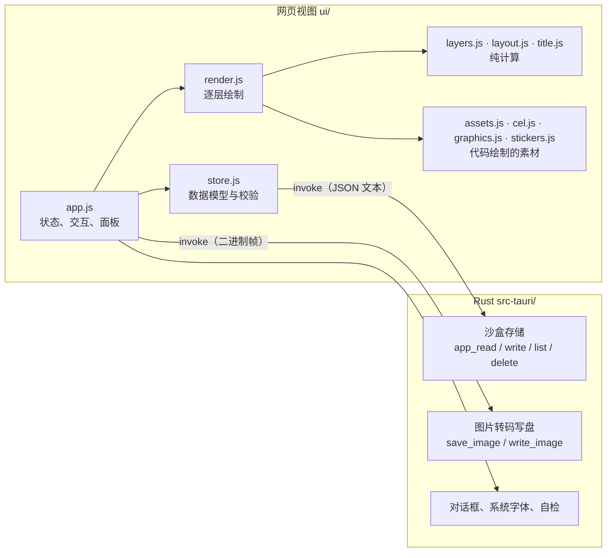

# SmedCover 架构与实现原理

[English](ARCHITECTURE.md) · 中文

本文面向想读懂或修改代码的人。使用说明见 [README.zh-CN.md](README.zh-CN.md)。

## 1. 总览

SmedCover 是一个 Tauri 2 应用，分成两半：

- **界面（`ui/`）**：运行在系统自带的网页视图里，负责全部交互和**全部绘制**。纯 ES 模块，没有打包器、没有框架、没有运行时依赖。
- **Rust 外壳（`src-tauri/`）**：只碰文件和网络，负责读写应用数据、把图片转码并写盘、弹出系统对话框、列出系统字体、发送生成素材的 AI 请求。



这样划分的原因：

- **所见即所得**：预览和导出走同一段绘制代码，只是画布像素数不同，不存在"预览和成品不一致"。
- **绘制代码可在浏览器里独立运行**：开发和自动化检查不需要启动桌面应用。
- **Rust 侧很小**，权限面也小：界面拿不到任意文件路径，只能读写应用数据目录，以及用户通过对话框选定的位置。

## 2. 目录

```
ui/
  index.html         结构与样式
  js/app.js          界面：状态、两种模式、选项卡、画布交互、图层面板、导出、撤销
  js/render.js       drawCover()：遍历图层并绘制一张封面；选中框与命中测试
  js/layers.js       图层模型：跨尺寸的位置、层级（纯函数）
  js/layout.js       任意宽高比和版式下的几何布局（纯函数）
  js/title.js        标题解析与字号适配
  js/stack3d.js      图层栏的 3D 视图：叠层的投影、适配、标签和绘制（除绘制外都是纯计算）
  js/platforms.js    封面要发的平台，作为数据：各平台要的比例、信息流里的显示宽度、平台叠在封面上的东西；尺寸的名字（platformsFor）
  js/check.js        封面标准的规则，纯函数（测试用它检查版式；版式里的执行见 layout.js 的 meetStandards；「你看着办」在 deal.js 里按它给每一手打分）
  js/deal.js         「你看着办」的全部规则：抽牌用的每个数字（RULES）、每个风格适合什么（FAMILIES、RECIPES）、把一手抽到封面上（dealCover）、给每一手打分和挑一手（coverScore、pickHand），纯函数
  js/textfx.js       文字效果：叠画、蒙版、轮廓、逐字四类
  js/ransom.js       剪报字：每个字有自己的字体、纸片和角度
  js/outlines.js     字形轮廓的缓存（向 Rust 侧索取）
  js/photo.js        照片的摆放与带缓存的高斯模糊
  js/assets.js       资产库：图形、贴纸、用户上传
  js/cel.js          赛璐珞绘图工具集和前 5 个频道图形
  js/graphics.js     另外 15 个频道图形
  js/stickers.js     72 个贴纸（含 12 个线框），以及公用的画法函数
  js/style.js        风格：每种风格的一组钩子，以及当前风格
  js/spec.js         以数据描述的贴纸：校验与解释执行（AI 生成的素材）
  （src-tauri/src/subject.rs：用 Vision 抠出照片主体的遮罩）
  js/repaint.js      照片重绘：三家图片服务的请求与回复、重绘提示词、内置风格的读取
  repaint-styles/    内置重绘风格，每个一个 `<id>.md`（开头是名称等信息），加上生成的清单 index.json
  js/solid.js        以数据描述的立体图形：校验，并用频道图形的渲染器绘制
  js/ai.js           AI 生成：连接设置、两种接口风格的请求、预设提示词（纯函数）
  js/store.js        数据模型、校验、持久化
  js/presets.js      起步档案与尺寸预设（平台要的每种比例一个）
  js/csv.js          批量导出用的 CSV 解析
  js/i18n.js         界面文字（中 / 英）
  fonts/             内置字体及许可
src-tauri/src/lib.rs Rust 侧全部代码
tests/               不依赖 DOM 的模块的单元测试
```

`layers.js`、`layout.js`、`title.js` 的解析部分、`csv.js`、`store.js` 的校验部分都不碰 DOM，因此可以直接用 Node 测试。

## 3. 数据模型

三份数据，全部是普通 JSON，读入时都经过 `store.js` 的 `normalize*` 校验补全：任何字段缺失或非法都会回落到默认值，所以旧文件和手改的文件不会让应用崩溃。

**档案**（`profiles/<id>.json`）

```jsonc
{
  "id": "…", "name": "…",
  "brand": { "name": "PIXEL HARBOR", "unit": "CHANNEL" },
  "categories": [                       // 界面上叫"频道"；字段名为兼容旧文件而保留
    { "id": "vlog", "name": "日常", "sub": "DAILY VLOG", "code": "VLOG", "color": "#fcee0a",
      "graphic": { "kind": "graphic", "id": "camera", "labels": [], "stamp": "" } }
  ],
  "style": { "template": "stack", "theme": "dark",
             "look": "cel", "lookParams": { "cyber": { "glow": 1.2 } }, "lookSeed": 7,
             "lookArt": { "jelly": { "kind": "sticker", "id": "star" } } },   // 可选：风格的身影用哪个图形代替频道图形
  "fonts": { "body": "", "display": "" },
  "sizes": [ { "w": 1920, "h": 1080, "label": "16:9", "name": "", "on": true } ],
  "design": { "layers": [ … ] }         // 默认设计：新封面的起始图层
}
```

**封面**（`covers/<档案 id>/<频道 id>.json`，每个档案的每个频道一张）

```jsonc
{ "catId": "vlog", "title": "第一行\n*第二行*", "tag": "EP.01", "layers": [ … ],
  "scene": { "court": { "ball": { "all": [0.1, -0.05], "by": { "1080x1920": [0.02, 0] } } } } }   // 可选：拖过的场景物件（见 7.5）
```

`S.covers` 是当前档案读入的各频道封面（以频道 id 为键），`S.cover` 是正在显示的那张；两者只经 `setCover()` 一起改。切换档案时 `loadCovers()` 读入新档案的封面；切换频道（`switchChannel()`）先提交撤销记录，再显示该频道的封面——没有就由 `channelCover()` 从档案的默认设计新建，带默认标题。保存（`persistCover`）按档案和频道分别防抖。每个档案停在哪个频道记在设置的 `channels`（`{档案 id: 频道 id}`），由 `channelOf()` 读取。删除档案时一并删掉它的 `covers/<档案 id>/`。「从其他频道复制」（`copyDialog`、`copyInto`）用 `coverOf()` 取来源封面（当前档案的取内存里的，其他的读文件，没有就按默认设计新建），`copyPreview()` 用来源档案的设置把它按画布当前尺寸画成缩略图，由 `layers.js` 的纯函数 `copyFreeLayers(into, from)` 复制用户添加的图层（`isAdded`：自由图层和版式图层的副本，见第 4 节）：深拷贝、换新 id，被动图层的 `of` 改指向它的照片的副本，抠出主体的 `weave` 改指向它穿插的文字的副本（版式图层的 id 保留，每张封面都有；其余的去掉）；每个副本插在来源里它下方最近的版式图层之上、那里已有的添加图层之上，保持原来的先后；对话框按类别计数，副本算「版式副本」；然后整张封面像读入时一样经 `channelCover()` 校验，算一步撤销。

旧数据：以前只有一张封面 `session.json`，所有频道共用，图层可以用 `cats` 限定频道。`migrateSession()` 在当前档案还没有任何频道封面时把它拆开：每个频道一份，`channelCover()` 只留下适用于该频道的图层并去掉 `cats`，标题和角标复制到每一份；原文件改名为 `session.migrated.json`，`session-photo*` 先由 `upgradeCover` 变成照片图层再删除。

**设置**（`settings.json`）：语言、当前档案、每个档案停留的频道（`channels`）、清晰度倍数、格式、JPEG 质量、文件名规则、调整范围，以及用户按风格改过的「你看着办」搭配（`recipes`：只存改过的项，由 `normalizeRecipes` 检查），和「你看着办」在两次之间记住的东西（`surprise`：下次不变的部分 `locks`；最近抽中的风格 `recent`，最多 `RECENT_KEPT`（12）个，其中最后 `RULES.look.recent` 个先不抽；每个风格被留下和被丢掉的次数 `taste`；见 `normalizeSurprise`）。

其他文件：`assets/<id>.json`（我的素材：图片为 data URL，AI 素材为描述；可带 `folder`，所在文件夹的 id）、`asset-folders.json`（我的素材的文件夹：`[{id, name}]`，`normalizeFolders` 校验；文件夹没了的素材视为未归类）、`fonts/<名称>.font`（导入的字体）、`photos/<pid>`（照片、原图和遮罩，见 6.3）、`photo-library.json`（位图素材：`[{pid, name, kind, at}]`，`kind` 是 `upload`、`ai` 或 `repaint`，最新的在前，`normalizeLibrary` 校验）、`ai.json`（AI 连接设置，含令牌，不随档案或工程导出）。

**档案文件**（`.smedprofile.json`，第 3 版）：`{app, kind: "profile", version, profile, assets, fonts}`，完整备份另有 `covers`（`{频道 id: 封面}`）、`photos`（`{pid: {src, original, mask}}`）和 `channel`（导出时所在频道）。`exportProfile()` 写，`profileActions.import()` 读：总是新档案（新 id，频道 id 不变），封面经 `channelCover()` 校验后写进 `covers/<新 id>/`，照片进照片库和位图素材。

**工程文件**（`.smedcover.json`，第 4 版；界面入口——顶栏「工程」和 Cmd+S——暂时去掉，`projectActions` 的代码保留）：`{app, kind: "project", version, profileName, profile, catId, cover, photos, assets, fonts}`。打开时（`projectActions.open()`）：本机有同 id 的档案，切到它和 `catId` 频道；没有则 `askProjectProfile()` 询问作为新档案导入还是套用到当前档案；第 3 版及以前没有 `profile`，放进画布上的频道。替换前先 `commitHistory()`，所以能撤销。

两种文件都带用到的用户素材（`embedAssets`）和导入字体（`embedFonts`：图层 `font` 指向的、在 `S.importedFonts` 里的；`adoptFonts` 装上本机还没有的，写进 `fonts/`）。

## 4. 图层模型（`layers.js`）

一张封面是一个自下而上的图层数组。

| 类别 | 类型 | 说明 |
|---|---|---|
| 版式图层（代码里叫 bound） | `bg` `accent` `graphic` `catname` `tag` `brand` `logo` `subtitle` `title` `frame`（自下而上的默认顺序，`BOUND_TYPES`） | 每张封面各有且仅有一个，内容来自别处（标题文字、频道的图形等），不能删除；`id` 就是类型名。除 `bg` 和 `frame` 外都能做副本（`COPYABLE`） |
| 自由图层 | `asset` `text` `photo` `solid` | 用户添加的素材、文字、照片和纯色块，可删除、可复制。素材可带 `ink`（矢量素材的自定义颜色，优先于原色和频道主色）和 `crop`（和照片的一样，见 6.3）；纯色块带 `color`，缩放为 1 时和画布一样大 |
| 版式图层的副本 | `COPYABLE` 里的类型，带 `copy: true` | 复制版式图层得到；和自由图层一样属于用户：可删除、改名、再复制 |

`normalizeLayers()` 负责修复图层列表：丢掉无法识别的层，补回缺失的版式图层，保证背景在最底，并让 `id` 唯一。默认顺序改过一次（以前是 `bg accent graphic brand title tag catname frame`；有品牌 Logo 和副标题之前的文件读进来时，`logo` 和 `subtitle` 补在 `brand` 上面，和补回其他缺失的版式图层一样，放在它前一个现有的版式图层之后）：`reorderLayout()` 把还是旧默认顺序的设计或封面换成新顺序，用户添加的每个图层（包括副本）跟着原来紧挨在它下面的版式图层走；应用在 `loadCovers()` 里对每个档案只做一次（档案记 `layerOrder: 2`），因为以后有人可能特意摆回旧顺序。
同样，新封面自带角标 `EP.01`；之前建的、还没动过的封面（占位标题、没有角标）只补一次（档案记 `tagged: true`），所以之后清空的角标会一直是空的；占位副标题也这样补一次（档案记 `subbed: true`）。

**版式图层的副本**：`duplicate()` 复制自由图层；复制 `COPYABLE` 里的版式图层时得到它的副本：同类型的图层，带 `copy: true` 和自己的 id（`normalizeLayer()` 读到用了版式图层 id 或没有 id 的副本时给它换一个新的，所以副本不会被当成原图层；副本上不读 `off`，给拿掉的元素做副本时副本会出现）。它显示原图层显示的内容——标题的文字、副标题、角标、品牌行、Logo、频道名、频道图形、色块——样式和位置是自己的，位置和版式图层一样按相对版式位置的偏移算（`resolve()`），新建时错开 0.03。它属于用户：`isAdded()`（自由图层和副本）决定能删除（`isRemovable(layer)`，现在传入图层本身）、能改名、「从其他频道复制」会带上、「清空」会去掉；`isLayout()`（版式类型且不是副本）决定版式顺序（`layoutOrder()`、`orderLayout()`）、「版式元素」（`partsBox()`）、「隐藏版式」（`layoutLayers()`）和「重置全部图层的位置」管哪些。图层列表里副本在类型图标的位置显示版式图标，后面是小人。要找版式自己的标题、副标题、Logo、频道图形的地方一律按 id 找（版式图层的 id 就是类型名），不按类型：`render.js` 的 `subtitlePlan()`、`partsOf()`、`env.hasBrand`、`env.logo`，`style.js` 的 `titleLayer()`、`graphicTop()`、`keepClear()`，`dealCover()` 把标题移到最上面，`seenNow()`。副标题本身隐藏或拿掉时，它的副本画在副标题的位置（`subtitlePlan(…, hidden)`，标题不给它留位置）；Logo 隐藏时，它的副本画在 Logo 的位置（`PAINT.logo` 自己取 `logoBox()`）。

**拿掉的版式元素**：除背景外的版式图层可以带 `off: true`（「封面 → 版式元素」，`partsBox()`）：它随之隐藏，编辑器不在图层列表、3D 视图和「隐藏版式」里列它；勾回来就和原来一样。「清空」保留封面拿掉的和留着的元素。新设计不显示 `DEFAULT_OFF`（频道名和频道图形）：`normalizeLayers()` 补回缺失的版式图层时把它们补成拿掉的，新档案的设计就是全部补出来的；已有档案的默认设计和还是占位标题的封面在 `loadCovers()` 里一次性拿掉它们（档案记 `lean: true`）。
同一组行也排版式图层的顺序：一行拖到另一行上，就对这张封面和档案的默认设计调用 `orderLayout(layers, types)`（自下而上的类型，背景在最前；用户添加的每个图层跟着紧挨在它下面的版式图层走；`reorderLayout()` 就是用它换旧默认顺序），所以新顺序从此就是默认顺序（新频道的封面、「清空」）；其他频道已有的封面保持各自的顺序。

**品牌 Logo**：档案的 `brand.logo` 是一个用户素材的 id（在「配置 → 品牌」上传，所以导出档案时会带上：`usedUserAssets()` 包括它）。`logo` 图层把它画在品牌行右端（`render.js` 的 `logoBox()`：按 `LOGO` 的大小右对齐、在品牌行上垂直居中，离右边 72，或者风格的 `logoInset`）；品牌行的色条或编号牌排在它左边，风格自己放在这个角上的东西让到它左边（`style.js` 的 `besideLogo()`；`env.logo` 是它的框，图层隐藏或没有 Logo 时为 null）。`brand.counter`（默认 false）决定品牌行要不要在 `brand.unit` 后面显示频道编号，以及色块上的编号牌。

**副标题**：文字属于封面（`cover.subtitle`，和 `title`、`tag` 并列）；`subtitle` 图层和标题一样是标题类图层（`HEADLINES`：文字效果、颜色、描边投影、底牌、字体、风格效果；没有剪切蒙版）。画图层之前，`render.js` 的 `subtitlePlan()` 先算出它的位置（`env.sub`，隐藏、拿掉或没有文字时为 null），用的是标题的字体：`title.js` 的 `subtitleFit()` 按标题单独排时的字号定它的大小（`layout.js` 的 `subtitleSize()`：标题的 0.4 倍，限制在短边的 `SUB.min` 到 `SUB.max` 之间），标题在标题框底部留出 `reserve`（`drawTitle` 和 `titleBlock` 的 `reserve`），两者一起居中，副标题在最后一行下面隔一个间距。如果留出的位置会让标题小于信息流里看得清的字号（`titleFloor()`），副标题先变小，最小到 `SUB.min`；而且它永远不超过标题最终字号的 `SUB.most`。`ink` 是它的字实际占的框。自己排标题的风格也可以自己放副标题（风格的 `subtitleFit`）：宋刻标题竖排时，副标题是标题左边的一列，标题换用窄一点的框（`titleBox`）。风格的背景也会避开它们（`style.js` 的 `titleArea()` 把副标题的 `ink` 算进去）。隐藏的副标题也照样算位置（`env.subHidden`，标题不给它留位置），所以 3D 视图里能显示它。

**标题当文字用**：文字图层有的，标题都有。它可以剪切（见下），可以带风格效果（`FX_TYPES` 包括它；`effectsFor` 和 `layerEffects` 给它文字图层能用的效果）；它属性里的文字内容改的是 `cover.title`，和「封面」页是同一段字。

**剪切蒙版**：自由图层（以及标题）可以带 `clip: true`，只在下方图层的形状里显示。它剪切到的那一层叫「底」：往下第一个本身没有剪切的图层（`clipBase()`），背景不算（背景铺满画布，剪切到它等于没剪切，返回 -1）；`clipEnd(layers, i)` 给出剪切到第 i 层上的最后一层。连续几层可以剪切到同一个底上。用户添加的图层（`isAdded()`：自由图层和副本）可以带 `name`，即用户在图层列表里起的名字（`layerName()` 优先用它，没有时按类型和内容自动起名，副本按类型叫「标题 副本」等，`layer.copyOf`）。界面按钮不随封面风格变化。

### 4.1 位置：一处拼贴映射到所有尺寸

每个图层有一个 `t`：

```jsonc
"t": {
  "all": { "x": 0.5, "y": 0.42, "s": 0.35, "r": 0, "kx": 1, "ky": 1 },
  "by":  { "1920x1080": { "dx": 0, "dy": -40, "s": 1.1, "r": 0, "kx": 1, "ky": 1 } }
}
```

- **`t.all` 对所有尺寸生效**，位置以**画布的比例**保存，所以同一个值在 16:9 和 9:16 上都落在相对一致的位置。
  - 自由图层：`x`、`y` 是中心点的位置。
  - 版式图层（以及它们的副本）：`x`、`y` 是相对于版式给出的位置的**偏移**，默认为 0。
  - `s` 是整体大小，`kx`、`ky` 是横向和纵向拉伸，`r` 是角度。
- **`t.by` 是逐尺寸微调**，以尺寸键（如 `"1920x1080"`）索引，单位是虚拟像素，叠加在 `t.all` 之上。
- **频道图形**的微调还可以按频道分别保存，键为 `"1920x1080@<频道 id>"`，因为不同图形的形状差别很大。

`resolve()` 把两者合成为最终位置：位置相加，缩放和拉伸相乘，角度相加。`adjust()` 是所有编辑的唯一入口：拖动、手柄、滚轮、方向键都把改动表达为一个补丁（属性面板里没有位置滑块，只有「重置位置」），再按当前的调整范围写进 `t.all` 或 `t.by`。

### 4.2 文字颜色与标题类图层

文字类图层（`title`、`tag`、`catname`、`brand`、`text`）可以带 `ink`，即它自己的文字颜色。
标题和文字图层（`HEADLINES`）是同一种东西：都还可以带 `hi`（强调词颜色）、`stroke`、`shadow`（描边、投影强度）、`plate` 与 `plateInk`（底牌及其颜色）、`hiPlate` 与 `hiPlateInk`（只垫在强调词下面的底牌及其颜色；画法用风格的底牌，`headline()` 定颜色，开着时强调词取与它反差的颜色，自己会给强调词加框的风格——赛博朋克、故障网络——收到 `o.hiPlate` 就不再加），或者改用 `hiMark`（`HI_MARKS`：手绘圈、马克笔、错位色块；由 `render.js` 的 `drawMark()` 画，按种类画在字下面或字上面，每段有自己的固定随机数，所以不会每次都变；马克笔和错位色块下的字保持文字本来的颜色，风格也通过 `o.hiPlate` 得知，和底牌一样处理）、`fx`、`fxAmt`、`fxSeed`（「换一组」抽出的种子，给 `seeded` 的效果用，见 6.2）、`bend`、`bendAmt`、`warp`、`reshape`；文字图层只多一个 `text`。文字、素材、照片、纯色这些自定义图层还可以带 `lookFx`（风格效果，见 7.4）。
没有颜色字段时，颜色由当前风格和频道主色决定；有底牌时，没有指定的文字颜色取与底牌反差的颜色。`render.js` 的 `headline()` 把这些规则算成一组颜色，标题和文字图层共用，各种风格的文字画法都从这里取色；有底牌时还把强调色作为 `hi`（RGB）交给自己上色的风格，免得它们用频道主色画在频道主色的底牌上。

旧文字图层的 `color`（白、频道主色、墨黑、自定义）在 `normalizeLayer()` 里换算：白 → 自动；墨黑、自定义 → `ink`；频道主色保留为 `color: "accent"`（直到选了颜色或「自动」）；有底牌时原颜色变成 `plateInk`，且没有 `stroke`/`shadow` 字段时两者为 0，与以前一样。

### 4.3 旧数据里的适用频道

以前自由图层可以带 `cats`（频道 id 数组），只在列出的频道出现。现在每个频道有自己的封面，这个字段只在读旧数据时有用：`normalizeLayers()` 仍然校验它（去掉已不存在的频道，一个不剩的图层删掉），`channelCover()` 按 `appliesTo(layer, catId)` 挑出该频道的图层后删掉它。档案的默认设计里可能还留着，新建频道封面时同样处理。

## 5. 布局（`layout.js`）

### 5.1 虚拟画布

所有几何都在一块"虚拟画布"上计算，它的短边固定在 1080 到 1200 个单位之间，与真实像素无关。`virtualSize(w, h)` 给出虚拟尺寸，例如 16:9 为 1920×1080，4:3 为 1600×1200。

好处是字号、线宽、间距都可以写成固定数值，从 900×383 到 8K 都保持同样的比例；绘制时只需要对画布做一次整体缩放。

### 5.2 调整与对调

模板算出的布局不直接使用，而是先经过 `adjustLayout()`。它接受档案里保存的调整量：色块占比 `size`、分界线倾斜 `slant`、
标题框的宽高比例 `tw` / `th`，以及是否对调 `flip`。这些都是画面的比例，所以一份设置适用于所有尺寸。
它对两类模板（斜切的和平直的）都适用，因为只读取并改写布局结果里的几何量，不关心这个布局是怎么算出来的。

对调不是简单的镜像：色带到了上面，品牌行就落在色带上，标题框改到色带下方，频道名和角标也要重新安排。
返回的布局因此多带几个标记（`brandOnAccent`、`railOnAccent`、`titleTop`、`flipped`），绘制时据此换颜色和位置。

然后 `meetStandards()` 让结果合乎封面标准（docs/cover-check.zh-CN.md），不管是哪种风格；用户调过大小或倾斜的色块留在用户放的位置
（这样拖动色块的手柄时，下一帧不会被改回去）。平台会盖角标的封面（16:9、4:3：`badged()`）上，带字的东西和频道图形都不碰到这些角标（`platforms.js` 的 `FOOT`，往下 84% 处）：
频道名把副名牌放到旁边并往上挪，色块太矮放不下时会长高（角标、频道图形和标题框的底边跟着上移）。
所有封面上，字都避开底部 14%，那里平台会显示播放量和浏览量（`wordsFoot()`：有平台角标的封面是角标线，其他是 `platforms.js` 的 `WORDS_FOOT`，往下 86% 处）：频道名、角标和标题框都在它上面。
标题框留够两行字的高度，字号按最窄的信息流算（`feedOf()`，信息流里 14px），色块在还放得下频道名的范围内让出地方；有副标题时（`parts.subtitle`）还要给它留一行。
「上下」版式（色块在下）里，频道图形（没有照片时它就是封面的看点）至少占画布的 12%（`ART_HALF` 是图形绘制框的一半）；
横版封面上它先往右靠，仍会挡住的东西再让位：标题框（变窄，其他比例里变矮）、频道名的宽度。
角标不碰频道名，标题不碰角标。它知道封面有哪些占地方的元素（`render.js` 的 `partsOf()`：没拿掉的，频道图形还要这个频道有图形，副标题和角标还要有字），拿掉的元素的位置让给其他元素：没有角标时，标题不用给它让位；没有频道名时，底部色块变薄，直到色块边上的角标（有的话）碰到字的底线、或色块只剩 `BAND_MIN`（高度的 16%）；在「左右」版式（或对调过的「上下」）里，角标落到频道名原来的位置；两种情况标题框都随之变大。没有频道图形时，标题不用给它让位，「左右」版式的色块收窄到宽度的 `SIDE_BARE`（竖版 13% 到 16:9 的 25%），标题栏随之变宽。有一个测试把每种风格、版式、比例和对调都跑一遍，元素全开和新封面的默认各跑一遍；另一个测试检查新封面带副标题时标题框是否合乎 A1。

画布上的菱形手柄由 `layoutHandles()` 给出位置，拖动时 `dragLayout()` 把指针位置换算回调整量；
对调过的布局会先换算回未对调的坐标再计算，所以两种情况下手柄都跟手。

### 5.3 版式

`layout(template, w, h)` 返回一张封面的全部几何：色块多边形、分界线、标题框、角标位置、频道名位置、图形的中心和大小。

- **上下（stack）**：有 5 组手工调好的锚点，分别对应 9:16、3:4、1:1、4:3、16:9。其他宽高比在相邻锚点之间按宽高比的对数做线性插值，所以任意尺寸都有合理的布局。
- **通栏（banner）**：沿用上下版式的结构，把色条压成一条细带。
- **左右（split）**：单独计算，色块是右侧的一块斜切面板。

约定：色块多边形的**前两个点就是分界线**。色块的 12 种形状都以这条边为基准来生成。

## 6. 绘制（`render.js`）

`drawCover(canvas, options)` 画一张封面：

1. 算出虚拟尺寸，设置画布的真实像素数，对上下文做一次整体缩放。
2. 准备一份环境：版式几何、频道主色、明暗主题、背景照片等。
3. 自下而上遍历图层，跳过隐藏的和不适用于当前频道的，用 `resolve()` 取位置，调用 `PAINT[类型]` 绘制。
4. 每个画出来的图层留下一条命中记录（中心、半宽、半高、角度），存到 `canvas._hits`。
5. 如果指定了选中图层，最后画选中框和手柄。

两个辅助函数统一了变换：

- **`placed()`** 用于版式图层。绘制函数会返回自己占据的矩形；先在一块用完即弃的上下文上跑一遍量出矩形，再以它的中心为轴做平移、旋转、缩放后真正绘制。这样缩放和旋转始终绕内容中心进行，且结果不依赖上一帧。
- **`centred()`** 用于素材和自由文字，它们本来就绕自身中心绘制。

**不透明度**：小于 1 的图层先单独画到一块临时画布上，再整体混合进来，避免图层内部的重叠笔画互相透出。

**剪切组**：`paintRange()` 遇到下面有剪切图层的底（`clipEnd()` 大于自己）时，把这一组单独画：底画到 `clipGround` 上（带它自己的不透明度和效果），每个剪切图层先画到 `clipOne`，再以 `source-atop` 叠到 `clipGround` 上，最后整组合成到画布。底隐藏时整组都不画。拖动时整组算一起移动（见 9.3），所以缓存的分段不会把一组切开。

**场景物件**：画背景前，`setScene()` 把这张封面在当前风格、当前尺寸下的物件偏移（`sceneOffsets()`）交给风格；画完后，`scenePlaced()` 给出各物件实际画在哪里，只留下风格在 `scene` 里声明过的，存到 `canvas._scene`，选中背景时画成圆形手柄（`drawSceneHandles()`，`sceneHandleAt()` 做命中）。拖动时不重画背景的帧保留上一帧的位置。

**预览与导出共用这段代码**。主画布按显示区域的像素数画，缩略图画得更小，导出按"尺寸 × 清晰度倍数"画。

### 6.1 标题（`title.js`）

标题不换行。`parseTitle()` 把文字拆成行，再按星号拆成普通段和强调段。字号取"最长一行放得下宽度，且所有行放得下高度"的最大值。描边和投影是多遍绘制：先画偏移的投影，再画墨色描边，最后填色。

`setLine()` 按中文标题的排版规矩排一行，切成若干片——在文种变化处、或标点挤压让后面的字移动处切开——每片带位置、宽度、缩放和下移量。整块里有汉字时，西文字母、数字和 ASCII 符号放大，大写字母高度为汉字墨迹高度的 `LATIN_TO_HAN`（0.86），并移到和汉字上下居中；两个高度都用 `measureText` 从字体实际量（`metricsOf`，按字体缓存），所以 Bebas Neue 配思源黑体约放大 1.12 倍，思源黑体自带的西文 1.05 倍，宋体的西文 1.25 倍。中文标点按开明式挤压：全角标点一半是墨迹一半是空白，哪一半是空白按墨迹量（`markInk`）；行内 。？！ 保持全角，其余标点让出空白一侧，最多半个字宽，且保留不少于墨迹一侧的空白；行首、行尾去掉外侧空白；两个标点相连时，中间至少去掉半个字宽，按两边各自的空白分摊。每片记下自己让出的空白（`lt`、`rt`），所以各段的范围（`runs`，以及每片的 `run`）就是字实际所在的位置。字符按人读的单位切（`Intl.Segmenter`：带附加符号的字母、键帽符号保持完整）；全角西文本来就是汉字大小，不再放大；度量按字体和已加载的字体数缓存，晚到的字体会重新量。`fitLines`、`drawTitle` 和自由文字图层都经由它测量和绘制，所以字号按排好的行来定。`passOf()` 是交给字形的 `pass`：画放大或下移的片时，在画布原型上临时包住 `fillText`、`strokeText` 和 `measureText`，用放大后的字号、下移后的位置来画（改字号而不是加变换，所以横跨整段的渐变、描边宽度都保持原样），各种字形——包括风格的工作画布和变形用的画布——不用知道这件事也会照样排；在 pass 之后才画字的字形（暗黑装饰）用 `inPiece()`；轮廓类效果直接画路径，自己带上片的缩放和下移（`glyphShapes`）。标记整段的东西——强调词底牌、赛博朋克和负形风格的框、拼贴的纸条、迷幻派对/液态镀铬/光谱的渐变——每段只画一次（在段的第一片，按 `run`），不按片画。没有真实字体度量时（测试用的替身上下文），按画布原样排。竖排标题照旧排。

### 6.2 文字效果（`textfx.js`、`outlines.js`）

标题、副标题和文字图层通过 `paintRuns()` 画字。效果是图层的属性（`fx`），没有设置时为"自动"，即交给当前风格。效果分四类，区别在于能改动什么：

| 类别 | 做法 | 能改什么 |
|---|---|---|
| 叠画 | 同一行字用不同颜色、不同位置画几遍 | 字外面的东西：描边、投影、回声。各风格自带的文字画法（`runs()`）都属于这类 |
| 蒙版 | 先把字单独画在一张备用画布上，再对这张画布做处理，最后贴回去 | 字内部的质感：填网点、条纹，磨损，内阴影，按行切开错位 |
| 轮廓 | 取得每个字的轮廓点，作为形状填充 | 字形本身：带真实厚度的挤出，或改变字的边缘（刺边、撕边、手剪、融化、膨胀、侵蚀） |
| 逐字 | 每个字单独画，画在这一行字体给它的位置上 | 每个字的字体、纸片、字色和角度：剪报字 |

菜单 `EFFECTS` 是通用字效，加上编辑设计的「下划线强调」：它要认出强调词，只能在写字时做。「贴纸字」（`sticker()`）只用描边：投影、深色外线、白边、字外细线，每层都是一遍圆角粗描边，最后填字，所以白边能把字连在一起、填平字里的小空隙，不需要字形轮廓。效果在菜单里可以列在别的类别下（`menu`）：立体挤出靠轮廓画，但看起来是叠画类，所以列在叠画类里，轮廓类里就是改边缘的几种。标了 `seeded` 的效果按图层的 `fxSeed` 画每个字，「换一组」（每个 seeded 效果下面都有）重抽它：剪报字，以及除膨胀外改边缘的几种。风格的字形由「自动」使用。切片错位、双色叠印、双层勾边、暖白立体以前也在菜单里，现在它们做的事是各自风格的后期效果（见 7.4），任何图层都能用：`layers.js` 仍认这几个名字（`TEXT_EFFECTS`），文字图层上的换成对应的后期效果（强度 0.6），标题上的保留，按「自动」画。

**轮廓从哪来**：网页视图读不到字体文件里的轮廓，所以由 Rust 侧提供。`text_outline` 命令用 `ttf-parser` 解析字体，把曲线拍平成折线，
以"字高为 1"的单位返回每个字的轮廓和步进。字体按名字查找，依次是内置字体（从应用自带的资源里读）、用户导入的字体、系统字体；
可变字体会按请求的字重取轮廓；一个字在第一款字体里没有时，换下一款。

**异步与绘制**：取轮廓要一点时间，而绘制不能等。`outline()` 立即从缓存回答，第一次没有时返回空并发出请求，效果此时退回普通文字；
轮廓到达后通知界面重画。导出时 `renderReady()` 会等所有请求完成再画一遍，保证导出图带效果。

**变形**和字形分开：标题类图层的 `bend`（`BENDS` 之一；`bendAmt` 是程度）可以和任何 `fx` 一起用，包括风格自带的字形。`drawTitle`（和自由文字的绘制）把每一行交给 `bentLine()`，同时给它一个"照原样画这一行"的函数：画在一张单独的画布上，用行坐标，四周留出字形会甩出去的空间（`P`，字号的 0.75），分辨率比下面的画布略高（拖动时略低）。`meshWarp()` 把这张图弯过去：源图切成边长约字号九分之一的三角形，结果的每个像素经由所在三角形反算回源图的位置，在四个像素之间按不透明度加权采样（所以没有暗边），每个像素只写一次（所以没有接缝），空的格子直接跳过。结果按决定这一行样子的一切（文字和强调、字体、效果和颜色、风格和它的参数、深浅底色和配置的随机种子、是否在拖动、之后新加载的字体）缓存在 `BENT` 里，最多 2400 万像素，所以移动、旋转弯过的标题或因为别的图层重画时，只是把它贴上去；描边类效果的字形轮廓还没到时临时画的那一行不缓存，轮廓到了会重新弯。变形在行的两端之外保持两端的样子（光晕、投影甩到那里的部分跟着两端弯，不会被抛远），结果的大小只由有内容的格子决定：透视拖过了地平线也只会让结果变粗，不会大到画不出来。因为先照原样画、再整体弯，字形做的一切——风格的工作画布、光晕、蒙版、强调词底牌——都会跟着弯，也不需要字形轮廓。`bendExtent()` 给出一行弯过之后超出原来框的距离（框边缘映射后的范围）；`fitLines()` 让弯过的整块正好放进标题框，`titleBlock()` 报告这一整块（副标题排在它下面，风格的背景避开它）。读到 `fx` 是某种变形的图层（以前它们是轮廓类效果，用通用描边字形画），改成 `fx: "cel"` 加同样的 `bend`，看起来和原来一样。

各种弯曲（`WARP`）每种都是对一行里的点做的映射，由这一行的字号、宽度和强度决定：「拱形」「下弧」按抛物线把中间抬高或压低；「圆弧」把这一行排到下方一个圆的圆周上（x 换成角度，y 换成半径，所以字会散开）；「上拱」只拉伸基线以上的部分；「鼓起」「收腰」以字的中线为准缩放字高，越靠行中间越明显；「鱼眼」在一个比这一行稍宽的椭圆里以行中点为心放大，往边缘渐渐减弱（沿每条射线点的先后不变，所以不会折叠）；「上扬」按 x 错切 y；「波浪」「旗帜」按正弦移动 y，旗帜从行首起越来越大，并让字跟着胀缩。变形图切得足够细，长直边也能弯得平滑。

**立体挤出**是真的把轮廓的每条边向后扫出一面"墙"：按朝向分成受光和背光两组，各自作为一个形状填充，再画背面和正面。

**改边缘的效果**（`SHAPED`：刺边、撕边、手剪、融化、侵蚀；另有膨胀）也是轮廓类，所以和立体挤出一样要桌面应用，轮廓到达之前和在普通浏览器里都显示为普通文字。`glyphShapes()` 按字给出一段的轮廓：每个字、它的闭合折线、它在这一行上的位置（`contours()` 是全部合在一起，给立体挤出用）。一个字的 `side` 是它面积最大的轮廓的面积（`areaOf()`）的符号，空洞的方向相反。`weighOf()` 给出 side 和这个字的分量 `k`（0.4 到 1）：笔画的平均宽度（墨的面积乘二除以轮廓长度）和粗体拉丁字母相比。所有效果都按它缩放：汉字笔画多、细、挨得近，刺、撕口、剪痕、滴落、咬痕和膨胀都小一些，笔画不会糊在一起。`walk(pts, step, side)` 按间距（或每次由函数给出的间距）重新取点，转角超过 40° 的点原样保留，两个转角之间的间距摊匀；每个点带着它在轮廓上的位置和指向字外（外轮廓朝外、空洞朝里）的单位法线。`loopNoise()` 是沿轮廓首尾相接的平滑噪声。`SHAPED[id].shape(g, R, o)` 给出一个字的新折线：刺边在每两点之间沿法线长出一根刺，间距和长短各不相同（偶尔一根短的，空洞里的约一半长），每根刺最长到沿这个方向到下一处墨的 0.45（`inkTest()`，按 nonzero 判断点在不在字里），缝隙和空洞两边的刺碰不到一起；撕边让每个点沿法线按长波噪声加细锯齿移动；手剪用更长、不均匀的间距取点，每个点略微偏离原线，整个字绕中心略转、略抬；融化让朝下的点再往下坠，再从多半是最低的下沿挑几处流下滴落；侵蚀按噪声往字里咬出坑，沿边加一层细颗粒。`o.amt`（强度）决定程度。每个字的随机数 `R` 由这个字、它是这一行里第几个同样的字、第几行（`o.row`）和图层的 `fxSeed`（`o.fxSeed`，由 `drawTitle()` 和自由文字的绘制传入；用 `ransom.js` 的 `seeded(hash(…))`）决定，所以预览、导出、各个尺寸上都一样，「换一组」换另一组。`reshapeRun()` 按来源缓存改过形的段（`SHAPES`，最多 120 段），重画封面不用重算。`outlined()` 和其他轮廓效果一样画：投影、字外细线（刺边和手剪用尖角连接 `join`，刺尖保持尖锐；其余用圆角）、填色，按 nonzero 填充，空洞仍是空洞。膨胀（它的 `r` 也按字的分量缩放）不需要新轮廓：在填色下面用圆角把轮廓描 `2r` 宽，字就向四周长出 `r`，所有角都是圆的，字外细线和投影围着长大后的字。「你看着办」只在桌面应用里抽它们（`can()`），来自卡通类（膨胀、刺边、融化）和印刷类（撕边、手剪、侵蚀），拼贴风格自己的搭配里也有（手剪、撕边），每次带自己的种子（`letterFor()`）。

**剪报字**（`ransom.js`）从 `pass` 拿到这一行的各段，把每段拆成每个字的格子：字在这一行字体里的步进（放大排的段按 setLine 的 `s` 算），按比例分到这一段的宽度上。纯函数 `ransomPlan()` 给每个字定样子：按文字种类从字体池里取字体；方式（贴纸片 62%，用图层自己的字形 18%，空心 8%，立体 8%，照片 4%；关掉的方式、以及没有照片时的照片字，改为贴纸片）；纸片（`papersFor()`：频道色、黑、白、旧报纸、牛皮纸、强调词的颜色、一种黄；频道色本身就是某个中性色时不再重复，彩色和已有的颜色接近时也不重复）；在纸上看得清的字色（对比度 4.5 : 1）；旋转、上下错位、大小；英文字母还可能换大小写（`amt` 即图层的强度，决定旋转、错位和换大小写的多少）。随机数由图层的种子（`o.ransom.salt`，来自 `render.js` 的 `ransomOf()`：图层 id 加上它的 `fxSeed`，即「换一组」抽出的数字）、第几行（`o.row`）、这个字以及它在这一行里第几次出现决定，所以各尺寸上同一个字样子相同；抽到和前一个字同一家族的字体时，从其他家族里重抽（别的家族都没有这个字时除外），抽到同一种纸片时换下一种。拉丁、希腊、西里尔字母和中日韩文字以外的文字（连写的、从右往左写的），从它的第一个字到最后一个字算一个格子，按这一行原样画。每行三个字以上时有一个主角字（有强调词时在强调词里），取名字哈希最大的那个，所以打字时只有新字的哈希更大才会换主角。`ransom()` 把每个字画成这一行大写字母（或「国」）的高度乘以它的大小，不超过格子的宽度（1.04 倍，主角字 1.12 倍），中心对准这一行字的中线：先画所有纸片，再画所有字，所以纸片不会盖住旁边的字；两遍里主角字都最后画。每一行的安排按它的字、种子、强度和颜色缓存（`PLANS`）；只用来量尺寸的画布（`placed()` 的探测画布）上改用通用描边字形。字体：`RANSOM_FACES` 列出内置字体和 macOS、Windows、Linux 上值得用的系统字体；`app.js` 的 `ransomFaces()` 留下装了的（`list_system_fonts`；普通浏览器里是画布能用的），并把页面外画布暂时用不了的告诉 `useRansomFaces()`，每种文字最多 `RANSOM_AWAY`（4）款：有图层用剪报字时，`ensureFonts()` 用 `ensureFont()` 加载它们，`ransomArrived()` 结束等待。在这之前，用这些字体的字先用这一行的字体画；`bentLine()` 的缓存键里有 `ransomEpoch()`，字体到了会重新弯。某种字体有没有某个字靠测量（`has()`：用这种字体排，和只用内置的参照字体 Noto Sans SC 或 JetBrains Mono 排，量出来不同就是有）；有字体加载或加进页面（`document.fonts.size` 变了）时，量过的和安排过的都清掉。

除了纸片（`tile`）、图层自己的字形（`bare`）和空心字（`cut`），一个字还可以是 `deep`（立体）：把这个字向右下方叠画很多份，每份相隔约一个设备像素，越往后越暗，正面用它的纸色（不需要字形轮廓，所以浏览器里也能用）；或 `photo`（照片字）：从封面的照片上剪下来（`render.js` 的 `ransomOf()` 给出背景照片，没有时用显示着的最下面一张），先按画布的分辨率把这个字画在一张备用画布上，再用 `source-in` 把照片的一块贴进去（取哪一块由这个字的 `tear` 种子决定），外面一圈白边。纸片可以有撕开的 `edge`（由 `tear` 选出几条边，做成字号 0.035 倍的锯齿，下面垫一层更大的锯齿形，颜色是纸的浅色纤维），也可以有 `tape`（横贴在顶部或斜贴在角上的胶带），胶带在画完所有字之后单独画一遍。`o.ransom.off`（图层的 `ransomOff`）让 `torn`、`tape`、`deep`、`photo` 不在随机时出现；照片字无论如何都需要封面上有照片。

手动调过的字存在图层的 `letters` 里（`layers.js` 的 `normalizeLetters()`；换成别的效果时也和 `fxSeed`、`ransomOff` 一起保留），键是 `letterKey()`：第几行、哪个字、这一行里第几次出现，和这个字随机名字用的是同一个键，所以它后面的文字改动时，手动设置留在这个字上（在它前面插入一行、或插入同一个字，手动设置会落到另一个字上）。`ransomPlan()` 里每个字的每个随机值都来自它自己的随机序列（由字的名字和这个值的名字决定），所以手动设了什么都不会改变这个字的其他值，除了由它决定的那些（样式决定纸色，纸色决定字色，主角决定大小和角度）；对后面的字，多数时候只影响下一个字的字体和纸色（它们要避开这个字，纸片按颜色比较）。抽好的值上面再盖手动设置：字体、样式、纸色（这时字色重新抽一个在新纸上看得清的，除非字色也手动设了）、字色、角度、上下、大小、大小写、边缘、胶带；`hero` 为 true 的字是这一行仅有的主角，为 false 的字不会被随机选为主角；`salt` 给这个字一个自己的名字（「只换这一个」）。`lock` 是编辑界面锁定时记下的快照（{seed, face, paper, ink, hero}）：当时图层的种子（这个字的名字一直用它），以及由相邻的字决定的那几项，所以锁定这一下什么都不变，「换一组」时它也保持原样；它不能为前一个字让路，所以由前一个字避开它的字体和纸色。手动设置在安排的缓存键里，也经由 `o` 进入弯曲行的缓存键。编辑界面是盖在左栏上的一个窗口（`#letterwin`，和「你看着办」的窗口一样由 `overLeft()` 定位），由「换一组」下面的「逐字调整…」打开（`lettersOpen()`；`S.letterWin` 是它对应的图层）。窗口里 `app.js` 的 `letterControls()` 和 `letterEditor()` 用 `ransomLetters()` 显示这些字：它按图层的文字逐行安排（在 `parseTitle()` 的结果上用 `lineCells()`，和绘制时得到的格子一样），纸色和频道色用这个图层上次在编辑画布上绘制时的（`ransomShown()`，在 `o.ransom.shown` 时记录）；每次绘制之后、以及重建右栏时，如果窗口要显示的内容变了——文字、颜色、手动设置，或图层对象本身（撤销会换成另一个对象）——`lettersShow()` 就重画窗口（在其中按着鼠标、或其中的输入框有焦点时不画，除非刚在里面选了什么），所以输入的文字、改了的颜色都会跟上。图层没了、不再选中、换了别的效果，或离开编辑模式（`setMode()`）时它关掉窗口（`lettersClose()`）；Esc、「完成」和 × 也会关掉。裁剪窗口和穿插窗口（6.3）也在同一个位置：打开一个就关掉其他的，打开「你看着办」的窗口全部关掉。立体字在拖动时（`isFast()`）最多叠 8 份；照片字按照片缓存（`PHOTO_LETTERS`，每张照片 48 个）。

### 6.2.1 自定义透视

「透视收缩」变形可以带图层自己的四角 `warp`（四个 `[dx, dy]`，单位是文字块的宽和高）。绘制标题和文字图层时，每一行把自己在文字块里的位置（`frame`：行原点、斜体系数、整块的矩形）交给变形；`perspective()`（经由 `bendMap()`）把点换到整块的坐标里，用 `squareToQuad` 的射影变换映射到新四边形，再换回行坐标绘制，所以多行文字作为一个整体变形。文字块的变换和矩形记在 `cv._blocks` 里，编辑器据此在四角画出手柄（`warpHandles`），拖动时用逆变换把鼠标位置换回文字块坐标。

其他变形都可以用手柄调形状，存在 `reshape`（八个 `[dx, dy]`，单位是文字块的宽和高：先是上沿的四个，再是下沿的四个）。手柄的静止位置就是变形后文字块的边缘——上沿按第一行的变形、下沿按最后一行的变形，比文字块短的行在两端之外和行端齐平（`bendRest()`，作为 `rest` 记在 `cv._blocks` 里），`reshapeHandles` 把它们按 `reshape` 移动后画出来（`reshaped()`）。`reshapeField()` 把这些偏移变成文字块里任意一点的偏移：沿每条边是一条穿过四个手柄的 Catmull-Rom 曲线（所以手柄下的边缘正好移动手柄的偏移量，其他手柄处不动），两条边之间按比例过渡，边外和边上相同。`bendMap()` 在变形结果上加上这个偏移（按点变形前的位置取），所以变形保持原来的特点（波浪还是波浪），拖动只是在上面叠加。字号只按变形本身来定（`fitLines` 不看 `reshape`），底牌和点选框会把移动过的手柄包进来。

### 6.3 照片图层与模糊（`photo.js`、`render.js` 的 `PAINT.photo`）

照片是自由图层 `photo`。图层只存照片编号 `pid`，图片本身在照片库 `S.photos` 里：`pid → {src, img, original, mask}`（图片、AI 重绘前的原图、主体遮罩），每样一个文件存在 `photos/`，工程文件（第 3 版）里内嵌在 `photos` 字段。`loadPhotos()` 只读要用的照片（当前封面的；打开位图素材栏时才读素材的），返回找不到的。启动时 `prunePhotos()` 删掉没人用的文件：位图素材里的、当前档案各封面的、以及每个档案 `covers/` 下各封面用到的照片都保留。这样复制图层、撤销重做都不复制大图。

两种放法：`fill` 铺满画布，位置语义和以前单独的背景照片一样（`t.all.x/y` 是以 0.5 为中心的偏移，`s` 是在"铺满"基础上的缩放，不旋转）；否则像相片一样，长边名义上 1000 个单位，按自由图层的位置、缩放、旋转、拉伸摆放。**关联**：`of` 指向另一个照片图层时，这一层是那张照片（主动图层）的被动图层——「抠出主体」（`cutOut`）建的就是它：开了 `cut`，显示主动图层的图片。只有位置跟主动图层：被动图层画在主动图层照片矩形的中心，加上自己的偏移（它 `t` 的 x、y，画布比例）；大小、角度、拉伸是自己的（`t` 的 s、r、kx、ky，大小按主动图层的方式计：铺满画布的按"盖满画布"的尺寸，相片按长边 1000 单位），模糊、压暗、描边、投影、不透明度也是自己的。`alignedT()` 给出正好盖住主动图层的 `t`（抠图时和「重新对齐原照片」用）；旧文件里的被动图层没有自己的大小（没有 `own`），读入时由 `settleLinks` 设成对齐。一张照片最多一个被动图层，再点就是重新抠图。编辑时，移动（`ddx`/`ddy`）一律改主动图层（`owner()`；`editAll`、`goLive` 也先换成它），所以拖任何一端两层一起动；缩放、旋转、拉伸被动图层只改它自己，并由 `aboutSubject()` 把它的框的中心绕主体中心移动同样的量，主体留在原处（命中区的 `px`、`py` 是框的中心）。删除主动图层时被动图层一起删（`removeLayer`、`removeGroup`），反过来不删。`unlink()` 结束关联：还对齐时被动图层接过主动图层的 `pid`、`t`、`fill`；移动或缩放过的，变成一张放在原处、同样大小的相片（用命中区的框中心和尺寸 `px`、`py`、`pw`、`ph` 算出），成为独立照片——取消关联和被动图层「恢复背景」都走这里。`replacePhoto()` 只换主动图层的 `pid`，被动图层同一层不动，只按新图片重新抠图；这比"删掉被动图层、重抠、再恢复属性"简单，结果相同。`settleLinks()` 去掉主动图层已不存在（或本身是被动图层）的被动图层；`upgradeCover` 还把上一版生成的、没挪过位置的独立抠图（同 `pid`、同 `t`）接回关联。界面上，去背景的图层按遮罩不透明部分的外框接收点击（`maskBox`），不再是整张照片的矩形；去背景的图层可带 `feather`（向内模糊）：遮罩的透明度先做高斯模糊，再只保留原本在内部的部分（`feathered()`），所以边缘向内渐隐、不带出背景。遮罩的透明度只读一次（`alphaOf`），只处理主体周围那一块，而且边缘越软，就在越小的副本上算（单通道，`photo.js` 的 `blurChannel`）；结果按遮罩和数值缓存，拖滑条或拖图层时先用一份粗一点的。还可带 `spread`（向外模糊）：主体画好后，把它模糊一份垫到自己后面（`haloBehind()`），主体自己的颜色向外散开。这个模糊在 GPU 上做——经过几张画布把图一级级缩小、再一级级放大——不需要把像素读回脚本。

添加：上传和拖进窗口走 `addPhoto()`（存进照片库，记入位图素材），再和位图素材栏的点击、拖放、AI 生成「添加到封面」一样走 `placePhoto(pid, at)`：图片还没读入时先读，封面还没有铺满画布的照片时，新照片 `fill`、插在「背景」正上方；否则像相片一样插在选中图层上面，拖到画布上的放在松手处（位图素材的拖放带类型 `application/x-smed-photo`，内容是 `pid`）。上传、AI 生成的入口由 `photoAdders()` 给出，「封面 → 添加照片」和「资产 → 位图素材」共用（位图素材栏的上传走 `stockPhotos()`，只存进照片库和位图素材，不放到封面）；前者多一个「资产导入」（`libraryDialog()`），和位图素材栏一样用 `libraryTiles()` 列出图片。「封面 → 添加照片」按图层顺序列出这张封面的非副本照片（删除、复制、调层级时都会重建这一栏），每张带自己的 AI 重绘（`REP.for` 是展开的那张，`REP.of` 是正在进行的重绘、或它的结果和错误所属的那张——收起后结果仍留给那张照片，直到下一次重绘）；抠图和去除背景在照片图层的属性里（`cutBox`、`photoControls`）。

绘制：照片先经过风格的照片处理——直接调用风格的 `background` 钩子，把 `env.photo` 换成这张照片、`drawPhoto` 换成"在这张照片的框里画"——处理在整张画布上进行（风格的整幅染色要盖满），然后只保留照片的矩形，或开了 `cut` 时只保留遮罩不透明的部分。没有抠图、描边、投影的照片直接画在画布上，用矩形裁剪区，不经过工作画布；其余的在工作画布上合成。描边和投影来自形状（遮罩，或照片的矩形）的剪影：在照片尺度（最长 1024 像素）生成一次，按形状缓存，每帧只铺一张图。开了描边样式为「撕纸边缘」（`torn`）时，描边换成 `tornSheet()`：同样在照片尺度上，先对形状做精确的距离变换（`distanceField()`，Felzenszwalb–Huttenlocher），每个像素按"到形状的距离是否小于这里的撕口半径"决定是不是纸。撕口半径由几层值噪声叠成：大的起伏和中等的锯齿按描边宽度的比例，小锯齿和纤维按封面像素的固定尺寸（所以大照片、小照片上纸纤维一样细），并限制在描边宽度的约 0.3 到 1.15 倍之间，不会撕进照片；撕口外是一圈半透明的纤维，撕口内是宽窄不一的一圈纸芯色（纸色和白色混合），再往里一条极细的暗线，纸面有很淡的纹理，最后整张纸用画布阴影投一层柔和的影子。种子来自图层 id（`seedOf()`），所以每张照片的撕法固定且各不相同。投影滑条在撕纸时也用撕开的形状。结果和剪影一样按形状、宽度、颜色缓存。描边样式为「线段」（`dash`，和撕纸二选一）时是 `dashedLine()`：同样先做距离变换，再找出距离等于线段中线半径的闭合线（`isolines()`，marching squares；两个内角对着的格子按中心值决定连不连，连线时内侧始终在同一边），平滑后用虚线描出，虚线的间隔会拉伸到每一圈正好是整数段；线段粗细约为描边宽度的三分之一，外缘就在实线描边的外缘。副本不产生点击区域，点击落到下面的图层。

**裁剪**：不铺满画布的照片和素材可以带 `crop: {x, y, w, h}`，即显示的那一部分，按图片的比例（`layers.js` 的 `normalizeCrop()`：每个方向至少 2%，在图片之内，取到 1e-4；整张图等于不裁剪，不存这个字段）。图片本身什么都不剪掉。照片的框不动，所以留下的部分在封面上位置不变；只画它（直接画的照片裁剪区、工作画布的 `destination-in` 都缩到它），也只有它能点中：命中区是裁剪框，抠出的主体是裁剪框里主体的外框（`shownBox()`），`px`、`py` 是框的中心。所以编辑器缩放、拉伸、旋转裁过的图层时和抠出的主体一样以显示出来的部分为中心：`edit()` 对裁过的图层和抠过的照片也调用 `aboutSubject()`，不只是被动图层（拉伸沿图层自己转过的轴）。描边、撕纸边缘、线段和投影来自形状被裁剪框留下的那一块（`cropShape()`：遮罩或照片矩形，切成裁剪框大小的画布，`at` 是它在原形状里的起点，从裁剪框的角画下去；每个形状留十二种裁剪，同一张照片的几个副本各自裁剪也不会互相挤掉，所以 `silhouette()` 和撕纸按形状的缓存照样有效）。铺满画布的照片不管裁剪；从裁过的照片抠出的主体，一开始带同样的裁剪（`cutOut`）。素材（`PAINT.asset`）按 `drawAsset()` 给它的框裁剪（`assets.js` 的 `assetHalf(ref)` 不画就给出这个框），点中的也是剩下的部分。

裁剪窗口（`#cropwin`：`cropOpen()`、`cropShow()`、`cropClose()`；`S.cropWin` 是它对应的图层）由照片「放置」组或素材「裁剪」组里的「裁剪…」打开（`cropButton()`：裁过之后叫「调整裁剪…」；铺满画布的照片上变灰并给出提示），和逐字调整的窗口一样盖在左栏上，显示整张图（`cropSource()`：照片的图片，抠过的主体亮着显示在整张图上；素材按它的颜色画在一张画布上），裁剪框之外变暗。框内拖动移动，拖边和角改大小，框外拖动从那里画一个新框；按住 Shift 保持当前比例。计算都是 `layers.js` 里的纯函数：`dragCrop(c, handle, dx, dy, ratio)`（拖角时以对角为准保持比例，拖边时以对边中点为准；不出图片，每个方向至少 2%），`drawnCrop(a, b, ratio)`（在旧框外拖出新框：从按下的点朝指针方向，哪个方向都行；指针移动几个像素后才开始，单击不改变裁剪），`fitCrop(c, ratio)` 给出这个比例、和 `c` 一样大（不超出图片）、尽量以 `c` 为中心的框，供比例按钮用（「自由」「原比例」、1:1、4:3、3:4、16:9、9:16：按像素算，换成图片的比例）。每一步经 `normalizeCrop()` 写回图层，像拖动一样重画（`holdLive()`）；窗口里显示保留多少像素。「不裁剪」清掉它。按 Esc、点「完成」或 ×、选中别的图层、照片改成铺满画布、离开编辑模式时关掉。

**穿插**：抠出的主体可以带 `weave: {with, by, line, front}`（`layers.js` 的 `normalizeWeave()`：最多 24 个图层 id，每个图层最多 400 个字的键，`line` 在 0.1–0.9 之间；不查这些 id 是否存在，因为图层是一个个单独读入的；照片取消抠图后也保留；`frontOf()` 读一个图层在前面的字，文件里的图层 id 叫什么都不会读到对象原型上的东西）。字的键是 `行|字|第几次`（`letterKey`），第一条竖线和最后一条之间都是这个字——可以就是一条竖线，也可以是 `lineCells` 整段排的别的文字，最多 200 个字符——所以选择跟着字所在的行和它在这一行里是第几次出现：在上面加一行、或在同一行前面打了同一个字，选择就会落到别的字上，和剪报字手动调过的字一样。文字从不画两遍：它留在下面，由抠出的主体让它透出来。画一个抠出的主体之前，`paintRange` 先向 `paintCover` 里的 `wovenFront(i)` 要它前面该露出的文字：它穿插的、在它下面、显示着、属于这个频道的每个图层（剪切进别的图层的只留在底图里），像剪切组那样在封面自己的像素空间里单独画到一张画布上，不调暗（FOCUS 调暗的是文字本身），按完全不透明画（半透明的文字在前面时，那里的主体整个让开，所以洞里露出的是文字和主体之间的东西：关联的抠出主体下面是它自己的照片，独立的抠出主体下面是底色）——`head` 时画整个图层，`letters` 时只画在前面的字（`env.only`，字的键的 Set，标题、副标题和文字图层的绘制会读它）。图层的风格效果也一起画：逐字时，铺满整个图层框的效果（纹理、色带）在那里也会挖穿主体。要在画主体之前算，是因为这要用到图层自己的工作画布（`scratch`、`fxScratch`）。然后 `PAINT.photo` 在放下之前用 `destination-out` 从主体合成好的整体（主体、描边、撕纸边缘、投影）里挖掉它（`letThrough`）；`head` 时先去掉头部线以上的部分：线在主体外框（`shownBox()`，裁剪也算进去）从上往下 `headLine(box, line)` 处，在照片自己的框 `F` 里切，所以跟着照片转动、拉伸和缩放。主体带风格效果时，等效果画完再挖：`PAINT.photo` 把它的挖法交给 `paintRange`（`env.letThrough`，在它自己的框里让文字透出来），效果画好的图（`FX_KEPT`）存的是挖之前的样子，连同挖法一起存，所以它的键里不含穿插，每次铺下这张图时再挖；不拖动时做的图在拖动的帧里也直接用（拖动时会做一张粗一点的），每帧都重画的图层（`moved`：被拖的和跟着动的）不存。所以拖着文字经过带风格效果的主体、或拖头部线的滑条时，不会重算效果。穿插画布只在编辑画布上缓存（`o.select` 或 `o.live`；缩略图、「你看着办」的候选、导出各画各的，用完就放掉），按主体和画布尺寸存（`WOVEN`，合计 1600 万像素），键是决定它的一切——画布和尺寸、频道、样式和风格参数、文字、副标题的位置、版式、每个穿插图层和它的位置、在前面的字、字体——拖动期间只要键不变就直接再用，所以拖动主体时不会重画文字；方式和头部线不在键里（它们只决定怎么挖）。比编辑画布大的工作画布（`BIG_PX`：剪切图层的、头部线的、`someLetters` 的）用完就放掉。有抠图、描边或投影的照片拖动时平移的那张图，存的是挖掉文字之前的样子，每帧再按文字现在的位置挖。拖动缓存里，和正在拖动的图层穿插的主体也算作会动的（跟着重画），在剪切组算进来之后再判断（所以拖动穿插文字的底图也算），它自己所在的剪切组也一起。

只画一部分字：`drawTitle`（`st.only`）和 `drawFreeText`（`env.only`）用 `ransom.js` 的 `letterCells()` 找出每行的字——就是剪报字用的格子（`lineCells`，由 `keysOf` 按 `letterKey` 编键），各占所在片段的一份，`pen` 是这个字按片段排出来时的起点（片段里它前面的文字一起量，所以算上了字距调整）。`title.js` 的 `someLetters()` 把这一行画到一张工作画布上，只保留落在这些字的形状上的部分——在各自的 `pen` 处用这行的字体画（大小、高低和所在片段一样），按文字效果向外扩出的距离加粗（描边、贴纸白边、`effectReach`），并沿投影、立体厚度或滴落的方向拖画——再减去在后面的字的字身和它们的投影，在前面的字的字身完整保留：在前面的字整个出来，后面的邻字留在后面；只按格子竖着裁做不到这一点（字的墨迹会伸出自己的格子）。多数风格在倾斜的行上把字摆正了画（`style.js` 的 `upright()`）：画这一行时，工作画布上去掉倾斜的 `transform` 会被记下来，字形在倾斜和摆正两种坐标里都加粗画，字身则在实际画字的那种坐标里减去和补回。它在行自己的坐标里做，所以在弯曲行的 `paint` 里也跟着字一起弯（弯曲行的缓存键里带着这些字）。一行里一个都没有就整行不画，底牌也不画。剪报字直接告诉它要哪些字（`o.only`），只画这些，连纸片和胶带；它强调词下面的底牌和标记只留在这些字的格子里（`clip`）。竖排（`drawTitleVertical`：竖排副标题，以及宋版刻本经 `titleSet` 画的标题，它把 `env.only` 传下去）跳过没有一个字被选中的单元，一列按一行编键。上下文不是画布时（测试替身），按格子裁剪代替。

抠出主体属性里的「穿插」组（`app.js` 的 `weaveControls()`：开关、穿插它下面的哪些文字——`weavable()`——、方式、头部线）和穿插窗口（`#weavewin`：`weaveOpen()`、`weaveShow()`、`weaveClose()`、`S.weaveWin`；`weaveLetters()` 在 `parseTitle` 的结果上用 `lineCells` 列出每个穿插图层的字，键和绘制时一样，每个字是一个开关，另有全部在前、全部在后、隔一个）的摆法和裁剪窗口一样，关法也一样，主体不再逐字穿插时也关掉。每次改动都经过 `touch()`，算一步撤销，画布跟着变。

「背景」层只画地面：风格的底（以 `photo: null` 调用 `background`）或主题底色，加网格；深浅在它的属性里设（`style.theme`），「样式」栏不再有这一项。风格和主题要问"有没有背景照片"时，看的是本频道最下面一个可见的铺满画布的照片（`env.photo`）。

模糊：macOS 的网页视图不支持画布滤镜，所以高斯模糊用脚本实现：三次方框模糊近似一次高斯模糊，每次用滑动窗口，耗时与半径无关。模糊作用在照片的缩小副本上，按"照片 + 模糊值"缓存（每张照片各自缓存）。

旧数据：`upgradeCover` 把以前存在封面旁边的那一张照片（会话里的 `session-photo*`，第 2 版工程的 `photo*` 字段）变成背景照片图层，接过「背景」层原来的位置、模糊和压暗；以前的 `subject` 图层变成它的抠图副本。默认设计里不保留照片图层。

### 6.4 抠图（`src-tauri/src/subject.rs`、`matting.rs`）

两种方式，界面按设置 `cutEngine` 选（`cutEngine()`：Mac 默认 Vision，其他系统默认 BiRefNet 轻量），结果格式相同。

**BiRefNet（`matting.rs`，所有系统）**：`ort` 用 `load-dynamic` 方式，运行库不编进应用。用户下载模型时（`cut_model_download`，进度通过事件 `cut-model-progress` 发给界面，`cut_model_cancel` 取消），先下载本平台的 ONNX Runtime 1.23.2 官方包（最后一个有 Intel Mac 版的版本，所以 `ort` 用 API 23），从 .tgz/.zip 里只取出那一个库文件，再下载模型（onnx-community 的 BiRefNet_lite / BiRefNet ONNX）；每个文件边下边算 SHA-256，大小和校验值都对上才放到位，都在数据目录 `models/` 下。抠图（`subject_mask_onnx`，模型 id 放在请求头 `x-model`）：第一次时 `ort::init_from` 加载运行库，模型会话按 id 缓存；照片缩放到 1024×1024、按 ImageNet 均值方差归一化，取最后一张输出图做 sigmoid，再放大回照片尺寸，同样转成"只有透明度有意义"的 PNG。界面送去的照片最长 2048 像素。

**Apple Vision（`subject.rs`，macOS）**：

`subject_mask` 把照片字节交给 Apple Vision 的 `VNGenerateForegroundInstanceMaskRequest`（macOS 14 起；通过 objc2 在运行时查找这个类，旧系统上报"需要 macOS 14"），取 `generateScaledMaskForImageForInstances` 得到与照片同尺寸的浮点遮罩，转成"只有透明度有意义"的 PNG 返回。界面先把照片画到画布上再编码成 JPEG 发送，所以 EXIF 方向已经摆正，遮罩与照片像素一一对应。遮罩存在照片记录上；图片换了（AI 重绘、还原原图）就清空，用到它的图层会自动重新抠。

拖动时的缓存（`o.live`）按"动的图层"和"不动的图层"把图层分成若干段，每段不动的图层只画一次成图，每帧只重画会动的段。拖动一张照片时，它的副本一起列为会动的，和被拖图层穿插的抠出主体也跟着重画；有抠图、描边或投影的照片在拖动期间只平移上一帧的图像（再按穿插的文字挖一次），松手后再精确重画。

### 6.5 素材

- **频道图形**和**贴纸**全部是代码画的矢量图形，没有图片文件，因此任意放大都清晰，并能随频道主色着色。`cel.js` 提供一套赛璐珞风格的绘图工具（明暗分色、墨线、伪三维的方块和棱柱），`graphics.js` 通过 `registerGraphics()` 追加图形。
- **用户上传**的图片以 data URL 存在应用数据目录，解码后缓存。
- `drawAsset()` 是统一入口，返回素材的半宽半高，供命中测试使用。
- `assetHalf(ref)` 不画就给出同样的半宽半高（素材不在了时为 null），给裁过的素材用（见 6.3 的「裁剪」）。

## 7. 风格（`style.js`）

封面的**内容**（图层、位置、贴纸和立体图形的描述、标题文字）不包含任何风格信息，所以切换风格只是换一种画法，
所有素材包括已经生成的 AI 素材都会跟着重画，数据不用改。

一种风格是一组**钩子**，每个都可以省略，省略的部分按默认的赛璐珞方式画。因此新风格可以从一个钩子开始，逐步补全。

| 钩子 | 负责什么 |
|---|---|
| `theme` | 背景底色、网格、普通文字的颜色 |
| `background` | 背景图层：底色、网格、照片及其染色 |
| `accent` | 色块：填充色、网点、分界线的画法 |
| `runs` | 由若干"段"组成的文字，即标题和自由文字的标题样式 |
| `wrap` | 返回一个替身画布，频道图形、立体图形和封面上的小部件（品牌行、角标、频道名、四角线）都画在它上面 |
| `sticker` | 平面贴纸的五个画法函数：`shape`、`blob`、`stroke`、`thin`、`word` |
| `tag` | 角标 |
| `frame` | 四角线图层，以及该风格想放在画面边缘的界面装饰 |
| `plate` | 标题和文字图层的底牌 |
| `subject` | 画在频道图形周围、随图形移动缩放的东西（如扫描锁定环） |
| `seeded` | 标记该风格有随机摆放的元素 |
| `layout` | 封面的几何布局，供"重在排版"的风格使用；返回的结构与 `layout.js` 的 `layout()` 相同，通常调用 `blockLayout()` 得到平直的色带和侧栏 |
| `titleSet` | 由风格自己排标题（如竖排）；返回空表示按通常方式排 |
| `faces` | 整张封面改用的字体。字体表是共用的，`drawCover()` 画完后会还原 |
| `titleFont` | 标题用的字体，供有自己字体主张的风格使用（如编辑设计的衬线字） |
| `oneTheme` | 标记该风格只有一种底色，界面会隐藏深浅选择 |
| `image` | 上传图片的投影或光晕 |
| `post` | 整张封面画完之后的叠加层，如扫描线和暗角 |
| `params` | 可调参数，在样式栏里显示为滑块 |
| `prompt` / `solidPrompt` | AI 提示词里"风格"一节的内容 |

当前风格是 `style.js` 的模块状态，`drawCover()` 在开始绘制前根据档案设置；界面在画素材缩略图前也会设置一次。

### 7.1 替身画布：不改绘图代码就换风格

20 个频道图形各有几十行直接调用画布的绘图代码。逐个改写成支持多风格不现实，所以用了一个替身：
`wrap` 返回一个 `Proxy`，它转发所有画布调用，只在两处介入。

- **设置颜色时**：先判断这个颜色在赛璐珞风格里扮演的角色（墨色、亮面、中间面、暗面、彩色），再换成当前风格里对应的颜色。赛博朋克把亮、中、暗三种面换成三档深色玻璃，彩色保持不变。
- **描边时**：墨色的线改画成一条光线，即一层宽而淡的光晕、一条彩色线、一条细的亮芯。

这样频道图形、AI 生成的立体图形的绘图代码一行都不用改。

赛博朋克对封面小部件（品牌行、频道名）不做替换：这个风格本来就是"纯色面板配黑字"，和赛璐珞的墨色配彩色一致。
它的差别来自别处：色块是实心的纯色面板，标题的强调词画成黑字切角底牌，赛璐珞里的墨色硬投影全部换成红青两色的"回声"，
最后整张画面做一次色彩错位和信号撕裂。

光晕用"多画几遍不同粗细的线"实现，而不是画布的模糊阴影。原因有两个：模糊阴影对每条线都很慢；而且不同网页视图算出的模糊范围不一样，
实测同一个数值在应用的网页视图里比在 Chrome 里糊得多。标题的光晕也是这样分层描出来的，所以各平台看到的一致。

### 7.2 几种风格共用的工具

新风格大多是"构造不变、换材料"，所以有几个共用的工具：

- `mapped(ctx, 规则)`：通用的替身画布，按颜色的角色（墨色、亮面、中间面、暗面、彩色）换色，并可整体缩放线宽。
- `painters(选项)`：按给定的描边色、线宽倍数、投影画法，生成贴纸的五个画法函数。
- `grain()`、`wash()`：颗粒、整幅叠色，用于纸张和胶片质感以及照片染色。纸张上的颗粒用正片叠底，胶片上的用叠加；后者在浅色底上几乎看不出来。
- 照片去色由 `drawPhoto()` 的 `grey` 参数完成：逐像素算出一份灰度副本并缓存。没有用画布的"饱和度"混合模式，因为它在各网页视图里不够可靠。

有深浅两种底色的风格（蓝调唱片、编辑设计）通过 `setLook()` 的第四个参数得知当前是深是浅。

**夏日插画**（`vivid`）的画面是一层层平涂叠出来的。天空是一整块天蓝。积云（`billow()`）由几排大小不一的圆组成，边上再补一圈小圆让轮廓碎成许多小起伏；光从左上来，整团云一起打光：先整体铺长春花蓝阴影，再把所有圆向左上挪一点铺淡蓝、再挪远一点铺白色，相邻的圆连成大块受光面，每个圆右下留下一道阴影月牙；外轮廓、平底和一部分圆的明暗交界用细靛蓝线勾出。云的高度受品牌行限制，不会盖住它。高塔（`skyTower()`）是珊瑚红圆柱：亮条、本色、暗面三块硬边，几道环带，两道黄铜色，顶上鼓形和圆顶，一侧黄铜管道拐进塔身。街景（`skyline()`）是一排宽高不一的房子，每栋一块颜色加暗面和窗，有的挂竖招牌或红灯笼。彩旗（`pennants()`）是下垂的二次曲线上挂的三角旗。地平线取自色块的边线（`env.G.edge`，色块在下方时）：房子站在边线上、脚埋进色块，云和塔在房子后面；色块在上方或侧边时，地平线是画面底边。频道主色经 `boost()` 提高饱和度（色相不变，灰色不变）。照片的处理是：照片以柔光再叠一遍，一块纯红以「饱和度」混合模式按约三成不透明度叠上（色相和明度不变，饱和度往满推，灰色不受影响），最后柔光叠一层暖橙。上面说的「饱和度」模式不可靠，指的是用它去色；这里用它加饱和，在应用的网页视图里实测有效。这个风格在开发时叫过 `ghibli`，读档案和图层时会改成 `vivid`。每个滑条都是渐进的：积云是一串位置固定的云，各占滑条的一段，云在自己那段里从小长到全尺寸，所以越往右云越多（`mass()` 的 `grow`）；街景先整排从地平线后面升起（到 0.3 升满），再随滑条长高；高塔不是出现或消失，而是从地平线后面升起，第一座在 0.3 到 0.7 之间，第二座在 0.65 到 1 之间，塔脚被色块和房子挡住；彩旗的第一串在前半段里线条渐显、旗子由小变大，第二串在后半段。

**五种海报风格**（负形海报 `negative`、极简电影 `cinema`、蓝晒光影 `cyano`、黑白胶片 `monofilm`、实验字体 `typo`）共用几样东西。`env.graphic`（`render.js` 给出）能把频道图形画在任意画布上，`env.figure` 是用户为这个风格的身影换上的图形（`style.lookArt[look]`，在风格的 `art` 指明的那个滑条下面选；没有换、或者那个素材已经不在素材库里时为 null；在那里上传的图会随档案导出，`usedUserAssets()` 包括它；在那里选的照片抠出的主体也一样：`app.js` 的 `subjectPng()` 按蒙版（缩小后读出范围）把主体裁出来，存进用户素材，照片还没抠过图时先抠）；`figureOf()` 给出身影实际用的图形。`graphicShape()` 把它（或传进来的图形：篮球海报的残影跟的是频道图形本身）在 1200 像素见方的画布上画一次，按透明度阈值得到一个干净的剪影（去掉半透明的地面阴影），记下实心部分的范围，按风格和图形缓存；`placeShape()` 把剪影按指定颜色、高度、中心和角度画出来（每个剪影缓存最多四种颜色）。`openField()` 由色块的边线算出画面上没被色块占的那块区域，剪影都站在这块区域的"地面"上。没有可靠的滤镜，模糊一律用 `blurred()`：把形状画到画布外很远的地方，用画布阴影（`shadowBlur` 加反向的 `shadowOffset`）投回原处，阴影就是模糊后的形状。`workLike()` / `layDown()` 是和当前画布同尺寸、同变换的工作画布，用来先画好一整块再整体叠上（带透明度、混合模式，或先在上面挖洞）；它会把当前的字体和对齐方式一起带过去，在上面写字和外面量出的宽度一致。`crumpled()` 生成皱纸（大量半透明三角形当折面、一道道亮暗成对的折痕），以柔光叠加；`dotScreen()` 是网点图案；`greeked()` 画"假字"——一行行长短不一的细条，用来做海报上密密的小字而不编造文字；`vignette()` 是暗角。

- **负形海报**：巨型剪影用底色的深一号颜色画（同色系），频道图形在它前面仍然是画面的主角；「负形分割」是一块带斜边的反色区域，边线随滑条从右往左扫过剪影（0.5 时正好穿过剪影中心），区域里的剪影改用底色画，形成反转；强调词画在一条反色色条上再反白，保证在底色、色块和剪影上都看得清。勾选「用频道色代替红色」后，所有用到红色的地方（`negSpot()`）都换成频道色。
- **极简电影**：底色由频道色降饱和后压暗（深色）或提亮（浅色）得到（`cineGround()`）；背光是剪影头部位置的两层径向渐变；远山是三条用几个正弦叠出的山脊，越远越接近天空色。照片铺满画布且「照片装进剪影」大于 0 时，在照片之上再画一遍底色（含背光和远山），用 `destination-out` 把剪影挖掉后按滑条的透明度叠上——照片只从剪影里透出来，就是双重曝光。照片图层调用风格的 `background` 时会带上 `fill`，用来区分铺满画布的照片和小照片。
- **蓝晒光影**：发光白影是剪影画在工作画布上（一层宽的模糊光晕、一层窄的亮边、一层半透明的本体），再整体以滑条决定的透明度叠上，像标题后面的一团光；喷枪柔雾是模糊的椭圆加一圈随机细点；刷涂不匀是几团深色径向渐变加从四边刷进来的笔触。色块的网点（`accent.tone`）也读「粗网点」滑条。
- **黑白胶片**：动态残影是剪影的几份模糊副本向一侧拖开、越远越淡；照片的动态模糊是同一张照片左右错开叠几遍；照片拼贴从照片上取几个矩形，在矩形里把照片错开一点重画，并且避开标题框（`G.title`），每三块里有一块用正片叠底染成频道色。折痕在 `post` 里画：每道折痕一侧暗、一侧亮。
- **实验字体**：标题效果都在 `runs` 里。切割：按滑条决定的条数，用略微倾斜的直线把一行字切成几条带，每条带左右错开；层叠残影：同一行字向上叠几层，越远越淡；粒子消散：先把这行字画在工作画布上，读出像素，从行的某个位置开始越往行尾越多的小格被擦掉，每个被擦掉的小格变成一个同色小圆点甩出去，最后整块叠回画布（拖动时不做）。巨型字母取频道代号的前几个字母，每个沿一条斜线切成两半、沿切线拉开。

**前五种风格的更多可调项。** 孔版印刷、九十年代动画、蓝调唱片、编辑设计、宋版刻本各有八到十个可调项，每一个都是逐渐变化的：一样东西在滑条上自己的一段里出现（淡入、长大、滑出），数值越大是"更多"，而不是同样的东西大一点。它们共用 `style.js` 里的几样工具：

- `wornTexture(w, h)` 和 `wear(ctx, w, h, colour, alpha, mode, mask, base)`：磨损。软斑块加成簇的小点，透明底上的白色，大小等于画布（以单位计），按尺寸和种子缓存。用纸色以 `lighten` 叠上，就是油墨没印上或被磨掉的地方（纸面本身不变）；用 `multiply` 就是污渍。`mask` 限定它出现的范围（一个圆环、四边），画在单独的画布上，所以可以由几个形状组成；`base` 在范围内再加一层均匀的磨痕，让磨损的形状整体读得出来。孔版印刷的墨色不匀、蓝调唱片的圆痕和边角磨损、宋版刻本的刷印不匀都是它。
- `softBand()`（横跨纸面的一条带，两侧柔和、沿长度深浅不一：孔版的滚筒条痕）和 `ghosted()`（整张再淡淡印一遍、错开一点，用 `darken` 叠上，纸白不变：孔版的重影）。
- `titleArea(ctx, env)`：在标题画出来之前，用 `title.js` 的 `titleBlock()` 量出它会占的位置（宋版刻本的竖排标题用 `titleBlockVertical()`，量的是 `songBox()` 给出的框，`titleSet` 用的也是它），背景里的文字据此让开标题。它考虑标题图层自己的字体，但不考虑图层被挪动过。`graphicTop(env, x0, x1)` 给出某一段横向范围下方的频道图形的顶边，用途相同。`title.js` 的测量和绘制共用同一套排字计算（`fitLines()`、`fitColumns()`），两者一致。
- 孔版印刷：`risoShapes()`（粉色圆、蓝色斜条、频道色半圆、粉色圆环，正片叠底，各在滑条自己的一段里出现，限定在空白区域）；网点粗细决定 `toneField()` 的网距。
- 九十年代动画：天空的三个颜色随「晚霞」移向紫、玫瑰和琥珀色；云按数量画，每一团在自己的一格里淡入；`godRays()` 是从画面上沿之外滤色叠下来的长楔形；`lensFlare()` 是一个亮的光源、几道星芒和一串穿过画面中心的光晕（亮边的圆环、六边形、小亮点）；漏光是从一侧滤色叠上的一个径向渐变和一个线性渐变；暗角用共用的 `vignette()`。
- 蓝调唱片：`record()` 让唱片从空白区域的远侧边滑出（纹路、两道反光楔、频道色标签、示意小字、中心孔）；日晒褪色是三层叠色（滤色、正片叠底、柔光）；照片网点是两遍 `dotScreen()`。
- 编辑设计：`edColumns()` 在标题（和栏线）右边、频道图形上方排一个频道色的大引号和两栏示意正文，一段段往下填；照片专色是正片叠底加滤色得到的双色调，不用 "color" 混合模式；装订阴影是两侧边缘的渐变。
- 宋版刻本：`songText()` 从右往左填满标题空出来的界栏：一段段正文大字，中间夹着两行并排的小注；字由 `fauxGlyph()` 拼出（横细竖粗，分左右两部分或上下两部分或独体，按宋体的结构造字，不是真字）；部分大字旁边画朱笔小圈，界栏线旁写几行朱笔小字旁批。`songSeals()` 在工作画布上画三方藏书印（白文、朱文、圆印；白文印的字用 `destination-out` 挖空），再以正片叠底叠上。`waterStains()` 和 `wormholes()` 在 `post` 里画。

**可输入文字的参数。** `text: true`（加上 `max`，长度上限）的参数显示为输入框而不是滑条：`lookParams()` 保留字符串，去掉首尾空白并截到上限；样式面板显示带 `placeholder` 提示的输入框；「随机一手」保留已经输入的内容。实验字体的「字母内容」就是这样（最多八个字符）：输入的字作为巨型字母，留空时用各频道的代号。三个以内仍是上下两排交错；更长的词排成一条往下斜的线，字号取平时的大小和按整个词实测宽度能放下的大小中较小的一个。

**移除的风格。** `store.js` 里的 `RETIRED` 把已经移除的风格换成最接近的现有风格（`bluetone` → `cyano`，`redstreet` → `negative`，夏日插画的旧名 `ghibli` → `vivid`）；其他不认识的风格回到 `cel`。

**动画海报**（`toon`）和**先锋影像**（`avant`）是后加的两种。

- **动画海报**：亮色底是更鲜艳的频道色（`boost()`），深色底是只带一点频道色调的夜空藏青（`toonGround()`）；文字按底色明暗用深墨色或米白（`toonText()`），色块是底色的深一号，当作地面（`toonFloor()`）。`toonPlace()` 把太阳挂在空白区域的远侧、频道图形所在位置的上方；`toonSun()` 画光晕、带夕阳渐变的圆盘，以及裁在圆盘里的下半部几道底色条纹。`toonBurst()` 从太阳放射出楔形，整体用一个径向渐变；`toonBeam()` 是从上方垂下的路灯和它的光楔；`toonRoad()` 是一条越往下摆幅越大的正弦线，按滑条画到相应长度，尽头是频道图形的小剪影；`toonParade()` 让剪影站在地面上一个接一个排开，越来越小，逐个淡入；巨型剪影用共用的 `placeShape()`。斑驳用共用的 `wear()`，白边是 `post` 里的奇偶填充边框。
- **先锋影像**在 `background` 里加工已经画好的画面：先画照片（铺满画布时）或身影（`avFigure()`：频道图形的剪影，中灰，边缘柔和），然后 `snap()` 复制画布、`inPixels()` 在画布像素坐标里绘制、`softCopy()` 分两步缩小再放大得到模糊。依次是：`avSmear()`（向一侧错开、越来越淡的副本）、`avGlow()`（模糊副本以滤色叠上，浅色底用变亮）、保存一份清晰副本（`sharp`）、`avFocus()`（模糊副本盖满，再在对焦框里画回清晰副本，加细线框和四角刻线）、`avGlass()`（一条条玻璃棱，每条把 1.9 倍宽的画面压进自己的宽度，再用渐变画出明暗；玻璃区从身影向两边扩展）、`avMosaic()`（从清晰副本取格子平均色，每格再亮一点或暗一点，边缘呈阶梯状，几格错位；用 `titleArea()` 放在标题旁边或下面的空处，一个方向受空间限制时，另一个方向仍随滑条变大）、`avBand()`（竖条里画清晰副本，正片叠底频道色再滤色提亮一点），最后是渐隐。文字和其上的图层画在之后，所以保持清晰。

**拼贴艺术**（`collage`）、**明黄海报**（`yellow`）、**绿茵球场**（`pitch`）、**点阵光影**（`dots`）和**霓虹波普**（`neon`）是再后加的五种，又多了几样共用工具：

- `toneTable(stops, hard)` 和 `mapTones(ctx, lut, amt)`：渐变映射。每个像素按明暗映射到一组色标上，`hard` 把每一级拉向较近的色标（分色），结果只在 ctx 的裁剪区内叠回。绿茵球场的分色照片和霓虹波普的照片都是它。`hueTurn(c, deg)` 把颜色在色环上转一个角度。
- `sampled(ctx, x0, y0, cols, rows, cell, slot)` 读出画布在一张网格上的内容，分两步缩到每格一个像素；`shapeCells()` 在同样的网格上读频道图形的剪影。点阵光影用 `dotGrid()` 画点（按颜色分批；越往下越多彩虹色；横向拖影把点拉成椭圆）；`rgbFringe()` 把红、青两份副本错开一点、以变亮模式叠上。
- 拼贴艺术：`tornPiece()`（边缘随机起伏的矩形，白色纸纤维描边，柔和投影，`inside` 用来画报纸字）、`starburst()`、`barcode()`；`clPieces()` 把纸片围绕频道图形摆放，每一类都一片片淡入。铺满画布的照片被撕成横条：每条裁在一条毛边带里，从快照横向错开画入。
- 明黄海报：`ylRoom()` 找出标题右边（或下方）的空处放黑剪影；白色字母（`ylWord()`、`ylLetters()`）可以垫在标题后面。剪影在字母里反色，是在字母的工作画布上用 `source-atop` 以底色再画一遍剪影；铺满画布的照片只在字母里透出（黄色盖在上面，字母处挖空）。色块是白色，系统里各小部件用的墨色在它上面和在黄底上一样能读。
- 绿茵球场：`pitchLines()`（按米画的球场标线，放大、转角、压扁）、`goalNet()`（网格在球击中处向外鼓）、`stadiumBowl()`、`football()`；足球放在标题末端的旁边（`titleArea()`）。
- 霓虹波普：`neonSet()` 从频道色生成调色板（深、低、中、热色＝转 135° 的互补色、亮），整体按「色相轮转」旋转；人物是在工作画布上用渐变照亮的剪影，轮廓光是错开一点的一份模糊、一份实心的剪影。
- 色块是深色时，系统小部件的墨色会看不见：点阵光影和霓虹波普把小部件的墨色映射成白色或亮色，并让自己的文字色稍稍离开系统墨色（亮度超过 0.05），这样地面上的品牌行不会被一起替换。

**篮球海报**（`court`）、**绒感插画**（`velvet`）、**迷幻派对**（`rave`）、**液态铬**（`chrome`）和**故障网络**（`netart`）是又一批，新增的共用工具：`artPlace(env, S)`（频道图形实际所在的位置，按 `placeShape()` 的参数给出）、`bevel()`（给工作画布上的剪影做出体积：往右下错开的副本压暗除左上边缘外的部分，往左上错开的副本提亮除右下边缘外的部分）、`iridescent()`（肥皂泡般的彩虹渐变）和 `glassBubble()`。

- 篮球海报：`bbTeam()` 是提纯后的频道色，看不清时换成皇家蓝或金色；球衣号码画在工作画布上，用 `destination-out` 的网点挖出半调，再用 `destination-over` 在下面加白边和橙色外描边；`basketball()`、`courtPlan()`（按米画的半场，经等距投影，带篮架和球网）和 `hoopFront()`；`bbSpot()` 把号码放在标题旁边，标题很长时把篮球放在标题末行下方、频道图形左边。斑驳用 `wear()`，墙底用 `lighten`，海军蓝底用 `darken`。
- 绒感插画：物件画在工作画布上——主体色、`source-atop` 的格纹、`bevel()`、一团柔和高光——身后一层模糊的同色光晕做毛边，一个模糊的椭圆做投影；山丘是贝塞尔曲线鼓起的形状，山脊受光，下面垫一层模糊副本；颗粒叠两遍。
- 迷幻派对：`liquidBlob()`（半径随机起伏的闭合曲线，镭射渐变，模糊辉光，高光弧线）、日食光环（先画模糊的光边，再盖黑色圆盘）、通向消失点的透视网格、带十字标记的拱门；身影是剪影填 `iridescent()` 再加 `bevel()`；最后 `rgbFringe()` 和柔光。
- 液态铬：`chromeFill()` 是一组明带渐暗、再被暗带硬切的渐变，像金属映出的地平线；熔滴从 `shapeCells()` 每一列最低的覆盖格开始往下流；全息彩光是 `source-atop` 叠在身影上的 `iridescent()`，再加一道滤色的椭圆拖出去；故障切片把快照的横条错开重画。标题的铬字只用亮的那几道（黑底上不会因近黑条纹断字），颜色也稍稍离开系统墨色。
- 故障网络：`osWindow()`（有斜面的对话框：标题栏、关闭按钮，内容是警告、进度条或棋盘格图，再加一个按钮）、`cursorArrow()`、乱码行；身影用 4×4 有序抖动阈值（`bayer()`）对 `shapeCells()` 抖动成像素；像素排序把快照里一像素宽的一列拉成长条，数据错位把方块复制到几格之外（有的染色，有的换成纯色块），扫描错行把整条横带错开。强调词加藏青色的选中框。

**漫画宇宙**（`verse`）、**压花玻璃**（`glass`）、**果冻机械**（`jelly`）、**动画晴空**（`skies`）和**光谱版画**（`spectrum`）是最新一批，新增的共用工具：`brushwork()`（把已有画面用它自己的颜色重画成短笔触：一层粗笔铺满，一层细笔只画在明暗变化快的地方，每一笔横跨那个变化方向；两层网格都用 `sampled()` 先读好再画）、`dotPattern()`（45° 网点图块做填充，阴影或字母可以填成本戴点）、`keptLayer()`（见动画晴空）和 `glassWarp()`（见下）。

- 漫画宇宙：身影由几张工作画布拼成——墨线（剪影绕小圆错开）、主体色、阴影（剪影减去往受光方向错开的副本，再用 `source-atop` 填网点和排线）和受光边；`vsTowers()` 把楼面画成汇向画面上方灭点的四边形，窗户按颜色合并绘制；`plateShift()` 精确地错开红、蓝两个通道——先用正片叠底把这个通道从画面里去掉，再用 `lighter` 把错开的副本加回来——所以只有边缘出现色边，深浅底都一样。
- 压花玻璃：`glassWarp()` 读一次画布、再把扭曲后的结果写回。高度场是到「每格一个随机点」的距离平方（每格一个凹点，像一枚小透镜，和相邻格交界处有一道棱）叠一层缓慢的值噪声起伏，在粗网格上算好再插值；每个像素从它所在斜坡的下方取色，斜坡朝向左上光源的程度给每个凹点一点浮雕感、一道高光和一道暗纹。花纹固定在封面上，「纹理大小」以封面中心为原点缩放；拖动时隔一个像素算一个。
- 果冻机械：面板（`jlPanel()`）的大小由自己的滑条（`board`）决定，和果冻无关：0.5 时左边到默认大小的果冻会到的地方，往 1 长到空出来的整块区域，往 0 绕中心缩小到 0.4；所以拖「果冻身影」滑条时面板、电路、小字和旋钮都不动（果冻周围的音箱、线缆和数码屏跟着它）。`circuit()` 铺一组组平行走线（`offsetLine()` 把折线按斜接方式平移），走线转 45° 弯，带焊盘、过孔和芯片；`speaker()`、`cable()` 和 `segDigit()`（略斜的七段数码字，未点亮的段淡淡显示）；放果冻之前可以先用 `softCopy()` 把机器虚化，果冻本身是从内部发亮的径向主体色、`bevel()`、气泡和高光，略透明地铺上去。
- 动画晴空：`cumulus()` 先把所有云团的并集涂成阴影色，轮廓清晰；里面的明暗——底部加深、每个大云团往太阳方向错开用宽而平的柔和渐变重涂（越高越亮）、边缘小鼓包一起受光、背光一侧压暗——画在三分之一大小的画布上，放大后铺在轮廓里；`fleece()` 把成千上万朵小云合成两条路径，同样在三分之一大小画好再放大，像模糊一样柔化了边缘；阳光的光束在四分之一大小画。天空和天上的一切（光束、絮状云、飞机云、积雨云、空气感）合成一层，由 `keptLayer()` 保留——一张和目标画布一样大的画布，只要它依赖的所有参数组成的键不变就直接复用，每种画布尺寸各一张，导出用的大画布不保留——所以调前面的街区、电线杆、枝叶时只重画它们自己，调天空的滑条时重画的代价也只是原来的一小部分；`skTown()`、`utilityPole()`（电线一根根加上来）和 `foliage()`（面积随滑条均匀增长）。「海面」调高时地平线升到街区上方。
- 光谱版画：`stippleShape()` 用 `shapeCells()` 读出剪影，横竖各做一次大范围的盒式模糊，随机数小于浓度的地方点一个点——往右下读模糊剪影变薄的地方、边缘那一圈、以及整体偏右下的地方更浓；`spectrumStream()` 把细线拉到画边，上面几根经一组嵌套的圆角折上去；照片被刻成水平线，线的粗细和起伏跟着明暗走。

**都市夜曲**（`citypop`）和**构成主义**（`construct`）在它们之后，共用 `reflectBelow()`（把一条线以上的画面镜像到线下，切成细条，越往下每条横向错开得越多；先铺一层水色，错开的地方露出的是水）和 `keepClear()`（版面小物件要避开的范围：标题实际排出来的框、角标、频道图形）。

- 都市夜曲：`cpCloud()` 一团一团地画云，高的在后、低的在前，每团裁在自己的椭圆里——先铺受光色，再把主体色往下错开盖上（上沿留出一道受光），再把暗色错得更远（下沿留出一道暗部）——所以赛璐珞的色阶保持硬边。`cpCity()` 画三排楼，窗户按颜色合并绘制，加上航空灯、楼冠灯带和竖招牌；`neonTube()` 把任意路径描成灯管（两层光晕、灯管、白色灯芯）。天空、星星、云和楼群合成一层由 `keptLayer()` 保留，云的拖动偏移也在键里，所以拖招牌、棕榈或人物时只重画它们。`celPixels()` 用一张四级（级间略带过渡）的明度表给每个像素分级，按级别缩放（色相不变），加强饱和，把暗部拉向夜色的青蓝、亮部拉暖——用在照片上、人物上（直接画出频道图形本身再分级，然后正片叠底进夜色的蓝里，裁回剪影，再用「剪影减去错开的自己」加上阴影月牙和霓虹轮廓光），也作为图层效果。`vhsTape()` 把只保留红色的画面副本往右错一点、只保留蓝色的往左错一点，都用 `lighten` 叠上，只有变亮的地方显出来；再加扫描线、底部一条横向错开带噪点的磁头带和一道缓慢滚过的亮线。
- 构成主义：`joinCells()` 把网格的格子拼成矩形——每个起始格先向右、再向下长到自己的目标大小，只要格子可用、未被占用且相似——`cnMachine()` 按平滑值噪声（`cnNoise()`）加左上方光照选灰阶来填，所以「块面碎度」把网格切细时色调分布不乱跳；少数块改成黑、纸白或红色，有的加细线框、一排窗槽或一个铆钉，最高的几列上竖起桅杆。覆盖范围来自频道图形的剪影（`shapeCells()`），没有图形时用 `cnShip()`。`cnRays()` 按黄金角排放射线，新加的一条总落在空隙里；`cnWedges()` 让每块楔形从自己的角上放大出来；`cnTruss()` 按当地的高度决定节间长度，所以越远节间越短。红色由 `cnRed()` 给出：海报红按「红色换成频道色」向频道色过渡。

**暗黑装饰**（`deco`）最后加入。它按九十年代动画画哥谭市的方式画在黑卡纸上：黑是底，只把光画上去，所以大多数画法是在暗处加光，而不是在亮处加暗。

- 夜空、星星、月亮、探照灯，以及远处和中间两排楼（连同中间的夜雾）合成一层，用 `keptLayer()` 缓存；月亮和探照灯的位置算在缓存键里，所以拖动主楼、飞艇、招牌或剪影时只重画它们自己。`dkSky(gilt, red)` 给出天空的四级色调，「鎏金」把它混向黑金，「赤红天幕」混向哥谭的血红；`dkSpot()` 把频道色变成泛光的颜色（色相不变、提纯，深蓝提亮到在夜色里读得出是光）。
- `dkRow()` 排一排退台式的楼，其中几栋高出很多，楼冠是四种装饰艺术做法之一（尖针、亮着小三角灯的叠拱、带红灯的桅杆、阶梯金字塔）；窗户按颜色批量画，像写字楼那样几层几层地亮；中间那排有些楼的立柱从每一层退台脚下打上泛光，高楼的楼冠也被照亮。`dkTower()` 是主楼：五层退台，立柱之间是金色窗灯，每层退台上一盏放射状的灯把光打到上一层，顶上一根尖针和一盏航空灯；有地方时它站在标题旁边（`titleArea()`），月亮再站在它旁边。
- `dkBeams()` 用 `lighter` 叠加光柱，所以交叉处更亮。`dkMoon()` 在月亮上铺几条两头尖的长条云，上沿被月光照亮。`dkAirship()` 的艇身上面被月光、下面被城市的光照亮，位置取几个候选点里第一个不碰标题、角标、频道图形和品牌行的（`keepClear()`）。
- 色块是一块黑色底座；它的 `edge()` 全部用沿边描线画出来：泛光的光晕、金色细线、一条饰带（两道虚线，长短竖条交替），还有抛光黑石里倒映的灯光——用不规则虚线描的粗线，每一段虚线就是横过底座的一道光，不管色块是什么形状都成立。
- 标题在 `runs()` 里画，字是一盏盏灯：先在字周围压一圈柔和的暗，让字从探照灯前分出来；再是一层层夜色最深的蓝的厚度；然后是字的光（字的影子从画布外投回来，用 `screen` 叠加，所以是提亮背后而不是染色）、一道暗边，最后把字从里面点亮——先填近白，再把「字以外的一切」的影子以琥珀色投进字里（`litUp()`），只投进一点点，汉字的笔画因此仍是亮的。高亮字用同样的办法画成频道色的霓虹（`dkGlass()`）；「鎏金」把灯光变成金色（`dkLamp()`）。光晕（`dkBloom()`，拖动时省略）是画布的模糊副本自乘两次，只留下最亮的部分，再用滤色叠上去。
- 照片由 `dkPixels()` 通过 `drawPhotoAt()` 的处理来画（和都市夜曲一样缓存）：明度先过一条带六级柔和台阶的 S 曲线（`DK_CURVE`），再映射到夜色的色阶上，饱和的暖色保留为深红和金色。作为图层效果用在已被本风格调过色的照片上时，改按最亮的通道取色，所以不会被再压暗一次。

### 7.3 调教画面效果

由浅到深三层：

1. **滑块**：风格的 `params`，保存在档案的 `style.lookParams[风格]` 里，不用改代码。
2. **常量**：`style.js` 里 `CY` 对象是赛博朋克的调色板（底色、黑、三档玻璃色、错位用的红和青、白）；`echo()` 决定回声的方向和距离；`tube()` 决定光线各层的粗细和透明度；`chamfer()` 是切角。
3. **钩子**：改某个钩子的画法，比如 `background` 里的网格和巨型代号，`frame` 里的界面装饰，`post` 里的错位、撕裂和扫描线，`runs` 里文字的层次。

加一个滑块：在风格的 `params` 里加一项，然后在钩子里读取对应的值即可，界面和保存都是自动的。

**随机但不乱跳**：风格里需要随机的东西（撕裂带、扫描线的位置）用 `rand(k)` 取值，它由档案里的 `style.lookSeed` 决定。
种子不变，每一帧、每个尺寸、预览和导出都落在同样的相对位置；界面上的「换一组随机位置」只是换一个种子。

### 7.4 图层上的风格效果

风格的**材质效果**（只依赖一个东西自己的形状和像素、跟着它移动缩放的效果，划分标准见 README 的待办）可以单独加给用户添加的图层。

- **声明**：每个风格可以有 `elementFx` 清单，每项是 `{ key, name, for, stage, sub?, paint(x, B, amt, E, opt) }`。`for` 是适用的图层类型；`stage` 是阶段；`sub` 是附带的设置（比如网点粗细）。全部风格都有清单；`FX_TYPES` 是开放的图层类型：文字、素材、照片、纯色。只给照片的效果 `for` 是 `FX_PHOTO`（多是照片调色，用 `tonesFx` 把明暗映射到风格的颜色上）；其余的是 `FX_ALL`。
- **数据**：存在图层上、跟着图层走，`L.lookFx = { "风格.效果": 强度, "风格.效果:设置": 值 }`。不管封面现在是什么风格都生效；`layers.js` 只认这两种键，强度限制在 0–1，强度为 0 的效果连同它的设置一起去掉。
- **管线**：`render.js` 的 `paintRange` 里，一个图层只要有生效的效果（`layerEffects(L)`），就和不透明度小于 1 时一样，先单独画到离屏画布上。然后 `paintEffects()` 在它的范围里（`pixelBox()`：命中框转过角度后、以画布像素计的外接框）按阶段加效果：替换填色 `fill` → 叠纹理 `over` → 处理像素 `filter` → 轮廓外 `behind`，最后整体合成。
- **绘制函数**：在离屏画布的像素坐标里工作，只动范围 `B` 里的东西（「轮廓外」的效果可以画出范围）。`E.k` 是每个单位的像素数，`E.R(n)` 是由图层 id 定下的随机数，所以同一个图层在各尺寸、预览和导出里一样；`E.C` 是频道色。辅助函数：`region()` 复制范围里的内容，`shapeIn()` 把形状染成一种颜色，`slideBands()` 把横条错开。各风格共用的绘制函数放在 `elementFx` 清单前面：`flatFx`（整块换成一种颜色或填充）、`tonesFx`（按明暗映射到色标）、`eachPixel`（逐像素处理，按强度混合）、`onLayer`（只在图层自己的像素上叠纹理）、`dotsFx` / `halftoneOf`（网点）、`knockWorn`（斑驳挖空）、`glowBehind` / `ringsBehind`（身后的光晕、描边圈）、`trail`（拖影）、`rePlate`（分色错开或缩放）、`cutBands`（切成横条错开）、`cellsOf`（读成方格）、`dripsBehind`（滴流）、`bevelFx`（边缘受光）、`softened`（缩小再放大的柔化）。压花玻璃的效果和整张的玻璃共用 `glassPixels()`，图案按封面原点固定，所以只处理一块时纹路也对得上。光晕、描边圈这类从无到有的效果，透明度在强度低段先爬升（如 `Math.min(1, a * 2.5)`），避免一拉就整圈出现。
- **性能**：带效果的图层画在一张放在内存里的画布上（`willReadFrequently`），效果用的工作画布（`fxCanvas()`）也一样。应用的 WebKit 里画布默认在显卡上，读回像素、从中复制、画到自己身上都要来回一趟；放在内存里，这些都只是内存操作，最后只把效果所及的范围（每个效果用 `reach` 说明自己会画出图层范围多远）合成回去。熔滴不读回像素：把图层往下错 1、2、4、8… 像素叠在自己后面，再裁成一条条滴。照片的效果是对整张照片逐像素的处理（满幅照片在 Retina 屏上是几百万个像素），所以 `render.js` 把结果按图层和画布尺寸留在 `FX_KEPT` 里：图层（以及它跟随的原照片）、位置、图片和蒙版、画布、样式、频道色都没变时直接贴上，总共留约 1600 万像素，最久没用的先丢；正在拖动的图层不留。逐像素的循环（`tonesFx`、`eachPixel`）直接写在循环里，不按像素算除法。自检的计时模式里，`FX_TIMING` 记下每个效果单独的耗时。
- **风格写法改成的后期效果**：三段切片（赛博朋克）、第二色叠印（孔版）、双色描边（九十年代动画）、日光立体（夏日插画）、反白选中（故障网络）是这几个风格写标题的方式在像素上的做法：切开错位加红青残影、偏移的第二色、两圈描边、深蓝厚度加下半截暖色、选框加反白。它们在 `elementFx` 清单最后统一追加，`for` 是全部四种图层。
- **界面**：`app.js` 的 `lookFxSection()` 分「本风格」和「从其他风格借用」：借用的风格按加入的先后排列（`BORROWED`，按图层 id 记在内存里；已经有效果的风格由图层自己的数据带着）。每个风格名后有「清除」（这一组拉回 0，组留着），借来的还有「删除」（连组去掉），下面是「从其他风格借用…」按钮：`borrowDialog()` 弹出窗口，每个风格连同它对这种图层的效果用虚线框框住，可以多选，已借用的预先勾上，取消勾选会去掉它的效果；最下面「清除所有风格效果」（借来的风格留着）和「删除所有风格效果」（借来的风格去掉），没有可清除的时候变灰。「你看着办」只从抽到的风格里给图层抽效果。

### 7.5 场景物件

风格画在背景里、可以拖动的物件，在风格的 `scene: { key: {zh, en} }` 里列出名字。默认位置不另外声明，就是绘制函数按版式算出来的位置；绘制函数通过 `objAt(key, x, y, ctx, axis)` 取物件的位置：返回 `(x, y)` 加上封面里这个物件的偏移（偏移按画布宽高的比例存，换成 ctx 自己的坐标系，ctx 转过或缩放过也对），同时记下物件在画布上的位置，供手柄使用；`axis` 为 `"x"` 或 `"y"` 时只沿这个方向移动（横贯画面的光带、从顶上照下来的光束）。`shift(key, x, y, ctx)` 是它的平移版：把接下来画的东西整体挪过去，用在由许多部件组成的物件上（叠印图形、一片云、几扇窗）。

- **依附关系**：有的物件是另一个物件的一部分，跟着它走：负形海报先移动剪影的位置（`at`），光束、负形分割、牵引线都从移动后的位置算；漫画宇宙的集中线、动画海报的路灯同理。它们自己也还有偏移，叠在上面。
- **缓存**：画进缓存层的物件（动画晴空的天空，`keptLayer()`）要把 `sceneKey()` 加进缓存键；而且缓存命中时绘制函数不会再跑，物件就不会被记下，所以这类物件的位置在缓存外面、对主画布算好（`moveOf()`），再在缓存层里按差值平移。缩小绘制的部件（云的明暗、光线）沿用 ctx 的变换，平移会一起带过去。
- **手柄重叠**：同一个点上的两个物件（漫画宇宙的身影和集中线中心、篮球海报的号码和篮球）把其中一个的手柄放在别处（身影的头部、号码的上方），再按差值还原位置。
- **数据**：`cover.scene = { 风格: { 物件: { all: [dx, dy], by: { 尺寸: [dx, dy] } } } }`，`normalizeScene()` 校验（偏移限制在 ±1.5 个画布，没动过的去掉）。这和风格效果一样，是封面数据里与风格相关的部分。
- 赛博朋克原来的「光带位置」滑条去掉了，光带的高度改成拖动。「你看着办」有四成的机会把抽到的风格的物件各自挪开一点（不超过画布的 6%）。

## 8. AI 生成素材（`ai.js`、`spec.js`）

### 8.1 为什么让模型返回数据而不是代码

内置贴纸是代码，所以最直接的想法是让模型也返回一段绘图代码。没有这样做，原因是安全：这段代码会在网页视图里执行，
而网页视图能调用读写应用数据、写出文件、发起网络请求的命令。执行一段由远端模型生成、且受用户输入影响的代码，
等于把这些能力交给了它。

所以模型返回的是一份**贴纸描述（spec）**：一个 JSON，列出若干绘图操作。它保留了"代码形式"的全部好处，
即实时绘制、任意放大都清晰、可跟随频道主色，但其中没有任何东西会被执行。

```jsonc
{ "name": { "zh": "爱心", "en": "Heart" }, "color": "#ff3b4f",
  "ops": [
    { "op": "shape", "path": { "curve": [["M",0,82], ["C",-118,8,-74,-96,0,-36], ["C",74,-96,118,8,0,82]] }, "fill": "main" },
    { "op": "detail", "pts": [[-46,-34], [-56,-14]], "color": "white", "lw": 9 }
  ] }
```

- 坐标系和内置贴纸一致：以原点为中心的 200×200 方框。
- 五种操作 `shape`、`blob`、`line`、`detail`、`text`，直接对应 `stickers.js` 里的五个画法函数；路径有多边形、圆、椭圆、圆角矩形、星形、曲线六种，线条还可以是圆弧。
- 任何操作都可以带 `mirror`，表示左右对称再画一遍。对称是通过翻转几何坐标实现的，而不是翻转画布，所以投影仍然落在右下方；对称的 `blob` 会把两半融合成一个轮廓。
- 颜色用 `"main"` 表示主色，着色时被频道主色替换。

**风格因此不靠模型自觉，而是由解释器保证**：粗墨线、硬投影、平涂都是画法函数加上的，模型只能决定形状和配色。

### 8.2 立体图形（`solid.js`）

AI 素材有两种。除了上面的平面贴纸，还有**立体图形**，对应内置的频道图形：

```jsonc
{ "kind": "solid", "name": { "zh": "洗衣机", "en": "Washing machine" }, "color": "#00e5ff",
  "parts": [
    { "box": [300, 380, 260], "at": [0, 0, 0],    "tone": "white" },
    { "cyl": [110, 30], "axis": "z", "at": [0, 30, 145], "tone": "dark" }
  ],
  "marks": [ { "circle": [0, 30, 82], "z": 161, "fill": "shade", "line": 5 } ] }
```

- `parts` 是方块和圆柱，各有中心位置和色调（白、深色、主色）。它们被转换成频道图形所用的同一种"积木"，交给同一个渲染器 `drawPieces()`：按远近排序，每个面按朝向落入亮、中、暗三档之一，暗面叠网点，每个面描墨线。
- `marks` 是画在物体正面的平面细节（圆、矩形、折线），绘制在所有积木之上。
- 物体会按投影后的范围**自动缩放并居中**，所以模型描述的绝对尺寸不重要，只有比例重要；地面投影也是按这个范围自动加的。
- 着色时，主色的部件、网点、地面投影一起换成频道主色。

渲染器按"部件"排序而不是按像素，所以互相深度穿插的部件可能前后顺序不对。提示词因此要求部件之间只接触或略微重叠。

### 8.3 校验

`normalizeSpec()` 对模型的回复逐项检查：操作类型必须在名单内，数字必须是有限数并被夹在允许范围内，
颜色必须是调色板名称或十六进制色值，操作数、点数、文字长度都有上限。任何不认识的东西都直接拒绝，不做猜测；
多余的字段被丢弃。如果模型一处都没用 `"main"`，校验时会把它用得最多的那个颜色提升为主色，保证素材总能跟随频道着色。`parseSpec()` 负责从可能带有代码围栏或客套话的回复里找出那个 JSON。

通过校验的描述存为 `assets/<id>.json`，与上传的图片并列，属于"我的矢量素材"，随档案和工程文件一起导出。

### 8.4 请求与提示词

`buildRequest()` 按接口风格生成请求：

| | OpenAI 风格 | Anthropic 风格 |
|---|---|---|
| 地址 | `{BASE_URL}/chat/completions` | `{BASE_URL}/v1/messages` |
| 认证 | `Authorization: Bearer` | `x-api-key`，或 `Authorization: Bearer` |
| 其他请求头 | 无 | `anthropic-version` |
| 系统提示词 | 一条 `system` 消息 | 顶层 `system` 字段 |
| 长度参数 | 不发送 | `max_tokens`（必填） |

OpenAI 风格刻意不发送温度和长度参数，因为不同模型接受的参数并不一致，多发一个就可能被拒绝。
`readReply()` 读取两种风格的回复、错误信息和"被截断"的标记。

回复通不过校验时，`requestSpec()` 会把模型的回复和校验错误作为后续对话发回去，让它改正，最多重试 3 次。
连接错误和被截断的回复不重试，因为再问一次也不会有不同结果。

预设提示词有两份：平面贴纸用 `systemPrompt(style)`，立体图形用 `solidPrompt(style)`，结构相同。前者包含风格、坐标系、颜色规则、上面的数据格式、一段"如何设计一个贴纸"的步骤指导，以及六个示例。
其中只有"风格"一节取自 `STYLE_NOTES[style]`，其余部分与风格无关，以后增加新风格时只需添加一条。
示例本身就是合法的描述，单元测试会逐个校验，避免提示词和解释器对不上。

### 8.5 照片重绘（`repaint.js`）

照片重绘和 AI 生成照片都是一次固定流程，不是 agent：照片加一段风格说明（重绘），或一段描述加可选的参考图（生成）发给图片模型，换回一张图。`buildImageRequest` 的 `image` 为空时是纯文字生成：OpenAI 改用 `/images/generations`，Gemini 只发文字，Seedream 不带 `image`；生成时按画布比例要尺寸，Gemini 另在 `generationConfig.imageConfig.aspectRatio` 里给最接近的画幅（`geminiRatio`）。提示词由 `generatePrompt` 组合。三家服务的接口各不相同，`buildImageRequest` 按各自的格式组请求，`readImageReply` 按各自的格式取图：

| 服务 | 请求 | 图片放在 | 结果在 |
|---|---|---|---|
| OpenAI | `POST {base}/images/edits`，Bearer | `images: [{image_url: data URL}]`，`size` 按照片比例 | `data[0].b64_json` |
| Gemini | `POST {base}/models/{model}:generateContent`，`x-goog-api-key` | `contents[0].parts` 里的 `inlineData` | `candidates[0].content.parts[].inlineData` |
| Seedream | `POST {base}/images/generations`，Bearer | `image: data URL`，`size: "WxH"`，`response_format: "b64_json"` | `data[0].b64_json`，或 `url`（再由 `fetch_image` 下载） |

内置风格是 `ui/repaint-styles/` 下的 Markdown 文件：文件名是 ID（用户设置记的就是它），开头 `---` 之间的 front matter 给出中英文名、说明、排序和出处（`parseStyle` 只认 `STYLE_KEYS` 里的几个键，写错即报错），其后是提示词。打包后的应用无法列出文件夹，所以 `scripts/repaint-styles.mjs` 在每次打包前（`beforeBuildCommand`）扫描文件夹写出 `index.json`；界面启动时读清单，选中某个风格、展开查看或重绘时才读它的文件（`styleText`，读过就缓存），`<!-- -->` 注释被去掉。

提示词由 `repaintPrompt` 组合：风格来源（当前风格的 `repaint(colour)`、内置风格文件、或用户的文字）＋「这是封面背景：不要文字和边框、保持比例」＋补充说明。跟随风格时还要求保持构图，这样背景图层原来的位置和缩放仍然合适；预设和自定义自己决定构图。可选参数（尺寸、水印等）被服务以 400 拒绝时，`refusedParam` 从错误信息里认出参数名，去掉后重发，最多三次。连接测试（`imageCheck` / `readImageCheck`）不出图：OpenAI、Gemini 用 GET 查询模型，Seedream 发空提示词看拒绝理由；为此 `ai_request` 可以发 GET。用户自己的风格是应用数据目录 `repaint-styles/` 下同样格式的 Markdown 文件（`userStyle` 宽松地读：没有开头信息、有未知键都行，未知键原样保留，`writeStyle` 写回时不丢），窗口回到前台时重新读取，`reveal_data_dir` 在文件管理器里打开这个文件夹；早先存在 `image-ai.json` 里的 `styles` / `custom` 会在启动时一次性写成文件（`legacyStyles`）。重绘总是从原图出发，原图存在照片记录的 `original` 上（会话里是 `photos/<pid>.original`，工程文件里是 `photos.<pid>.original`）。

## 9. 交互（`app.js`）

### 9.1 状态与刷新

所有状态在一个对象 `S` 里：当前档案、封面、设置、模式、选中的尺寸和图层、撤销历史。

改动数据后调用 `touch({ profile, cover, panel, side, strip })`，它负责：标记需要保存的部分、安排重画、按需重建某一栏的界面、记录撤销历史。保存、重画、记录历史都做了防抖，连续拖动不会反复写盘。

界面没有用框架，各栏由一个小的元素构造函数 `el()` 直接生成，需要时整栏重建。右栏的属性面板是一张四列网格（`.props`：组名 | 控件自己的标签 | 控件 | 数值），所有组共用，所以各组的滑条、数值、勾选框对齐在同一条竖线上；组和组体用 `display:contents` 不占盒子，子元素直接是网格项（滑条的三部分占第 2–4 列，其他控件跨 2–4 列）。`psec()` 生成一组（组名在本组第一行垂直居中，可带 `info()` 的 ⓘ，点击弹出说明气泡 `showTip`），`layerSection()` 是每个图层都有的「图层」组，`swatch()` 是颜色小色块（可"自动"）。

### 9.2 画布上的操作

- 鼠标位置先换算成虚拟坐标，再对 `canvas._hits` 自上而下做命中测试。测试时把点反向旋转到图层自己的坐标系里，所以旋转过的图层也能准确点中。
- 「隐藏版式」（`toggleLayout()`）把当前频道封面上版式图层（`layoutLayers()`：版式自己的图层，`isLayout()`，既不是自由图层也不是副本）全部设为隐藏，并在内存里记下其中原先显示着的那些（`LAYOUT_HID`，按封面对象）；全部隐藏时按钮变成「显示版式」，点它只恢复记下的那些，没有记录（比如换过频道）时全部显示。改的是图层的 `visible`，所以和眼睛图标一致，可以撤销。
- 「3D 分层」（`set3d()`，状态在 `V3`，不存盘）在画布区域上盖一块自己的画布（`#cv3d`），封面画布隐藏且不再重绘。当前频道封面上的每个图层单独画成一张薄片（`drawCover` 的 `o.only`：隐藏的也照画，剪切到基底的按基底形状裁切，封面的主照片和明暗仍按真正显示的图层决定，不叠风格的整体后期），存在 `V3.sheets`，附一份缩小的不透明度（`maskOf()`）。`stack3d.js` 把它们画成轴测的一叠——没有透视，每张薄片就是一个仿射变换，`sheetUnder()` 能把屏幕上的点精确映射回每张薄片，从前往后找第一张在该点有内容的。`drawMain()` 转交 `paint3d()`，只重画变了的薄片：只改了选择时一张不画（`selectLayer`、`pickLayers` 用 `queueDraw(false)`），某层的滑块拖动中（`LIVE`）只画它和跟它同一剪切组的，其余情况全部重画；`draw3d()` 合成薄片，有东西在过渡时由 `tick3d()` 每帧调用：从平面封面展开、收回平面（`V3.k`；平的时候叠层正好占画布原来的框，两者衔接）、薄片滑到新的层级（`V3.z`）、缩放（拖动视角时保持，松手后缓动到合适大小）、「复位视角」。鼠标指着列表里的某行（`#side` 的 pointermove）时其余薄片变暗；鼠标下的薄片在列表里标出对应行（`markRows()`）。离开编辑模式时立即关闭（`close3d()`）。
- 「仅当前层」即 FOCUS（`S.focus`，不存盘）开启时，画布带 `o.spot` 绘制，即 `spotIds()` 给出的图层（选中的，连同关联照片的另一半）：其余图层按自身不透明度的 `SPOT_DIM` 画，剪切组整组变暗或不变暗；列表里它们的行变灰，`focusAllows()` 拒绝从列表、照片缩略图、关联标记或 3D 视图选中它们，并弹出提示。画布上不做命中测试：选中图层的控制点照常可用，其余的按下拖动走 `focusDrag()`，滚轮也只作用于 `focusTargets()`（选中的一组里能移动的，或选中的那一层；固定、锁定的不算），画布外的点击也不再取消选择。`syncFocus()` 随 `renderSide()` 更新画布的虚线框和标签。
- 选中图层后先检查是否点在手柄上：四角缩放、四边拉伸、顶部圆点旋转。铺满画布的照片只在盖不满画布时才有选框（点击区域的 `covers`，见 `showsFrame()`），而且只有四角手柄：它不会被拉伸或旋转。手柄大小按屏幕像素换算，画布缩放后看起来一样大。
- 四角线和「背景」不参与拖动；铺满画布的照片选中后，从任何"地面"位置（背景、色块、锁定的图层）都能拖动它。
- 选中背景时，按下的点若在场景物件的拖拽点上（`sceneGrip()`），拖动改的是这张封面上该物件的偏移（`moveScene()`，按顶部的范围设置写进 `all` 或 `by`）。拖动时只重画背景层和四角线层（`goLive(["bg", "frame"])`，赛博朋克的扫描光带画在四角线层里；漏光、镜头光斑这类画在整张后期里的每帧本来就会重画），其余各层用缓存的图，而且用草稿清晰度（`draftTouch()`）：背景是风格的主要开销，又恰好是这时唯一在变的。双击拖拽点复位（`resetScene()`）。拖拽点是黑边白圈，不随频道色，任何底色上都看得清；「隐藏拖拽点」（`S.settings.hideScene`）把它们从画布上去掉，也不再响应拖动。背景的属性里另有「场景物件」一组（`sceneSection()`），点物件名由 `jumpToScene()` 通过 Rust 的 `move_pointer` 把系统指针移到拖拽点上，并在页面上（不重画封面）放一个渐隐的圆圈。

### 9.3 拖动时只重画一层

拖动、缩放或旋转一个图层时，其余图层并没有变。所以拖动开始时，`drawCover()` 把被拖图层**下面**和**上面**的所有图层各画成一张图，
之后每一帧只做三件事：贴上下面那张、重画被拖的图层、贴上上面那张。缓存放在界面传入的 `o.live` 对象里，拖动结束就丢弃。
拖动的是剪切组（见第 6 节）里的底或剪切图层时，整组都算在被拖的里面一起重画，因为它们要一起合成。
画布上的拖动和滚轮都走这条路。

在应用所用的引擎里实测（1900 像素宽）：整张重画赛璐珞约 18 毫秒、赛博朋克约 44 毫秒；拖动一个图层时两者都降到 5 到 11 毫秒。

风格里代价高的整画面效果（目前是色彩错位）在拖动的帧里会跳过，由 `setFast()` 控制，松手后的那一帧恢复。

左栏里风格自己的滑条和版式比例的滑条不一样：它们可能改动每一个图层，没法只重画一层。拖动这些滑条时（`draftTouch()`），主画布先画成**草稿**：按屏幕的逻辑像素而不是 Retina 像素，Retina 屏上只有四分之一的像素；尺寸缩略图也等着。最后一步之后约 0.25 秒，再补画一次全清晰度。图层属性里的滑条仍走上面的 `holdLive()`，只重画这一层。在应用所用的引擎里实测：拖动画晴空的「积雨云」，全清晰度每帧 44 毫秒，草稿 23 毫秒；其余滑条在 17–22 毫秒，基本就是一帧的时间。

### 9.4 撤销

每次改动后（防抖 0.5 秒）把档案和封面序列化成一个字符串快照，与上一个不同才入栈，最多保留 80 步。撤销就是把快照解析回来并重新校验。实现简单，代价是每步存一份完整数据；在目前的数据规模下可以接受。恢复之后，`timeTravel()` 用恢复后的状态重写这一格快照：校验会补上缺省字段、换掉键的顺序，若不重写，下一次提交会把这点差别当成新改动，截掉可以重做的那几步（「重做」曾因此失效）。

**清空**（顶栏，`clearDialog()`）：先确认，再用 `channelCover()` 按档案的默认设计重建这个频道的封面，去掉其中用户添加的图层（自由图层和副本，只留 `isLayout()` 的），标题和角标文字照旧；前后各提交一次历史，所以是一步撤销。

**弹框**：`#modal` 上点暗处（按下和抬起都在暗处，从框里拖出来的不算）就是取消：调用对话框设的 `m.onDismiss`（等着回答的对话框，比如打开工程时问档案，等于点「取消」），没有就直接关闭。`data-sticky` 的不响应：首次启动的欢迎框、导出进度框。

「你看着办」（`surprise()`）一次抽几手（`dealHand()`；`RULES.hands`：六手，风格画得慢时少一些，至少两手），逐手测量（`seenNow()`：每个尺寸画一张小图取命中框，标题的命中框带着它实际排的字号 `fs`，`typeSize()` 优先用它，所以变形的标题、竖排的标题按字本身算；在当前显示的尺寸（或同比例的第一个尺寸），取封面上标题实心处的像素（压在标题上面的图层设为透明度 0，剪切进标题的图层保留；实心与否看单独画的标题），和把标题及其上方图层设为透明度 0 画出的背景比，交给 `titleContrast()`；透明度 0 的图层仍占着位置，背景照样给它们让路），用 `deal.js` 的 `coverScore()` 打分（每个尺寸按所有用到这个比例的平台、横竖版视频都算，跑 `checkCover()`，同一问题只算一次、取最严重的：按 `RULES.score`，红色扣 10，黄色扣 3，不算 A2 和 E1；对比度和 A1 字号高出及格线的余量各最多加 1；和封面原风格相同的一手扣 1），再由它旁边的 `pickHand()` 选：只在问题扣分最少的几手里，取离最好不到 2 分的前三手，按 3 : 2 : 1 抽（`RULES.keep`）。每一手都还原到原来的对象上（样式、按 id 的各图层）；某一手出错就跳过，一手都抽不成时封面恢复原样。每一手由 `deal.js` 的 `dealCover(style, cover, env)` 抽，「你看着办」的规则全在这个文件里：`RULES` 是抽牌用的每个数字（抽几手、多快；怎么打分、留哪一手；哪些风格先不抽、喜好的权重；滑块、场景物件、封面本身的调整、文字效果；各图层的开关、描边和投影；风格效果；自定义图层的位置），改一个数字，抽出来的就跟着变；`FAMILIES` 和 `RECIPES` 是每个风格适合什么；`dealCover()` 按顺序抽：风格和它的种子、滑块、场景物件、深浅底、文字回到原位（位置不锁定时）、标题移到最上面、各图层自己的选项和文字效果、风格效果。`app.js` 只留下需要把封面画出来的部分：`surprise()`、`dealHand()`（先 `dealCover()`，再由读 `RULES.places` 的 `dealPlaces()` 摆放自定义图层）和窗口。按搭配表，风格分三类（`FAMILIES`：卡通 pop、印刷 print、发光 light），每类定好深色底的概率、标题保留风格自己的字（`auto`）的概率、其他适合的文字效果及权重、变形的概率和适合的变形；`RECIPES` 给每个风格指定类别和与类别不同的地方、默认关闭的各部分出现的概率，`tune()` 处理一起变的滑块（暗黑装饰下雨时雾也会浓）。`tuneLook()` 让每个滑块取在默认值上下 0.3 个量程内、越靠近默认值越可能（默认值在两端时也能取到），默认关闭的部分一次最多放进 `EXTRAS`（2）样；`letterFor()` 给图层抽文字效果（副标题一半时候和标题相同、从不变形；需要轮廓的效果只在能读字体轮廓时出现；和风格同名的文字效果本来就是它自己的字，不当作别的效果抽）。用户可以在风格栏里查看和修改风格的搭配（`app.js` 的 `recipeBox()`）：改过的项存在 `settings.recipes[look]`，`baseRecipe()` 把它盖在搭配表上（选类别会把那一类的各项写进去，只有深色底概率不写，交给类别本身，好让频道主色仍能调整它）。封面本身也会调整搭配（`coverContext()`，交给 `recipeOf()`）：标题长（有一行超过 8 个字宽，或三行以上）时变形概率乘 0.3，贴纸字和立体的权重减半；标题短时变形概率乘 1.5（最多 0.5）；频道主色接近黑色（亮度低于 0.05）时深色底的概率乘 0.6，很亮（高于 0.6：接近白色、浅黄）时深色底更可能；用户自己设过深色底概率时两者都不调。`dealPlaces()` 在允许的位置里试十几个，取挡住标题和抠出主体最少的（`overlap()`）；还挡住超过四分之一时，把图层缩到 0.85 倍再放，最多四次；图层不用避开自己带着的主体（它本身是抠图，或链接在它上面的抠图：这些框跟着它一起移动；原来正好盖在它上面的抠图按它的新大小和角度重新对齐，`alignedT()`），带着主体的图层先放；剪切在下层上的图层什么都不用避开。每一手只随机「怎么画」：风格和滑块、深浅底色、色块形状、网格、文字效果、自定义图层的风格效果（多数来自抽到的风格，有时来自别的风格）；版式、比例和版式图层的位置都不动，只有标题会连同剪切进它的图层移到最上面（它自己剪切在别的图层上时不动），只在原来就压在它上面的抠出主体之下。自定义图层的位置、角度、大小由 `dealPlaces()` 重新给，文字图层要在 `wordsFoot()` 以上（layout.js：横版封面是角标线，其他是底部 14%，即 platforms.js 的 `WORDS_FOOT`；`meetStandards()` 也让角标和频道名待在它上面）：先按当前状态把每个尺寸各画一张小图取得每个图层的范围，再按新的角度和大小算出中心在每个尺寸下能落的范围（加一点余量给描边和投影），取各尺寸的交集随机落点；交集为空时先摆正、再缩小。锁定的、铺满画布的、跟随原照片的抠图不动。在这之前，用户移动或缩放过的文字回到规则定的位置：版式里带字的图层（`LETTERED`）回到档案设计里的位置（`channelCover(null, …)`），用户的文字图层恢复新建时的大小、去掉按尺寸的单独调整。风格由 `deal.js` 的 `pickLook()` 抽：不抽最近四次抽中的（`RULES.look.recent`，取自 `settings.surprise.recent`），每个风格的概率按 `tasteWeight()`，看它被留下的次数（在「你看着办」那一步之上又提交了编辑：`commitHistory()`；从那一步导出：`runExport()`）和被丢掉的次数（从那一步撤销：`timeTravel()`；换成别的风格的一手：`dealTake()`；再换回同一风格时扣回来）：（留下 + 1）/（丢掉 + 1），限制在 0.25 到 3 之间（`learn()`；风格设成不变的那一次不记录；换了新的撤销历史时，`resetHistory()` 会忘掉那一步）。抽的时候，等着记录的一步撤销（`recordHistory()`）也等抽完再记。`settings.surprise.locks`（`store.js` 的 `SURPRISE_LOCKS`）让风格和它的滑条、深浅底、文字效果或所有位置保持不变。每一手抽好就显示在「你看着办」的窗口里（`dealOpen()`、`dealShow()`：用 `seenNow()` 在当前显示的尺寸画的那张小图，标出没达到的标准；两手之间至少隔 `RULES.hands.pace`，即 90 毫秒，好让人看清一手一手出来）；留下的一手会被标出（`dealKept()`），在还没有后续操作时，`dealTake()` 可以在同一步撤销里换成另一手。窗口盖在左栏上，画布始终看得见；抽的时候 `body.dealing` 让页面暂时不能操作。

## 10. Rust 侧（`src-tauri/src/lib.rs`）

### 10.1 沙盒存储

`app_read`、`app_write`、`app_list`、`app_delete` 只接受相对路径，由 `resolve()` 拼到应用数据目录下，并拒绝绝对路径和 `..`。界面因此无法读写目录之外的文件。写入采用"先写临时文件再改名"，避免中途退出留下半个文件。

### 10.2 导出管线

```
画布 ──toBlob（异步）──▶ PNG 字节 ──二进制帧──▶ Rust 工作线程 ──▶ PNG / JPEG / WebP 文件
```

1. 界面把封面画到一块离屏画布上，用 `toBlob` **异步**编码成 PNG，不阻塞界面。
2. 字节通过 Tauri 的原始请求体发给 Rust，**不经过 base64**。请求体是一个自定义帧：

   ```
   [4 字节小端长度][JSON 元信息：目录、文件名、格式、质量][PNG 字节]
   ```

   元信息放在请求体里而不是请求头里，是因为实测自定义请求头在真实应用中到不了 Rust。
3. `save_image`（弹保存对话框）和 `write_image`（写入已选文件夹）是异步命令，在工作线程上执行。目标格式是 PNG 时直接写盘；JPEG 先铺一层深色底再编码；WebP 用无损编码。
4. 界面最多同时挂起两个写入请求，下一张封面在等待期间已经开始绘制。进度框显示张数，取消后停止派发新任务。

文件名经过 `safe_name()` 处理，只保留最后一段，因此不能借文件名写到别的目录。

### 10.3 字形轮廓

`text_outline` 见 6.2 节。字体文件按名字找到后会缓存，系统字体只扫描一次。

`font_faces` 和 `font_data` 把一款系统字体的文件交给网页视图：前者说明有哪些正体字面（每个字重一个，可变字体给出字重轴的范围），并给出几个这款字体有的字；后者交出其中一个字面（字体集 `.ttc` 会裁成这个字面的表目录和它指向的那些表：`single_face()`）。WebKit 给不在页面里的画布（效果用的工作画布、导出、标题的测量）排字时，只认系统自带的字体：用户自己装的、或 macOS 按需下载的（楷体、行楷、魏碑……）在那里会退回默认字体，而屏幕上那块画布由 WebKit 的 GPU 进程来画，却能显示出来。所以编辑器（`app.js` 的 `ensureFont()`）在每次绘制和每次导出前，把图层用到的系统字体用它自己有的字放到这样的画布上试一下；够不着的就从文件读进来，每个字面以字体原名、按它自己的字重注册成 `FontFace`，这样每种字重的字都找到和用系统字体时一样的字面。自检会拿找到的第一款够不着的已安装字体验证这一点。

### 10.4 AI 请求

`ai_request` 把界面构造好的请求（地址、请求头、JSON 正文）发出去，并把状态码和正文原样交还，错误回复也不例外，
这样界面可以显示服务商自己的错误信息。由 Rust 发送是为了绕开网页视图的跨域限制。

- 请求在阻塞线程池里等待回复，不占用界面线程，也不占用异步运行时的工作线程。
- 只接受 `http://` 和 `https://`，回复最多读取 4 MB；带图片的回复（照片重绘，`image: true`）最多 64 MB。超时由设置决定，默认 300 秒。
- 代理：优先用设置里填写的；否则读环境变量 `HTTPS_PROXY` / `HTTP_PROXY` / `ALL_PROXY`。**本机地址永不走环境变量里的代理**，否则本地模型会被代理拦住。

`fetch_image` 用于照片重绘时服务只回了一个图片链接的情况：下载它，确认是图片（看 `content-type`，不对就看文件头），以 base64 交给界面。

### 10.5 其他命令

`pick_folder`、`save_text`（导出档案、工程、CSV 模板）、`list_system_fonts`（用 fontdb 枚举系统字体，并标出能否排中文）、`reveal_data_dir`（在文件管理器里打开数据目录下的某个文件夹，只限数据目录内）、`move_pointer`（把系统指针移到窗口内容里的某个位置，逻辑像素：场景物件的「跳到拖拽点」）。

## 11. 宿主、能力和布局

同一套界面运行在三种地方，叫**宿主**（`store.js` 的 `HOST`），页面加载时识别：

| `HOST` | 怎么识别 | `invoke(cmd, args, options)` |
|---|---|---|
| `"tauri"` | 有 `window.__TAURI__`：桌面应用（将来也可能是手机应用） | Tauri 自己的 |
| `"server"` | SmedCover 服务器发来的页面，在模块加载前设好 `window.SMEDCOVER_SERVER = { api }` | `httpInvoke()`：POST `<api>/invoke/<cmd>` |
| `"browser"` | 两者都没有：单独打开的页面 | 没有：返回一个被拒绝的 promise |

`httpInvoke()` 把参数作为 JSON 发出，二进制内容（照片的字节）原样发出并带上 `options.headers`；回答是 JSON 类型就按 JSON 读（空的或 204 为 null），否则是字节（`ArrayBuffer`：遮罩、字体），和 Tauri 一样；出错时抛出回答的文字，也和 Tauri 一样。只读的命令（`app_read`、`app_list`、字体、`text_outline`、`cut_models`）在连不上服务器或回答 502–504 时，隔 0.4 秒、1.2 秒再问两次；写的命令从不重发。所以上面这些命令在哪个宿主下名字和参数都不变，服务器用它自己的数据目录、字体和模型来回答。服务器另外要做到：拒绝只属于应用的命令（`reveal_data_dir`、`pick_folder`、`save_image`、`save_text`、`move_pointer`、自检的命令），只让它的用户进来，不让 `ai_request`、`fetch_image` 成为谁都能用的转发。

文件或文件夹不存在不算失败，在哪个宿主下都一样：文件读出来是 null，文件夹是 `[]`（`store_read`、`store_list`）；服务器也必须这样回答，不能回 404 或报错，否则新的数据目录永远启动不起来。在本机，读失败只会是出了长久的问题，当作没有存过。在服务器上读文件可能一时失败，当作没有存过就会用默认值覆盖已有的数据，或者把东西清掉。所以在服务器上（`app.js` 的 `absent()`），启动时读那些之后会被写入或清理的东西（设置、素材和素材文件夹、AI 设置、用户自己的风格、档案、位图库、封面、旧会话的图片）失败，就停止启动：页面上说明情况，不覆盖任何数据。字体不在其中：少读一个字体，什么都不会写。启动之后：图片文件读不出来不当作已经没了（`readPhoto()` 返回 null 而不是 false），过一会儿再读；切换档案时，另一个档案的封面读到之前什么都不变，删除档案也要等切换到别的档案之后才删；窗口回到前台时重读风格，读不出来就保留原有的。`prunePhotos()` 在任何宿主下，只要有封面读不出来，就一张图都不删，读封面期间新来的图也不删。

界面提供什么，看宿主能做什么（`CAN`），而不是看它是哪个宿主：`files`（数据目录，否则 `localStorage`）、`fonts`（已安装的字体及其文件）、`outlines`（字形轮廓，轮廓类字效）、`cut`（抠出主体）、`relay`（绕过浏览器跨域限制发 AI 请求）——除单独的页面外三种宿主都有；`saveFiles`（导出和文件写到这台电脑上用户选的位置，否则改为下载）、`folders`（系统的文件夹对话框和文件管理器）、`pointer`（`move_pointer`）、`selftest` 只有应用自己有。`native` 就是 `HOST === "tauri"`。缺少某种能力时，在用到它的地方说明（轮廓类字效、抠图）；抠图模型下载的进度靠 Tauri 的事件传来，所以目前只在应用里有。

布局看屏幕，不看宿主：`arrange()`（`app.js`）在 body 上设 `data-layout`，"desk"（三栏）或窄触屏（`(max-width: 760px) and (pointer: coarse)`）的 "phone"，手机自己的排布以后写在 `body[data-layout="phone"]` 下；地址里加 `?layout=phone` 或 `desk` 可以指定，方便在电脑上做手机布局。

因此仍可以直接用静态服务器打开界面做开发（`"browser"` 宿主）：

```bash
python3 -m http.server -d ui 4599
```

## 12. 字体

三款内置字体通过 `@font-face` 加载，三个平台渲染一致。用户导入的字体以 data URL 存入 `fonts/`，启动时用 `FontFace` 注册。启动时会等字体就绪后再画第一帧，否则标题的字号适配会按错误的字宽计算。

## 13. 测试

| 层次 | 命令 | 覆盖 |
|---|---|---|
| 前端单元测试 | `npm test` | 布局、图层位置与层级、适用频道、CSV、数据校验、文件名规则、素材库的数量与命名、风格的颜色映射与参数、贴纸描述与立体图形描述的校验与绘制、两种接口风格的请求与回复、3D 视图的投影、点选与标签、界面文字的中英文齐全 |
| Rust 单元测试 | `cd src-tauri && cargo test` | 路径沙盒、存储读写、帧解析、三种格式的编码、文件名处理、对本地模拟服务发请求、代理规则 |
| 端到端自检 | `SMEDCOVER_SELFTEST=<目录> <可执行文件>` | 在真实的网页视图和 Rust 之间走完整导出流程 |

自检模式下，应用改用指定目录存放数据，导出几张封面的三种格式，再用每一种其他风格各导出一张，写出 `report.json` 后退出。再设置 `SMEDCOVER_SELFTEST_AI=<模拟服务地址>`，还会用两种接口风格各生成一个素材并画到封面上。它能发现只在真实应用里出现的问题，例如上面提到的请求头问题。

给了真实照片（`SMEDCOVER_SELFTEST_PHOTO=<文件>`）时，还会抠出它的主体放到标题上，写出按头部穿插、逐字穿插（普通字、摆正了画的字、剪报字）、文字半透明时穿插和拖动后的封面（`weave-*.png`）；穿插后和不穿插一模一样、拖动时透出文字的地方和静止时不一样、拖头部线滑条时画面不跟着变、拖着标题经过主体时重算了主体的风格效果，都会报错。

设置 `SMEDCOVER_SELFTEST_LOOKS=<风格 id，逗号分隔>` 时，只检查列出的风格——它们有照片和没照片的封面、所有滑条拉到最大的封面、它们的图层风格效果，以及移动过、显示着拖拽点的场景物件（否则只拍篮球海报的）；下面的拖动计时也只测它们的场景物件。每一步开始时都会记进数据目录里的 `selftest-progress.txt`，自检卡住时能看出停在哪一步。以前偶发的卡住（所有进程空闲、网页视图在等待、每次停在不同的步骤）是因为自检窗口开在了屏幕之外——别的桌面上、全屏应用后面：WebKit 对看不见的窗口停止绘制，从显卡读回画布（导出、编码 PNG）就一直等不到结果。所以自检模式下应用会让网页视图不检测窗口是否可见（`_setWindowOcclusionDetectionEnabled:`，WebKit 自己的测试也用这个设置；见 `lib.rs` 的 `setup`）。另外，都市夜曲和构成主义直接在内存里给照片本身调色、只做一次（`photo.js` 的 `treatedOf()`），而不是每次重画都读回画布。

设置 `SMEDCOVER_SELFTEST_DRAG=1` 时，自检改为测编辑的流畅度：读入数据目录里的封面（可以复制一份真实的应用数据进去），按 Retina 屏的像素比，测整张重画（第一次，以及全部缓存好之后）、各尺寸缩略图、把每个文字和照片图层用指针事件在画布上拖一遍（拖动开始的前几帧和之后的每帧），逐步拖动最耗时的照片的滑条（压暗、两种边缘模糊、描边），当前风格自己的滑条（每个拉到 0 时的整张重画，再逐个像拖动那样一步步调），以及封面上有风格效果时每个效果单独的耗时。每一项都拆成最耗时的几个图层（`render.js` 的 `TIMING`）和在脚本里算像素的时间，比如模糊（`photo.js` 的 `PIXELS`），两者平时都关闭。每帧最多等一秒，因为被挡住的窗口收不到帧。

## 14. 已知的取舍和限制

- **只有拖动时才有图层缓存**。输入标题、调整风格滑块仍是整张重画，赛博朋克下每次约 44 毫秒。在很重的封面上（19 个图层、7 张照片），按 Retina 像素比整张重画约 120 毫秒，几乎都花在 GPU 绘制和风格对整张画布的效果上，而不是脚本；之后拖动每帧 17 毫秒，但开始的一两帧要把不动的图层画好，约 100 毫秒。
- **绘制在界面线程上**：4 倍清晰度的大图绘制时界面会短暂停顿。转码和写盘已经移到工作线程。
- **没有打包器**：模块直接由网页视图加载，结构简单，但没有压缩和摇树；目前代码量下启动时间可以忽略。
- **撤销存完整快照**：简单可靠，数据量变大后需要改成增量。
- **缩略图每次都全部重画**：尺寸很多时是主要开销。为了不卡住界面，它们一次只画一张、画完让出主线程，有新的绘制就中断；拖动期间（`LIVE`）不画——否则在很重的封面上，拖动一停顿缩略图就插进来，拖动的下一帧又被它拖慢，形成每帧几百毫秒的循环。
- **内置字体未做子集化**：占了安装包体积的大部分。
- **只在 macOS 上实际运行过**：Windows 和 Linux 的构建配置已写好，尚未验证。

## 15. 常见改动从哪里下手

| 想做的事 | 改哪里 |
|---|---|
| 加一个频道图形 | `graphics.js` 里写绘制函数并 `registerGraphics()`；`assets.js` 无需改动 |
| 加一个贴纸 | `stickers.js` |
| 加一种色块形状 | `layers.js` 的 `ACCENT_SHAPES`，`render.js` 的 `paintAccent()` 和 `edgePoints()`，`i18n.js` 加名称 |
| 加一种版式 | `layout.js` 的 `TEMPLATES` 和 `layout()`，`i18n.js` 加名称 |
| 给图层加一个属性 | `layers.js` 的 `PROPS` 和 `normalizeLayer()`，`render.js` 的 `PAINT`，`app.js` 的 `typeControls()`（标题和文字图层是 `headlineControls()`） |
| 加一种导出格式 | `lib.rs` 的 `encode()`，`app.js` 的 `EXT` 和格式选择 |
| 给 AI 素材加一种绘图操作 | `spec.js` 的校验和 `drawSpec()`，`ai.js` 的提示词和示例 |
| 给立体图形加一种部件 | `solid.js` 的校验和 `pieces()`，`ai.js` 的 `solidPrompt()` 和示例 |
| 加一种风格 | `style.js` 的 `LOOKS` 里加一项，从一两个钩子开始 |
| 改「你看着办」怎么抽 | `deal.js` 的 `RULES`（所有数字）、`FAMILIES` 和 `RECIPES`（每个风格适合什么） |
| 加一句界面文字 | `i18n.js`，中英文都要写；测试会检查两种语言是否齐全 |
