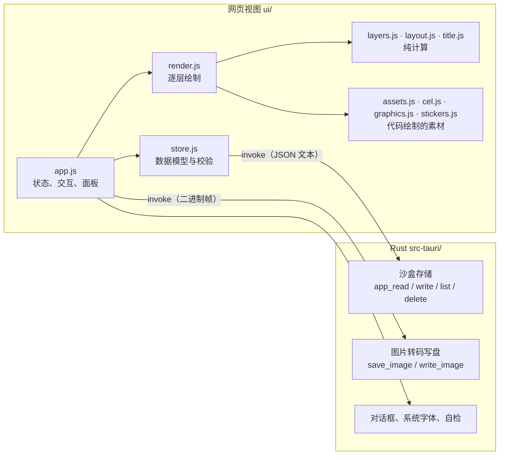

# SmedCover 架构与实现原理

[English](ARCHITECTURE.md) · 中文

本文面向想读懂或修改代码的人。使用说明见 [README.zh-CN.md](README.zh-CN.md)。

## 1. 总览

SmedCover 是一个 Tauri 2 应用，分成两半：

- **界面（`ui/`）**：运行在系统自带的网页视图里，负责全部交互和**全部绘制**。纯 ES 模块，没有打包器、没有框架、没有运行时依赖。
- **Rust 外壳（`src-tauri/`）**：只碰文件和网络，负责读写应用数据、把图片转码并写盘、弹出系统对话框、列出系统字体、发送生成素材的 AI 请求。



这样划分的原因：

- **所见即所得**：预览和导出走同一段绘制代码，只是画布像素数不同，不存在"预览和成品不一致"。
- **绘制代码可在浏览器里独立运行**：开发和自动化检查不需要启动桌面应用。
- **Rust 侧很小**，权限面也小：界面拿不到任意文件路径，只能读写应用数据目录，以及用户通过对话框选定的位置。

## 2. 目录

```
ui/
  index.html         结构与样式
  js/app.js          界面：状态、两种模式、选项卡、画布交互、图层面板、导出、撤销
  js/render.js       drawCover()：遍历图层并绘制一张封面；选中框与命中测试
  js/layers.js       图层模型：跨尺寸的位置、层级、适用频道（纯函数）
  js/layout.js       任意宽高比和版式下的几何布局（纯函数）
  js/title.js        标题解析与字号适配
  js/textfx.js       文字效果：叠画、蒙版、轮廓三类
  js/outlines.js     字形轮廓的缓存（向 Rust 侧索取）
  js/photo.js        背景照片与带缓存的高斯模糊
  js/assets.js       资产库：图形、贴纸、用户上传
  js/cel.js          赛璐珞绘图工具集和前 5 个频道图形
  js/graphics.js     另外 15 个频道图形
  js/stickers.js     60 个贴纸，以及公用的画法函数
  js/style.js        风格：每种风格的一组钩子，以及当前风格
  js/spec.js         以数据描述的贴纸：校验与解释执行（AI 生成的素材）
  （src-tauri/src/subject.rs：用 Vision 抠出照片主体的遮罩）
  js/repaint.js      照片重绘：三家图片服务的请求与回复、重绘提示词、内置风格的读取
  repaint-styles/    内置重绘风格，每个一个 `<id>.md`（开头是名称等信息），加上生成的清单 index.json
  js/solid.js        以数据描述的立体图形：校验，并用频道图形的渲染器绘制
  js/ai.js           AI 生成：连接设置、两种接口风格的请求、预设提示词（纯函数）
  js/store.js        数据模型、校验、持久化
  js/presets.js      起步档案与尺寸预设
  js/csv.js          批量导出用的 CSV 解析
  js/i18n.js         界面文字（中 / 英）
  fonts/             内置字体及许可
src-tauri/src/lib.rs Rust 侧全部代码
tests/               不依赖 DOM 的模块的单元测试
```

`layers.js`、`layout.js`、`title.js` 的解析部分、`csv.js`、`store.js` 的校验部分都不碰 DOM，因此可以直接用 Node 测试。

## 3. 数据模型

三份数据，全部是普通 JSON，读入时都经过 `store.js` 的 `normalize*` 校验补全：任何字段缺失或非法都会回落到默认值，所以旧文件和手改的文件不会让应用崩溃。

**档案**（`profiles/<id>.json`）

```jsonc
{
  "id": "…", "name": "…",
  "brand": { "name": "PIXEL HARBOR", "unit": "CHANNEL" },
  "categories": [                       // 界面上叫"频道"；字段名为兼容旧文件而保留
    { "id": "vlog", "name": "日常", "sub": "DAILY VLOG", "code": "VLOG", "color": "#fcee0a",
      "graphic": { "kind": "graphic", "id": "camera", "labels": [], "stamp": "" } }
  ],
  "style": { "template": "stack", "theme": "dark", "imageShadow": true,
             "look": "cel", "lookParams": { "cyber": { "glow": 1.2 } }, "lookSeed": 7 },
  "fonts": { "body": "", "display": "" },
  "sizes": [ { "w": 1920, "h": 1080, "label": "16:9", "name": "", "on": true } ],
  "design": { "layers": [ … ] }         // 默认设计：新封面的起始图层
}
```

**封面**（`session.json`，即当前会话）

```jsonc
{ "catId": "vlog", "title": "第一行\n*第二行*", "tag": "EP.01", "layers": [ … ] }
```

**设置**（`settings.json`）：语言、当前档案、清晰度倍数、格式、JPEG 质量、文件名规则、调整范围。

其他文件：`assets/<id>.json`（用户上传的素材，内容为 data URL）、`fonts/<名称>.font`（导入的字体）、`session-photo`（当前背景照片）、`ai.json`（AI 连接设置，含令牌，不随档案或工程导出）。

**工程文件**把封面、档案和用到的用户素材打包进同一个 JSON，因此可以在另一台电脑上原样打开。

## 4. 图层模型（`layers.js`）

一张封面是一个自下而上的图层数组。

| 类别 | 类型 | 说明 |
|---|---|---|
| 内置图层 | `bg` `accent` `graphic` `brand` `title` `tag` `catname` `frame` | 每张封面各有且仅有一个，内容来自别处（标题文字、频道的图形等），不能删除；`id` 就是类型名 |
| 自由图层 | `asset` `text` | 用户添加的素材和文字，可删除、可复制 |

`normalizeLayers()` 负责修复图层列表：丢掉无法识别的层，补回缺失的内置图层，保证背景在最底，并让 `id` 唯一。

### 4.1 位置：一处拼贴映射到所有尺寸

每个图层有一个 `t`：

```jsonc
"t": {
  "all": { "x": 0.5, "y": 0.42, "s": 0.35, "r": 0, "kx": 1, "ky": 1 },
  "by":  { "1920x1080": { "dx": 0, "dy": -40, "s": 1.1, "r": 0, "kx": 1, "ky": 1 } }
}
```

- **`t.all` 对所有尺寸生效**，位置以**画布的比例**保存，所以同一个值在 16:9 和 9:16 上都落在相对一致的位置。
  - 自由图层：`x`、`y` 是中心点的位置。
  - 内置图层：`x`、`y` 是相对于版式给出的位置的**偏移**，默认为 0。
  - `s` 是整体大小，`kx`、`ky` 是横向和纵向拉伸，`r` 是角度。
- **`t.by` 是逐尺寸微调**，以尺寸键（如 `"1920x1080"`）索引，单位是虚拟像素，叠加在 `t.all` 之上。
- **频道图形**的微调还可以按频道分别保存，键为 `"1920x1080@<频道 id>"`，因为不同图形的形状差别很大。

`resolve()` 把两者合成为最终位置：位置相加，缩放和拉伸相乘，角度相加。`adjust()` 是所有编辑的唯一入口：拖动、手柄、滚轮、方向键、滑块都把改动表达为一个补丁，再按当前的调整范围写进 `t.all` 或 `t.by`。

### 4.2 文字颜色

文字类图层（`title`、`tag`、`catname`、`brand`、`text`）可以带 `ink`，即它自己的文字颜色；标题还可以带 `hi`，即强调词的颜色。
没有这些字段时，颜色由当前风格和频道主色决定。各种风格的文字画法都要认这两个字段。

### 4.3 适用频道

自由图层可以带一个 `cats` 数组（频道 id）。没有它表示属于全部频道；有它则只属于列出的频道。`appliesTo(layer, catId)` 是唯一的判断点，绘制、图层列表、上下移动都用它。校验时会去掉已不存在的频道，一个频道都不剩的图层随之删除。

## 5. 布局（`layout.js`）

### 5.1 虚拟画布

所有几何都在一块"虚拟画布"上计算，它的短边固定在 1080 到 1200 个单位之间，与真实像素无关。`virtualSize(w, h)` 给出虚拟尺寸，例如 16:9 为 1920×1080，4:3 为 1600×1200。

好处是字号、线宽、间距都可以写成固定数值，从 900×383 到 8K 都保持同样的比例；绘制时只需要对画布做一次整体缩放。

### 5.2 调整与对调

模板算出的布局不直接使用，而是先经过 `adjustLayout()`。它接受档案里保存的调整量：色块占比 `size`、分界线倾斜 `slant`、
标题框的宽高比例 `tw` / `th`，以及是否对调 `flip`。这些都是画面的比例，所以一份设置适用于所有尺寸。
它对两类模板（斜切的和平直的）都适用，因为只读取并改写布局结果里的几何量，不关心这个布局是怎么算出来的。

对调不是简单的镜像：色带到了上面，品牌行就落在色带上，标题框改到色带下方，频道名和角标也要重新安排。
返回的布局因此多带几个标记（`brandOnAccent`、`railOnAccent`、`titleTop`、`flipped`），绘制时据此换颜色和位置。

画布上的菱形手柄由 `layoutHandles()` 给出位置，拖动时 `dragLayout()` 把指针位置换算回调整量；
对调过的布局会先换算回未对调的坐标再计算，所以两种情况下手柄都跟手。

### 5.3 版式

`layout(template, w, h)` 返回一张封面的全部几何：色块多边形、分界线、标题框、角标位置、频道名位置、图形的中心和大小。

- **上下（stack）**：有 5 组手工调好的锚点，分别对应 9:16、3:4、1:1、4:3、16:9。其他宽高比在相邻锚点之间按宽高比的对数做线性插值，所以任意尺寸都有合理的布局。
- **通栏（banner）**：沿用上下版式的结构，把色条压成一条细带。
- **左右（split）**：单独计算，色块是右侧的一块斜切面板。

约定：色块多边形的**前两个点就是分界线**。色块的 12 种形状都以这条边为基准来生成。

## 6. 绘制（`render.js`）

`drawCover(canvas, options)` 画一张封面：

1. 算出虚拟尺寸，设置画布的真实像素数，对上下文做一次整体缩放。
2. 准备一份环境：版式几何、频道主色、明暗主题、背景照片等。
3. 自下而上遍历图层，跳过隐藏的和不适用于当前频道的，用 `resolve()` 取位置，调用 `PAINT[类型]` 绘制。
4. 每个画出来的图层留下一条命中记录（中心、半宽、半高、角度），存到 `canvas._hits`。
5. 如果指定了选中图层，最后画选中框和手柄。

两个辅助函数统一了变换：

- **`placed()`** 用于内置图层。绘制函数会返回自己占据的矩形；先在一块用完即弃的上下文上跑一遍量出矩形，再以它的中心为轴做平移、旋转、缩放后真正绘制。这样缩放和旋转始终绕内容中心进行，且结果不依赖上一帧。
- **`centred()`** 用于素材和自由文字，它们本来就绕自身中心绘制。

**不透明度**：小于 1 的图层先单独画到一块临时画布上，再整体混合进来，避免图层内部的重叠笔画互相透出。

**预览与导出共用这段代码**。主画布按显示区域的像素数画，缩略图画得更小，导出按"尺寸 × 清晰度倍数"画。

### 6.1 标题（`title.js`）

标题不换行。`parseTitle()` 把文字拆成行，再按星号拆成普通段和强调段。字号取"最长一行放得下宽度，且所有行放得下高度"的最大值。描边和投影是多遍绘制：先画偏移的投影，再画墨色描边，最后填色。

### 6.2 文字效果（`textfx.js`、`outlines.js`）

标题和"标题样式"的文字图层通过 `paintRuns()` 画字。效果是图层的属性（`fx`），没有设置时为"自动"，即交给当前风格。效果分三类，区别在于能改动什么：

| 类别 | 做法 | 能改什么 |
|---|---|---|
| 叠画 | 同一行字用不同颜色、不同位置画几遍 | 字外面的东西：描边、投影、回声。各风格自带的文字画法都属于这类，也都可以按名字单独选用 |
| 蒙版 | 先把字单独画在一张备用画布上，再对这张画布做处理，最后贴回去 | 字内部的质感：填网点、条纹，磨损，内阴影，按行切开错位 |
| 轮廓 | 取得每个字的轮廓点，移动这些点之后再填充 | 字形本身：弯成拱形、透视收缩、波浪、带真实厚度的挤出 |

**轮廓从哪来**：网页视图读不到字体文件里的轮廓，所以由 Rust 侧提供。`text_outline` 命令用 `ttf-parser` 解析字体，把曲线拍平成折线，
以"字高为 1"的单位返回每个字的轮廓和步进。字体按名字查找，依次是内置字体（从应用自带的资源里读）、用户导入的字体、系统字体；
可变字体会按请求的字重取轮廓；一个字在第一款字体里没有时，换下一款。

**异步与绘制**：取轮廓要一点时间，而绘制不能等。`outline()` 立即从缓存回答，第一次没有时返回空并发出请求，效果此时退回普通文字；
轮廓到达后通知界面重画。导出时 `renderReady()` 会等所有请求完成再画一遍，保证导出图带效果。

**立体挤出**是真的把轮廓的每条边向后扫出一面"墙"：按朝向分成受光和背光两组，各自作为一个形状填充，再画背面和正面。

### 6.3 背景照片与模糊（`photo.js`）

macOS 的网页视图不支持画布滤镜，所以高斯模糊用脚本实现：**三次方框模糊近似一次高斯模糊**，每次方框模糊用滑动窗口，耗时与模糊半径无关。

模糊作用在照片的一份缩小副本上，并按"照片 + 模糊值"缓存。之后移动、缩放照片或编辑其他图层，都只是一次贴图。导出时用更高精度的副本重新计算。

### 6.4 主体图层（抠图）

`subject_mask`（`src-tauri/src/subject.rs`）把照片字节交给 Apple Vision 的 `VNGenerateForegroundInstanceMaskRequest`（macOS 14 起；通过 objc2 在运行时查找这个类，旧系统上报"需要 macOS 14"），取 `generateScaledMaskForImageForInstances` 得到与照片同尺寸的浮点遮罩，转成"只有透明度有意义"的 PNG 返回。界面先把照片画到画布上再编码成 JPEG 发送，所以照片的 EXIF 方向已经摆正，遮罩与照片像素一一对应。

遮罩存为 `S.photoMask = {img, src, of}`，`of` 是它所属的照片；换照片即清空。`subject` 图层（`OPTIONAL_TYPES`，每张封面最多一个，可删除）在绘制时把背景层再画一遍——同一张照片、同一位置（`env.bgTr`）、同样的风格处理，默认不模糊不压暗——再用遮罩 `destination-in` 裁出主体；描边和投影由遮罩剪影着色后错位叠出。它不产生点击区域，点击会落到下面的图层。拖动背景时 `goLive` 把主体图层一并列入重画范围，保证两者对齐。

### 6.5 素材

- **频道图形**和**贴纸**全部是代码画的矢量图形，没有图片文件，因此任意放大都清晰，并能随频道主色着色。`cel.js` 提供一套赛璐珞风格的绘图工具（明暗分色、墨线、伪三维的方块和棱柱），`graphics.js` 通过 `registerGraphics()` 追加图形。
- **用户上传**的图片以 data URL 存在应用数据目录，解码后缓存。
- `drawAsset()` 是统一入口，返回素材的半宽半高，供命中测试使用。

## 7. 风格（`style.js`）

封面的**内容**（图层、位置、贴纸和立体图形的描述、标题文字）不包含任何风格信息，所以切换风格只是换一种画法，
所有素材包括已经生成的 AI 素材都会跟着重画，数据不用改。

一种风格是一组**钩子**，每个都可以省略，省略的部分按默认的赛璐珞方式画。因此新风格可以从一个钩子开始，逐步补全。

| 钩子 | 负责什么 |
|---|---|
| `theme` | 背景底色、网格、普通文字的颜色 |
| `background` | 背景图层：底色、网格、照片及其染色 |
| `accent` | 色块：填充色、网点、分界线的画法 |
| `runs` | 由若干"段"组成的文字，即标题和自由文字的标题样式 |
| `wrap` | 返回一个替身画布，频道图形、立体图形和封面上的小部件（品牌行、角标、频道名、四角线）都画在它上面 |
| `sticker` | 平面贴纸的五个画法函数：`shape`、`blob`、`stroke`、`thin`、`word` |
| `tag` | 角标 |
| `frame` | 四角线图层，以及该风格想放在画面边缘的界面装饰 |
| `freeText` | 自由文字图层的"纯文字"和"底牌"样式 |
| `subject` | 画在频道图形周围、随图形移动缩放的东西（如扫描锁定环） |
| `seeded` | 标记该风格有随机摆放的元素 |
| `layout` | 封面的几何布局，供"重在排版"的风格使用；返回的结构与 `layout.js` 的 `layout()` 相同，通常调用 `blockLayout()` 得到平直的色带和侧栏 |
| `titleSet` | 由风格自己排标题（如竖排）；返回空表示按通常方式排 |
| `faces` | 整张封面改用的字体。字体表是共用的，`drawCover()` 画完后会还原 |
| `titleFont` | 标题用的字体，供有自己字体主张的风格使用（如编辑设计的衬线字） |
| `oneTheme` | 标记该风格只有一种底色，界面会隐藏深浅选择 |
| `image` | 上传图片的投影或光晕 |
| `post` | 整张封面画完之后的叠加层，如扫描线和暗角 |
| `params` | 可调参数，在样式栏里显示为滑块 |
| `prompt` / `solidPrompt` | AI 提示词里"风格"一节的内容 |

当前风格是 `style.js` 的模块状态，`drawCover()` 在开始绘制前根据档案设置；界面在画素材缩略图前也会设置一次。

### 7.1 替身画布：不改绘图代码就换风格

20 个频道图形各有几十行直接调用画布的绘图代码。逐个改写成支持多风格不现实，所以用了一个替身：
`wrap` 返回一个 `Proxy`，它转发所有画布调用，只在两处介入。

- **设置颜色时**：先判断这个颜色在赛璐珞风格里扮演的角色（墨色、亮面、中间面、暗面、彩色），再换成当前风格里对应的颜色。赛博朋克把亮、中、暗三种面换成三档深色玻璃，彩色保持不变。
- **描边时**：墨色的线改画成一条光线，即一层宽而淡的光晕、一条彩色线、一条细的亮芯。

这样频道图形、AI 生成的立体图形的绘图代码一行都不用改。

赛博朋克对封面小部件（品牌行、频道名）不做替换：这个风格本来就是"纯色面板配黑字"，和赛璐珞的墨色配彩色一致。
它的差别来自别处：色块是实心的纯色面板，标题的强调词画成黑字切角底牌，赛璐珞里的墨色硬投影全部换成红青两色的"回声"，
最后整张画面做一次色彩错位和信号撕裂。

光晕用"多画几遍不同粗细的线"实现，而不是画布的模糊阴影。原因有两个：模糊阴影对每条线都很慢；而且不同网页视图算出的模糊范围不一样，
实测同一个数值在应用的网页视图里比在 Chrome 里糊得多。标题的光晕也是这样分层描出来的，所以各平台看到的一致。

### 7.2 几种风格共用的工具

新风格大多是"构造不变、换材料"，所以有几个共用的工具：

- `mapped(ctx, 规则)`：通用的替身画布，按颜色的角色（墨色、亮面、中间面、暗面、彩色）换色，并可整体缩放线宽。
- `painters(选项)`：按给定的描边色、线宽倍数、投影画法，生成贴纸的五个画法函数。
- `grain()`、`wash()`：颗粒、整幅叠色，用于纸张和胶片质感以及照片染色。纸张上的颗粒用正片叠底，胶片上的用叠加；后者在浅色底上几乎看不出来。
- 照片去色由 `drawPhoto()` 的 `grey` 参数完成：逐像素算出一份灰度副本并缓存。没有用画布的"饱和度"混合模式，因为它在各网页视图里不够可靠。

有深浅两种底色的风格（蓝调唱片、编辑设计）通过 `setLook()` 的第四个参数得知当前是深是浅。

### 7.3 调教画面效果

由浅到深三层：

1. **滑块**：风格的 `params`，保存在档案的 `style.lookParams[风格]` 里，不用改代码。
2. **常量**：`style.js` 里 `CY` 对象是赛博朋克的调色板（底色、黑、三档玻璃色、错位用的红和青、白）；`echo()` 决定回声的方向和距离；`tube()` 决定光线各层的粗细和透明度；`chamfer()` 是切角。
3. **钩子**：改某个钩子的画法，比如 `background` 里的网格和巨型代号，`frame` 里的界面装饰，`post` 里的错位、撕裂和扫描线，`runs` 里文字的层次。

加一个滑块：在风格的 `params` 里加一项，然后在钩子里读取对应的值即可，界面和保存都是自动的。

**随机但不乱跳**：风格里需要随机的东西（撕裂带、扫描线的位置）用 `rand(k)` 取值，它由档案里的 `style.lookSeed` 决定。
种子不变，每一帧、每个尺寸、预览和导出都落在同样的相对位置；界面上的「换一组随机位置」只是换一个种子。

## 8. AI 生成素材（`ai.js`、`spec.js`）

### 8.1 为什么让模型返回数据而不是代码

内置贴纸是代码，所以最直接的想法是让模型也返回一段绘图代码。没有这样做，原因是安全：这段代码会在网页视图里执行，
而网页视图能调用读写应用数据、写出文件、发起网络请求的命令。执行一段由远端模型生成、且受用户输入影响的代码，
等于把这些能力交给了它。

所以模型返回的是一份**贴纸描述（spec）**：一个 JSON，列出若干绘图操作。它保留了"代码形式"的全部好处，
即实时绘制、任意放大都清晰、可跟随频道主色，但其中没有任何东西会被执行。

```jsonc
{ "name": { "zh": "爱心", "en": "Heart" }, "color": "#ff3b4f",
  "ops": [
    { "op": "shape", "path": { "curve": [["M",0,82], ["C",-118,8,-74,-96,0,-36], ["C",74,-96,118,8,0,82]] }, "fill": "main" },
    { "op": "detail", "pts": [[-46,-34], [-56,-14]], "color": "white", "lw": 9 }
  ] }
```

- 坐标系和内置贴纸一致：以原点为中心的 200×200 方框。
- 五种操作 `shape`、`blob`、`line`、`detail`、`text`，直接对应 `stickers.js` 里的五个画法函数；路径有多边形、圆、椭圆、圆角矩形、星形、曲线六种，线条还可以是圆弧。
- 任何操作都可以带 `mirror`，表示左右对称再画一遍。对称是通过翻转几何坐标实现的，而不是翻转画布，所以投影仍然落在右下方；对称的 `blob` 会把两半融合成一个轮廓。
- 颜色用 `"main"` 表示主色，着色时被频道主色替换。

**风格因此不靠模型自觉，而是由解释器保证**：粗墨线、硬投影、平涂都是画法函数加上的，模型只能决定形状和配色。

### 8.2 立体图形（`solid.js`）

AI 素材有两种。除了上面的平面贴纸，还有**立体图形**，对应内置的频道图形：

```jsonc
{ "kind": "solid", "name": { "zh": "洗衣机", "en": "Washing machine" }, "color": "#00e5ff",
  "parts": [
    { "box": [300, 380, 260], "at": [0, 0, 0],    "tone": "white" },
    { "cyl": [110, 30], "axis": "z", "at": [0, 30, 145], "tone": "dark" }
  ],
  "marks": [ { "circle": [0, 30, 82], "z": 161, "fill": "shade", "line": 5 } ] }
```

- `parts` 是方块和圆柱，各有中心位置和色调（白、深色、主色）。它们被转换成频道图形所用的同一种"积木"，交给同一个渲染器 `drawPieces()`：按远近排序，每个面按朝向落入亮、中、暗三档之一，暗面叠网点，每个面描墨线。
- `marks` 是画在物体正面的平面细节（圆、矩形、折线），绘制在所有积木之上。
- 物体会按投影后的范围**自动缩放并居中**，所以模型描述的绝对尺寸不重要，只有比例重要；地面投影也是按这个范围自动加的。
- 着色时，主色的部件、网点、地面投影一起换成频道主色。

渲染器按"部件"排序而不是按像素，所以互相深度穿插的部件可能前后顺序不对。提示词因此要求部件之间只接触或略微重叠。

### 8.3 校验

`normalizeSpec()` 对模型的回复逐项检查：操作类型必须在名单内，数字必须是有限数并被夹在允许范围内，
颜色必须是调色板名称或十六进制色值，操作数、点数、文字长度都有上限。任何不认识的东西都直接拒绝，不做猜测；
多余的字段被丢弃。如果模型一处都没用 `"main"`，校验时会把它用得最多的那个颜色提升为主色，保证素材总能跟随频道着色。`parseSpec()` 负责从可能带有代码围栏或客套话的回复里找出那个 JSON。

通过校验的描述存为 `assets/<id>.json`，与上传的图片并列，属于"我的素材"，随档案和工程文件一起导出。

### 8.4 请求与提示词

`buildRequest()` 按接口风格生成请求：

| | OpenAI 风格 | Anthropic 风格 |
|---|---|---|
| 地址 | `{BASE_URL}/chat/completions` | `{BASE_URL}/v1/messages` |
| 认证 | `Authorization: Bearer` | `x-api-key`，或 `Authorization: Bearer` |
| 其他请求头 | 无 | `anthropic-version` |
| 系统提示词 | 一条 `system` 消息 | 顶层 `system` 字段 |
| 长度参数 | 不发送 | `max_tokens`（必填） |

OpenAI 风格刻意不发送温度和长度参数，因为不同模型接受的参数并不一致，多发一个就可能被拒绝。
`readReply()` 读取两种风格的回复、错误信息和"被截断"的标记。

回复通不过校验时，`requestSpec()` 会把模型的回复和校验错误作为后续对话发回去，让它改正，最多重试 3 次。
连接错误和被截断的回复不重试，因为再问一次也不会有不同结果。

预设提示词有两份：平面贴纸用 `systemPrompt(style)`，立体图形用 `solidPrompt(style)`，结构相同。前者包含风格、坐标系、颜色规则、上面的数据格式、一段"如何设计一个贴纸"的步骤指导，以及六个示例。
其中只有"风格"一节取自 `STYLE_NOTES[style]`，其余部分与风格无关，以后增加新风格时只需添加一条。
示例本身就是合法的描述，单元测试会逐个校验，避免提示词和解释器对不上。

### 8.5 照片重绘（`repaint.js`）

照片重绘是一次固定流程，不是 agent：照片加一段风格说明发给图片模型，换回一张图。三家服务的接口各不相同，`buildImageRequest` 按各自的格式组请求，`readImageReply` 按各自的格式取图：

| 服务 | 请求 | 图片放在 | 结果在 |
|---|---|---|---|
| OpenAI | `POST {base}/images/edits`，Bearer | `images: [{image_url: data URL}]`，`size` 按照片比例 | `data[0].b64_json` |
| Gemini | `POST {base}/models/{model}:generateContent`，`x-goog-api-key` | `contents[0].parts` 里的 `inlineData` | `candidates[0].content.parts[].inlineData` |
| Seedream | `POST {base}/images/generations`，Bearer | `image: data URL`，`size: "WxH"`，`response_format: "b64_json"` | `data[0].b64_json`，或 `url`（再由 `fetch_image` 下载） |

内置风格是 `ui/repaint-styles/` 下的 Markdown 文件：文件名是 ID（用户设置记的就是它），开头 `---` 之间的 front matter 给出中英文名、说明、排序和出处（`parseStyle` 只认 `STYLE_KEYS` 里的几个键，写错即报错），其后是提示词。打包后的应用无法列出文件夹，所以 `scripts/repaint-styles.mjs` 在每次打包前（`beforeBuildCommand`）扫描文件夹写出 `index.json`；界面启动时读清单，选中某个风格、展开查看或重绘时才读它的文件（`styleText`，读过就缓存），`<!-- -->` 注释被去掉。

提示词由 `repaintPrompt` 组合：风格来源（当前风格的 `repaint(colour)`、内置风格文件、或用户的文字）＋「这是封面背景：不要文字和边框、保持比例」＋补充说明。跟随风格时还要求保持构图，这样背景图层原来的位置和缩放仍然合适；预设和自定义自己决定构图。可选参数（尺寸、水印等）被服务以 400 拒绝时，`refusedParam` 从错误信息里认出参数名，去掉后重发，最多三次。连接测试（`imageCheck` / `readImageCheck`）不出图：OpenAI、Gemini 用 GET 查询模型，Seedream 发空提示词看拒绝理由；为此 `ai_request` 可以发 GET。用户自己的风格是应用数据目录 `repaint-styles/` 下同样格式的 Markdown 文件（`userStyle` 宽松地读：没有开头信息、有未知键都行，未知键原样保留，`writeStyle` 写回时不丢），窗口回到前台时重新读取，`reveal_data_dir` 在文件管理器里打开这个文件夹；早先存在 `image-ai.json` 里的 `styles` / `custom` 会在启动时一次性写成文件（`legacyStyles`）。重绘总是从原图出发，原图存在 `S.photoOriginal`（会话里是 `session-photo-original`，工程文件里是 `photoOriginal`）。

## 9. 交互（`app.js`）

### 9.1 状态与刷新

所有状态在一个对象 `S` 里：当前档案、封面、设置、模式、选中的尺寸和图层、撤销历史。

改动数据后调用 `touch({ profile, cover, panel, side, strip })`，它负责：标记需要保存的部分、安排重画、按需重建某一栏的界面、记录撤销历史。保存、重画、记录历史都做了防抖，连续拖动不会反复写盘。

界面没有用框架，各栏由一个小的元素构造函数 `el()` 直接生成，需要时整栏重建。

### 9.2 画布上的操作

- 鼠标位置先换算成虚拟坐标，再对 `canvas._hits` 自上而下做命中测试。测试时把点反向旋转到图层自己的坐标系里，所以旋转过的图层也能准确点中。
- 选中图层后先检查是否点在手柄上：四角缩放、四边拉伸、顶部圆点旋转。手柄大小按屏幕像素换算，画布缩放后看起来一样大。
- 四角线不参与命中；背景只在有照片时可拖动。

### 9.3 拖动时只重画一层

拖动、缩放或旋转一个图层时，其余图层并没有变。所以拖动开始时，`drawCover()` 把被拖图层**下面**和**上面**的所有图层各画成一张图，
之后每一帧只做三件事：贴上下面那张、重画被拖的图层、贴上上面那张。缓存放在界面传入的 `o.live` 对象里，拖动结束就丢弃。
画布上的拖动、滚轮和属性面板里的位置滑块都走这条路。

在应用所用的引擎里实测（1900 像素宽）：整张重画赛璐珞约 18 毫秒、赛博朋克约 44 毫秒；拖动一个图层时两者都降到 5 到 11 毫秒。

风格里代价高的整画面效果（目前是色彩错位）在拖动的帧里会跳过，由 `setFast()` 控制，松手后的那一帧恢复。

### 9.4 撤销

每次改动后（防抖 0.5 秒）把档案和封面序列化成一个字符串快照，与上一个不同才入栈，最多保留 80 步。撤销就是把快照解析回来并重新校验。实现简单，代价是每步存一份完整数据；在目前的数据规模下可以接受。

## 10. Rust 侧（`src-tauri/src/lib.rs`）

### 10.1 沙盒存储

`app_read`、`app_write`、`app_list`、`app_delete` 只接受相对路径，由 `resolve()` 拼到应用数据目录下，并拒绝绝对路径和 `..`。界面因此无法读写目录之外的文件。写入采用"先写临时文件再改名"，避免中途退出留下半个文件。

### 10.2 导出管线

```
画布 ──toBlob（异步）──▶ PNG 字节 ──二进制帧──▶ Rust 工作线程 ──▶ PNG / JPEG / WebP 文件
```

1. 界面把封面画到一块离屏画布上，用 `toBlob` **异步**编码成 PNG，不阻塞界面。
2. 字节通过 Tauri 的原始请求体发给 Rust，**不经过 base64**。请求体是一个自定义帧：

   ```
   [4 字节小端长度][JSON 元信息：目录、文件名、格式、质量][PNG 字节]
   ```

   元信息放在请求体里而不是请求头里，是因为实测自定义请求头在真实应用中到不了 Rust。
3. `save_image`（弹保存对话框）和 `write_image`（写入已选文件夹）是异步命令，在工作线程上执行。目标格式是 PNG 时直接写盘；JPEG 先铺一层深色底再编码；WebP 用无损编码。
4. 界面最多同时挂起两个写入请求，下一张封面在等待期间已经开始绘制。进度框显示张数，取消后停止派发新任务。

文件名经过 `safe_name()` 处理，只保留最后一段，因此不能借文件名写到别的目录。

### 10.3 字形轮廓

`text_outline` 见 6.2 节。字体文件按名字找到后会缓存，系统字体只扫描一次。

### 10.4 AI 请求

`ai_request` 把界面构造好的请求（地址、请求头、JSON 正文）发出去，并把状态码和正文原样交还，错误回复也不例外，
这样界面可以显示服务商自己的错误信息。由 Rust 发送是为了绕开网页视图的跨域限制。

- 请求在阻塞线程池里等待回复，不占用界面线程，也不占用异步运行时的工作线程。
- 只接受 `http://` 和 `https://`，回复最多读取 4 MB；带图片的回复（照片重绘，`image: true`）最多 64 MB。超时由设置决定，默认 300 秒。
- 代理：优先用设置里填写的；否则读环境变量 `HTTPS_PROXY` / `HTTP_PROXY` / `ALL_PROXY`。**本机地址永不走环境变量里的代理**，否则本地模型会被代理拦住。

`fetch_image` 用于照片重绘时服务只回了一个图片链接的情况：下载它，确认是图片（看 `content-type`，不对就看文件头），以 base64 交给界面。

### 10.5 其他命令

`pick_folder`、`save_text`（导出档案、工程、CSV 模板）、`list_system_fonts`（用 fontdb 枚举系统字体，并标出能否排中文）、`reveal_data_dir`（在文件管理器里打开数据目录下的某个文件夹，只限数据目录内）。

## 11. 浏览器回退

`store.js` 里的 `files` 对象有两种实现：有 Tauri 时调用上面的命令；没有时退回 `localStorage`，导出改为浏览器下载。因此可以直接用静态服务器打开界面做开发：

```bash
python3 -m http.server -d ui 4599
```

## 12. 字体

三款内置字体通过 `@font-face` 加载，三个平台渲染一致。用户导入的字体以 data URL 存入 `fonts/`，启动时用 `FontFace` 注册。启动时会等字体就绪后再画第一帧，否则标题的字号适配会按错误的字宽计算。

## 13. 测试

| 层次 | 命令 | 覆盖 |
|---|---|---|
| 前端单元测试 | `npm test` | 布局、图层位置与层级、适用频道、CSV、数据校验、文件名规则、素材库的数量与命名、风格的颜色映射与参数、贴纸描述与立体图形描述的校验与绘制、两种接口风格的请求与回复、界面文字的中英文齐全 |
| Rust 单元测试 | `cd src-tauri && cargo test` | 路径沙盒、存储读写、帧解析、三种格式的编码、文件名处理、对本地模拟服务发请求、代理规则 |
| 端到端自检 | `SMEDCOVER_SELFTEST=<目录> <可执行文件>` | 在真实的网页视图和 Rust 之间走完整导出流程 |

自检模式下，应用改用指定目录存放数据，导出几张封面的三种格式，再用每一种其他风格各导出一张，写出 `report.json` 后退出。再设置 `SMEDCOVER_SELFTEST_AI=<模拟服务地址>`，还会用两种接口风格各生成一个素材并画到封面上。它能发现只在真实应用里出现的问题，例如上面提到的请求头问题。

## 14. 已知的取舍和限制

- **只有拖动时才有图层缓存**。输入标题、调整风格滑块仍是整张重画，赛博朋克下每次约 44 毫秒。
- **绘制在界面线程上**：4 倍清晰度的大图绘制时界面会短暂停顿。转码和写盘已经移到工作线程。
- **没有打包器**：模块直接由网页视图加载，结构简单，但没有压缩和摇树；目前代码量下启动时间可以忽略。
- **撤销存完整快照**：简单可靠，数据量变大后需要改成增量。
- **缩略图每次都全部重画**：尺寸很多时是主要开销。
- **内置字体未做子集化**：占了安装包体积的大部分。
- **只在 macOS 上实际运行过**：Windows 和 Linux 的构建配置已写好，尚未验证。

## 15. 常见改动从哪里下手

| 想做的事 | 改哪里 |
|---|---|
| 加一个频道图形 | `graphics.js` 里写绘制函数并 `registerGraphics()`；`assets.js` 无需改动 |
| 加一个贴纸 | `stickers.js` |
| 加一种色块形状 | `layers.js` 的 `ACCENT_SHAPES`，`render.js` 的 `paintAccent()` 和 `edgePoints()`，`i18n.js` 加名称 |
| 加一种版式 | `layout.js` 的 `TEMPLATES` 和 `layout()`，`i18n.js` 加名称 |
| 给图层加一个属性 | `layers.js` 的 `PROPS` 和 `normalizeLayer()`，`render.js` 的 `PAINT`，`app.js` 的 `typeControls()` |
| 加一种导出格式 | `lib.rs` 的 `encode()`，`app.js` 的 `EXT` 和格式选择 |
| 给 AI 素材加一种绘图操作 | `spec.js` 的校验和 `drawSpec()`，`ai.js` 的提示词和示例 |
| 给立体图形加一种部件 | `solid.js` 的校验和 `pieces()`，`ai.js` 的 `solidPrompt()` 和示例 |
| 加一种风格 | `style.js` 的 `LOOKS` 里加一项，从一两个钩子开始 |
| 加一句界面文字 | `i18n.js`，中英文都要写；测试会检查两种语言是否齐全 |
