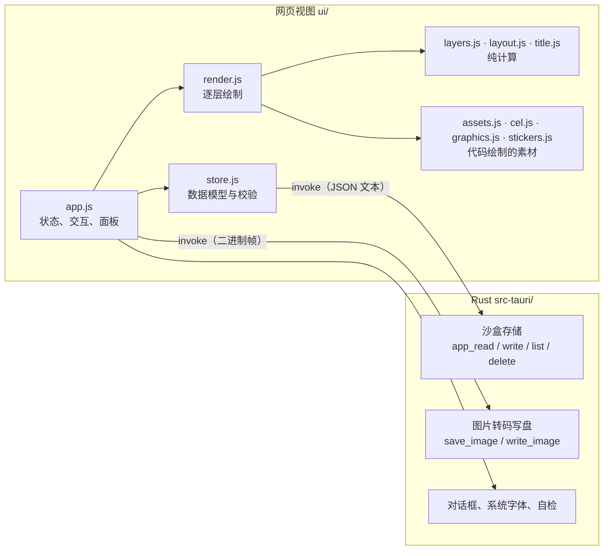

# SmedCover 架构与实现原理

[English](ARCHITECTURE.md) · 中文

本文面向想读懂或修改代码的人。使用说明见 [README.zh-CN.md](README.zh-CN.md)。

## 1. 总览

SmedCover 是一个 Tauri 2 应用，分成两半：

- **界面（`ui/`）**：运行在系统自带的网页视图里，负责全部交互和**全部绘制**。纯 ES 模块，没有打包器、没有框架、没有运行时依赖。
- **Rust 外壳（`src-tauri/`）**：只碰文件和网络，负责读写应用数据、把图片转码并写盘、弹出系统对话框、列出系统字体、发送生成素材的 AI 请求。



这样划分的原因：

- **所见即所得**：预览和导出走同一段绘制代码，只是画布像素数不同，不存在"预览和成品不一致"。
- **绘制代码可在浏览器里独立运行**：开发和自动化检查不需要启动桌面应用。
- **Rust 侧很小**，权限面也小：应用数据目录只能用相对路径读写，出不了这个目录（10.1）；在它之外，界面只写到用户在对话框里选的位置。后一条靠界面自己守：导出文件夹选过一次后按档案记在 `custom.json` 里（`exportDirs`，见第 3 节），每次导出时交回去，`write_image` 只检查它是不是一个绝对路径的文件夹（10.2）。

## 2. 目录

```
ui/
  index.html         结构与样式
  js/app.js          界面：状态、窗口（左侧的停靠栏和面板、画布上的浮动工具条、属性抽屉、「设置」和其他窗口）、画布交互、导出、撤销
  js/render.js       drawCover()：遍历图层并绘制一张封面；选中框与命中测试
  js/layers.js       图层模型：跨尺寸的位置、层级（纯函数）
  js/layout.js       任意宽高比和版式下的几何布局（纯函数）
  js/title.js        标题解析与字号适配，横排和竖排
  js/stack3d.js      「图层」面板的 3D 视图：叠层的投影、适配、标签和绘制（除绘制外都是纯计算）
  js/platforms.js    封面要发的平台，作为数据：各平台要的比例、信息流里的显示宽度、平台叠在封面上的东西；尺寸的名字（platformsFor）
  js/check.js        封面标准的规则，纯函数（测试用它检查版式；版式里的执行见 layout.js 的 meetStandards）
  js/deal.js         「你看着办」的全部规则：抽牌用的每个数字（RULES）、每个风格适合什么（FAMILIES、RECIPES）、用户在上面调的概率（oddsOf、rebalance；概率窗口的条用 moveShare，圆点用 DOTS、dotsOf、withDots）、一手用哪个版式设定（pickLayout）、把一手抽到封面上（dealCover），纯函数
  js/textfx.js       文字效果：叠画、蒙版、轮廓、逐字四类
  js/ransom.js       剪报字：每个字有自己的字体、纸片和角度
  js/outlines.js     字形轮廓的缓存（向 Rust 侧索取）
  js/photo.js        照片的摆放与带缓存的高斯模糊
  js/assets.js       资产库：图形、贴纸、用户上传
  js/cel.js          赛璐珞绘图工具集和前 5 个频道图形
  js/graphics.js     另外 15 个频道图形
  js/stickers.js     72 个贴纸（含 12 个线框），以及公用的画法函数
  js/style.js        风格：风格可用的钩子、注册表（LOOKS）、「风格」面板按什么分类（LOOK_CATEGORIES、LOOK_TAGS）和应用其他部分引用的接口
  js/looks/kit.js    各风格共用的部分：工具函数、场景物件、当前风格的状态（setLook）、风格效果的框架
  js/looks/<id>.js   每种风格一个文件（cel、cyber、riso……wasteland、facet）：风格对象、它自己的工具函数和图层效果
  js/spec.js         以数据描述的贴纸：校验与解释执行（AI 生成的素材）
  （src-tauri/src/subject.rs：用 Vision 抠出照片主体的遮罩）
  js/repaint.js      照片重绘：三家图片服务的请求与回复、重绘提示词、内置风格的读取
  repaint-styles/    内置重绘风格，每个一个 `<id>.md`（开头是名称等信息），加上生成的清单 index.json
  js/solid.js        以数据描述的立体图形：校验，并用频道图形的渲染器绘制
  js/ai.js           AI 生成：连接设置、两种接口风格的请求、预设提示词（纯函数）
  js/store.js        数据模型、校验、持久化
  js/presets.js      起步档案（三个频道的起步档案的名字、品牌和频道取自 defaults.json）与尺寸预设（平台要的每种比例一个）
  js/defaults.js     默认值：读一次 defaults.json，再把 custom.json 里设置以外的模块盖上去（DEFAULTS、layOver）
  defaults.json      应用的默认值，按模块分：settings、profile、layout、surprise、ui
  js/csv.js          批量导出用的 CSV 解析（「设置 → 尺寸与导出」）
  js/i18n.js         界面文字（中 / 英）
  fonts/             内置字体及许可
src-tauri/src/lib.rs Rust 侧全部代码
tests/               不依赖 DOM 的模块的单元测试
```

`layers.js`、`layout.js`、`title.js` 的解析部分、`csv.js`、`store.js` 的校验部分都不碰 DOM，因此可以直接用 Node 测试。

## 3. 数据模型

三份数据，全部是普通 JSON，读入时都经过 `store.js` 的 `normalize*` 校验补全：任何字段缺失或非法都会回落到默认值，所以旧文件和手改的文件不会让应用崩溃。

**档案**（`profiles/<id>.json`）

```jsonc
{
  "id": "…", "name": "…",
  "brand": { "name": "PIXEL HARBOR", "unit": "CHANNEL" },
  "categories": [                       // 界面上叫"频道"；字段名为兼容旧文件而保留
    { "id": "vlog", "name": "日常", "sub": "DAILY VLOG", "code": "VLOG", "color": "#fcee0a",
      "graphic": { "kind": "graphic", "id": "camera", "labels": [], "stamp": "" } }
  ],
  "style": { "template": "stack", "layoutAdjust": { "stack": { "size": 0.3 } }, "theme": "dark",
             "layoutBy": { "1920x1080": { "template": "split", "adjust": {} } },   // 可选：单独设置了版式的尺寸（见 5.2）
             "look": "cel", "lookParams": { "cyber": { "glow": 1.2 } }, "lookSeed": 7,
             "lookArt": { "jelly": { "kind": "sticker", "id": "star" } } },   // 可选：风格的身影用哪个图形代替频道图形
  "fonts": { "body": "", "display": "" },
  "sizes": [ { "w": 1920, "h": 1080, "label": "16:9", "name": "", "on": true } ],
  "design": { "layers": [ … ] }         // 默认设计：新封面的起始图层
}
```

**封面**（`covers/<档案 id>/<频道 id>.json`，每个档案的每个频道一张）

```jsonc
{ "catId": "vlog", "title": "第一行\n*第二行*", "tag": "EP.01", "layers": [ … ],
  "scene": { "court": { "ball": { "all": [0.1, -0.05], "by": { "1080x1920": [0.02, 0] } } } } }   // 可选：拖过的场景物件（见 7.5）
```

`S.covers` 是当前档案读入的各频道封面（以频道 id 为键），`S.cover` 是正在显示的那张；两者只经 `setCover()` 一起改。切换档案时 `loadCovers()` 读入新档案的封面；切换频道（`switchChannel()`）先提交撤销记录，再显示该频道的封面——没有就由 `channelCover()` 从档案的默认设计新建，带默认标题。保存（`persistCover`）按档案和频道分别防抖。每个档案停在哪个频道记在设置的 `channels`（`{档案 id: 频道 id}`），由 `channelOf()` 读取。删除档案时一并删掉它的 `covers/<档案 id>/`。「从其他频道复制」（`copyDialog`、`copyInto`）用 `coverOf()` 取来源封面（当前档案的取内存里的，其他的读文件，没有就按默认设计新建），`copyPreview()` 用来源档案的设置把它按画布当前尺寸画成缩略图，由 `layers.js` 的纯函数 `copyFreeLayers(into, from)` 复制用户添加的图层（`isAdded`：自由图层和版式图层的副本，见第 4 节）：深拷贝、换新 id，被动图层的 `of` 改指向它的照片的副本，抠出主体和素材的 `weave` 改指向它们穿插的文字的副本（版式图层的 id 保留，每张封面都有；其余的去掉）；每个副本插在来源里它下方最近的版式图层之上、那里已有的添加图层之上，保持原来的先后；对话框按类别计数，副本算「版式副本」；从别的档案复制时，先用 `acrossSizes()` 把副本按尺寸记的东西放到当前档案的尺寸上（见 4.4）；然后整张封面像读入时一样经 `channelCover()` 校验，算一步撤销。

旧数据：以前只有一张封面 `session.json`，所有频道共用，图层可以用 `cats` 限定频道。`migrateSession()` 在当前档案还没有任何频道封面时把它拆开：每个频道一份，`channelCover()` 只留下适用于该频道的图层并去掉 `cats`，标题和角标复制到每一份；原文件改名为 `session.migrated.json`，`session-photo*` 先由 `upgradeCover` 变成照片图层再删除。

**设置**（`custom.json` 的 `settings` 下，只记和默认值不一样的，见下）：语言、当前档案、每个档案停留的频道（`channels`）、清晰度倍数、格式、JPEG 质量、文件名规则（`nameTemplate`，不管按标签还是按文字改都是同一段字，见 9.5），按档案 id 记的导出窗口里关掉的尺寸（`exportSizes`：`{档案 id: {尺寸键: false}}`，只记关掉的，所以没写到的尺寸——后来加的——是打开的；一个都没关掉的档案不记；`normalizeExportSizes`）和导出保存到的文件夹（`exportDirs`：`{档案 id: 路径}`，第一次导出选了才有）、调整范围（`scope`：`all`、`orient` 或 `size`，见 4.1；不记，每次启动都设成默认值里的那一档，`startScope()`）、每个风格在这台电脑上被换成档案风格的次数（`lookUse`：点卡片换上的，或留下了「你看着办」的一手；整数，只记存在的风格、大于 0 的——「风格」面板的「★ 常用」，见 9.5），在那里点卡片上的 ♡ 喜欢的风格（`lookLikes`：风格 id，最近喜欢的在前，每个只记一次，只记存在的风格——「♥ 喜欢」），以及用户按风格改过的「你看着办」可有可无部分的概率（`recipes`：{look: {params}}，只存改过的项，由 `normalizeRecipes` 检查），和「你看着办」记住的东西（`surprise`：下次不变的部分 `locks`，取自 `SURPRISE_LOCKS`——`look`、`theme`、`lettering`、`places`、`layout`；在「你看着办」的概率窗口里调过的概率 `odds`，只存调过的；见 `normalizeSurprise`），以及用户的版式设定（`layouts`，见下）；还有窗口的（见 9.5）：面板是不是毛玻璃（`glass`）、属性抽屉开没开（`drawer`）、各栏拖成的宽度（`columns`）。删除档案（`profileActions.delete()`）时，它在 `exportSizes` 和 `exportDirs` 里的记录一起去掉。

**默认值**（`ui/defaults.json`，随应用发布；`custom.json` 在数据文件夹里，由应用写，不用手写，按同样的模块分）：值得不改代码就能调的默认值，按模块分。`settings`：`normalizeSettings()` 回落到的值——语言（`""` 跟随系统）、导出的清晰度、格式、JPEG 质量和文件名、调整范围（经 `startScope()` 也是每次启动时的那一档）、毛玻璃、属性抽屉、抠图引擎。`profile`：新档案的起点——深浅底、风格和种子（`style`），尺寸（`sizes`；「设置」里列出的尺寸仍是 `presets.js` 的 `SIZE_PRESETS`），三个频道的起步档案的名字、品牌和频道（`starter`，由 `starterProfile()` 读；名字可以按语言分别写 `{zh, en}`）。`layout`：每个方向默认的版式（`byOrient`，见 5.2：新档案、档案后加的尺寸、新建的版式设定和模板的「恢复默认值」都从它开始）。`surprise`：「你看着办」在用户的概率之下用的概率（`odds`，即 `deal.js` 的 `RULES.odds`，见 9.4）。`ui`：两边栏的最窄和初始宽度（`columns`）、画布至少留多宽（`centreMin`、`centreRoomy`），以及开着毛玻璃时拖动多慢算卡（`glassSlowMs`；见 9.5）。35 个风格自己的滑条默认值仍在各自的文件里，「你看着办」的其他数字（`RULES`）也是。

`defaults.js` 在模块加载时读一次 `defaults.json`——在页面里用 `fetch()` 读它旁边的文件（桌面应用自己的协议、服务器发的页面、单独的浏览器都一样，和内置重绘风格的读法相同），在 Node 里（测试）从磁盘读；两种都用顶层 `await`——读进 `SHIPPED`（冻结，不变）和 `DEFAULTS`。`DEFAULTS` 是唯一的一个对象，各模块要用默认值时现读，不在加载时复制一份。`start()` 第一件事是读 `custom.json`（`readCustom()`：经 `files.read`，也就是数据文件夹；单独的浏览器里是它的存储里的 `smedcover:custom.json`；在服务器上读失败就停下启动，和其他会被覆盖的文件一样），把 `settings` 以外的模块盖到默认值上（`layOver(custom)`，原地修改），这发生在别的任何地方读默认值之前。按键逐层覆盖：只有 `defaults.json` 里有这个键、值的类型也相同时才采用——有限的数字、文字、true 或 false、列表（每一项都要和它的第一项同类，对象项只留第一项里有的键）、对象（再逐键往下）；`defaults.json` 里留空的对象（「你看着办」按风格的概率）接受任何名字，值是数字、文字或 true/false 就行。其余的都不用，保留默认值，`layOver()` 返回没用上的项的路径，在窗口出来后用一条提示说一次（`msg.customLeft`）。这些模块应用都不写（按读到的原样写回，`CUSTOM.rest`）。值在不在范围内由读它的地方管——`normalizeSettings()`、`normalizeProfile()`、`oddsOf()`、`orientDefault()`、`column()`——和文件里的值一样限制在范围内。默认值只管还没设过的：已有的档案不变。

`custom.json` 的 `settings` 就是用户的设置本身，不是默认值：`layOver()` 不碰它，所以 `DEFAULTS.settings` 一直是发布时的样子。`store.js` 的 `readSettings(custom, legacy)` 返回它的 `normalizeSettings()`——`defaults.json` 的设置，盖上用户的，再规整；检查设置的地方仍只有 `normalizeSettings()` 一处。`persistSettings()`（`app.js`，防抖；`writeCustom()`）写的是 `{ settings: settingsToKeep(S.settings), …读到的其他模块 }`。`settingsToKeep()` 只留和 `normalizeSettings({})` 不一样的字段：等于默认值的不写，所以以后 `defaults.json` 改了默认值，没改过的用户会跟着变；没有默认值的东西有了内容才写（上次打开的档案、`channels`、`columns`、`recentFonts`、`lookUse`、`layouts`、`recipes`、`exportDirs`……）；`scope` 从不写，每次启动都设成默认值里的那一档（`startScope()`）。文件带着标记 `"by": "app"`（`CUSTOM_BY`，`layOver()` 不管它），用来区分应用写的 `custom.json` 和手写的。在别的模块里有默认值的用户设置仍放在 `settings` 下——「你看着办」的概率（`surprise.odds`，盖在 `defaults.json` 的 `surprise.odds` 上）和两边栏的宽度（`columns`，盖在 `ui.columns` 上）：那些模块是概率窗口的「重置」和双击栏边界回到的值，盖上去用户的值就成了默认值；而且 `layOver()` 只收 `defaults.json` 里有的键，`odds.groups.layout` 里版式设定的 id 不在其中。以前的版本把设置存在 `settings.json` 里：还没有应用写的 `custom.json` 时（还没有这个文件，或是照上一版说明手写的），`readSettings()` 也读 `settings.json`，手写文件的 `settings` 盖在它上面（`normalizeSettings({ ...settings.json, ...文件里的 settings })`），启动时的 `persistSettings()` 据此写出带标记的 `custom.json`；`settings.json` 留在原处，不再写入，有了标记以后也不再读。不是 JSON（或不是对象）的 `custom.json` 当作应用写的、没有设置的文件，也就是默认设置，用一条提示说一次（`msg.customBad`）；原文留在 `CUSTOM.bad` 里，下次写 `custom.json` 之前先写到 `custom.json.bad`，所以不会被悄悄覆盖。

**版式设定**（`settings.layouts`，和概率一样对所有档案通用）：去掉「长什么样」之后，封面上的东西摆在哪里；「你看着办」按概率抽它（见 9.4），也可以原样套用到画布上。

```jsonc
[{ "id": "k3j9x0ab", "name": "海报",
   "template": "stack", "adjust": { "size": 0.38, "flip": true },          // 色块：所有尺寸的……
   "orient": { "wide": { "template": "split", "adjust": {} } },            // 可选：……每个方向的……
   "by": { "1080x1920": { "template": "stack", "adjust": { "slant": 0.1 } } },   // 可选：……单个尺寸的
   "custom": ["1080x1350"],                                                // 可选：编辑器里自己加的尺寸
   "parts": { "title": { "t": { "all": { … }, "by": { "1080x1920": { … } } }, "shown": true, "vertical": false },   // vertical：COLUMN_PARTS 里的每一项（以前的版式设定没有）
              "tag": { "t": { … }, "shown": true, "hide": ["1200x1600"] },   // 可选：在这些尺寸上隐藏
              "subtitle": { "t": { … }, "shown": false }, … },             // LAYOUT_PARTS 里的每一项（以前的版式设定没有色块或品牌 Logo 这一项）
   "extras": [{ "id": "xk2p9", "kind": "text", "t": { … }, "shown": true, "vertical": false },   // 可选：用户自己加的元素
              { "id": "x7q1m", "kind": "vector", "t": { … }, "shown": true, "sticker": "burst" }] }]
```

它只记三样东西，每个尺寸都算，别的一概不记。一是版式里各个元素（`layers.js` 的 `LAYOUT_PARTS`：标题、副标题、角标、频道名、品牌行、品牌 Logo、频道图形，以及色块与分界线）的位置 `t`：所有尺寸的和按尺寸的；频道图形也只按尺寸记，对所有频道通用（见下面的 `plainPlaces()`）。二是这个版式里有哪些元素（`shown`：在封面上、没有被拿掉，见第 4 节的 `off`），以及某个元素在哪些尺寸上隐藏（`hide`，见 4.4 的 `sizes`）。三是每个尺寸的色块：在哪一边、占多大、分界线斜多少，也就是一个模板和它的调整 `{ template, adjust }`，和档案的 `layoutOf()` 回答的一样（见 5.2）。色块分三层记：所有尺寸的（`template`、`adjust`）、每个方向自己的（`orient`）、单个尺寸自己的（`by`）；`presetLayout(preset, key)` 先找这个尺寸自己的，没有就找它那个方向的，再没有就用所有尺寸的，所以版式设定没见过的尺寸，按同方向的尺寸来画（元素的位置用 `t.all`）。另外还记标题、副标题、角标和频道名（`COLUMN_PARTS`）的文字方向：竖排还是横排，元素的 `vertical` 和图层的一样（见 6.1.1）。字体、文字效果、颜色、风格、品牌行的 `vertical` 和所有 `rules`（属于用户自己）都不在其中。版式设定还可以有自己的尺寸（`custom`，档案能用的尺寸键），在编辑器里和档案的尺寸一起排；套用到档案时只用档案自己的尺寸。除了这些元素，还可以有最多八个用户自己加的元素（`extras`，只在编辑器里加），每个是 `EXTRA_KINDS` 里的一种——`text`、`solid`、`image`、`vector`——和元素一样记位置和显示（`t` 是自由图层的位置，只按尺寸键；`shown`、`hide`），文字元素记竖排与否（`vertical`），矢量元素记用哪个内置贴纸（`sticker`，一开始是 `EXTRA_STICKER`「burst」）。

`takeLayout(style, layers, keys, catId)` 从档案的样式和封面的图层（频道 `catId` 的封面）、按档案的尺寸 `keys` 取出一个版式设定：色块所有尺寸的那份就是档案自己的模板和调整；某个方向的尺寸画法全都一样、又和这份不同时，记成这个方向自己的；否则画法不同的尺寸各记一份。元素由 `takeParts(layers, keys, was, catId)` 取：封面上有就算打开——没被拿掉，这个尺寸上显示（`inSize`）——，不管眼睛开没开（「隐藏全部版式元素」或手动隐藏只是暂时看不见，元素仍在版式里）；只在部分尺寸显示的，`hide` 写出不显示的那些尺寸；一个尺寸都不显示，就算关掉；`COLUMN_PARTS` 里的每一项按图层记下 `vertical`（true 或 false）；按尺寸的位置只取 `keys` 里的，频道图形在频道 `catId` 上单独调过的位置（`"尺寸@频道"`）改记成这个尺寸自己的，其他频道的丢掉（`plainPlaces()`），这样版式设定放到哪个频道的封面上，图形都在同一个地方。`putLayout(style, layers, preset, keys)` 只在档案的尺寸 `keys` 上把它放回去：色块所有尺寸的那份成为档案的模板和调整（没有调整就用模板自己的；其他模板的调整不动），这些尺寸里版式设定画法不同的（按尺寸自己的或方向的），各自写进 `layoutBy`，别的尺寸不再单独设置；每个元素放到它在这些尺寸上的位置（其他尺寸的 `t.by` 不要），打开的元素出现在没隐藏的尺寸上（`keepTo`；一个都没有就拿掉）——原来被拿掉的会显示出来，用眼睛藏起来的仍然藏着——，关掉的拿掉，版式设定里没有的元素不动；`COLUMN_PARTS` 里的元素，版式设定写了 `vertical` 就照它设（以前的版式设定没写，图层自己的不动）。锁定的元素不论是抽到还是套用都保持原样（位置、显示与否、在哪些尺寸显示和文字方向）；色块（`accent`）锁定时，连档案的色块也不换——模板、调整和 `layoutBy` 都不动，因为色块在哪一边、占多大，和它的 `t` 一样是这个元素的位置。然后按顺序放用户自己加的元素（`putLayout(…, env)`，`env` 是 `{ catId, vector, words, color }`，即 app 的 `presetEnv()`）：`extrasOn()` 给每个元素找封面上同一种的下一个图层，从下往上，只在频道 `catId` 的封面上找——`text` 是文字图层，`solid` 是不铺满画布的纯色（`colourFills()`，即罩在上面的一层颜色，和 `dealPlaces()` 的判断一样），`image` 是既不铺满画布（`fill`）也不是链接抠图（`of`）的照片，`vector` 是 `env.vector(ref)` 认为是矢量的素材（app 的：贴纸、频道图形、以数据形式生成的贴纸、上传的 SVG；默认只算前两种）——跳过 `env.skip` 里的 id（「你看着办」时穿插的文字，`wovenIds()`），并连同它按尺寸拆开的图层（`twins`：同类型、显示同样的东西、各自只在互不重叠的尺寸显示，比如 `cutAt()` 拆开的照片）一起摆放，每个只在它原来那些尺寸里显示，拆开的仍然拆开；这些图层取元素的 `t`（按尺寸的只取 `keys` 里的）、显示的尺寸（`keepTo`；一个都没有就是空的 `sizes`，以后还能再显示）和文字元素的 `vertical`，锁定的图层不动；封面上这一种已经用完的元素就加一个（`extraLayer()`：写着 `env.words` 的文字图层、`env.color` 的纯色、它那个贴纸的素材并跟随频道色；不加照片，图片编不出来；在 `keys` 里一个尺寸都不显示的也不加），放在同一种的最后一个上面（越过剪切在它上面的图层），没有的话纯色放在色块上面、文字和贴纸放在最上面（`insertExtra()`）。所以再套用一次，摆放的还是这些图层，不会再加；加出来的图层算用户自己加的（`isAdded`）。它返回元素摆放的图层的 id，「你看着办」让它们留在那里（见 9.4）。编辑器用 `setPresetLayout(preset, scope, key, fn)` 改色块（见 9.4）：`fn(lay, at, here)` 把一个版式变成新的样子，从 `key` 出发调整范围够得着的每一份——`size` 是这个尺寸自己的，`orient` 是这个方向自己的和同方向各尺寸自己的，`all` 是所有尺寸的和每一份单独的——都在各自原来的基础上这样变，同时告诉它这是谁的（`at`：尺寸键、方向，或 null 表示所有尺寸的那份），以及 `key` 是不是就画在这一份上（`here`）；变完以后和它本来就会跟随的那份一样的，就去掉。够得着的色块不一定排法相同（横版左右排，其他上下排），所以编辑器让每一份按自己的样子变（`layout.js`）：`sideLike(lay, from, to)`，拖到对面时每个色块各自换到自己的对面（像照镜子：横版的侧栏换到左边，上下排的色带换到上边），拖到旁边时都换到那一边；`scaleBlock(lay, own, was, now, lean)`，大小和倾斜的变化按被拖的色块自己的大小来量（`blockValues()`），再按各自色块的大小放上去，所以侧栏宽了三分之一，色带就高三分之一，而不是把侧栏占宽度的比例直接当成色带的高度。`takeExtras(layers, extras, keys, was)` 像 `takeParts()` 取元素那样，从编辑器的图层上取回用户自己加的元素；`newExtra(kind, id, n)` 是编辑器新加的一个（在中间附近，同一种的第 n 个稍微往右下错开）。`newBlock()` 是新版式设定的色块：每个方向用它默认的版式（`orientDefault()`，见 5.2：自带的是横版左右，也是所有尺寸的那份，竖版上下，方形通栏，各带默认的大小和倾斜），和所有尺寸的那份一样的方向不单独记；`newPreset()` 是一个新的版式设定：这个色块，加上 `LAYOUT_PARTS` 里的每个元素，在每个尺寸都显示在模板给的位置（新设计默认拿掉的频道名和频道图形也在内），`COLUMN_PARTS` 的文字都是横排。

`normalizeLayouts()` 最多留 24 个（`LAYOUTS`），id 原样保留（不重复，也不会是 `keep`：概率靠它对应），名字去掉首尾空白、最长 40 个字符，`orient` 和 `by` 跟档案的 `layoutBy` 一样检查，只是分别按方向和任何尺寸键（版式设定对所有档案通用），`custom` 是 64 到 8192 之间的尺寸键，不重复，最多 12 个；有记录的元素才留（没写 `shown` 的算显示），数值限制在范围内，按尺寸的键只留尺寸，`hide` 只留尺寸键、只在显示的元素上留，`vertical` 只在 `COLUMN_PARTS` 上、只留 true 或 false；`extras` 保持顺序，最多 8 个（`LAYOUTS.extras`），不认识的种类丢掉，id 原样保留（没有、重复或是版式图层的 id 时换新的），位置按自由图层检查、只留尺寸键，`vertical` 只在文字元素上，`sticker` 只在矢量元素上（一个 id，没有就是 `EXTRA_STICKER`），一个都没有就不写。没有记录的元素不补：现在存的版式设定八个元素都有（`takeParts()`、`newPreset()`），色块或品牌 Logo 还不算版式元素时存的版式设定没有这一项，`putLayout()` 就不动它（它挪过的位置、显示与否）；在编辑器里，这样的元素按模板的位置显示、打开，保存后版式设定就带上它。`vertical` 这个字段，更早的版式设定只在为 true 时记，后来丢掉过一阵；那之后存的版式设定没有它，`putLayout()` 就不动图层自己的（在编辑器里这样的元素显示为横排，保存后版式设定就记下来）。以前的版式设定其余的照旧生效（包括「通栏」色块：编辑器不再提供，但照样画，在上下之间挪动时仍是细条）。它们的概率存在 `surprise.odds.groups.layout`（{keep, id: 概率}）；`normalizeSurprise(raw, ids)` 只留现有版式设定的，所以删掉一个版式设定，它的概率也随之去掉。

其他文件：`assets/<id>.json`（我的素材：图片为 data URL，AI 素材为描述；可带 `folder`，所在文件夹的 id）、`asset-folders.json`（我的素材的文件夹：`[{id, name}]`，`normalizeFolders` 校验；文件夹没了的素材视为未归类）、`fonts/<名称>.font`（导入的字体）、`photos/<pid>`（照片、原图和遮罩，见 6.3）、`photo-library.json`（照片架，即位图素材库：`[{pid, name, kind, at}]`，`kind` 是 `upload`、`ai` 或 `repaint`，最新的在前，`normalizeLibrary` 校验）、`ai.json`（AI 连接设置，含令牌，不随档案或工程导出）。

**档案文件**（`.smedprofile.json`，第 3 版）：`{app, kind: "profile", version, profile, assets, fonts}`，完整备份另有 `covers`（`{频道 id: 封面}`）、`photos`（`{pid: {src, original, mask}}`）和 `channel`（导出时所在频道）。`exportProfile()` 写，`profileActions.import()` 读：总是新档案（新 id，频道 id 不变），封面经 `channelCover()` 校验后写进 `covers/<新 id>/`，照片进照片库和照片架。

**工程文件**（`.smedcover.json`，第 4 版；在「⋯」菜单的「工程文件」里打开和保存，也可以按 ⌘O、⌘S——不是 Mac 用 Ctrl，⌘S 在输入框里打字时也行——宿主能存文件或能下载文件时才有，`CAN_PROJECT`）：`{app, kind: "project", version, profileName, profile, catId, cover, photos, assets, fonts}`。打开时（`projectActions.open()`）：本机有同 id 的档案，切到它和 `catId` 频道；没有则 `askProjectProfile()` 询问作为新档案导入还是套用到当前档案；第 3 版及以前没有 `profile`，放进画布上的频道。替换前先 `commitHistory()`，所以能撤销。

两种文件都带用到的用户素材（`embedAssets`）和导入字体（`embedFonts`：图层 `font` 指向的、在 `S.importedFonts` 里的；`adoptFonts` 装上本机还没有的，写进 `fonts/`）。

## 4. 图层模型（`layers.js`）

一张封面是一个自下而上的图层数组。

| 类别 | 类型 | 说明 |
|---|---|---|
| 版式图层（代码里叫 bound） | `bg` `accent` `graphic` `catname` `tag` `brand` `logo` `subtitle` `title` `frame`（自下而上的默认顺序，`BOUND_TYPES`） | 每张封面各有且仅有一个，内容来自别处（标题文字、频道的图形等），不能删除；`id` 就是类型名。除 `bg` 和 `frame` 外都能做副本（`COPYABLE`） |
| 自由图层 | `asset` `text` `photo` `solid` | 用户添加的素材、文字、照片和纯色块，可删除、可复制。素材可带 `ink`（矢量素材的自定义颜色，优先于原色和频道主色）、`crop` 和 `weave`（和照片的一样，见 6.3）；纯色块带 `color`，缩放为 1 时和画布一样大 |
| 版式图层的副本 | `COPYABLE` 里的类型，带 `copy: true` | 复制版式图层得到；和自由图层一样属于用户：可删除、改名、再复制 |

`normalizeLayers()` 负责修复图层列表：丢掉无法识别的层，补回缺失的版式图层，保证背景在最底，并让 `id` 唯一。默认顺序改过一次（以前是 `bg accent graphic brand title tag catname frame`；有品牌 Logo 和副标题之前的文件读进来时，`logo` 和 `subtitle` 补在 `brand` 上面，和补回其他缺失的版式图层一样，放在它前一个现有的版式图层之后）：`reorderLayout()` 把还是旧默认顺序的设计或封面换成新顺序，用户添加的每个图层（包括副本）跟着原来紧挨在它下面的版式图层走；应用在 `loadCovers()` 里对每个档案只做一次（档案记 `layerOrder: 2`），因为以后有人可能特意摆回旧顺序。
同样，新封面自带角标 `EP.01`；之前建的、还没动过的封面（占位标题、没有角标）只补一次（档案记 `tagged: true`），所以之后清空的角标会一直是空的；占位副标题也这样补一次（档案记 `subbed: true`）。

**版式图层的副本**：`duplicate()` 复制自由图层；复制 `COPYABLE` 里的版式图层时得到它的副本：同类型的图层，带 `copy: true` 和自己的 id（`normalizeLayer()` 读到用了版式图层 id 或没有 id 的副本时给它换一个新的，所以副本不会被当成原图层；副本上不读 `off`，给拿掉的元素做副本时副本会出现）。它显示原图层显示的内容——标题的文字、副标题、角标、品牌行、Logo、频道名、频道图形、色块——样式和位置是自己的，位置和版式图层一样按相对版式位置的偏移算（`resolve()`），新建时错开 0.03。它属于用户：`isAdded()`（自由图层和副本）决定能删除（`isRemovable(layer)`，现在传入图层本身）、能改名、「从其他频道复制」会带上、「清空这张封面」会去掉；`isLayout()`（版式类型且不是副本）决定版式顺序（`layoutOrder()`、`orderLayout()`）、「显示哪些元素」（`partsBox()`）、「隐藏全部版式元素」（`layoutLayers()`）和「重置版式元素的位置」管哪些。图层列表在副本的名字后面标「副本」，和在版式自己的图层后面标「版式」一样（`layerKinds()`）。要找版式自己的标题、副标题、Logo、频道图形的地方一律按 id 找（版式图层的 id 就是类型名），不按类型：`render.js` 的 `subtitlePlan()`、`partsOf()`、`env.hasBrand`、`env.logo`，`looks/kit.js` 的 `titleLayer()`、`graphicTop()`、`keepClear()`，`dealCover()` 把标题移到最上面。副标题本身隐藏或拿掉时，它的副本画在副标题的位置（`subtitlePlan(…, hidden)`，标题不给它留位置）；Logo 隐藏时，它的副本画在 Logo 的位置（`PAINT.logo` 自己取 `logoBox()`）。

**拿掉的版式元素**：除背景外的版式图层可以带 `off: true`（「版式」面板的「显示哪些元素」，`partsBox()`，每个元素一个开关）：它随之隐藏，编辑器不在图层列表、3D 视图和「隐藏全部版式元素」里列它；打开开关它就回来，而且是显示着的（`visible`），哪怕之前用眼睛图标隐藏过。「清空这张封面」保留封面拿掉的和留着的元素。新设计不显示 `DEFAULT_OFF`（频道名和频道图形）：`normalizeLayers()` 补回缺失的版式图层时把它们补成拿掉的，新档案的设计就是全部补出来的；已有档案的默认设计和还是占位标题的封面在 `loadCovers()` 里一次性拿掉它们（档案记 `lean: true`）。
这些元素的上下顺序就是图层列表的顺序：在「图层」面板里把一行拖到另一行上，它就放到那一行正上方（`moveLayer()`）。这样一拖如果改变了版式自己的图层的顺序（`layoutOrder()`），档案的设计也换成新顺序（`layerRow()` 的放下处理里调 `orderLayout(S.profile.design.layers, order)`），新频道的封面和「清空这张封面」都按它叠放，和以前的「版式元素」列表一样；封面和设计一起改，是一步撤销（同一次 `touch()`）。「上移一层」「下移一层」（`shiftLayer()`）只改这张封面。`orderLayout(layers, types)`（自下而上的类型，背景在最前；用户添加的每个图层跟着紧挨在它下面的版式图层走）把整张封面或设计按一组类型排好；`reorderLayout()` 也用它换掉旧的默认顺序。

**品牌 Logo**：档案的 `brand.logo` 是一个用户素材的 id（在「设置 → 品牌与频道」或 Logo 图层的属性里上传，两处都是 `logoControls()`；所以导出档案时会带上：`usedUserAssets()` 包括它）。`logo` 图层把它画在品牌行右端（`render.js` 的 `logoBox()`：按 `LOGO` 的大小右对齐、在品牌行上垂直居中，离右边 72，或者风格的 `logoInset`）；品牌行的色条或编号牌排在它左边，风格自己放在这个角上的东西让到它左边（`looks/kit.js` 的 `besideLogo()`；`env.logo` 是它的框，图层隐藏或没有 Logo 时为 null）。`brand.logo` 不是 id 而是图片的 data URL 时，就画那张图（`pictureOf()`，只解码一次）：版式编辑器的占位 Logo 就是这样（见 9.4）。`brand.counter`（默认 false）决定品牌行要不要在 `brand.unit` 后面显示频道编号，以及色块上的编号牌。

**副标题**：文字属于封面（`cover.subtitle`，和 `title`、`tag` 并列）；`subtitle` 图层和标题一样是标题类图层（`HEADLINES`：文字效果、颜色、描边投影、底牌、字体、风格效果；没有剪切蒙版）。画图层之前，`render.js` 的 `subtitlePlan()` 先算出它的位置（`env.sub`，隐藏、拿掉或没有文字时为 null），用的是标题的字体：`title.js` 的 `subtitleFit()` 按标题单独排时的字号定它的大小（`layout.js` 的 `subtitleSize()`：标题的 0.4 倍，限制在短边的 `SUB.min` 到 `SUB.max` 之间），标题在标题框底部留出 `reserve`（`drawTitle` 和 `titleBlock` 的 `reserve`），两者一起居中，副标题在最后一行下面隔一个间距。如果留出的位置会让标题小于信息流里看得清的字号（`titleFloor()`），副标题先变小，最小到 `SUB.min`；而且它永远不超过标题最终字号的 `SUB.most`。`ink` 是它的字实际占的框。标题或副标题竖排时（`columned()`，见 6.1.1），改由 `subtitleColumns()` 来放：两个都竖排，副标题是标题左边的一列，低一个字起头，标题换用窄一点的框（`titleBox`）；标题竖排、副标题横排，副标题那一行放在各列下面，各列在框底留出 `reserve`；标题横排、副标题竖排，副标题的几列从标题块顶上开始，放在它右边，标题框相应变窄（`titleBox`）。标题的各列放在风格自己给的位置（`columnBoxOf()`：宋版刻本的 `songBox()`，让开印章、一直排到色带），没有就放在标题框里。风格的背景也会避开它们（`looks/kit.js` 的 `titleArea()` 把副标题的 `ink` 算进去）。隐藏的副标题也照样算位置（`env.subHidden`，标题不给它留位置），所以 3D 视图里能显示它。

**标题当文字用**：文字图层有的，标题都有。它可以剪切（见下），可以带风格效果（`FX_TYPES` 包括它；`effectsFor` 和 `layerEffects` 给它文字图层能用的效果）；它属性里的文字内容改的是 `cover.title`，和「内容」面板是同一段字。

**剪切蒙版**：自由图层（以及标题）可以带 `clip: true`，只在下方图层的形状里显示。它剪切到的那一层叫「底」：往下第一个本身没有剪切的图层（`clipBase()`），背景不算（背景铺满画布，剪切到它等于没剪切，返回 -1）；`clipEnd(layers, i)` 给出剪切到第 i 层上的最后一层。连续几层可以剪切到同一个底上。用户添加的图层（`isAdded()`：自由图层和副本）可以带 `name`，即用户在图层列表里起的名字（`layerName()` 优先用它，没有时按类型和内容自动起名，副本按类型叫「标题 副本」等，`layer.copyOf`）。界面按钮不随封面风格变化。

### 4.1 位置：一处拼贴映射到所有尺寸

每个图层有一个 `t`：

```jsonc
"t": {
  "all": { "x": 0.5, "y": 0.42, "s": 0.35, "r": 0, "kx": 1, "ky": 1 },
  "by":  { "1920x1080": { "dx": 0, "dy": -40, "s": 1.1, "r": 0, "kx": 1, "ky": 1 } }
}
```

- **`t.all` 对所有尺寸生效**，位置以**画布的比例**保存，所以同一个值在 16:9 和 9:16 上都落在相对一致的位置。
  - 自由图层：`x`、`y` 是中心点的位置。
  - 版式图层（以及它们的副本）：`x`、`y` 是相对于版式给出的位置的**偏移**，默认为 0。
  - `s` 是整体大小，`kx`、`ky` 是横向和纵向拉伸，`r` 是角度。
- **`t.by` 是逐尺寸微调**，以尺寸键（如 `"1920x1080"`）索引，单位是虚拟像素，叠加在 `t.all` 之上。
- **频道图形**的微调还可以按频道分别保存，键为 `"1920x1080@<频道 id>"`，因为不同图形的形状差别很大。

`resolve()` 把两者合成为最终位置：位置相加，缩放和拉伸相乘，角度相加。`adjust()` 是所有编辑的唯一入口：拖动、手柄、滚轮、方向键都把改动表达为一个补丁（属性里没有位置滑块，只有「重置位置」），再按当前的调整范围（`settings.scope`；每次启动都从默认值给的那一档开始，即 `defaults.json` 的 `settings.scope`，自带的是 `orient`，不管上次关闭时是哪一档：`store.js` 的 `startScope()`，在 `start()` 里设）写进 `t.all` 或 `t.by`。调整范围有三档：

- `all`：写进 `t.all`，所有尺寸。
- `size`：写进画布上这个尺寸的 `t.by`。
- `orient`：写进和它同方向的每个尺寸的 `t.by`（它的 `group`，`[{key, vw, vh}]`，由应用里的 `frame()` 连同尺寸一起给出）。移动按各自的画布折算（`ddx · vw′ / vw`），缩放、拉伸、旋转都一样。尺寸朝哪个方向由 `layout.js` 的 `orientOf(w, h)` 决定：宽高比大于 1.1 是 `wide`（5:4 也是），小于 0.91 是 `tall`（4:5 也是），其余是 `square`（`ORIENTS`）；画布下方的调整范围里，中间那个按钮按当前尺寸所在的一组命名（所有横版、所有方形、所有竖版）。

`resetPlacement()`、`moveScene()` 和 `resetScene()` 也按这三档来，同方向那一组的尺寸键由调用方传入；版式也一样（见 5.2）。

### 4.2 文字颜色与标题类图层

文字类图层（`LETTERED`：`title`、`subtitle`、`tag`、`catname`、`brand`、`text`）可以带 `ink`，即它自己的文字颜色；它们都带 `vertical` 和 `rules`，表示竖排和画界行线（见 6.1.1）。
标题和文字图层（`HEADLINES`）是同一种东西：都还可以带 `hi`（强调词颜色）、`stroke`、`shadow`（描边、投影强度）、`plate` 与 `plateInk`（底牌及其颜色）、`hiPlate` 与 `hiPlateInk`（只垫在强调词下面的底牌及其颜色；画法用风格的底牌，`headline()` 定颜色，开着时强调词取与它反差的颜色，自己会给强调词加框的风格——赛博朋克、故障网络——收到 `o.hiPlate` 就不再加），或者改用 `hiMark`（`HI_MARKS`：手绘圈、马克笔、错位色块；由 `render.js` 的 `drawMark()` 画，按种类画在字下面或字上面，每段有自己的固定随机数，所以不会每次都变；马克笔和错位色块下的字保持文字本来的颜色，风格也通过 `o.hiPlate` 得知，和底牌一样处理）、`fx`、`fxAmt`、`fxSeed`（「换一组」抽出的种子，给 `seeded` 的效果用，见 6.2）、`bend`、`bendAmt`、`warp`、`reshape`；文字图层只多一个 `text`。文字、素材、照片、纯色这些自定义图层还可以带 `lookFx`（风格效果，见 7.4）。
没有颜色字段时，颜色由当前风格和频道主色决定；有底牌时，没有指定的文字颜色取与底牌反差的颜色。`render.js` 的 `headline()` 把这些规则算成一组颜色，标题和文字图层共用，各种风格的文字画法都从这里取色；有底牌时还把强调色作为 `hi`（RGB）交给自己上色的风格，免得它们用频道主色画在频道主色的底牌上。

旧文字图层的 `color`（白、频道主色、墨黑、自定义）在 `normalizeLayer()` 里换算：白 → 自动；墨黑、自定义 → `ink`；频道主色保留为 `color: "accent"`（直到选了颜色或「自动」）；有底牌时原颜色变成 `plateInk`，且没有 `stroke`/`shadow` 字段时两者为 0，与以前一样。

### 4.3 旧数据里的适用频道

以前自由图层可以带 `cats`（频道 id 数组），只在列出的频道出现。现在每个频道有自己的封面，这个字段只在读旧数据时有用：`normalizeLayers()` 仍然校验它（去掉已不存在的频道，一个不剩的图层删掉），`channelCover()` 按 `appliesTo(layer, catId)` 挑出该频道的图层后删掉它。档案的默认设计里可能还留着，新建频道封面时同样处理。

### 4.4 只在部分尺寸显示的图层

背景以外的图层都可以带 `sizes`（尺寸键的列表）：它只在档案里这些尺寸显示（`inSize(layer, key)`），在别的尺寸就像拿掉了一样。没有这个字段就是所有尺寸都显示；空列表就是哪个尺寸都不显示。

- **校验**：`normalizeLayer()`（经 `normalizeLayers(raw, catIds, sizeKeys)`，`normalizeCover()` 和 `normalizeProfile()` 传入档案的尺寸键）只留尺寸键，每个一次，只留档案有的，按档案的顺序排；列出了档案所有尺寸就等于不设（这样以后新加的尺寸里也显示），一个都不剩时保留空列表：尺寸和频道不同，去掉一个尺寸不会把图层一起删掉。`keepTo(L, keys, all)` 设置列表，全部尺寸就去掉列表。在「设置 → 尺寸与导出」里加上或去掉一个尺寸时（`sizesTab()` 的 `toggle`），默认设计和画布上这张封面里的列表马上按现在的尺寸重新整理，和重新读入时一样（`refitSizes(layers, all)`），两者都在这一步撤销里；已经读入的其他频道的封面，等下次显示时再整理（`coverFor()`），在这之前也不写回去，所以撤销这一步后每个频道都和原来一样，也不用等重新打开应用。
- **来自别的档案**：「从其他频道复制」的副本经过 `channelCover()`，所以只留当前档案有的尺寸。可尺寸键是精确的像素数：在 16:9 是 1280x720 的档案里，只在 1920x1080 显示的图层就哪个尺寸都不在了。所以从别的档案复制时（把项目打开到当前档案时也一样，在读入它封面的图层之前），先用 `acrossSizes(layers, from, to)` 把每个图层按尺寸记的东西放到这里对应的尺寸上。对应哪些由 `layout.js` 的 `standsFor(key, from, to)` 决定：那个档案也有这个尺寸，就是它本身；否则是那个档案有、这里没有的同比例尺寸；再没有，就是朝向相同（`orientOf()`）、而且这里没有同比例尺寸的那些。图层的列表换成这里对应到列表中某个尺寸的那些尺寸（一个都对应不上时，所有尺寸都显示，而不是哪个都不显示；空列表仍是空列表）；`t.by` 也这样换，位移按各自画布的大小折算（`virtualSize()`），只有那个档案才有的尺寸去掉，按频道记的（`<尺寸>@<频道>`）同样处理。`style.layoutBy` 不这样换：导入的档案带着自己的尺寸，它单独设置的版式本来就是按这些尺寸记的。
- **绘制**：`render.js` 的 `coverAt(cover, key)` 在 `paintCover()` 开头，在封面的浅拷贝上把不在这个尺寸的图层隐藏，版式图层标成拿掉（`off`），所以凡是看哪些图层显示的地方都不用另外处理：`partsOf()`（拿掉的元素的位置让给其他元素，见 5.2）、背景照片和主题、品牌行、副标题的安排、抠出主体穿插的文字、剪报字取字的照片、命中记录。导出、缩略图和「你看着办」的小图都跟着走（`dealPlaces()` 只按图层显示的那些尺寸、也就是有命中记录的尺寸来摆）。应用里 `mainPhoto()`、`letterPhoto()` 和 3D 分层的薄片（`here3d()`）按画布上的尺寸判断。
- **编辑**：属性「图层」组的「显示的尺寸」（`sizesControl()`）：每个尺寸一个按钮，标着比例，图层显示的尺寸点亮（至少留一个）；下面可以一次选所有尺寸或某个方向的全部尺寸。图层列表里，当前尺寸不显示的行变灰（`away`），设了列表的行带一个标签（`sizesNote()`、`sizesSaid()`：「仅 3:4」「仅竖版」「不含 9:16」「不在任何尺寸」；列表正好是某个方向的全部尺寸、而且不止一个时，用方向的名字）。底不显示时，剪切到它上面的图层也看不到（见第 6 节的「剪切组」），所以剪切到的底不在当前尺寸时，这一行也变灰，鼠标悬停说明原因（「剪切到「照片」，而它在当前尺寸不显示……」）；它的「显示的尺寸」里，底不显示的那些尺寸的按钮变成虚线，下面再加一行说明（`sizes.base`）。
- **只在部分尺寸抠图**：调整范围是某个尺寸或某个方向时（见 4.1），「抠出主体」新建的关联抠图的尺寸是 `sizesFor(photo, keys, all)`（范围里照片显示的尺寸；照片在其中都不显示时，就用范围的尺寸）；照片已经有抠出的主体、但只在别的尺寸显示时，让它在这些尺寸也显示。照片在这些尺寸不显示、而同一张图片的另一个照片图层在那里显示（就是「去除背景」在那里留下的副本）时，从那一层抠（`cutFrom(layers, photo, keys, all)`），不会关联到一张在那里隐藏的照片。「去除背景」调用 `cutAt(layers, photo, keys, all)`：照片在别的尺寸都不显示时直接去除它的背景；否则由 `showApart()` 复制一份（`duplicate()`，再放回原位），去除背景，只在这些尺寸显示，照片只留在其余尺寸，并且把跟着照片的东西一起带过去，所以这些尺寸原有的都还在，别的尺寸完全不变。副本放在照片和剪切到它上面的图层之上：要是放在中间，它就成了那些图层的底，而它在别的尺寸隐藏，那些图层在那里也会跟着看不到。剪切到照片上的图层复制一份，剪切到副本上；照片关联的抠出主体复制一份，关联到副本（`of`），所以在这些尺寸里，抠出的主体跟着显示的那张照片走，拖它带动的也是那一张，「你看着办」也把两者一起移动（`dealPlaces()`）；剪切到抠出主体上的图层，同样跟着它的副本走。只在这些尺寸显示的图层不复制，整个移过去（剪切到副本上，或关联到副本）；这些尺寸都不显示的不动。原来的图层只留在其余尺寸，版式图层除外（标题也可以剪切）：它复制成一个版式副本（`copy`），自己仍留在所有尺寸，因为它占的位置属于版式；在这些尺寸里它的底不显示，它照样看不到。和被复制的文字穿插的也跟着改：所有尺寸都显示的抠出主体或素材和两个都穿插（每个尺寸只显示其中一个），副本和副本穿插，原来的和原来的穿插。两种情况都会提示用于哪些尺寸（`toast`），「抠图」组里也有一行说明范围到哪些尺寸。

## 5. 布局（`layout.js`）

### 5.1 虚拟画布

所有几何都在一块"虚拟画布"上计算，它的短边固定在 1080 到 1200 个单位之间，与真实像素无关。`virtualSize(w, h)` 给出虚拟尺寸，例如 16:9 为 1920×1080，4:3 为 1600×1200。

好处是字号、线宽、间距都可以写成固定数值，从 900×383 到 8K 都保持同样的比例；绘制时只需要对画布做一次整体缩放。

### 5.2 调整与对调

模板算出的布局不直接使用，而是先经过 `adjustLayout()`。它接受档案里保存的调整量：色块占比 `size`、分界线倾斜 `slant`、
标题框的宽高比例 `tw` / `th`，以及是否对调 `flip`。这些都是画面的比例，所以一份设置适用于所有尺寸。
它对两类模板（斜切的和平直的）都适用，因为只读取并改写布局结果里的几何量，不关心这个布局是怎么算出来的。

对调不是简单的镜像：色带到了上面，品牌行就落在色带上，标题框改到色带下方，频道名和角标也要重新安排。
返回的布局因此多带几个标记（`brandOnAccent`、`railOnAccent`、`titleTop`、`flipped`），绘制时据此换颜色和位置。

然后 `meetStandards()` 让结果合乎封面标准（docs/cover-check.zh-CN.md），不管是哪种风格；用户调过大小或倾斜的色块留在用户放的位置
（这样拖动色块的手柄时，下一帧不会被改回去），默认版式给了大小和倾斜的色块（见下）也一样：竖版和方形默认的色带只占高度的 14% 和 13%，放不下频道名，文字的下限会让频道名停在色带上面；这时它像在色带外一样用频道色、带描边（`render.js` 的 `catname`：频道名按各自的位置不完全落在显示着的色块上时，`drawCategory()` 就这样写它；名字后面的底板不变）。平台会盖角标的封面（16:9、4:3：`badged()`）上，带字的东西和频道图形都不碰到这些角标（`platforms.js` 的 `FOOT`，往下 84% 处）：
频道名把副名牌放到旁边并往上挪，色块太矮放不下时会长高（角标、频道图形和标题框的底边跟着上移）。
所有封面上，字都避开底部 14%，那里平台会显示播放量和浏览量（`wordsFoot()`：有平台角标的封面是角标线，其他是 `platforms.js` 的 `WORDS_FOOT`，往下 86% 处）：频道名、角标和标题框都在它上面。
标题框留够两行字的高度，字号按最窄的信息流算（`feedOf()`，信息流里 14px），色块在还放得下频道名的范围内让出地方；有副标题时（`parts.subtitle`）还要给它留一行。
「上下」版式（色块在下）里，频道图形（没有照片时它就是封面的看点）至少占画布的 12%（`ART_HALF` 是图形绘制框的一半）；
横版封面上它先往右靠，仍会挡住的东西再让位：标题框（变窄，其他比例里变矮）、频道名的宽度。
角标不碰频道名，标题不碰角标。它知道封面有哪些占地方的元素（`render.js` 的 `partsOf()`：没拿掉的，频道图形还要这个频道有图形，副标题和角标还要有字），拿掉的元素的位置让给其他元素：没有角标时，标题不用给它让位；没有频道名时，底部色块变薄，直到色块边上的角标（有的话）碰到字的底线、或色块只剩 `BAND_MIN`（高度的 16%）；在「左右」版式（或对调过的「上下」）里，角标落到频道名原来的位置；两种情况标题框都随之变大。没有频道图形时，标题不用给它让位，「左右」版式的色块收窄到宽度的 `SIDE_BARE`（竖版 13% 到 16:9 的 25%），标题栏随之变宽。有一个测试把每种风格、版式、比例和对调都跑一遍，元素全开和新封面的默认各跑一遍；另一个测试检查新封面带副标题时标题框是否合乎 A1。

画布上的菱形手柄由 `layoutHandles()` 给出位置，拖动时 `dragLayout()` 把指针位置换算回调整量；
对调过的布局会先换算回未对调的坐标再计算，所以两种情况下手柄都跟手。

**每个尺寸的版式。** 模板和它的调整每个档案一份（`style.template` 和对应的 `style.layoutAdjust`），所有尺寸都跟着它，除非某个尺寸单独设置了版式：`style.layoutBy` = `{ 尺寸键: { template, adjust } }`，好比图层的 `t.by` 叠在 `t.all` 上，只不过这里是整个替换，不是叠加。某个尺寸用哪个 `{ template, adjust }`，只由 `layout.js` 的 `layoutOf(style, key)` 回答，凡是要排版的地方都问它：`paintCover()`（通过 `render.js` 的 `coverLayout(look, lay, w, h, parts)`，依次是 `L.layout` 或 `layout()`、`adjustLayout()`、`meetStandards()`；色块的滑条也用它，从当前尺寸画出来的样子开始调：按 `coverAt()` 取这个尺寸下封面有哪些元素，只在别的尺寸显示的不算）、画布上的菱形手柄、色块的「大小与倾斜」、版式设定（`takeLayout()` 按档案的每个尺寸取色块，`putLayout()` 放回这些尺寸，见第 3 节）、「你看着办」窗口里每一手的说明（`handSays()`）。所以缩略图、导出、3D 视图和封面标准检查不用另外处理。`ownLayout(style, key)` 判断一个尺寸是不是单独设置了；`setLayoutOf(style, keys, lay)` 写入：`keys` 为 null 时写档案自己的（换模板、改调整，其他模板的调整留着），否则给 `keys` 里每个尺寸各写一份；`followLayout(style, key)` 去掉一个尺寸自己的（`layoutBy` 空了就整个去掉，所以从没单独设置过的档案存下来和以前一样）。

改版式落在哪里，和改位置一样由调整范围决定：`all` 改档案自己的，`orient` 把画布上这个尺寸现在的版式写给同方向的每个尺寸，`size` 只写这个尺寸。色块的「大小与倾斜」（`blockSection()`，是它属性里的一组，所以工具条上也有）放着按色块起名的模板本身（「色块位置」：「底边色带」`stack`、「侧边色块」`split`、「细通栏」`banner`，即 `tpl.*`，提示是 `tpl.*Tip`；换一次是一步撤销，从档案给这个模板记着的调整开始，没有就用它的默认数值，和版式框的列表一样）、它下面的「镜像对调」（`flip` 调整，就是版式框的对调，一个经 `layoutAdjuster()` 的 `set()` 改的开关：底边色带或细通栏换到顶边，侧边色块换到左边；提示是 `props.blockFlipTip.<模板>`；一步撤销）、模板的两个色块滑条（色块占多少、分界线斜多少，这里是刻度标在模板默认值上的滑条，默认值来自 `templateDefault()`；版式框的是 `blockSliders()`，建在 `layoutAdjuster()` 上，`templateControls()` 也用它）和「色块按方向摆」（`byOrient()`，见下），改的地方和「版式」面板的版式框一样（`layoutScope()`）：没有调整范围的按钮，它的 ⓘ 写出这次改哪些尺寸、范围在画布下方切换；当前尺寸单独设置了版式时，有一行「此尺寸单独设置」和「恢复跟随」（范围是 `all` 时滑条改的是档案自己的那份，这个尺寸不跟着变）。拖滑条时封面画成草稿（`draftTouch()`），是一步撤销；在画布上拖完菱形手柄会重建属性抽屉，滑条跟着变。画布下面的缩略图给单独设置了版式的尺寸加个标记（`markStrip()`）。版式框本身（`layoutBox()`：模板、色块和标题区的滑条、对调、恢复模板默认值、「色块按方向摆」）暂时隐藏（`app.js` 里 `TEMPLATE_BOX` 为 false，代码保留）：还要用的那几样在「大小与倾斜」里，版式设定也会换模板。在画布上拖菱形手柄按调整范围来改，只有一个例外：范围是 `all` 而当前尺寸单独设置了版式时，改的是它自己的那份，因为指针下画的就是它。给某个尺寸换模板时，从档案里这个模板记着的调整开始。在「设置」里去掉一个尺寸时，它自己的版式一起去掉；`normalizeProfile()` 只留档案现有尺寸的 `layoutBy`，模板必须存在，调整也经过同一个 `normalizeAdjust()`。

**默认版式。** 每个方向默认有一个版式 `orientDefault(o)`，取自 `defaults.json` 的 `layout.byOrient`（模板必须存在，调整经过 `normalizeAdjust()`）：自带的是横版「左右」，侧栏占宽度的 0.21，分界线倾斜 0.17；竖版「上下」，色带占高度的 0.14，倾斜 0.08；方形「通栏」，0.13，不倾斜；标题区都是 1 × 1。`layoutByOrient(style, sizes)` 原地按这些排每个尺寸：档案自己的版式正好是某些尺寸的默认版式时保留，否则换成 `sizes` 里大多数尺寸所在方向的默认版式（一样多时取第一个尺寸的方向），这样所有尺寸都跟随的那份总有尺寸在用；画法不同的尺寸各自单独设置成自己的默认版式，原先的 `layoutBy` 全部去掉。`normalizeProfile()` 对完全没有 `style` 的档案——也就是新档案（起步档案、完整示例：`starterProfile()`、`sampleProfile()`，欢迎对话框和「这个档案」下的「新建」）——这样排；已经有样式的档案照原样画，对它来说 `layoutByOrient()` 就是色块「大小与倾斜」里的「色块按方向摆」（`byOrient()`），是一步撤销。在「设置 → 尺寸与导出」里加的尺寸（`sizesTab()` 的 `toggle`）经过 `layoutAdded(style, sizes, key)`：同方向的其他尺寸画法都一样时跟它们一样，否则用这个方向的默认版式，和档案自己的不同时单独设置。模板的默认值 `templateDefault(template, o)` 是以它为默认版式的那个方向的（先看 `o`）：「版式」面板的「恢复这个版式的默认值」恢复成它（已经是它时按钮不可点），档案里没记着某个模板的调整时换成这个模板也从它开始（`templateControls()`，先看画布尺寸的方向），版式编辑器的「复位大小和倾斜」（`resetBlock()`）恢复它的大小和倾斜，色块在哪一边和标题区不变（`blockDefault()`）。版式图层的位置是相对模板给的位置的偏移，所以换了模板的尺寸，标题、角标这些元素也跟着走。

### 5.3 版式

`layout(template, w, h)` 返回一张封面的全部几何：色块多边形、分界线、标题框、角标位置、频道名位置、图形的中心和大小。

- **上下（stack）**：有 5 组手工调好的锚点，分别对应 9:16、3:4、1:1、4:3、16:9。其他宽高比在相邻锚点之间按宽高比的对数做线性插值，所以任意尺寸都有合理的布局。
- **通栏（banner）**：沿用上下版式的结构，把色条压成一条细带。
- **左右（split）**：单独计算，色块是右侧的一块斜切面板。

约定：色块多边形的**前两个点就是分界线**。色块的 12 种形状都以这条边为基准来生成。

## 6. 绘制（`render.js`）

`drawCover(canvas, options)` 画一张封面：

1. 算出虚拟尺寸，设置画布的真实像素数，对上下文做一次整体缩放。取这张封面在这个尺寸下的样子（`coverAt(cover, key)`）：只在别的尺寸显示的图层（`sizes`，见 4.4）在一份浅拷贝上隐藏，版式图层还标成拿掉（`off`）；所有图层都在这个尺寸显示时，就是原来那张封面。
2. 准备一份环境：版式几何（按这个尺寸用的版式，见 5.2）、频道主色、明暗主题、背景照片等。
3. 自下而上遍历图层，跳过隐藏的和不适用于当前频道的，用 `resolve()` 取位置，调用 `PAINT[类型]` 绘制。
4. 每个画出来的图层留下一条命中记录（中心、半宽、半高、角度；自由裁剪的图层还有它的形状 `poly`），存到 `canvas._hits`。
5. 如果指定了选中图层，最后画选中框和手柄。

两个辅助函数统一了变换：

- **`placed()`** 用于版式图层。绘制函数会返回自己占据的矩形；先在一块用完即弃的上下文上跑一遍量出矩形，再以它的中心为轴做平移、旋转、缩放后真正绘制。这样缩放和旋转始终绕内容中心进行，且结果不依赖上一帧。
- **`centred()`** 用于素材和自由文字，它们本来就绕自身中心绘制。

**不透明度**：小于 1 的图层先单独画到一块临时画布上，再整体混合进来，避免图层内部的重叠笔画互相透出。

**剪切组**：`paintRange()` 遇到下面有剪切图层的底（`clipEnd()` 大于自己）时，把这一组单独画：底画到 `clipGround` 上（带它自己的不透明度和效果），每个剪切图层先画到 `clipOne`，再以 `source-atop` 叠到 `clipGround` 上，最后整组合成到画布。底隐藏时整组都不画。拖动时整组算一起移动（见 9.3），所以缓存的分段不会把一组切开。

**场景物件**：画背景前，`setScene()` 把这张封面在当前风格、当前尺寸下的物件偏移（`sceneOffsets()`）交给风格；画完后，`scenePlaced()` 给出各物件实际画在哪里，只留下风格在 `scene` 里声明过的，存到 `canvas._scene`，选中背景时画成圆形手柄（`drawSceneHandles()`，`sceneHandleAt()` 做命中）。拖动时不重画背景的帧保留上一帧的位置。

**预览与导出共用这段代码**。主画布按显示区域的像素数画，缩略图画得更小，导出按"尺寸 × 清晰度倍数"画。

### 6.1 标题（`title.js`）

标题不换行。`parseTitle()` 把文字拆成行，再按星号拆成普通段和强调段。字号取"最长一行放得下宽度，且所有行放得下高度"的最大值。描边和投影是多遍绘制：先画偏移的投影，再画墨色描边，最后填色。

`setLine()` 按中文标题的排版规矩排一行，切成若干片——在文种变化处、或标点挤压让后面的字移动处切开——每片带位置、宽度、缩放和下移量。整块里有汉字时，西文字母、数字和 ASCII 符号放大，大写字母高度为汉字墨迹高度的 `LATIN_TO_HAN`（0.86），并移到和汉字上下居中；两个高度都用 `measureText` 从字体实际量（`metricsOf`，按字体缓存），所以 Bebas Neue 配思源黑体约放大 1.12 倍，思源黑体自带的西文 1.05 倍，宋体的西文 1.25 倍。中文标点按开明式挤压：全角标点一半是墨迹一半是空白，哪一半是空白按墨迹量（`markInk`）；行内 。？！ 保持全角，其余标点让出空白一侧，最多半个字宽，且保留不少于墨迹一侧的空白；行首、行尾去掉外侧空白；两个标点相连时，中间至少去掉半个字宽，按两边各自的空白分摊。每片记下自己让出的空白（`lt`、`rt`），所以各段的范围（`runs`，以及每片的 `run`）就是字实际所在的位置。字符按人读的单位切（`Intl.Segmenter`：带附加符号的字母、键帽符号保持完整）；全角西文本来就是汉字大小，不再放大；度量按字体和已加载的字体数缓存，晚到的字体会重新量。`fitLines`、`drawTitle` 和自由文字图层都经由它测量和绘制，所以字号按排好的行来定。`passOf()` 是交给字形的 `pass`：画放大或下移的片时，在画布原型上临时包住 `fillText`、`strokeText` 和 `measureText`，用放大后的字号、下移后的位置来画（改字号而不是加变换，所以横跨整段的渐变、描边宽度都保持原样），各种字形——包括风格的工作画布和变形用的画布——不用知道这件事也会照样排；在 pass 之后才画字的字形（暗黑装饰）用 `inPiece()`；轮廓类效果直接画路径，自己带上片的缩放和下移（`glyphShapes`）。标记整段的东西——强调词底牌、赛博朋克和负形风格的框、拼贴的纸条、迷幻派对/液态镀铬/光谱的渐变——每段只画一次（在段的第一片，按 `run`），不按片画。没有真实字体度量时（测试用的替身上下文），按画布原样排。竖排的一列由 `setColumn()` 来排（见 6.1.1）。

### 6.1.1 竖排

所有文字类图层（`LETTERED`，副本也算）都带 `vertical` 和 `rules`，只有明确为 true 才是 true（`normalizeLayer()`），存在档案设计和各封面里。图层是否竖排由 `looks/kit.js` 的 `columned(L)` 决定：看它自己的 `vertical`；标题和副标题还要看风格自己的默认（风格的 `columns(p)`：宋版刻本的「标题竖排」），图层的 `vertical` 关不掉它——开着时，属性里选中「竖排」并显示为灰色，画布上浮动工具条的这个按钮也是灰的（`app.js` 的 `columnsByLook()`）。「你看着办」不会抽这两项：`dealCover()` 原样保留（只有抽到的版式设定会带上标题、副标题、角标和频道名的 `vertical`，见第 3 节），也不给竖排的图层抽变形和 `NO_COLUMNS` 里的文字效果。

一列就是把一行顺时针转四分之一圈，好让它从上往下读。`setColumn()` 像 `setLine()` 排一行那样给出各片，每片带它在列上的位置：立着的字（`textfx.js` 的 `standsUp()`：汉字、假名、谚文、全角字符和中文标点——括号、引号、破折号和省略号除外——以及表情符号）一字一片，居中放在 `GAP`（1.06）个字高的格子里；一段西文字母、数字和符号（中间的空格也算进去）合成一片，比字本身长出 `AIR`，挨着汉字时像横排一样放大（`LATIN_TO_HAN`），并横向挪动（`dy`），让大写字母的中线落在列的中线上；括号、引号、破折号、省略号各占一格，墨迹的中线挪到列的中线上；空格占三分之一个字。`mid` 是列的中线离这一行基线的距离：一个字身的中线，即「国」字墨迹的中线（`emMiddle()`）。各片的文字就是这一行的文字，顺序也一样，所以 `letterCells()` 给一列的键和给一行的一样（`letterKey`），不论图层横排还是竖排：剪报字手动调过的字、穿插里放在前面的字，横竖切换时都跟着原来的字。

`drawTitleVertical()` 把各列排进一个框（`fitColumns()`：最长的一列和框一样高，所有列加起来和框一样宽；`blockWidth()`：每列一个列距 `PITCH`，即 1.32 个字，减去最后一列外侧的空白，有界行线时不减），或者直接用 `st.fs` 给的字号（文字图层的 120，整块以中心为准），整块放在框的左上角；`titleBlockVertical()` 只量不画。它在整块转过来的坐标里依次画：底牌，界行线（`st.rules`：每列两侧各一条细线，用 `st.fill`，透明度 0.32），然后像 `drawTitle()` 画一行那样用 `lineOf()` 画每一列——强调词的底牌和标记、`paintRuns()`、画在字上面的标记——`frame.c` 为 0，整行平移到让列的中线和字身的中线重合，并在 `inColumn()` 里画；`env.only` 经 `someLetters()` 只保留选中的字，一列算一行。它返回的框包括底牌和效果甩出字外的部分（`effectReach`），`fs` 是单个字的大小，封面标准按它量字号（`check.js` 的 `typeSize()`）。竖排不变形：竖排的图层 `bendOf()` 返回空，`layoutHandles()` 不给手柄，属性「变形」组里的菜单换成一句说明（原来的变形保留着，改回横排时用）。

`textfx.js` 的 `inColumn(ctx, run)` 在 `run` 运行期间，把画在任何地方的立着的字转回来：和 `larger()` 一样，它在画布原型上包住 `fillText` 和 `strokeText`（ctx 不是画布时——测试替身——也包住它自己），`columnText()` 把一段文字里躺着的部分照原样画，立着的字各自绕自己字身的中心（字宽的中点、`emMid()`）往回转四分之一圈，画在原本的位置上；句号、逗号、顿号挪到格子右上角（墨迹关于字身中心镜像过去，`markShift()`），问号、叹号、冒号、分号横向挪到格子正中。所以各种字形不用知道也会排成竖排：风格的 `runs()` 和它们的工作画布、蒙版类效果、贴纸字的白边、剪报字的字和从照片上剪下的字，以及 `someLetters()` 用来保留选中字的字形。在这期间，`looks/kit.js` 的 `asColumn()` 让风格的 `upright()` 不再去掉本来就没有的倾斜，并打开 `fall(dx, dy)`：光不随这一行转，所以字往一个方向甩出的偏移——基础字形的投影、贴纸字的投影、各风格的投影、厚度、长投影、重影和套色错位（`echo()`）、剪报字的投影和厚度、轮廓类效果的投影和「立体挤出」的厚度、底牌的投影（`drawPlate()`、风格的 `plate` 和 `tag`）、色块强调——都按页面上的方向给出，竖排时由 `fall()` 往回转四分之一圈，于是和横排一样落在右下方。画布自带的阴影（`shadowOffsetX/Y`）本来就按页面方向，以像素为单位的偏移（内阴影）也一样，不用处理。轮廓类效果画的是路径而不是文字：`glyphShapes()` 给每个立着的字一个 `turn`（`uprightTurn()`），等 `SHAPED` 改完字形再转，所以融化的字往页面下方滴；躺着的字则得到一个 `lie`，往页面下方走的改形（`down`：融化）借它按页面上的方向看这个字，所以也顺着这一列往下滴；竖排改出的字形和横排的分开缓存（`SHAPES` 的键）。
`NO_COLUMNS` 是竖排画不出的效果，`paintRuns()` 在竖排里改用风格自己的字形：「逐行错位」（`rows`）要把画布切成水平的行，而转过来的一行里没有这样的行。

小部件——角标（包括风格自己的 `tag`）、频道名、品牌行——先按横排画，再整个转过来（`render.js` 的 `turned()`，交给 `placed()`）：在 `inColumn()` 里绕横排时的框转四分之一圈，底牌和色条一起转；位置就在原来横排的地方，从框的顶边往下垂，如果这样会伸进平台盖播放数的底部（`wordsFoot()`），就从框的底边往上长；横向在画布左半边时对齐左端，右半边时对齐右端，并且不出画布；频道名不再倾斜，并按不在色带上的样子上色（竖起来以后会伸出色带），品牌行不画频道色条和编号牌；有 `rules` 时，两侧各画一条细线，用它的文字颜色（`rulesOf()`）。

### 6.2 文字效果（`textfx.js`、`outlines.js`）

标题、副标题和文字图层通过 `paintRuns()` 画字。效果是图层的属性（`fx`），没有设置时为"自动"，即交给当前风格。效果分四类，区别在于能改动什么：

| 类别 | 做法 | 能改什么 |
|---|---|---|
| 叠画 | 同一行字用不同颜色、不同位置画几遍 | 字外面的东西：描边、投影、回声。各风格自带的文字画法（`runs()`）都属于这类 |
| 蒙版 | 先把字单独画在一张备用画布上，再对这张画布做处理，最后贴回去 | 字内部的质感：填网点、条纹，磨损，内阴影，按行切开错位 |
| 轮廓 | 取得每个字的轮廓点，作为形状填充 | 字形本身：带真实厚度的挤出，或改变字的边缘（刺边、撕边、手剪、融化、膨胀、侵蚀） |
| 逐字 | 每个字单独画，画在这一行字体给它的位置上 | 每个字的字体、纸片、字色和角度：剪报字 |

`EFFECTS` 是「效果」组提供的字效（每种一张卡片，画着图层的第一个字：`fxCards()`，见 9.5），即通用字效，加上编辑设计的「下划线强调」：它要认出强调词，只能在写字时做。「贴纸字」（`sticker()`）只用描边：投影、深色外线、白边、字外细线，每层都是一遍圆角粗描边，最后填字，所以白边能把字连在一起、填平字里的小空隙，不需要字形轮廓。效果可以算在别的类别下（`menu`），这决定它的卡片排在哪里（`FX_ORDER`，各类依次排）：立体挤出靠轮廓画，但看起来是叠画类，所以算在叠画类里，轮廓类里就是改边缘的几种。标了 `seeded` 的效果按图层的 `fxSeed` 画每个字，「换一组」（每个 seeded 效果下面都有）重抽它：剪报字，以及除膨胀外改边缘的几种。风格的字形由「自动」使用。切片错位、双色叠印、双层勾边、暖白立体以前也在菜单里，现在它们做的事是各自风格的后期效果（见 7.4），任何图层都能用：`layers.js` 仍认这几个名字（`TEXT_EFFECTS`），文字图层上的换成对应的后期效果（强度 0.6），标题上的保留，按「自动」画。

**轮廓从哪来**：网页视图读不到字体文件里的轮廓，所以由 Rust 侧提供。`text_outline` 命令用 `ttf-parser` 解析字体，把曲线拍平成折线，
以"字高为 1"的单位返回每个字的轮廓和步进。字体按名字查找，依次是内置字体（从应用自带的资源里读）、用户导入的字体、系统字体；
可变字体会按请求的字重取轮廓；一个字在第一款字体里没有时，换下一款。

**异步与绘制**：取轮廓要一点时间，而绘制不能等。`outline()` 立即从缓存回答，第一次没有时返回空并发出请求，效果此时退回普通文字；
轮廓到达后通知界面重画。导出时 `renderReady()` 会等所有请求完成再画一遍，保证导出图带效果。

**变形**和字形分开：标题类图层的 `bend`（`BENDS` 之一；`bendAmt` 是程度）可以和任何 `fx` 一起用，包括风格自带的字形。`drawTitle`（和自由文字的绘制）把每一行交给 `bentLine()`，同时给它一个"照原样画这一行"的函数：画在一张单独的画布上，用行坐标，四周留出字形会甩出去的空间（`P`，字号的 0.75），分辨率比下面的画布略高（拖动时略低）。`meshWarp()` 把这张图弯过去：源图切成边长约字号九分之一的三角形，结果的每个像素经由所在三角形反算回源图的位置，在四个像素之间按不透明度加权采样（所以没有暗边），每个像素只写一次（所以没有接缝），空的格子直接跳过。结果按决定这一行样子的一切（文字和强调、字体、效果和颜色、风格和它的参数、深浅底色和配置的随机种子、是否在拖动、之后新加载的字体）缓存在 `BENT` 里，最多 2400 万像素，所以移动、旋转弯过的标题或因为别的图层重画时，只是把它贴上去；描边类效果的字形轮廓还没到时临时画的那一行不缓存，轮廓到了会重新弯。变形在行的两端之外保持两端的样子（光晕、投影甩到那里的部分跟着两端弯，不会被抛远），结果的大小只由有内容的格子决定：透视拖过了地平线也只会让结果变粗，不会大到画不出来。因为先照原样画、再整体弯，字形做的一切——风格的工作画布、光晕、蒙版、强调词底牌——都会跟着弯，也不需要字形轮廓。`bendExtent()` 给出一行弯过之后超出原来框的距离（框边缘映射后的范围）；`fitLines()` 让弯过的整块正好放进标题框，`titleBlock()` 报告这一整块（副标题排在它下面，风格的背景避开它）。读到 `fx` 是某种变形的图层（以前它们是轮廓类效果，用通用描边字形画），改成 `fx: "cel"` 加同样的 `bend`，看起来和原来一样。

各种弯曲（`WARP`）每种都是对一行里的点做的映射，由这一行的字号、宽度和强度决定：「拱形」「下弧」按抛物线把中间抬高或压低；「圆弧」把这一行排到下方一个圆的圆周上（x 换成角度，y 换成半径，所以字会散开）；「上拱」只拉伸基线以上的部分；「鼓起」「收腰」以字的中线为准缩放字高，越靠行中间越明显；「鱼眼」在一个比这一行稍宽的椭圆里以行中点为心放大，往边缘渐渐减弱（沿每条射线点的先后不变，所以不会折叠）；「上扬」按 x 错切 y；「波浪」「旗帜」按正弦移动 y，旗帜从行首起越来越大，并让字跟着胀缩。变形图切得足够细，长直边也能弯得平滑。

**立体挤出**是真的把轮廓的每条边向后扫出一面"墙"：按朝向分成受光和背光两组，各自作为一个形状填充，再画背面和正面。

**改边缘的效果**（`SHAPED`：刺边、撕边、手剪、融化、侵蚀；另有膨胀）也是轮廓类，所以和立体挤出一样要桌面应用，轮廓到达之前和在普通浏览器里都显示为普通文字。`glyphShapes()` 按字给出一段的轮廓：每个字、它的闭合折线、它在这一行上的位置（`contours()` 是全部合在一起，给立体挤出用）。一个字的 `side` 是它面积最大的轮廓的面积（`areaOf()`）的符号，空洞的方向相反。`weighOf()` 给出 side 和这个字的分量 `k`（0.4 到 1）：笔画的平均宽度（墨的面积乘二除以轮廓长度）和粗体拉丁字母相比。所有效果都按它缩放：汉字笔画多、细、挨得近，刺、撕口、剪痕、滴落、咬痕和膨胀都小一些，笔画不会糊在一起。`walk(pts, step, side)` 按间距（或每次由函数给出的间距）重新取点，转角超过 40° 的点原样保留，两个转角之间的间距摊匀；每个点带着它在轮廓上的位置和指向字外（外轮廓朝外、空洞朝里）的单位法线。`loopNoise()` 是沿轮廓首尾相接的平滑噪声。`SHAPED[id].shape(g, R, o)` 给出一个字的新折线：刺边在每两点之间沿法线长出一根刺，间距和长短各不相同（偶尔一根短的，空洞里的约一半长），每根刺最长到沿这个方向到下一处墨的 0.45（`inkTest()`，按 nonzero 判断点在不在字里），缝隙和空洞两边的刺碰不到一起；撕边让每个点沿法线按长波噪声加细锯齿移动；手剪用更长、不均匀的间距取点，每个点略微偏离原线，整个字绕中心略转、略抬；融化让朝下的点再往下坠，再从多半是最低的下沿挑几处流下滴落；侵蚀按噪声往字里咬出坑，沿边加一层细颗粒。`o.amt`（强度）决定程度。每个字的随机数 `R` 由这个字、它是这一行里第几个同样的字、第几行（`o.row`）和图层的 `fxSeed`（`o.fxSeed`，由 `drawTitle()` 和自由文字的绘制传入；用 `ransom.js` 的 `seeded(hash(…))`）决定，所以预览、导出、各个尺寸上都一样，「换一组」换另一组。`reshapeRun()` 按来源缓存改过形的段（`SHAPES`，最多 120 段），重画封面不用重算。`outlined()` 和其他轮廓效果一样画：投影、字外细线（刺边和手剪用尖角连接 `join`，刺尖保持尖锐；其余用圆角）、填色，按 nonzero 填充，空洞仍是空洞。膨胀（它的 `r` 也按字的分量缩放）不需要新轮廓：在填色下面用圆角把轮廓描 `2r` 宽，字就向四周长出 `r`，所有角都是圆的，字外细线和投影围着长大后的字。「你看着办」只在桌面应用里抽它们（`can()`），来自卡通类（膨胀、刺边、融化）和印刷类（撕边、手剪、侵蚀），拼贴风格自己的搭配里也有（手剪、撕边），每次带自己的种子（`letterFor()`）。

**剪报字**（`ransom.js`）从 `pass` 拿到这一行的各段，把每段拆成每个字的格子：字在这一行字体里的步进（放大排的段按 setLine 的 `s` 算），按比例分到这一段的宽度上。纯函数 `ransomPlan()` 给每个字定样子：按文字种类从字体池里取字体；方式（贴纸片 62%，用图层自己的字形 18%，空心 8%，立体 8%，照片 4%；关掉的方式、以及没有照片时的照片字，改为贴纸片）；纸片（`papersFor()`：频道色、黑、白、旧报纸、牛皮纸、强调词的颜色、一种黄；频道色本身就是某个中性色时不再重复，彩色和已有的颜色接近时也不重复）；在纸上看得清的字色（对比度 4.5 : 1）；旋转、上下错位、大小；英文字母还可能换大小写（`amt` 即图层的强度，决定旋转、错位和换大小写的多少）。随机数由图层的种子（`o.ransom.salt`，来自 `render.js` 的 `ransomOf()`：图层 id 加上它的 `fxSeed`，即「换一组」抽出的数字）、第几行（`o.row`）、这个字以及它在这一行里第几次出现决定，所以各尺寸上同一个字样子相同；抽到和前一个字同一家族的字体时，从其他家族里重抽（别的家族都没有这个字时除外），抽到同一种纸片时换下一种。拉丁、希腊、西里尔字母和中日韩文字以外的文字（连写的、从右往左写的），从它的第一个字到最后一个字算一个格子，按这一行原样画。每行三个字以上时有一个主角字（有强调词时在强调词里），取名字哈希最大的那个，所以打字时只有新字的哈希更大才会换主角。`ransom()` 把每个字画成这一行大写字母（或「国」）的高度乘以它的大小，不超过格子的宽度（1.04 倍，主角字 1.12 倍），中心对准这一行字的中线：先画所有纸片，再画所有字，所以纸片不会盖住旁边的字；两遍里主角字都最后画。每一行的安排按它的字、种子、强度和颜色缓存（`PLANS`）；只用来量尺寸的画布（`placed()` 的探测画布）上改用通用描边字形。字体：`RANSOM_FACES` 列出内置字体和 macOS、Windows、Linux 上值得用的系统字体；`app.js` 的 `ransomFaces()` 留下装了的（`list_system_fonts`；普通浏览器里是画布能用的），并把页面外画布暂时用不了的告诉 `useRansomFaces()`，每种文字最多 `RANSOM_AWAY`（4）款：有图层用剪报字时，`ensureFonts()` 用 `ensureFont()` 加载它们，`ransomArrived()` 结束等待。在这之前，用这些字体的字先用这一行的字体画；`bentLine()` 的缓存键里有 `ransomEpoch()`，字体到了会重新弯。某种字体有没有某个字靠测量（`has()`：用这种字体排，和只用内置的参照字体 Noto Sans SC 或 JetBrains Mono 排，量出来不同就是有）；有字体加载或加进页面（`document.fonts.size` 变了）时，量过的和安排过的都清掉。

除了纸片（`tile`）、图层自己的字形（`bare`）和空心字（`cut`），一个字还可以是 `deep`（立体）：把这个字向右下方叠画很多份，每份相隔约一个设备像素，越往后越暗，正面用它的纸色（不需要字形轮廓，所以浏览器里也能用）；或 `photo`（照片字）：从封面的照片上剪下来（`render.js` 的 `ransomOf()` 给出背景照片，没有时用显示着的最下面一张），先按画布的分辨率把这个字画在一张备用画布上，再用 `source-in` 把照片的一块贴进去（取哪一块由这个字的 `tear` 种子决定），外面一圈白边。纸片可以有撕开的 `edge`（由 `tear` 选出几条边，做成字号 0.035 倍的锯齿，下面垫一层更大的锯齿形，颜色是纸的浅色纤维），也可以有 `tape`（横贴在顶部或斜贴在角上的胶带），胶带在画完所有字之后单独画一遍。`o.ransom.off`（图层的 `ransomOff`）让 `torn`、`tape`、`deep`、`photo` 不在随机时出现；照片字无论如何都需要封面上有照片。

手动调过的字存在图层的 `letters` 里（`layers.js` 的 `normalizeLetters()`；换成别的效果时也和 `fxSeed`、`ransomOff` 一起保留），键是 `letterKey()`：第几行、哪个字、这一行里第几次出现，和这个字随机名字用的是同一个键，所以它后面的文字改动时，手动设置留在这个字上（在它前面插入一行、或插入同一个字，手动设置会落到另一个字上）。`ransomPlan()` 里每个字的每个随机值都来自它自己的随机序列（由字的名字和这个值的名字决定），所以手动设了什么都不会改变这个字的其他值，除了由它决定的那些（样式决定纸色，纸色决定字色，主角决定大小和角度）；对后面的字，多数时候只影响下一个字的字体和纸色（它们要避开这个字，纸片按颜色比较）。抽好的值上面再盖手动设置：字体、样式、纸色（这时字色重新抽一个在新纸上看得清的，除非字色也手动设了）、字色、角度、上下、大小、大小写、边缘、胶带；`hero` 为 true 的字是这一行仅有的主角，为 false 的字不会被随机选为主角；`salt` 给这个字一个自己的名字（「只换这一个」）。`lock` 是编辑界面锁定时记下的快照（{seed, face, paper, ink, hero}）：当时图层的种子（这个字的名字一直用它），以及由相邻的字决定的那几项，所以锁定这一下什么都不变，「换一组」时它也保持原样；它不能为前一个字让路，所以由前一个字避开它的字体和纸色。手动设置在安排的缓存键里，也经由 `o` 进入弯曲行的缓存键。编辑界面是盖在左侧面板上的一个窗口（`#letterwin`，由 `overLeft()` 定位，画布和属性抽屉仍看得见；属性抽屉占了面板的位置时，就盖在抽屉上，见 9.5），由「换一组」下面的「逐字调整…」打开（`lettersOpen()`；`S.letterWin` 是它对应的图层）。窗口里 `app.js` 的 `letterControls()` 和 `letterEditor()` 用 `ransomLetters()` 显示这些字：它按图层的文字逐行安排（在 `parseTitle()` 的结果上用 `lineCells()`，和绘制时得到的格子一样），纸色和频道色用这个图层上次在编辑画布上绘制时的（`ransomShown()`，在 `o.ransom.shown` 时记录）；每次绘制之后、以及每次 `renderSide()` 时，如果窗口要显示的内容变了——文字、颜色、手动设置，或图层对象本身（撤销会换成另一个对象）——`lettersShow()` 就重画窗口（在其中按着鼠标、或其中的输入框有焦点时不画，除非刚在里面选了什么），所以输入的文字、改了的颜色都会跟上。图层没了、不再选中、换了别的效果，或打开「设置」（`setMode()`）时它关掉窗口（`lettersClose()`）；Esc、「完成」和 × 也会关掉。裁剪窗口、穿插窗口和穿插画笔的面板（6.3）也在同一个位置：打开一个就关掉其他的，打开「你看着办」的窗口全部关掉。立体字在拖动时（`isFast()`）最多叠 8 份；照片字按照片缓存（`PHOTO_LETTERS`，每张照片 48 个）。

### 6.2.1 自定义透视

「透视收缩」变形可以带图层自己的四角 `warp`（四个 `[dx, dy]`，单位是文字块的宽和高）。绘制标题和文字图层时，每一行把自己在文字块里的位置（`frame`：行原点、斜体系数、整块的矩形）交给变形；`perspective()`（经由 `bendMap()`）把点换到整块的坐标里，用 `squareToQuad` 的射影变换映射到新四边形，再换回行坐标绘制，所以多行文字作为一个整体变形。文字块的变换和矩形记在 `cv._blocks` 里，编辑器据此在四角画出手柄（`warpHandles`），拖动时用逆变换把鼠标位置换回文字块坐标。

其他变形都可以用手柄调形状，存在 `reshape`（八个 `[dx, dy]`，单位是文字块的宽和高：先是上沿的四个，再是下沿的四个）。手柄的静止位置就是变形后文字块的边缘——上沿按第一行的变形、下沿按最后一行的变形，比文字块短的行在两端之外和行端齐平（`bendRest()`，作为 `rest` 记在 `cv._blocks` 里），`reshapeHandles` 把它们按 `reshape` 移动后画出来（`reshaped()`）。`reshapeField()` 把这些偏移变成文字块里任意一点的偏移：沿每条边是一条穿过四个手柄的 Catmull-Rom 曲线（所以手柄下的边缘正好移动手柄的偏移量，其他手柄处不动），两条边之间按比例过渡，边外和边上相同。`bendMap()` 在变形结果上加上这个偏移（按点变形前的位置取），所以变形保持原来的特点（波浪还是波浪），拖动只是在上面叠加。字号只按变形本身来定（`fitLines` 不看 `reshape`），底牌和点选框会把移动过的手柄包进来。

### 6.3 照片图层与模糊（`photo.js`、`render.js` 的 `PAINT.photo`）

照片是自由图层 `photo`。图层只存照片编号 `pid`，图片本身在照片库 `S.photos` 里：`pid → {src, img, original, mask}`（图片、AI 重绘前的原图、主体遮罩），每样一个文件存在 `photos/`，工程文件（第 3 版）里内嵌在 `photos` 字段。`loadPhotos()` 只读要用的照片（当前封面的；「素材」面板显示照片架时才读照片架的），返回找不到的。启动时 `prunePhotos()` 删掉没人用的文件：照片架上的、当前档案各封面的、以及每个档案 `covers/` 下各封面用到的照片都保留。这样复制图层、撤销重做都不复制大图。

两种放法：`fill` 铺满画布，位置语义和以前单独的背景照片一样（`t.all.x/y` 是以 0.5 为中心的偏移，`s` 是在"铺满"基础上的缩放，不旋转）；否则像相片一样，长边名义上 1000 个单位，按自由图层的位置、缩放、旋转、拉伸摆放。**关联**：`of` 指向另一个照片图层时，这一层是那张照片（主动图层）的被动图层——「抠出主体」（`cutOut`）建的就是它：开了 `cut`，显示主动图层的图片。只有位置跟主动图层：被动图层画在主动图层照片矩形的中心，加上自己的偏移（它 `t` 的 x、y，画布比例）；大小、角度、拉伸是自己的（`t` 的 s、r、kx、ky，大小按主动图层的方式计：铺满画布的按"盖满画布"的尺寸，相片按长边 1000 单位），模糊、压暗、描边、投影、不透明度也是自己的。`alignedT()` 给出正好盖住主动图层的 `t`（抠图时和「重新对齐原照片」用）；旧文件里的被动图层没有自己的大小（没有 `own`），读入时由 `settleLinks` 设成对齐。一张照片最多一个被动图层，再点就是重新抠图。编辑时，移动（`ddx`/`ddy`）一律改主动图层（`owner()`；`editAll`、`goLive` 也先换成它），所以拖任何一端两层一起动；缩放、旋转、拉伸被动图层只改它自己，并由 `aboutSubject()` 把它的框的中心绕主体中心移动同样的量，主体留在原处（命中区的 `px`、`py` 是框的中心）。删除主动图层时被动图层一起删（`removeLayer`、`removeGroup`），反过来不删。`unlink()` 结束关联：还对齐时被动图层接过主动图层的 `pid`、`t`、`fill`；移动或缩放过的，变成一张放在原处、同样大小的相片（用命中区的框中心和尺寸 `px`、`py`、`pw`、`ph` 算出），成为独立照片——取消关联和被动图层「恢复背景」都走这里。`replacePhoto()` 只换主动图层的 `pid`，被动图层同一层不动，只按新图片重新抠图；这比"删掉被动图层、重抠、再恢复属性"简单，结果相同。`settleLinks()` 去掉主动图层已不存在（或本身是被动图层）的被动图层；`upgradeCover` 还把上一版生成的、没挪过位置的独立抠图（同 `pid`、同 `t`）接回关联。界面上，去背景的图层按遮罩不透明部分的外框接收点击（`maskBox`），不再是整张照片的矩形；去背景的图层可带 `feather`（向内模糊）：遮罩的透明度先做高斯模糊，再只保留原本在内部的部分（`feathered()`），所以边缘向内渐隐、不带出背景。遮罩的透明度只读一次（`alphaOf`），只处理主体周围那一块，而且边缘越软，就在越小的副本上算（单通道，`photo.js` 的 `blurChannel`）；结果按遮罩和数值缓存，拖滑条或拖图层时先用一份粗一点的。还可带 `spread`（向外模糊）：主体画好后，把它模糊一份垫到自己后面（`haloBehind()`），主体自己的颜色向外散开。这个模糊在 GPU 上做——经过几张画布把图一级级缩小、再一级级放大——不需要把像素读回脚本。

添加：上传（「素材」面板顶上的「上传照片」，`uploadPhotos()`）和拖进窗口（「AI 生成」开着时除外，那时拖进来的是它的参考图，见 9.5）走 `addPhoto()`（存进照片库，记入照片架），再和照片架上的点击、拖放、AI 生成「添加到封面」一样走 `placePhoto(pid, at)`：图片还没读入时先读，像相片一样插在选中图层上面，封面的第一张照片也一样（只有自检传 `fill`，插在「背景」正上方），拖到画布上的放在松手处（从照片架拖出的带类型 `application/x-smed-photo`，内容是 `pid`）。打开「铺满画布」时照片移到底下当背景（`toGround()`：「背景」和已经铺满画布的照片之上，剪切到它的图层一起走，抠出的主体留在原处、仍在它上面）；照片本身剪切到某一层时（铺满文字的照片）不移，仍留在剪切的那一层里。「素材」面板（`assetsSheet()`）在添加的入口（文字、纯色、「上传照片」、「AI 生成」）下面，按图层顺序列出这张封面的照片（`coverPhotos()`：每张照片后面跟着关联到它的抠图；删除、复制、调层级时都会重建），每张带 AI 重绘（`repaintOpen()` 打开重绘窗口，见 9.5）和「更换照片」（`replacePhoto()`）；再往下是照片架，用 `libraryTiles()` 列出照片库里的图片，照片架自己的上传（`stockPhotos()`）只存进照片库和照片架，不放到封面。`REP.for` 是重绘窗口开着的那张照片，`REP.of` 是正在进行的重绘、或它的结果和错误所属的那张——`REP.made` 是这张照片这次打开应用以来的结果（最多 `REP_MADE` 即 12 个），`REP.result` 是其中正在看的那个：窗口关了，它们仍留给那张照片，直到重绘别的照片；一次只重绘一张，正在重绘时别的照片打不开重绘。抠图和「去除背景」在照片图层的属性里（`photoControls()`），「去除背景」在它的浮动工具条上也有。

绘制：照片先经过风格的照片处理——直接调用风格的 `background` 钩子，把 `env.photo` 换成这张照片、`drawPhoto` 换成"在这张照片的框里画"——处理在整张画布上进行（风格的整幅染色要盖满），然后只保留照片的矩形，或开了 `cut` 时只保留遮罩不透明的部分。没有抠图、描边、投影的照片直接画在画布上，用矩形裁剪区，不经过工作画布；其余的在工作画布上合成。描边和投影来自形状（遮罩，或照片的矩形）的剪影：在照片尺度（最长 1024 像素）生成一次，按形状缓存，每帧只铺一张图。开了描边样式为「撕纸边缘」（`torn`）时，描边换成 `tornSheet()`：同样在照片尺度上，先对形状做精确的距离变换（`distanceField()`，Felzenszwalb–Huttenlocher），每个像素按"到形状的距离是否小于这里的撕口半径"决定是不是纸。撕口半径由几层值噪声叠成：大的起伏和中等的锯齿按描边宽度的比例，小锯齿和纤维按封面像素的固定尺寸（所以大照片、小照片上纸纤维一样细），并限制在描边宽度的约 0.3 到 1.15 倍之间，不会撕进照片；撕口外是一圈半透明的纤维，撕口内是宽窄不一的一圈纸芯色（纸色和白色混合），再往里一条极细的暗线，纸面有很淡的纹理，最后整张纸用画布阴影投一层柔和的影子。种子来自图层 id（`seedOf()`），所以每张照片的撕法固定且各不相同。投影滑条在撕纸时也用撕开的形状。结果和剪影一样按形状、宽度、颜色缓存。描边样式为「线段」（`dash`，和撕纸二选一）时是 `dashedLine()`：同样先做距离变换，再找出距离等于线段中线半径的闭合线（`isolines()`，marching squares；两个内角对着的格子按中心值决定连不连，连线时内侧始终在同一边），平滑后用虚线描出，虚线的间隔会拉伸到每一圈正好是整数段；线段粗细约为描边宽度的三分之一，外缘就在实线描边的外缘。副本不产生点击区域，点击落到下面的图层。

**裁剪**：不铺满画布的照片和素材可以带 `crop: {x, y, w, h}`，即显示的那一部分，按图片的比例（`layers.js` 的 `normalizeCrop()`：每个方向至少 2%，在图片之内，取到 1e-4；整张图等于不裁剪，不存这个字段）。图片本身什么都不剪掉。照片的框不动，所以留下的部分在封面上位置不变；只画它（直接画的照片裁剪区、工作画布的 `destination-in` 都缩到它），也只有它能点中：命中区是裁剪框，抠出的主体是裁剪框里主体的外框（`shownBox()`），`px`、`py` 是框的中心。所以编辑器缩放、拉伸、旋转裁过的图层时和抠出的主体一样以显示出来的部分为中心：`edit()` 对裁过的图层和抠过的照片也调用 `aboutSubject()`，不只是被动图层（拉伸沿图层自己转过的轴）。描边、撕纸边缘、线段和投影来自形状被裁剪框留下的那一块（`cropShape()`：遮罩或照片矩形，切成裁剪框大小的画布，`at` 是它在原形状里的起点，从裁剪框的角画下去；每个形状留十二种裁剪，同一张照片的几个副本各自裁剪也不会互相挤掉，所以 `silhouette()` 和撕纸按形状的缓存照样有效）。铺满画布的照片不管裁剪（画笔的覆盖层也一样）；从裁过的照片抠出的主体，一开始带同样的裁剪（`cutOut`）。素材（`PAINT.asset`）按 `drawAsset()` 给它的框裁剪（`assets.js` 的 `assetHalf(ref)` 不画就给出这个框），点中的也是剩下的部分。

**自由裁剪**是任意轮廓的形状：`crop: {x, y, w, h, pts}`，`pts` 是绕形状一圈依次排列的顶点（[u, v]，图片的比例，在图片之内，和矩形一样取到 1e-4；3 到 64 个，`CROP_PTS`，多了留前面的，不是一对数字的丢掉），x、y、w、h 是包住它们的框（每次读进来都按顶点重新算，每个方向至少 2%，在图片之内）。所以凡是读裁剪框的地方，读自由裁剪就和读矩形一样：图层的框、命中框和 `px`、`py`、`shownBox()`（抠出的主体在框里的部分）、工作画布的范围、`aboutSubject()`、穿插素材的框、头部线、「随便来一个」给的位置；只有画和点中时才按形状来。顶点不到三个时按它带的矩形读；按顺序绕图片四个角的四个顶点就是整张图，不裁剪。几乎没有面积的形状也一样（`hasArea()`：比最小的矩形裁剪留下的少，`CROP_AREA`，即 2% × 2%，或面积除以外框长边不到 1%；顶点在一条线上、落在一点上，或挤成沿一条线的细条；细尖角很多的星形、月牙形、细的 L 形都够），它什么也显示不出来，框也只剩一条细缝：与其留那个框，不如当成整张图，和四个角一样。`hasArea()` 按保存时的样子判断顶点（在图片之内、取到 1e-4），所以窗口按它写到图层上的形状，读回来不会变成不裁剪。面积用 `polyArea()` 算，按奇偶规则，和画出来的一样，而且是精确的（在顶点和边与边交点的高度之间分条计算：领结形的两瓣都算，绕了两圈的形状什么也不盖）。矩形没有 `pts`，读、画、点中都和以前一样，一个像素都不差。画的时候，原来矩形裁剪或填充的地方改成描出这个形状（`tracePoly()`）：直接画的照片的裁剪区、工作画布的 `destination-in`、`cropShape()`（照样把形状切成框大小的画布，再用 `destination-in` 只留顶点围住的部分，所以描边、撕纸边缘、线段和投影都沿形状走；它的键 `cropKey()` 带上顶点，拖动时滑动图像的标记也一样）、素材按框的裁剪区、画笔的覆盖层；按奇偶规则填充，和 `inPoly()` 的算法一样，形状自己交叉时哪里都一致。命中记录带 `poly`，即顶点在画布上的位置（经命中记录的 `pf` 换算），`hitAt()` 只在形状里面、或离轮廓不超过框的余量时点中它（`edgePoint()`）；选中时的框和手柄仍是外框。复制、撤销、从别的频道复制和读文件，顶点都和图层的其他内容一样带过去（`JSON`、`normalizeCrop()`）。

裁剪窗口（`#cropwin`：`cropOpen()`、`cropShow()`、`cropClose()`；`S.cropWin` 是它对应的图层）由照片「放置」组或素材「裁剪」组里的「裁剪…」（`cropButton()`：裁过之后叫「调整裁剪…」；铺满画布的照片上变灰并给出提示）或图层的浮动工具条打开，和逐字调整的窗口一样盖在左侧面板上，显示整张图（`cropSource()`：照片的图片，抠过的主体亮着显示在整张图上；素材按它的颜色画在一张画布上），裁剪框之外变暗。框内拖动移动，拖边和角改大小，框外拖动从那里画一个新框；按住 Shift 保持当前比例。计算都是 `layers.js` 里的纯函数：`dragCrop(c, handle, dx, dy, ratio)`（拖角时以对角为准保持比例，拖边时以对边中点为准；不出图片，每个方向至少 2%），`drawnCrop(a, b, ratio)`（在旧框外拖出新框：从按下的点朝指针方向，哪个方向都行；指针移动几个像素后才开始，单击不改变裁剪），`fitCrop(c, ratio)` 给出这个比例、和 `c` 一样大（不超出图片）、尽量以 `c` 为中心的框，供比例按钮用（「任意比例」「原比例」、1:1、4:3、3:4、16:9、9:16：按像素算，换成图片的比例）。每一步经 `normalizeCrop()` 写回图层（`setCrop()`），像拖动一样重画（`holdLive()`）；窗口里显示保留多少像素。「不裁剪」清掉它。按 Esc、点「完成」或 ×、选中别的图层、照片改成铺满画布、打开「设置」时关掉。图片离窗口边缘留 8 像素（`CROP_PAD`；很扁的图片留得少些），边上的手柄能完整露出来。

最后一个按钮「自由」（`CROP.ratio` 为 "free"）按形状裁剪。窗口这时把顶点画成圆形手柄（选中的那个，`CROP.point`，用频道颜色），边连起来，形状外面变暗；只要图层的裁剪是自由裁剪，窗口就是这个样子，裁剪是矩形时回到「任意比例」（撤销可能让它变来变去）。选「自由」时从整张图的四个角开始（`cropPoly()`：矩形给出它的四个角，没裁剪时是整张图的四个角；动了一个顶点才算裁剪），已经是自由裁剪时再选不会重来。按住一个顶点只拖它自己，从按下时的位置算起（`dragPoint(pts, i, dx, dy)`：不出图片，相邻的顶点不动），拖到会让形状没有面积的地方就停在形状按保存时的样子最后还有面积的位置（`hasArea()`；加顶点、整体移动也一样，按保存时的取整判断；指针回到形状有面积的地方再接着走）；在边的 7 像素以内按下，就在那里加一个顶点并接着拖它（`edgePoint(poly, x, y)` 给出轮廓上最近的点，按窗口的像素算；`addPoint(pts, i, p)` 加在第 i 个顶点之后）；在形状里面按下就整体移动（`movePoly()`，外框不出图片为止）。指针停在边上时变成加号，要加顶点的位置画一个带加号的淡色顶点，窗口里图片的提示（title）说点击可以加一个；已经有 64 个顶点时边上不再给出加顶点（没有加号，指针是禁止符号，提示和按下时都说最多 64 个）。400 毫秒内在同一个顶点上再按一下（中间没拖动，`CROP.tap`）就删掉它，和按 Delete 或 Backspace 删掉选中的顶点一样（`cropDropPoint()`、`dropPoint()`）：至少留三个，也不能删到形状几乎没有面积，到了会提示是哪一种；窗口按形状裁剪时，不管有没有选中顶点，这两个键都不会删掉图层。从自由裁剪选「任意比例」得到包住形状的框，选别的比例就在这个框的基础上套比例（`fitCrop()`）。窗口里显示外框的像素和顶点个数。

**穿插**：抠出的主体和素材可以带 `weave: {with, by, line, front, strokes}`（`layers.js` 的 `normalizeWeave()`：最多 24 个图层 id，每个图层最多 400 个字的键，`line` 在 0.1–0.9 之间，画笔的笔迹见下文；`by` 是 "head"、"letters" 或 "brush"（`WEAVE_WAYS`），不管选哪种，每种方式的数据都留着，换回去还是原样；不查这些 id 是否存在，因为图层是一个个单独读入的；照片取消抠图后也保留；`frontOf()` 读一个图层在前面的字，文件里的图层 id 叫什么都不会读到对象原型上的东西）。能不能穿插由 `canWeave()` 决定：抠了图的照片，以及所有素材——贴纸、图形、用户上传的图片、立体物件。素材画出来的东西以外本来就是透明的，不用抠图，在普通浏览器里也能穿插；它的「图片」是 `drawAsset()` 画它的那个框（`assetHalf()`），「主体」是它在框里画出来的东西。字的键是 `行|字|第几次`（`letterKey`），第一条竖线和最后一条之间都是这个字——可以就是一条竖线，也可以是 `lineCells` 整段排的别的文字，最多 200 个字符——所以选择跟着字所在的行和它在这一行里是第几次出现：在上面加一行、或在同一行前面打了同一个字，选择就会落到别的字上，和剪报字手动调过的字一样。文字从不画两遍：它留在下面，由抠出的主体让它透出来。画一个抠出的主体之前，`paintRange` 先向 `paintCover` 里的 `wovenFront(i)` 要它前面该露出的文字：它穿插的、在它下面、显示着、属于这个频道的每个图层（剪切进别的图层的只留在底图里），像剪切组那样在封面自己的像素空间里单独画到一张画布上，不调暗（FOCUS 调暗的是文字本身），按完全不透明画（半透明的文字在前面时，那里的主体整个让开，所以洞里露出的是文字和主体之间的东西：关联的抠出主体下面是它自己的照片，独立的抠出主体下面是底色）——`head` 和 `brush` 时画整个图层，`letters` 时只画在前面的字（`env.only`，字的键的 Set，标题、副标题和文字图层的绘制会读它）。图层的风格效果也一起画：逐字时，铺满整个图层框的效果（纹理、色带）在那里也会挖穿主体。要在画主体之前算，是因为这要用到图层自己的工作画布（`scratch`、`fxScratch`）。然后 `PAINT.photo` 在放下之前用 `destination-out` 从主体合成好的整体（主体、描边、撕纸边缘、投影）里挖掉它（`letThrough`）；`head` 时先去掉头部线以上的部分：线在主体外框（`shownBox()`，裁剪也算进去）从上往下 `headLine(box, line)` 处，在照片自己的框 `F` 里切，所以跟着照片转动、拉伸和缩放；`brush` 时先只留画笔遮罩里的部分（见下文），遮罩在同一个框里用 `destination-in` 盖上去。挖法是 `weaveCut()`，抠出的主体和素材共用，告诉它框、框里的图片和主体外框就行。`PAINT.asset` 也这样让文字透出来：穿插时先把素材画到一张只盖住它画出范围的工作画布（`sheet`）上，在那里从它的全部——投影、墨线、颜色（频道色或自选色）——里挖掉文字，再铺到画布上；不穿插时照旧直接画在画布上。素材画出的范围只量一次（`assetBox()`：按框的长边 256 像素、按静止的封面那样画——拖动时的帧会省掉一些东西，比如赛博风格的色彩错位——四周各多留半个框，再用 `opaqueBox()` 读透明度；按素材、颜色、是否染色、风格和页面上的字体缓存，最多 64 个）：`ink` 是它画到的全部范围，工作画布就盖这么大，四周再多留 `ASSET_GLOW_PX`（32）个画布像素，给风格的贴纸画法按像素模糊出来的光晕（迷幻派对的 `shadowBlur` 20 最宽）；`solid` 是足够不透明的部分（大于 64，和 `maskBox()` 读遮罩一样），也就是它的主体，头部线按它的高度算——所以在文字前面的是贴纸的上部，或者圆形图形在线以上的部分；线在素材自己的框里，跟着它转动、拉伸和缩放。它的命中框和照片一样带 `pf`，按的就是这个框。主体（或素材）带风格效果时，等效果画完再挖：`PAINT.photo` 把它的挖法交给 `paintRange`（`env.letThrough`，在它自己的框里让文字透出来；`PAINT.asset` 交的是它自己的），效果画好的图（`FX_KEPT`；穿插的素材也存，按它画的是哪个素材和页面上的字体（`fontState()`，和 `wovenFront` 给文字的键一样））存的是挖之前的样子，连同挖法一起存，所以它的键里不含穿插，每次铺下这张图时再挖；不拖动时做的图在拖动的帧里也直接用（拖动时会做一张粗一点的），每帧都重画的图层（`moved`：被拖的和跟着动的）不存。所以拖着文字经过带风格效果的主体、或拖头部线的滑条时，不会重算效果。穿插画布只在编辑画布上缓存（`o.select` 或 `o.live`；缩略图、「你看着办」的候选、导出各画各的，用完就放掉），按主体和画布尺寸存（`WOVEN`，合计 1600 万像素），键是决定它的一切——画布和尺寸、频道、样式和风格参数、文字、副标题的位置、版式、每个穿插图层和它的位置、在前面的字、字体——拖动期间只要键不变就直接再用，所以拖动主体时不会重画文字；头部线和笔迹不在键里，方式也只看是不是逐字（它们只决定怎么挖），所以用画笔涂抹时从不重画文字。比编辑画布大的工作画布（`BIG_PX`：剪切图层的、头部线的、`someLetters` 的）用完就放掉。有抠图、描边或投影的照片拖动时平移的那张图，存的是挖掉文字之前的样子，每帧再按文字现在的位置挖。拖动缓存里，和正在拖动的图层穿插的主体或素材也算作会动的（跟着重画），在剪切组算进来之后再判断（所以拖动穿插文字的底图也算），它自己所在的剪切组也一起。

用画笔穿插：`strokes` 是按涂的先后排的 [{front, r, pts}]。「在前」的一笔把文字在前面的范围扩大，「在后」的一笔（`front` 为 false）再把它去掉，所以在「在前」涂过的地方用「在后」涂就是擦掉，再用「在前」涂又回来。点在照片自己的框里，是图片宽和高的比例（横竖都是 0 到 1；保留 -1–2），半径 `r` 是图片长边的比例（0.001–0.5）：照片移动、缩放、拉伸、转动，换任何尺寸，以及关联的抠出主体自己的大小和角度，笔迹都跟着走，一直落在涂的时候那块画面上。裁剪不改变图片在框里的位置（见「裁剪」），所以也不动笔迹（涂在裁掉的地方看不出来；取消裁剪后还在）；照片没有翻转（拉伸总是正的；真有镜像的拉伸，笔迹也会跟着镜像）；换一张图片时，笔迹按比例留在原处。素材的笔迹是它画在其中的那个框的比例，半径是框的长边的比例：素材移动、缩放、拉伸、转动，或换任何尺寸，笔迹都跟着走。`normalizeWeave` 最多保留 300 笔、每笔 2000 个点、合计 12000 个点（`WEAVE_MAX`，留前面的），数字都保留 4 位小数，没有点的一笔去掉，一笔都没有时不写 `strokes`。图片在画布上的位置是它的命中框里的 `pf`：`photoMap(rect, at)` 给出的从图片比例到画布的仿射映射（就是 `PAINT.photo` 摆放图片的方式：矩形围绕框的中心，拉伸、转动、放到位置上；铺满画布的照片直接用它在画布上的矩形）；旁边还有 `onCanvas()`、反过来的 `photoPoint()` 和 `photoLong()`（图片长边在画布上的长度，拉伸取平均，半径就是它的比例），都是纯函数。遮罩在照片自己的框里画（`render.js` 的 `brushMask()`）：一张画布盖住图片和四周各八分之一的边（`BRUSH_PAD`，给超出图片边缘的描边和投影用），大小约等于图片在画布上的大小，但不比画布更细（图片的长边最多和画布的长边一样长：比画布大的照片只露出一部分；按 256 像素一档，长边 256 到 4096），每一笔画成圆头、圆角的线，起点先点一个圆（只有一个点的一笔就是一个圆），「在前」用 `source-over`，「在后」用 `destination-out`。遮罩按主体和尺寸缓存（`BRUSHED`，合计 1600 万像素；比 `BIG_PX` 大的——导出的——用完就放掉，编辑器画布上的则一直留着，所以在大屏幕上给大照片涂一笔，每帧也只画新加的点），连同画它用的每一笔对象和各画了几个点，由 `brushToDo()`（纯函数）算出还差什么：最后一笔新加的点，以及它后面新加的笔（只有正在涂的最后一笔会变长）；其他变化（撤销、「清除全部」、改了某一笔）就整张重画。没有一笔「在前」时（`brushesFront()`），`wovenFront` 什么都不透出，也不画文字。

只画一部分字：`drawTitle`（`st.only`）和 `drawFreeText`（`env.only`）用 `ransom.js` 的 `letterCells()` 找出每行的字——就是剪报字用的格子（`lineCells`，由 `keysOf` 按 `letterKey` 编键），各占所在片段的一份，`pen` 是这个字按片段排出来时的起点（片段里它前面的文字一起量，所以算上了字距调整）。`title.js` 的 `someLetters()` 把这一行画到一张工作画布上，只保留落在这些字的形状上的部分——在各自的 `pen` 处用这行的字体画（大小、高低和所在片段一样），按文字效果向外扩出的距离加粗（描边、贴纸白边、`effectReach`），并沿投影、立体厚度或滴落的方向拖画——再减去在后面的字的字身和它们的投影，在前面的字的字身完整保留：在前面的字整个出来，后面的邻字留在后面；只按格子竖着裁做不到这一点（字的墨迹会伸出自己的格子）。多数风格在倾斜的行上把字摆正了画（`looks/kit.js` 的 `upright()`）：画这一行时，工作画布上去掉倾斜的 `transform` 会被记下来，字形在倾斜和摆正两种坐标里都加粗画，字身则在实际画字的那种坐标里减去和补回。它在行自己的坐标里做，所以在弯曲行的 `paint` 里也跟着字一起弯（弯曲行的缓存键里带着这些字）。一行里一个都没有就整行不画，底牌也不画。剪报字直接告诉它要哪些字（`o.only`），只画这些，连纸片和胶带；它强调词下面的底牌和标记只留在这些字的格子里（`clip`）。竖排的字（`drawTitleVertical`，见 6.1.1）也这样处理，一列算一行：它本来就是转过来的一行，保留选中字用的字形也在 `inColumn()` 里画，和字本身转得一样；加粗和减去时，投影的方向按页面给出（`fall()`），滴落沿页面往下，也就是沿着这一列（`columnNow()`），和字形甩出它们的方向一致。上下文不是画布时（测试替身），按格子裁剪代替。

抠出主体和素材属性里的「穿插」组（`app.js` 的 `weaveControls()`：开关、穿插它下面的哪些文字——`weavable()`——、方式、头部线；素材换成它自己的说法，`weaveT()`：「自动（上部在字前）」「上部到」）和穿插窗口（`#weavewin`：`weaveOpen()`、`weaveShow()`、`weaveClose()`、`S.weaveWin`；`weaveLetters()` 在 `parseTitle` 的结果上用 `lineCells` 列出每个穿插图层的字，键和绘制时一样，每个字是一个开关，另有全部在前、全部在后、隔一个）的摆法和裁剪窗口一样，关法也一样，主体不再逐字穿插时也关掉。每次改动都经过 `touch()`，算一步撤销，画布跟着变。

用画笔穿插时，「涂抹…」（`brushOpen()`）在穿插窗口的位置打开画笔面板（`#brushwin`：`brushShow()`、`brushClose()`，`S.brushWin` 是正在涂的抠出主体），关法和穿插窗口一样，主体不再用画笔穿插时也关掉。面板上有笔的大小（`BRUSH.size`，按封面自己的单位算的宽度）、「在前」或「在后」（`BRUSH.front`；按住 Alt/Option 时是另一种）、「清除全部」和「完成」。面板开着时画布只管涂：`paintFlat` 传入 `o.brush`，于是不画选框和手柄，由 `brushOverlay()` 把在前的区域用频道色盖在画布上，主体外淡一些（15%），主体上约 35%（素材的主体是它画出来的东西，在它的框里再画一遍），用的是和挖文字同一张、同样大小的遮罩；按下交给 `brushDown()`，移动交给 `brushRing()`（指针下和笔一样宽的圆圈，涂「在后」时是虚线；按下或松开 Alt 时跟着变）；滚轮、双击、点画布外面都不起作用，键盘上只有 Esc（结束涂抹）、撤销和重做有用。一笔是这样画的：按下时先把还没记下的改动记成一步，用命中框的 `pf` 和 `photoLong`（按图片的大小，`pictureSize()`：照片的，或素材画在其中的框）把笔的大小换算成 `r`，再把这一笔加到图层的笔迹里；指针经过的每个位置（有合并事件时逐个取）由 `photoPoint` 换算到图片上，`brushNext()`（纯函数）给出下一个点：最近三个位置的平均，离上一个点至少四分之一半径时才加，这样手的抖动被轻轻抹平，点也不会多于需要。松开时加上松开处的点，并立刻记一步（`commitHistory()`），所以每一笔是一步撤销，「清除全部」也是一步。涂的时候 `LIVE` 里只有这个抠出主体（不像拖动那样连它的照片一起），所以每帧只贴上其余部分的缓存图，平移抠出主体上一帧的图（见 6.4 的拖动缓存），用这一帧新画上的遮罩把文字挖出来，再盖上提示色；缩略图等这一笔画完再更新。到了上限就不再加点，并给出提示。

「背景」层（`PAINT.bg`）分三步画。先画底（`base`）："grid" 是风格的底色——以 `photo: null`、`grid: false` 调用风格的 `background`，没有就用主题底色——再在上面画网格（`lookGrid()`：风格自己的 `gridLines(ctx, env, color)`，没有就每 60 一条线，颜色是这个风格在当前深浅底上的网格色 `th.grid`）；"look" 是有底之前的样子：风格的底色，不画网格（风格没有自己的底色时，比如赛璐珞，仍是主题底色加网格）；"clear" 什么都不画（透明：PNG 保留透明，JPEG 在 `lib.rs` 里垫上 `MATTE`，编辑器里画布后面显示棋盘格）。然后画风格画在底上的东西：场景和图案，即再调用一次 `background`，带 `grid: true`、`ground: false`，这时不画风格自己的底。风格的滑条全在最小值时这一步什么都不画（测试「what a look paints on the ground lies on its base」），所以只剩底。不带 `ground` 调用 `background` 会画底；`grid: false` 且没有照片时只画底。照片的处理也走这个钩子，带上照片和 `grid: false`：画照片和它的染色，铺满画布的照片还会叠上风格的效果。透明底上，盖在整幅画面上的东西（风格的 `post`：颗粒、暗角、磨损；有些风格在场景上叠的整片色调和色边）只落在画了东西的地方，按那里的不透明度（`looks/kit.js` 的 `wherePainted()`），所以透明的地方还是透明。`BASE.lines`（render.js）可以关掉网格，用来比较不带网格的画面。背景层的 `grid` 总是开着（存着关掉的封面读进来时 `normalizeLayer()` 会打开它）。深浅在它的属性里设（`style.theme`，它的浮动工具条上也有），「风格」面板里没有这一项。风格和主题要问"有没有背景照片"时，看的是本频道最下面一个可见的铺满画布的照片（`env.photo`）。

模糊：macOS 的网页视图不支持画布滤镜，所以高斯模糊用脚本实现：三次方框模糊近似一次高斯模糊，每次用滑动窗口，耗时与半径无关。模糊作用在照片的缩小副本上，按"照片 + 模糊值"缓存（每张照片各自缓存）。

旧数据：`upgradeCover` 把以前存在封面旁边的那一张照片（会话里的 `session-photo*`，第 2 版工程的 `photo*` 字段）变成背景照片图层，接过「背景」层原来的位置、模糊和压暗；以前的 `subject` 图层变成它的抠图副本。默认设计里不保留照片图层。

### 6.4 抠图（`src-tauri/src/subject.rs`、`matting.rs`）

两种方式，界面按设置 `cutEngine` 选（`cutEngine()`：Mac 默认 Vision，其他系统默认 BiRefNet 轻量），结果格式相同。

**BiRefNet（`matting.rs`，所有系统）**：`ort` 用 `load-dynamic` 方式，运行库不编进应用。用户下载模型时（`cut_model_download`，进度通过事件 `cut-model-progress` 发给界面，`cut_model_cancel` 取消），先下载本平台的 ONNX Runtime 1.23.2 官方包（最后一个有 Intel Mac 版的版本，所以 `ort` 用 API 23），从 .tgz/.zip 里只取出那一个库文件，再下载模型（onnx-community 的 BiRefNet_lite / BiRefNet ONNX）；每个文件边下边算 SHA-256，大小和校验值都对上才放到位，都在数据目录 `models/` 下。抠图（`subject_mask_onnx`，模型 id 放在请求头 `x-model`）：第一次时 `ort::init_from` 加载运行库，模型会话按 id 缓存；照片缩放到 1024×1024、按 ImageNet 均值方差归一化，取最后一张输出图做 sigmoid，再放大回照片尺寸，同样转成"只有透明度有意义"的 PNG。界面送去的照片最长 2048 像素。

**Apple Vision（`subject.rs`，macOS）**：

`subject_mask` 把照片字节交给 Apple Vision 的 `VNGenerateForegroundInstanceMaskRequest`（macOS 14 起；通过 objc2 在运行时查找这个类，旧系统上报"需要 macOS 14"），取 `generateScaledMaskForImageForInstances` 得到与照片同尺寸的浮点遮罩，转成"只有透明度有意义"的 PNG 返回。界面先把照片画到画布上再编码成 JPEG 发送，所以 EXIF 方向已经摆正，遮罩与照片像素一一对应。遮罩存在照片记录上；图片换了（AI 重绘、还原原图）就清空，用到它的图层会自动重新抠。

拖动时的缓存（`o.live`）按"动的图层"和"不动的图层"把图层分成若干段，每段不动的图层只画一次成图，每帧只重画会动的段。拖动一张照片时，它的副本一起列为会动的，和被拖图层穿插的抠出主体或素材也跟着重画；有抠图、描边或投影的照片在拖动期间只平移上一帧的图像（再按穿插的文字挖一次），松手后再精确重画。

### 6.5 素材

- **频道图形**和**贴纸**全部是代码画的矢量图形，没有图片文件，因此任意放大都清晰，并能随频道主色着色。`cel.js` 提供一套赛璐珞风格的绘图工具（明暗分色、墨线、伪三维的方块和棱柱），`graphics.js` 通过 `registerGraphics()` 追加图形。
- **用户上传**的图片以 data URL 存在应用数据目录，解码后缓存。
- `drawAsset()` 是统一入口，返回素材的半宽半高，供命中测试使用。
- `assetHalf(ref)` 不画就给出同样的半宽半高（素材不在了时为 null），给裁过的素材（见 6.3 的「裁剪」）和穿插的素材（见 6.3 的「穿插」）用，这就是它们的框。

## 7. 风格（`style.js`、`looks/`）

每种风格一个文件 `looks/<id>.js`：风格对象（下面的钩子）、它自己的工具函数和图层效果（`elementFx`）。不止一种风格用到的东西放在 `looks/kit.js`：颜色和绘图工具、场景物件、当前风格的模块状态、风格效果的框架；这里不引用任何风格。`style.js` 是注册表：引入每种风格，按菜单顺序放进 `LOOKS`（由 kit.js 持有，在此之前是空的），把基础风格交给 kit（`houseLook(cel)`），并重新导出应用其他部分引用的接口，所以其他模块不用改。只改一种风格自己的文件，不会碰到别的风格；改 kit.js、render.js 或 photo.js 则可能影响所有风格。

封面的**内容**（图层、位置、贴纸和立体图形的描述、标题文字）不包含任何风格信息，所以切换风格只是换一种画法，
所有素材包括已经生成的 AI 素材都会跟着重画，数据不用改。

一种风格是一组**钩子**，每个都可以省略，省略的部分按默认的赛璐珞方式画。因此新风格可以从一个钩子开始，逐步补全。

| 钩子 | 负责什么 |
|---|---|
| `theme` | 背景底色、网格、普通文字的颜色 |
| `background` | 背景图层：它的底（`grid: false`）、画在底上的东西（`ground: false`）、照片及其染色 |
| `accent` | 色块：填充色、网点、分界线的画法（交给它分界线上的点），以及色块里一层自己的表面（`body`，可选） |
| `leave` | 可选：换到别的风格时放掉这个风格缓存的东西（由 `setLook()` 调用） |
| `runs` | 由若干"段"组成的文字，即标题和自由文字的标题样式 |
| `wrap` | 返回一个替身画布，频道图形、立体图形和封面上的小部件（品牌行、角标、频道名、四角线）都画在它上面 |
| `sticker` | 平面贴纸的五个画法函数：`shape`、`blob`、`stroke`、`thin`、`word` |
| `tag` | 角标 |
| `frame` | 四角线图层，以及该风格想放在画面边缘的界面装饰 |
| `plate` | 标题和文字图层的底牌 |
| `subject` | 画在频道图形周围、随图形移动缩放的东西（如扫描锁定环） |
| `seeded` | 标记该风格有随机摆放的元素 |
| `layout` | 封面的几何布局，供"重在排版"的风格使用；返回的结构与 `layout.js` 的 `layout()` 相同，通常调用 `blockLayout()` 得到平直的色带和侧栏 |
| `columns` | 风格自己把标题和副标题竖排时为 true（这是风格的默认，见 6.1.1） |
| `columnBox` | 风格给竖排标题另找位置时，各列放在哪里（宋版刻本的 `songBox()`） |
| `faces` | 整张封面改用的字体。字体表是共用的，`drawCover()` 画完后会还原 |
| `titleFont` | 标题用的字体，供有自己字体主张的风格使用（如编辑设计的衬线字） |
| `oneTheme` | 标记该风格只有一种底色，界面会隐藏深浅选择 |
| `image` | 上传图片的投影或光晕 |
| `post` | 整张封面画完之后的叠加层，如扫描线和暗角 |
| `params` | 可调参数，在「风格」面板里（风格卡片下面）显示为滑条，刻度在 `def`（`toggle: true` 的显示为开关） |
| `prompt` / `solidPrompt` | AI 提示词里"风格"一节的内容 |

当前风格是 `looks/kit.js` 的模块状态，`drawCover()` 在开始绘制前根据档案设置；界面在画素材缩略图前也会设置一次。

### 7.1 替身画布：不改绘图代码就换风格

20 个频道图形各有几十行直接调用画布的绘图代码。逐个改写成支持多风格不现实，所以用了一个替身：
`wrap` 返回一个 `Proxy`，它转发所有画布调用，只在两处介入。

- **设置颜色时**：先判断这个颜色在赛璐珞风格里扮演的角色（墨色、亮面、中间面、暗面、彩色），再换成当前风格里对应的颜色。赛博朋克把亮、中、暗三种面换成三档深色玻璃，彩色保持不变。
- **描边时**：墨色的线改画成一条光线，即一层宽而淡的光晕、一条彩色线、一条细的亮芯。

这样频道图形、AI 生成的立体图形的绘图代码一行都不用改。

赛博朋克对封面小部件（品牌行、频道名）不做替换：这个风格本来就是"纯色面板配黑字"，和赛璐珞的墨色配彩色一致。
它的差别来自别处：色块是实心的纯色面板，标题的强调词画成黑字切角底牌，赛璐珞里的墨色硬投影全部换成红青两色的"回声"，
最后整张画面做一次色彩错位和信号撕裂。

光晕用"多画几遍不同粗细的线"实现，而不是画布的模糊阴影。原因有两个：模糊阴影对每条线都很慢；而且不同网页视图算出的模糊范围不一样，
实测同一个数值在应用的网页视图里比在 Chrome 里糊得多。标题的光晕也是这样分层描出来的，所以各平台看到的一致。

### 7.2 几种风格共用的工具

新风格大多是"构造不变、换材料"，所以有几个共用的工具：

- `mapped(ctx, 规则)`：通用的替身画布，按颜色的角色（墨色、亮面、中间面、暗面、彩色）换色，并可整体缩放线宽。
- `painters(选项)`：按给定的描边色、线宽倍数、投影画法，生成贴纸的五个画法函数。
- `grain()`、`wash()`：颗粒、整幅叠色，用于纸张和胶片质感以及照片染色。纸张上的颗粒用正片叠底，胶片上的用叠加；后者在浅色底上几乎看不出来。
- 照片去色由 `drawPhoto()` 的 `grey` 参数完成：逐像素算出一份灰度副本并缓存。没有用画布的"饱和度"混合模式，因为它在各网页视图里不够可靠。
- `photo.js` 为照片缓存的几份副本——模糊过的、去了色的、被风格改过像素的（`treatedOf()`）——都是在内存里的画布上算出来的。WebKit 每画一次这样的画布，都要把它重新送一遍到显卡上，一份照片副本就是好几毫秒；风格一帧里把照片画几遍，这笔账就付几遍（黑白胶片的动态残影加上照片拼贴，一帧要画十来遍）。草稿和拖动中的帧（`setDraft()`，见 9.3）改从显卡上的一份拷贝来画（`onCard()`），副本重新算过才重新拷一次；静止的封面、缩略图和导出仍旧画内存里的副本，结果和以前分毫不差（两种画法在 WebKit 里重采样出来会差一丝）。草稿画出来的东西不留给静止的封面用：图层风格效果留下的那张图（`render.js` 的 `FX_KEPT`）记着自己是怎么画的，只给画得不比它更好的那一次用（`fxServes()`）——以前松开滑块补画全清晰度时，若画布正好和草稿一样大（像素比为 1 的屏幕），拿回来的就是草稿那张。显卡上的拷贝在拖动或草稿结束时放掉（`dropCards()`，主画布第一次静止重画时调用）：以前它们跟照片活得一样久，在 Retina 画布上拖过图层，每份要在显卡上白占约 17 MB。

有深浅两种底色的风格（蓝调唱片、编辑设计）通过 `setLook()` 的第四个参数得知当前是深是浅。

**夏日插画**（`vivid`）的画面是一层层平涂叠出来的。天空是一整块天蓝。积云（`billow()`）由几排大小不一的圆组成，边上再补一圈小圆让轮廓碎成许多小起伏；光从左上来，整团云一起打光：先整体铺长春花蓝阴影，再把所有圆向左上挪一点铺淡蓝、再挪远一点铺白色，相邻的圆连成大块受光面，每个圆右下留下一道阴影月牙；外轮廓、平底和一部分圆的明暗交界用细靛蓝线勾出。云的高度受品牌行限制，不会盖住它。高塔（`skyTower()`）是珊瑚红圆柱：亮条、本色、暗面三块硬边，几道环带，两道黄铜色，顶上鼓形和圆顶，一侧黄铜管道拐进塔身。街景（`skyline()`）是一排宽高不一的房子，每栋一块颜色加暗面和窗，有的挂竖招牌或红灯笼。彩旗（`pennants()`）是下垂的二次曲线上挂的三角旗。地平线取自色块的边线（`env.G.edge`，色块在下方时）：房子站在边线上、脚埋进色块，云和塔在房子后面；色块在上方或侧边时，地平线是画面底边。频道主色经 `boost()` 提高饱和度（色相不变，灰色不变）。照片的处理是：照片以柔光再叠一遍，一块纯红以「饱和度」混合模式按约三成不透明度叠上（色相和明度不变，饱和度往满推，灰色不受影响），最后柔光叠一层暖橙。上面说的「饱和度」模式不可靠，指的是用它去色；这里用它加饱和，在应用的网页视图里实测有效。这个风格在开发时叫过 `ghibli`，读档案和图层时会改成 `vivid`。每个滑条都是渐进的：积云是一串位置固定的云，各占滑条的一段，云在自己那段里从小长到全尺寸，所以越往右云越多（`mass()` 的 `grow`）；街景先整排从地平线后面升起（到 0.3 升满），再随滑条长高；高塔不是出现或消失，而是从地平线后面升起，第一座在 0.3 到 0.7 之间，第二座在 0.65 到 1 之间，塔脚被色块和房子挡住；彩旗的第一串在前半段里线条渐显、旗子由小变大，第二串在后半段。

**五种海报风格**（负形海报 `negative`、极简电影 `cinema`、蓝晒光影 `cyano`、黑白胶片 `monofilm`、实验字体 `typo`）共用几样东西。`env.graphic`（`render.js` 给出）能把频道图形画在任意画布上，`env.figure` 是用户为这个风格的身影换上的图形（`style.lookArt[look]`，在风格的 `art` 指明的那个滑条下面选；没有换、或者那个素材已经不在素材库里时为 null；在那里上传的图会随档案导出，`usedUserAssets()` 包括它；在那里选的照片抠出的主体也一样：`app.js` 的 `subjectPng()` 按蒙版（缩小后读出范围）把主体裁出来，存进用户素材，照片还没抠过图时先抠）；`figureOf()` 给出身影实际用的图形。`graphicShape()` 把它（或传进来的图形：篮球海报的残影跟的是频道图形本身）在 1200 像素见方的画布上画一次，按透明度阈值得到一个干净的剪影（去掉半透明的地面阴影），记下实心部分的范围，按风格和图形缓存；`placeShape()` 把剪影按指定颜色、高度、中心和角度画出来（每个剪影缓存最多四种颜色）。`openField()` 由色块的边线算出画面上没被色块占的那块区域，剪影都站在这块区域的"地面"上。没有可靠的滤镜，模糊一律用 `blurred()`：把形状画到画布外很远的地方，用画布阴影（`shadowBlur` 加反向的 `shadowOffset`）投回原处，阴影就是模糊后的形状。`workLike()` / `layDown()` 是和当前画布同尺寸、同变换的工作画布，用来先画好一整块再整体叠上（带透明度、混合模式，或先在上面挖洞）；它会把当前的字体和对齐方式一起带过去，在上面写字和外面量出的宽度一致。`crumpled()` 生成皱纸（大量半透明三角形当折面、一道道亮暗成对的折痕），以柔光叠加；`dotScreen()` 是网点图案；`greeked()` 画"假字"——一行行长短不一的细条，用来做海报上密密的小字而不编造文字；`vignette()` 是暗角。

- **负形海报**：巨型剪影用底色的深一号颜色画（同色系），频道图形在它前面仍然是画面的主角；「负形分割」是一块带斜边的反色区域，边线随滑条从右往左扫过剪影（0.5 时正好穿过剪影中心），区域里的剪影改用底色画，形成反转；强调词画在一条反色色条上再反白，保证在底色、色块和剪影上都看得清。打开「用频道色代替红色」后，所有用到红色的地方（`negSpot()`）都换成频道色。
- **极简电影**：底色由频道色降饱和后压暗（深色）或提亮（浅色）得到（`cineGround()`）；背光是剪影头部位置的两层径向渐变；远山是三条用几个正弦叠出的山脊，越远越接近天空色。照片铺满画布且「照片装进剪影」大于 0 时，在照片之上再画一遍底色（含背光和远山），用 `destination-out` 把剪影挖掉后按滑条的透明度叠上——照片只从剪影里透出来，就是双重曝光。照片图层调用风格的 `background` 时会带上 `fill`，用来区分铺满画布的照片和小照片。
- **蓝晒光影**：发光白影是剪影画在工作画布上（一层宽的模糊光晕、一层窄的亮边、一层半透明的本体），再整体以滑条决定的透明度叠上，像标题后面的一团光；喷枪柔雾是模糊的椭圆加一圈随机细点；刷涂不匀是几团深色径向渐变加从四边刷进来的笔触。色块的网点（`accent.tone`）也读「粗网点」滑条。
- **黑白胶片**：动态残影是剪影的几份模糊副本向一侧拖开、越远越淡；照片的动态模糊是同一张照片左右错开叠几遍；照片拼贴从照片上取几个矩形，在矩形里把照片错开一点重画，并且避开标题框（`G.title`），每三块里有一块用正片叠底染成频道色。折痕在 `post` 里画：每道折痕一侧暗、一侧亮。
- **实验字体**：标题效果都在 `runs` 里。切割：按滑条决定的条数，用略微倾斜的直线把一行字切成几条带，每条带左右错开；层叠残影：同一行字向上叠几层，越远越淡；粒子消散：先把这行字画在工作画布上，读出像素，从行的某个位置开始越往行尾越多的小格被擦掉，每个被擦掉的小格变成一个同色小圆点甩出去，最后整块叠回画布（拖动时不做）。巨型字母取频道代号的前几个字母，每个沿一条斜线切成两半、沿切线拉开。

**前五种风格的更多可调项。** 孔版印刷、九十年代动画、蓝调唱片、编辑设计、宋版刻本各有八到十个可调项，每一个都是逐渐变化的：一样东西在滑条上自己的一段里出现（淡入、长大、滑出），数值越大是"更多"，而不是同样的东西大一点。它们用到的工具：`wornTexture()`、`wear()` 和 `titleArea()` 在 `looks/kit.js`，其余在各风格自己的文件里：

- `wornTexture(w, h)` 和 `wear(ctx, w, h, colour, alpha, mode, mask, base)`：磨损。软斑块加成簇的小点，透明底上的白色，大小等于画布（以单位计），按尺寸和种子缓存。用纸色以 `lighten` 叠上，就是油墨没印上或被磨掉的地方（纸面本身不变）；用 `multiply` 就是污渍。`mask` 限定它出现的范围（一个圆环、四边），画在单独的画布上，所以可以由几个形状组成；`base` 在范围内再加一层均匀的磨痕，让磨损的形状整体读得出来。孔版印刷的墨色不匀、蓝调唱片的圆痕和边角磨损、宋版刻本的刷印不匀都是它。
- `softBand()`（横跨纸面的一条带，两侧柔和、沿长度深浅不一：孔版的滚筒条痕）和 `ghosted()`（整张再淡淡印一遍、错开一点，用 `darken` 叠上，纸白不变：孔版的重影）。
- `titleArea(ctx, env)`：在标题画出来之前，用 `title.js` 的 `titleBlock()` 量出它会占的位置（竖排的标题用 `titleBlockVertical()`，量的是标题绘制时用的框：副标题给出的 `titleBox`，或 `columnBoxOf()`），背景里的文字据此让开标题。它考虑标题图层自己的字体，但不考虑图层被挪动过。`graphicTop(env, x0, x1)` 给出某一段横向范围下方的频道图形的顶边，用途相同。`title.js` 的测量和绘制共用同一套排字计算（`fitLines()`、`fitColumns()`），两者一致。
- 孔版印刷：`risoShapes()`（粉色圆、蓝色斜条、频道色半圆、粉色圆环，正片叠底，各在滑条自己的一段里出现，限定在空白区域）；网点粗细决定 `toneField()` 的网距。
- 九十年代动画：天空的三个颜色随「晚霞」移向紫、玫瑰和琥珀色；云按数量画，每一团在自己的一格里淡入；`godRays()` 是从画面上沿之外滤色叠下来的长楔形；`lensFlare()` 是一个亮的光源、几道星芒和一串穿过画面中心的光晕（亮边的圆环、六边形、小亮点）；漏光是从一侧滤色叠上的一个径向渐变和一个线性渐变；暗角用共用的 `vignette()`。
- 蓝调唱片：`record()` 让唱片从空白区域的远侧边滑出（纹路、两道反光楔、频道色标签、示意小字、中心孔）；日晒褪色是三层叠色（滤色、正片叠底、柔光）；照片网点是两遍 `dotScreen()`。
- 编辑设计：`edColumns()` 在标题（和栏线）右边、频道图形上方排一个频道色的大引号和两栏示意正文，一段段往下填；照片专色是正片叠底加滤色得到的双色调，不用 "color" 混合模式；装订阴影是两侧边缘的渐变。
- 宋版刻本：`songText()` 从右往左填满标题空出来的界栏：一段段正文大字，中间夹着两行并排的小注；字由 `fauxGlyph()` 拼出（横细竖粗，分左右两部分或上下两部分或独体，按宋体的结构造字，不是真字）；部分大字旁边画朱笔小圈，界栏线旁写几行朱笔小字旁批。`songSeals()` 在工作画布上画三方藏书印（白文、朱文、圆印；白文印的字用 `destination-out` 挖空），再以正片叠底叠上。`waterStains()` 和 `wormholes()` 在 `post` 里画。

**可输入文字的参数。** `text: true`（加上 `max`，长度上限）的参数显示为输入框而不是滑条：`lookParams()` 保留字符串，去掉首尾空白并截到上限；「风格」面板显示带 `placeholder` 提示的输入框；「随机一手」保留已经输入的内容。实验字体的「字母内容」就是这样（最多八个字符）：输入的字作为巨型字母，留空时用各频道的代号。三个以内仍是上下两排交错；更长的词排成一条往下斜的线，字号取平时的大小和按整个词实测宽度能放下的大小中较小的一个。

**移除的风格。** `store.js` 里的 `RETIRED` 把已经移除的风格换成最接近的现有风格（`bluetone` → `cyano`，`redstreet` → `negative`，夏日插画的旧名 `ghibli` → `vivid`）；其他不认识的风格回到 `cel`。

**动画海报**（`toon`）和**先锋影像**（`avant`）是后加的两种。

- **动画海报**：亮色底是更鲜艳的频道色（`boost()`），深色底是只带一点频道色调的夜空藏青（`toonGround()`）；文字按底色明暗用深墨色或米白（`toonText()`），色块是底色的深一号，当作地面（`toonFloor()`）。`toonPlace()` 把太阳挂在空白区域的远侧、频道图形所在位置的上方；`toonSun()` 画光晕、带夕阳渐变的圆盘，以及裁在圆盘里的下半部几道底色条纹。`toonBurst()` 从太阳放射出楔形，整体用一个径向渐变；`toonBeam()` 是从上方垂下的路灯和它的光楔；`toonRoad()` 是一条越往下摆幅越大的正弦线，按滑条画到相应长度，尽头是频道图形的小剪影；`toonParade()` 让剪影站在地面上一个接一个排开，越来越小，逐个淡入；巨型剪影用共用的 `placeShape()`。斑驳用共用的 `wear()`，白边是 `post` 里的奇偶填充边框。
- **先锋影像**在 `background` 里加工已经画好的画面：先画照片（铺满画布时）或身影（`avFigure()`：频道图形的剪影，中灰，边缘柔和），然后 `snap()` 复制画布、`inPixels()` 在画布像素坐标里绘制、`softCopy()` 分两步缩小再放大得到模糊。依次是：`avSmear()`（向一侧错开、越来越淡的副本）、`avGlow()`（模糊副本以滤色叠上，浅色底用变亮）、保存一份清晰副本（`sharp`）、`avFocus()`（模糊副本盖满，再在对焦框里画回清晰副本，加细线框和四角刻线）、`avGlass()`（一条条玻璃棱，每条把 1.9 倍宽的画面压进自己的宽度，再用渐变画出明暗；玻璃区从身影向两边扩展）、`avMosaic()`（从清晰副本取格子平均色，每格再亮一点或暗一点，边缘呈阶梯状，几格错位；用 `titleArea()` 放在标题旁边或下面的空处，一个方向受空间限制时，另一个方向仍随滑条变大）、`avBand()`（竖条里画清晰副本，正片叠底频道色再滤色提亮一点），最后是渐隐。文字和其上的图层画在之后，所以保持清晰。

**拼贴艺术**（`collage`）、**明黄海报**（`yellow`）、**绿茵球场**（`pitch`）、**点阵光影**（`dots`）和**霓虹波普**（`neon`）是再后加的五种，又多了几样共用工具：

- `toneTable(stops, hard)` 和 `mapTones(ctx, lut, amt)`：渐变映射。每个像素按明暗映射到一组色标上，`hard` 把每一级拉向较近的色标（分色），结果只在 ctx 的裁剪区内叠回。绿茵球场的分色照片和霓虹波普的照片都是它。`hueTurn(c, deg)` 把颜色在色环上转一个角度。
- `sampled(ctx, x0, y0, cols, rows, cell, slot)` 读出画布在一张网格上的内容，分两步缩到每格一个像素；`shapeCells()` 在同样的网格上读频道图形的剪影。点阵光影用 `dotGrid()` 画点（按颜色分批；越往下越多彩虹色；横向拖影把点拉成椭圆）；`rgbFringe()` 把红、青两份副本错开一点、以变亮模式叠上。
- 拼贴艺术：`tornPiece()`（边缘随机起伏的矩形，白色纸纤维描边，柔和投影，`inside` 用来画报纸字）、`starburst()`、`barcode()`；`clPieces()` 把纸片围绕频道图形摆放，每一类都一片片淡入。铺满画布的照片被撕成横条：每条裁在一条毛边带里，从快照横向错开画入。
- 明黄海报：`ylRoom()` 找出标题右边（或下方）的空处放黑剪影；白色字母（`ylWord()`、`ylLetters()`）可以垫在标题后面。剪影在字母里反色，是在字母的工作画布上用 `source-atop` 以底色再画一遍剪影；铺满画布的照片只在字母里透出（黄色盖在上面，字母处挖空）。色块是白色，系统里各小部件用的墨色在它上面和在黄底上一样能读。
- 绿茵球场：`pitchLines()`（按米画的球场标线，放大、转角、压扁）、`goalNet()`（网格在球击中处向外鼓）、`stadiumBowl()`、`football()`；足球放在标题末端的旁边（`titleArea()`）。
- 霓虹波普：`neonSet()` 从频道色生成调色板（深、低、中、热色＝转 135° 的互补色、亮），整体按「色相轮转」旋转；人物是在工作画布上用渐变照亮的剪影，轮廓光是错开一点的一份模糊、一份实心的剪影。
- 色块是深色时，系统小部件的墨色会看不见：点阵光影和霓虹波普把小部件的墨色映射成白色或亮色，并让自己的文字色稍稍离开系统墨色（亮度超过 0.05），这样地面上的品牌行不会被一起替换。

**篮球海报**（`court`）、**绒感插画**（`velvet`）、**迷幻派对**（`rave`）、**液态铬**（`chrome`）和**故障网络**（`netart`）是又一批，新增的共用工具：`artPlace(env, S)`（频道图形实际所在的位置，按 `placeShape()` 的参数给出）、`bevel()`（给工作画布上的剪影做出体积：往右下错开的副本压暗除左上边缘外的部分，往左上错开的副本提亮除右下边缘外的部分）、`iridescent()`（肥皂泡般的彩虹渐变）和 `glassBubble()`。

- 篮球海报：`bbTeam()` 是提纯后的频道色，看不清时换成皇家蓝或金色；球衣号码画在工作画布上，用 `destination-out` 的网点挖出半调，再用 `destination-over` 在下面加白边和橙色外描边；`basketball()`、`courtPlan()`（按米画的半场，经等距投影，带篮架和球网）和 `hoopFront()`；`bbSpot()` 把号码放在标题旁边，标题很长时把篮球放在标题末行下方、频道图形左边。斑驳用 `wear()`，墙底用 `lighten`，海军蓝底用 `darken`。
- 绒感插画：物件画在工作画布上——主体色、`source-atop` 的格纹、`bevel()`、一团柔和高光——身后一层模糊的同色光晕做毛边，一个模糊的椭圆做投影；山丘是贝塞尔曲线鼓起的形状，山脊受光，下面垫一层模糊副本；颗粒叠两遍。
- 迷幻派对：`liquidBlob()`（半径随机起伏的闭合曲线，镭射渐变，模糊辉光，高光弧线）、日食光环（先画模糊的光边，再盖黑色圆盘）、通向消失点的透视网格、带十字标记的拱门；身影是剪影填 `iridescent()` 再加 `bevel()`；最后 `rgbFringe()` 和柔光。
- 液态铬：`chromeFill()` 是一组明带渐暗、再被暗带硬切的渐变，像金属映出的地平线；熔滴从 `shapeCells()` 每一列最低的覆盖格开始往下流；全息彩光是 `source-atop` 叠在身影上的 `iridescent()`，再加一道滤色的椭圆拖出去；故障切片把快照的横条错开重画。标题的铬字只用亮的那几道（黑底上不会因近黑条纹断字），颜色也稍稍离开系统墨色。
- 故障网络：`osWindow()`（有斜面的对话框：标题栏、关闭按钮，内容是警告、进度条或棋盘格图，再加一个按钮）、`cursorArrow()`、乱码行；身影用 4×4 有序抖动阈值（`bayer()`）对 `shapeCells()` 抖动成像素；像素排序把快照里一像素宽的一列拉成长条，数据错位把方块复制到几格之外（有的染色，有的换成纯色块），扫描错行把整条横带错开。强调词加藏青色的选中框。

**漫画宇宙**（`verse`）、**压花玻璃**（`glass`）、**果冻机械**（`jelly`）、**动画晴空**（`skies`）和**光谱版画**（`spectrum`）是最新一批，新增的共用工具：`brushwork()`（把已有画面用它自己的颜色重画成短笔触：一层粗笔铺满，一层细笔只画在明暗变化快的地方，每一笔横跨那个变化方向；两层网格都用 `sampled()` 先读好再画）、`dotPattern()`（45° 网点图块做填充，阴影或字母可以填成本戴点）、`keptLayer()`（见动画晴空）和 `glassWarp()`（见下）。

- 漫画宇宙：身影由几张工作画布拼成——墨线（剪影绕小圆错开）、主体色、阴影（剪影减去往受光方向错开的副本，再用 `source-atop` 填网点和排线）和受光边；`vsTowers()` 把楼面画成汇向画面上方灭点的四边形，窗户按颜色合并绘制；`plateShift()` 精确地错开红、蓝两个通道——先用正片叠底把这个通道从画面里去掉，再用 `lighter` 把错开的副本加回来——所以只有边缘出现色边，深浅底都一样。
- 压花玻璃：`glassWarp()` 读一次画布、再把扭曲后的结果写回。高度场是到「每格一个随机点」的距离平方（每格一个凹点，像一枚小透镜，和相邻格交界处有一道棱）叠一层缓慢的值噪声起伏，在粗网格上算好再插值；每个像素从它所在斜坡的下方取色，斜坡朝向左上光源的程度给每个凹点一点浮雕感、一道高光和一道暗纹。花纹固定在封面上，「纹理大小」以封面中心为原点缩放；拖动时隔一个像素算一个。
- 果冻机械：面板（`jlPanel()`）的大小由自己的滑条（`board`）决定，和果冻无关：0.5 时左边到默认大小的果冻会到的地方，往 1 长到空出来的整块区域，往 0 绕中心缩小到 0.4；所以拖「果冻身影」滑条时面板、电路、小字和旋钮都不动（果冻周围的音箱、线缆和数码屏跟着它）。`circuit()` 铺一组组平行走线（`offsetLine()` 把折线按斜接方式平移），走线转 45° 弯，带焊盘、过孔和芯片；`speaker()`、`cable()` 和 `segDigit()`（略斜的七段数码字，未点亮的段淡淡显示）；放果冻之前可以先用 `softCopy()` 把机器虚化，果冻本身是从内部发亮的径向主体色、`bevel()`、气泡和高光，略透明地铺上去。
- 动画晴空：`cumulus()` 先把所有云团的并集涂成阴影色，轮廓清晰；里面的明暗——底部加深、每个大云团往太阳方向错开用宽而平的柔和渐变重涂（越高越亮）、边缘小鼓包一起受光、背光一侧压暗——画在三分之一大小的画布上，放大后铺在轮廓里；`fleece()` 把成千上万朵小云合成两条路径，同样在三分之一大小画好再放大，像模糊一样柔化了边缘；阳光的光束在四分之一大小画。天空和天上的一切（光束、絮状云、飞机云、积雨云、空气感）合成一层，由 `keptLayer()` 保留——一张和目标画布一样大的画布，只要它依赖的所有参数组成的键不变就直接复用，每种画布尺寸各一张，导出用的大画布不保留——所以调前面的街区、电线杆、枝叶时只重画它们自己，调天空的滑条时重画的代价也只是原来的一小部分；`skTown()`、`utilityPole()`（电线一根根加上来）和 `foliage()`（面积随滑条均匀增长）。「海面」调高时地平线升到街区上方。
- 光谱版画：`stippleShape()` 用 `shapeCells()` 读出剪影，横竖各做一次大范围的盒式模糊，随机数小于浓度的地方点一个点——往右下读模糊剪影变薄的地方、边缘那一圈、以及整体偏右下的地方更浓；`spectrumStream()` 把细线拉到画边，上面几根经一组嵌套的圆角折上去；照片被刻成水平线，线的粗细和起伏跟着明暗走。

**都市夜曲**（`citypop`）和**构成主义**（`construct`）在它们之后，共用 `reflectBelow()`（把一条线以上的画面镜像到线下，切成细条，越往下每条横向错开得越多；先铺一层水色，错开的地方露出的是水）和 `keepClear()`（版面小物件要避开的范围：标题实际排出来的框、角标、频道图形）。

- 都市夜曲：`cpCloud()` 一团一团地画云，高的在后、低的在前，每团裁在自己的椭圆里——先铺受光色，再把主体色往下错开盖上（上沿留出一道受光），再把暗色错得更远（下沿留出一道暗部）——所以赛璐珞的色阶保持硬边。`cpCity()` 画三排楼，窗户按颜色合并绘制，加上航空灯、楼冠灯带和竖招牌；`neonTube()` 把任意路径描成灯管（两层光晕、灯管、白色灯芯）。天空、星星、云和楼群合成一层由 `keptLayer()` 保留，云的拖动偏移也在键里，所以拖招牌、棕榈或人物时只重画它们。`celPixels()` 用一张四级（级间略带过渡）的明度表给每个像素分级，按级别缩放（色相不变），加强饱和，把暗部拉向夜色的青蓝、亮部拉暖——用在照片上、人物上（直接画出频道图形本身再分级，然后正片叠底进夜色的蓝里，裁回剪影，再用「剪影减去错开的自己」加上阴影月牙和霓虹轮廓光），也作为图层效果。`vhsTape()` 把只保留红色的画面副本往右错一点、只保留蓝色的往左错一点，都用 `lighten` 叠上，只有变亮的地方显出来；再加扫描线、底部一条横向错开带噪点的磁头带和一道缓慢滚过的亮线。
- 构成主义：`joinCells()` 把网格的格子拼成矩形——每个起始格先向右、再向下长到自己的目标大小，只要格子可用、未被占用且相似——`cnMachine()` 按平滑值噪声（`cnNoise()`）加左上方光照选灰阶来填，所以「块面碎度」把网格切细时色调分布不乱跳；少数块改成黑、纸白或红色，有的加细线框、一排窗槽或一个铆钉，最高的几列上竖起桅杆。覆盖范围来自频道图形的剪影（`shapeCells()`），没有图形时用 `cnShip()`。`cnRays()` 按黄金角排放射线，新加的一条总落在空隙里；`cnWedges()` 让每块楔形从自己的角上放大出来；`cnTruss()` 按当地的高度决定节间长度，所以越远节间越短。红色由 `cnRed()` 给出：海报红按「红色换成频道色」向频道色过渡。

**暗黑装饰**（`deco`）随后加入。它按九十年代动画画哥谭市的方式画在黑卡纸上：黑是底，只把光画上去，所以大多数画法是在暗处加光，而不是在亮处加暗。

- 夜空、星星、月亮、探照灯，以及远处和中间两排楼（连同中间的夜雾）合成一层，用 `keptLayer()` 缓存；月亮和探照灯的位置算在缓存键里，所以拖动主楼、飞艇、招牌或剪影时只重画它们自己。`dkSky(gilt, red)` 给出天空的四级色调，「鎏金」把它混向黑金，「赤红天幕」混向哥谭的血红；`dkSpot()` 把频道色变成泛光的颜色（色相不变、提纯，深蓝提亮到在夜色里读得出是光）。
- `dkRow()` 排一排退台式的楼，其中几栋高出很多，楼冠是四种装饰艺术做法之一（尖针、亮着小三角灯的叠拱、带红灯的桅杆、阶梯金字塔）；窗户按颜色批量画，像写字楼那样几层几层地亮；中间那排有些楼的立柱从每一层退台脚下打上泛光，高楼的楼冠也被照亮。`dkTower()` 是主楼：五层退台，立柱之间是金色窗灯，每层退台上一盏放射状的灯把光打到上一层，顶上一根尖针和一盏航空灯；有地方时它站在标题旁边（`titleArea()`），月亮再站在它旁边。
- `dkBeams()` 用 `lighter` 叠加光柱，所以交叉处更亮。`dkMoon()` 在月亮上铺几条两头尖的长条云，上沿被月光照亮。`dkAirship()` 的艇身上面被月光、下面被城市的光照亮，位置取几个候选点里第一个不碰标题、角标、频道图形和品牌行的（`keepClear()`）。
- 色块是一块黑色底座；它的 `edge()` 全部用沿边描线画出来：泛光的光晕、金色细线、一条饰带（两道虚线，长短竖条交替），还有抛光黑石里倒映的灯光——用不规则虚线描的粗线，每一段虚线就是横过底座的一道光，不管色块是什么形状都成立。
- 标题在 `runs()` 里画，字是一盏盏灯：先在字周围压一圈柔和的暗，让字从探照灯前分出来；再是一层层夜色最深的蓝的厚度；然后是字的光（字的影子从画布外投回来，用 `screen` 叠加，所以是提亮背后而不是染色）、一道暗边，最后把字从里面点亮——先填近白，再把「字以外的一切」的影子以琥珀色投进字里（`litUp()`），只投进一点点，汉字的笔画因此仍是亮的。高亮字用同样的办法画成频道色的霓虹（`dkGlass()`）；「鎏金」把灯光变成金色（`dkLamp()`）。光晕（`dkBloom()`，拖动时省略）是画布的模糊副本自乘两次，只留下最亮的部分，再用滤色叠上去。
- 照片由 `dkPixels()` 通过 `drawPhotoAt()` 的处理来画（和都市夜曲一样缓存）：明度先过一条带六级柔和台阶的 S 曲线（`DK_CURVE`），再映射到夜色的色阶上，饱和的暖色保留为深红和金色。作为图层效果用在已被本风格调过色的照片上时，改按最亮的通道取色，所以不会被再压暗一次。

**寂静荒原**（`wasteland`）接着加入：末日之后那片安静的世界，按数字概念绘画的画法画——大笔和刮刀的平涂笔触，什么都不勾线，所有边缘消失在雾里，低沉的色调里只有一处滚烫的点睛。场景里每一部分都是一笔笔画出来的，不是画成几何形状，所以它有几件自己的画具：

- `wlStroke()` 往路径里加一笔蘸饱颜料的平头笔触（两边略有起伏，笔头钝，笔尾干枯，散成两三缕参差的笔毛），`wlKnife()` 加一笔刮刀（边缘略不齐的一条带子，末端平切或斜切），`wlDab()` 加一个穿过九个远近不一的点的色块，`wlTaper()` 加一笔越来越细的笔触；`wlBatch()` 把成千上万笔按颜色归成几十次填充；`wlBreak()` 给每一笔重新调色，亮一点或暗一点、暖一点或冷一点（按档调，仍能归批），`wlStep()` 只调明暗。`wlHairs()` 把一张笔毛纹理（稍亮和稍暗的细纹）只叠在某一部分自己的颜料上（`source-atop`）。`wlSoftly()` 用画布几分之一的像素画，再放大铺上去，像湿画法那样柔和：巨构和最远一排楼略带柔和，云下的底色和烟柱的主体也这样画，上面再叠清晰的笔触。
- 每一团东西都是一笔笔堆出来的，不是填一个形状。天空是互相叠压的宽而短的笔触，越往高处越斜，底下衬几团柔和的色块，每笔取略高或略低处的天色，所以笔笔可见；地面是横向笔触，近处宽，越近地平线越细，笔触里带笔毛纹理（天空不加，否则像拖影），雪原上还有几道深蓝的宽阴影。废墟楼成几团、各有各的高度，中间是瓦砾（`wlRow()`，不再是一整排同样的节奏）：每栋楼是并排竖着的刮刀笔触，顶部平切或斜着断开，楼面上颜色打散，朝太阳一侧有一个受光的侧面，有楼层和窟窿，偶尔一点灯光，朝太阳的边缘带一道暖色的轮廓光。巨构按它的尺度同样画，它的脚在自己的画布上渐渐淡去，所以被拖低时那里没有硬边；枯林里零星有几团深色的针叶林，雪原上更多，每棵是一叠越往上越窄的短横笔。一层云是沿着它堆起来的大笔触，下面衬一层柔和的底色，底边受光。烟柱是沿着一条微弯的脊线（`wlSpine()`）铺开的一团柔和而不规则的烟：一条宽窄起伏的烟芯，源头浓而暗、越往上越淡，四周沿着上升方向铺许多柔和、半透明的笔触（`wlBillows()`），它们在横向上的位置随种子的几道缓慢波动游移，所以边缘断续、消失在空气里，不会是一串圆团；顶部只略微散开、渐渐淡进天空，不会铺成一块盖子，竖版上它也斜得少些，避开标题。整团烟都柔和地画出（`wlSoftly()`），再用一道横贯的渐变来打光：朝太阳的一侧受光，另一侧渐渐进入阴影，根部被火光映暖；根部渐渐淡进雾里（所以被拖到地面上时那里没有边）；上面再加几笔烟本身颜色的断续笔触。远近靠天色来表现：`wlSkyAt()` 给出某个高度的天色，`wlTone()` 给出站在那里、隔着某个距离的东西的颜色（近处的暗色渐渐变成那个高度的天色；`wlDepthFill()` 是同样的渐变，给枯林用），所以巨构（距离 0.82）、远排废墟（0.66）、枯林（0.5）和近排废墟（0.32）越远越融进天里；雪原上距离都减五分之一，让这些东西在雾前更暗。雾（`wlMist()`）铺在它们脚下。地平线的高低随种子略有变化。几处亮点：火上飞起的火星、太阳下方水洼里的反光、湿地上一笔笔的阳光（`wlSunPath()`）、太阳周围用暖色笔触画出的空气（`wlSunAir()`，缓存并随太阳移动）、人影手里的灯。
- 每一部分由 `wlKept()` 各自缓存：做法同 `keptLayer()`，但画布只盖住这一部分的范围（一排楼就是一条横带，烟柱就是 `wlPlumeBox()` 算出的那些烟团，电线杆包括伸出最近一根之外的电线），缓存键是它读到的一切（轮廓光和电线杆的受光读太阳的位置，太阳周围的空气读点睛色）；`wlLay()` 把它铺上去——随场景物件的偏移整体平移（巨构、烟柱、电线杆、太阳周围的空气），所以拖动它们时除了光什么都不用重画。每一部分最多为六种画布尺寸缓存，最久没用的先放掉，但从不放掉最大的（编辑区的），而且只为值得缓存的画布缓存（`wlKeeps()`）：页面上的画布（编辑区、各尺寸的缩略图）或和它们一样大的画布（拖动草稿时在页面外画的各段）；导出用的画布只把每部分在它范围大小的画布上画一次，用完就放掉，为比页面上任何画布都大的画布准备的工作画布（`wlLetGo()`：柔化、积水、字用的）用完也放掉。风格现在可以有 `leave()`，`setLook()` 换到别的风格时会调用它；寂静荒原的（`wlFreeAll()`）把它缓存的一切都放掉。每帧现画的只是便宜的、或要叠在下面画面上的东西：太阳的光晕和圆盘、横过太阳的云条、雾、火光、人影、积水。一个滑条只重画它自己那部分和这些，所以每个滑条拖起来都接近满帧。场景按标题布置（`wlPlan()`）：太阳、巨构和人影站在标题旁留出的空处；大小按画面短边算（竖版的地面景物比例不变，多出来的是天空）；太阳和人影要是会被标题挡住，就往下挪到标题下面（`below`），最近的电线杆也在标题下方就停住，并站到角标旁边（按 `keepClear()` 给角标留的范围）、让开孤影（这时不画它伸出画面的电线，免得横过人影）；透明底上人影的倒影也和水洼一样，只落在已画出的东西上。
- 积水（`wlWater()`）把地平线上方那一条画面镜像进水洼里，并往下拉伸铺满地面（所以靠近底边的水洼和地平线边的一样映着余晖，画家就是这样画的），在三分之一大小上画得柔和些，越往下越暗。每个水洼（`wlPuddles()`）是几笔并在一起的横向笔触，所以边缘参差；倒影被几笔横过的地面打断，远侧边缘零星有一道浅色的水边，太阳正下方的水洼里有反光。透明底上空气保持透明：太阳的光晕和雾只加在已画出的东西上（`source-atop`），水洼也一样——那里没有地面可以承接它们。
- 色块是前景里一堵很久以前刷了频道色的墙。`paintAccent()`（render.js）现在会在色块填色之后、在它的剪裁范围里调用风格的 `accent.body(ctx, box, nx, ny, C, p)`（如果有的话），并且除了 `run` 还把边缘的点交给 `accent.edge()`；其他风格没有 `body`，也不理会这些点。`wlBlock()` 把频道色压灰、偏向地面的泥土色，并把明度收进一个很窄的范围（黄昏底约 0.31，雪原底约 0.36）：比它前面的场景暗，又足够亮，压得住默认的墨色字。`wlBoard()` 画它的表面（按范围、颜色和深浅底缓存）：沿边缘方向的大笔触，每笔重新调色；几处油漆剥落、露出水泥；从顶上流下的污渍和底部溅起的泥点；上方受光，底部在阴影里；再加笔毛纹理。竖着的侧边色块（split）更安静——没有剥落的斑块、污渍更少、颜色打散得更轻——靠场景的那条边受光，远离场景的一侧在阴影里。它的边缘（`accent.edge`，沿 `wlAlong()` 给出的点，不论什么形状）是略微伸出边缘的笔触、边沿上的一道光、边沿下的一道阴影，朝天的边缘上长着枯草（朝下的边缘挂着水痕）。
- 照片由 `wlPaintPhoto()` 通过 `drawPhotoAt()` 的处理重画；这个处理现在除了像素，还把副本的宽高和做副本用的那张图交给处理函数（`fn(data, w, h, src)`，其他风格的处理函数不理会）。做法来自 Hertzmann 的绘画式渲染：先把照片收进色调（`wlPixels()`：明度归成几个柔和的明暗面，暗部像被雾气托起那样提亮，映射到色阶上，保留一部分原色，暖而浓的颜色保留得更多）；五号笔里最大的一号先铺满全画面，之后每一号更小的笔只画在「到目前为止的画」和「用这号笔的尺度看的照片」差得还远的格子里，所以平坦处留着大笔触，细节处才有小笔触（最细的一号只画误差很大的地方：眼睛、嘴、最暗的点睛处）。每一笔有自己的长度，是笔宽的两到四倍，从起点顺着轮廓往两头走（`wlFlow()`：平滑过的结构张量；平坦处是一股在水平和倾斜之间缓慢转动的走向），走到要跨过「用它自己这号笔的尺度看到的」边缘就停（所以比笔细的纹理拦不住它），但至少是一个短笔触；颜色取那里照片的颜色再重新调过：亮一点或暗一点、暖一点或冷一点、浓一点或灰一点。笔触像平头笔留下的那样铺（`wlBrush()`：两端平切略斜，边缘利落，几笔大笔触上带一道稍亮或稍暗的笔毛）；最后一遍在高光处补几笔更亮的短笔触（要在最亮的那一档、又比周围亮，所以一片平平的亮天空不会被撒上碎点）。笔触只排一次（`wlLayStrokes()`），排在同一张分析图上（长边 640），这张图由 `src` 做成（照片本身，很大时先一步缩到 1280，或它的模糊副本）；每号笔的每个格子都有自己的随机数，取自风格的种子和格子的位置，铺的顺序也这样抽：所以预览、拖动草稿和导出铺的是同一批笔触，不论副本多大，差别不超过副本本身的差别（平均 0.2–0.6 级）。笔触按照片、深浅底和种子记下来（`WL_STROKES`，模糊副本还按它被重新填充的次数），所以导出或换尺寸重画时只需把它们画出来。处理的缓存键只有深浅底和种子：「照片重绘」只是把画好的副本叠在原照片上淡入淡出，没有哪个滑条会让它重画。`treatedOf()` 为每张图片保留风格处理过的最近三份副本（预览尺寸三份，导出尺寸也三份），最久没用的先被重新填充，所以同一张图片出现两次——一层背景用一种模糊、一张照片卡用另一种——不会每次静止重绘都重新画一遍；图片不在了它们也随之放掉（WeakMap）。它还有一个 `quick` 版本（只收进色调）：拖动草稿中如果每帧都要重新处理（拖动照片的模糊），`drawPhotoAt()` 就先用它，松手后再画——这是一处共用的改动，其他风格的处理都没有 quick。「笔触重绘」效果按交给它的像素的哈希值（连同尺寸、深浅底、种子、强度）记住最近的结果（最多八份、16 MB，编辑区和各尺寸缩略图的都放得下），所以松开某个风格滑条、图层效果被重新计算时（FX_KEPT 的键是整个 style），能直接取用；比页面上显示过这个风格的任何画布都大的画布（导出用的）的结果不保留，还没有页面上的画布显示过这个风格时（编辑区显示着别的风格时导出）也一律不保留。
- 字（`wlLetters()`）像刷在招牌上：字的颜色上带一点刷子拖过的笔痕（一张笔毛纹理用 `source-atop` 叠上），边缘是干笔没刷到的断口（每条边缘的一圈 `strokeText` 只留下一张短横断口的纹理，再从字上抠掉），字里也顺着笔画方向有些干笔的空隙；字后面衬一层另一种明度的柔和雾气，让字压得住画面。只有存在高亮字时才读点睛色，所以拖它的滑条时其余的字保持缓存不动。缩略图上的画布纹理和颗粒随画布缩小，更细更淡。

**折面夜雨**（`facet`）最后加入：把一部雨夜的新黑色电影重新画成折纸般的平面插画，每个面都是一块平涂，像纸折出来的。

- `fcDelaunay(P)` 对点做 Delaunay 三角剖分（仿照 Mapbox 的 Delaunator：从中心向外扫描，凸包当作一个环，用哈希找新点能看到的那段边，每加一个三角形就翻转边，直到没有点落在别的三角形的外接圆里），几千个点约一毫秒。`fcEdges()` 把一张图读一遍：在一半大小上（每 2 × 2 取平均，照片的颗粒就不会被当成边）看它的颜色（还有透明度，所以抠图的边也算）变化得多锐利，另存一份四分之一大小的图，并找出它最暗和最亮（两头各去掉 2%）。`fcFacets(d, w, h, size, unit, refine, cut)` 把它切成棱面：先在很小的格子里把最强的变化处设为顶点，门槛低到嘴这样较柔的边也算（眼睛、嘴：各有自己的小棱面），再在小格子里把较弱的边设为顶点，越锐利越可能保留，其余地方每隔一格放一个点（平坦处是大棱面；格子大小由 `size` 按 `unit` 的比例定）；图外再围一圈略微外鼓的点把它封住；每个三角形取它覆盖的像素（横竖各隔一个）的平均色（`fcRaster()`、`fcMeans()`）。`refine` 时做两轮：和覆盖的像素差得最多的那些棱面（在四分之一大小上看，颗粒不算），在差得最多的地方加顶点，再切一次。`cut`（抠图的像素）时逐个像素读，主体碰到的棱面都是完整不透明的、颜色只取主体的，其余的不画：边缘由抠图的蒙版来定（它在之后裁剪画出的东西），所以不会有跨过边缘的细长棱面让主体半透明。同一张图、同一个大小，得到同样的棱面，坐标是图上的比例。
- 照片按它的棱面画成形状而不是像素：`photo.js` 里 `drawPhotoAt()` 接受一种带 `draw` 的处理——`fn(RGBA, w, h, cut)` 在照片的一份副本上算（预览和导出都读预览的模糊副本，所以画出同样的棱面），有抠图时按抠图自己的蒙版裁过再算（这时 `cut` 为真），所以边上的棱面是主体的颜色而不是背景的——`draw(ctx, model, x, y, w, h)` 每次照着它画，任何尺寸都清晰。`modelOf()` 为每张图保留最近读过的三份副本（按模糊、大小和蒙版：同一张照片的两种模糊、背景和它的抠图，各算各的），每份保留最近算出的三个结果。静止的封面在长边 1100 像素的副本上切并细化；某个滑条让棱面需要重切时（拖「棱面大小」），在长边 720 像素的副本上切、不细化（`quickCap`），松手再按原样切。`fcPaint()` 给每个棱面调色（`fcGrade()`：明暗先按这张照片自己的范围拉开大半，再过一条把纯黑压死、但让暗部还留出层次（深色头发、衣服还有几个面）、亮处不到纯白的曲线，映射到青绿——暖光下是橄榄色——原本偏暖的映射到琥珀——越亮，需要的颜色越少就算暖，所以皮肤上的高光是暖的奶白，不是冷冷的浅色——偏红的按它的饱和强度映射到红，嘴唇也算在内），离右上方的主光越远越暗，再按它自己的折痕微微朝光或背光，浅色底上再盖一层雾；按颜色合成一条条路径填色，每块再用自己的颜色描一像素的边，所以棱面之间没有缝；棱面全都不透明时（抠图的、照片的）先铺一层它们的平均色，两块相接处也透不出后面的东西（`fcFill()`）。在值得缓存的画布上，棱面按画布的像素、只在它们覆盖的范围（抠图的主体）画一次并缓存，所以为照片上的雨或光柱重画照片的那一帧只需贴一次。
- 底色是天空的渐变，切成几块略亮或略暗的大平面（四条路径）。`fcRow()` 用纸折出一排少而宽的楼：每栋是从一角看过去的盒子，正面和侧面两个平面，朝向光（霓虹字的中心）的那面受光、离得越近越暖，另一面背光；越近的一排两面差得越多，近处的楼还有一道倒角和立面上一道折痕；楼顶像屋顶那样折——斜切、倒角、人字顶、退台到桅杆、尖塔——每个面按朝向受光或背光。灯光落在一张按城市尺度定的窗格上：几簇加班亮着的办公室，每簇一种光，偶尔一扇单独的窗，有时一条沿楼角的光缝，对齐到整像素（至少一像素、相隔两像素），所以小尺寸的封面上是清楚的小点而不是闪烁的杂纹；两排楼之间横着一道深深的雾。浅色底上近处的楼在雾前显得深，远处的楼隐在雾里。`fcWord()` 得出霓虹字：大写，整词放得下八个字符就整词放，否则取第一个词的前八个；`fcLetters()` 把它切成一个个读起来是一个字的单位（`Intl.Segmenter`：带连接符的 emoji、带附加符号的字母），空格是一段更宽的间隔；`down` 时一个个竖着排。`fcSignAt()` 在空出来的地方给它找位置，让开标题和副标题（各算各的框，所以短副标题旁边的空地也算）、角标和频道图形（`fcKeep()`，由 `titleOnly()` 和 `keepOthers()` 组成，`keepClear()` 也由它们组成）：先横着放在天际线上，放得下的最大尺寸，街面上方几个高度里的第一个，尽量靠近横向 0.66 处；地方窄的时候竖着排在一块挂在楼侧的灯箱上——这样字能大两成以上，或者横着根本放不下时——尽量靠右；两样都放不下就不放。在审阅用的 72 种版式（两种标题、六种模板、六种尺寸）里，67 种有霓虹字，其中 7 种是竖排的，没有一种碰到文字。`fcSign()` 把字母画成灯箱：深色的玻璃，再在一张只有这个词大小的画布上（`fcBox()`）画一根贴着轮廓内侧走的灯管——先把字填满，挖掉离边一道描边宽的部分，再用另一张同样大小的画布上一道更宽的描边裁出来（以 `destination-in` 贴上；不能逐字这样贴，每个字都会把别的字清掉），灯管靠外的一半用 `source-atop` 提亮——偶尔断开一处、一截不亮；最后描外圈的频道色灯管和它的芯，下面是辉光。汉字（或 emoji）是实心的灯管：笔画是外圈颜色的灯管，笔画中间一道白热的芯（字形去掉边缘，同样裁出来）；emoji 照原样画。竖排时字立在一块深色玻璃的灯箱上，四周一圈灯管，挂在一栋它自己的楼上（`fcHanger()`，和别的楼一样折出来），近处的楼矮在它下面；光晕是竖着的椭圆。浅色底上玻璃是深色的，像白天看到的灯牌。后面的光晕整个画出，不再被一个矩形切出硬边。霓虹字对齐到整像素，画好后缓存起来，只要字本身不变——楼群或街面在动——每帧只贴一次。远处一排楼、雾霭、霓虹字和近处一排楼合成一层（`fcBack()`），霓虹字的位置算在键里。这一层整个立在街面上，街面线对齐到整像素、不算在键里：只移动街面的草稿里（「积水倒影」），把画好的这一层整体往下或往上挪。这一层里的每种颜色、夜色里每个棱面的颜色，都随暖光线性混合，所以在只有暖光变化的草稿里，两者都缓存两端的版本，按暖光的值混合（`fcMix()`：一张取 1 − w、一张取 w，用 `lighter` 相加；把一张叠在另一张上会把半透明的雾霭叠两次）。积水的街面（`fcFloor()`）把上方一条画面倒映下来、向下拉长三倍半，按涟漪切成一条条，各自稍稍错开；夜里先把这份拷贝自乘两次再用 screen 贴上，雾霭沉进暗处，只有灯光拉成竖条，雾晨里则用 multiply 贴上。每个霓虹字下面拉下几道它灯管颜色的竖条（灯箱下面是它边框的和中间的），和别的倒影一起被一段段裸露的街面断开——这些缺口用街面自己的渐变填，所以只在有倒影的地方看得出来。光柱（`fcShafts()`）和百叶窗光是平涂的楔形和光条，直接叠上去：光接近白色，夜里用 screen 贴上也只差一两级，而对这么大一片做混合更费时。`fcFold()` 像折纸的基本形那样折频道图形：从中心略上方的一点放出几道直的折痕，分成七个大平面，相邻的折向相反，每个面按朝向光的程度取四种色调之一；人物站在街上或更近处的积水里，放在第一个完全不挡文字、角标、频道图形和霓虹字的位置，不够地方就缩小，最小到四成，再没有地方就不画。
- 这个风格缓存的东西按画布尺寸放在一个个仓库里（`fcStore()`）：后面的城市（`fcLayer()`）、最近画过的两张照片的棱面、霓虹字、人物、一两张工作画布。只有页面上的画布（编辑器、各尺寸的缩略图）或和它们一样大的画布（在页面外画的草稿）才缓存（`fcKeeps()`）；导出或别的页面外的画布直接画，比页面上任何画布都大的画布画完后，它用到的工作画布就放掉（`fcLetGo()`）。大尺寸最多留两个（编辑器的，和窗口改变大小前的那一个），小尺寸最多留八个，最久没用的先放掉，所以缩略图永远挤不掉编辑器，窗口拖动时经过的每个宽度也不会留下。静止的封面只留它自己那一份（暖光两端的版本、拖「棱面大小」时复用的备用画布，松手就放掉）。`leave()`（`fcFreeAll()`）在换到别的风格时把这些都放掉。用示例封面加一个抠图：编辑器 2848 像素宽时留 35 MB；拖动窗口经过 30 个宽度、中间画缩略图，58 MB；2 倍导出后 55 MB；换到别的风格后为 0。
- 标题在 `runs()` 里画：大写字母拉开字距（和暗黑装饰一样把整行缩小，保持原来的宽度），每个字先整体填受光色，再按它自己的一道斜折痕把下半部分裁出来填背光色；字后面一圈柔和的暗（`blurred()`，拖动时省略）；强调词是霓虹——外圈灯管的辉光、浅色的字身、外圈灯管；浅色底上像白天看到的灯牌：深色玻璃的字，外面一圈深色的边，灯管亮着，中间白热的芯。「折纸棱面」效果在图层的一份副本上切（按图层在单位中的大小取一个比例，长边最多 720 像素），所以预览和导出切出同样的棱面；又长又矮的图层（一行字）按它的高度切得更细；文字图层上的霓虹——鲜艳明亮的像素，灯管和它的辉光——按原样贴回去（效果从 `paintEffects()` 的 `E.type` 知道图层是哪一类），所以棱面填满字身，灯管保持清晰。

### 7.3 调教画面效果

由浅到深三层：

1. **滑块**：风格的 `params`，保存在档案的 `style.lookParams[风格]` 里，不用改代码。
2. **常量**：`looks/cyber.js` 里 `CY` 对象是赛博朋克的调色板（底色、黑、三档玻璃色、错位用的红和青、白）；`echo()` 决定回声的方向和距离；`tube()` 决定光线各层的粗细和透明度；`chamfer()` 是切角。
3. **钩子**：改某个钩子的画法，比如 `background` 里的网格和巨型代号，`frame` 里的界面装饰，`post` 里的错位、撕裂和扫描线，`runs` 里文字的层次。

加一个滑块：在风格的 `params` 里加一项，然后在钩子里读取对应的值即可，界面和保存都是自动的。

**随机但不乱跳**：风格里需要随机的东西（撕裂带、扫描线的位置）用 `rand(k)` 取值，它由档案里的 `style.lookSeed` 决定。
种子不变，每一帧、每个尺寸、预览和导出都落在同样的相对位置；界面上的「换一组随机位置」只是换一个种子。

### 7.4 图层上的风格效果

风格的**材质效果**（只依赖一个东西自己的形状和像素、跟着它移动缩放的效果，划分标准见 README 的待办）可以单独加给用户添加的图层。

- **声明**：每个风格可以有 `elementFx` 清单，每项是 `{ key, name, for, stage, sub?, paint(x, B, amt, E, opt) }`。`for` 是适用的图层类型；`stage` 是阶段；`sub` 是附带的设置（比如网点粗细）。全部风格都有清单；`FX_TYPES` 是开放的图层类型：文字、素材、照片、纯色。只给照片的效果 `for` 是 `FX_PHOTO`（多是照片调色，用 `tonesFx` 把明暗映射到风格的颜色上）；其余的是 `FX_ALL`。
- **数据**：存在图层上、跟着图层走，`L.lookFx = { "风格.效果": 强度, "风格.效果:设置": 值 }`。不管封面现在是什么风格都生效；`layers.js` 只认这两种键，强度限制在 0–1，强度为 0 的效果连同它的设置一起去掉。
- **管线**：`render.js` 的 `paintRange` 里，一个图层只要有生效的效果（`layerEffects(L)`），就和不透明度小于 1 时一样，先单独画到离屏画布上。然后 `paintEffects()` 在它的范围里（`pixelBox()`：命中框转过角度后、以画布像素计的外接框）按阶段加效果：替换填色 `fill` → 叠纹理 `over` → 处理像素 `filter` → 轮廓外 `behind`，最后整体合成。
- **绘制函数**：在离屏画布的像素坐标里工作，只动范围 `B` 里的东西（「轮廓外」的效果可以画出范围）。`E.k` 是每个单位的像素数，`E.R(n)` 是由图层 id 定下的随机数，所以同一个图层在各尺寸、预览和导出里一样；`E.C` 是频道色。辅助函数：`region()` 复制范围里的内容，`shapeIn()` 把形状染成一种颜色，`slideBands()` 把横条错开。各风格共用的绘制函数放在 `elementFx` 清单前面：`flatFx`（整块换成一种颜色或填充）、`tonesFx`（按明暗映射到色标）、`eachPixel`（逐像素处理，按强度混合）、`onLayer`（只在图层自己的像素上叠纹理）、`dotsFx` / `halftoneOf`（网点）、`knockWorn`（斑驳挖空）、`glowBehind` / `ringsBehind`（身后的光晕、描边圈）、`trail`（拖影）、`rePlate`（分色错开或缩放）、`cutBands`（切成横条错开）、`cellsOf`（读成方格）、`dripsBehind`（滴流）、`bevelFx`（边缘受光）、`softened`（缩小再放大的柔化）。压花玻璃的效果和整张的玻璃共用 `glassPixels()`，图案按封面原点固定，所以只处理一块时纹路也对得上。光晕、描边圈这类从无到有的效果，透明度在强度低段先爬升（如 `Math.min(1, a * 2.5)`），避免一拉就整圈出现。
- **性能**：带效果的图层画在一张放在内存里的画布上（`willReadFrequently`），效果用的工作画布（`fxCanvas()`）也一样。应用的 WebKit 里画布默认在显卡上，读回像素、从中复制、画到自己身上都要来回一趟；放在内存里，这些都只是内存操作，最后只把效果所及的范围（每个效果用 `reach` 说明自己会画出图层范围多远）合成回去。熔滴不读回像素：把图层往下错 1、2、4、8… 像素叠在自己后面，再裁成一条条滴。照片的效果是对整张照片逐像素的处理（满幅照片在 Retina 屏上是几百万个像素），所以 `render.js` 把结果按图层和画布尺寸留在 `FX_KEPT` 里：图层（以及它跟随的原照片）、位置、图片和蒙版、画布、样式、频道色都没变时直接贴上，总共留约 1600 万像素，最久没用的先丢；正在拖动的图层不留。逐像素的循环（`tonesFx`、`eachPixel`）直接写在循环里，不按像素算除法。自检的计时模式里，`FX_TIMING` 记下每个效果单独的耗时。
- **风格写法改成的后期效果**：三段切片（赛博朋克）、第二色叠印（孔版）、双色描边（九十年代动画）、日光立体（夏日插画）、反白选中（故障网络）是这几个风格写标题的方式在像素上的做法：切开错位加红青残影、偏移的第二色、两圈描边、深蓝厚度加下半截暖色、选框加反白。它们在 `elementFx` 清单最后统一追加，`for` 是全部四种图层。
- **界面**：`app.js` 的 `lookFxSection()` 分「本风格」和「从其他风格借用」：借用的风格按加入的先后排列（`BORROWED`，按图层 id 记在内存里；已经有效果的风格由图层自己的数据带着）。每个风格名后有「清除」（这一组拉回 0，组留着），借来的还有「删除」（连组去掉），下面是「从其他风格借用…」按钮：`borrowDialog()` 弹出窗口，每个风格连同它对这种图层的效果用虚线框框住，可以多选，已借用的预先勾上，取消勾选会去掉它的效果；最下面「清除所有风格效果」（借来的风格留着）和「删除所有风格效果」（借来的风格去掉），没有可清除的时候变灰。「你看着办」只从抽到的风格里给图层抽效果。

### 7.5 场景物件

风格画在背景里、可以拖动的物件，在风格的 `scene: { key: {zh, en} }` 里列出名字。默认位置不另外声明，就是绘制函数按版式算出来的位置；绘制函数通过 `objAt(key, x, y, ctx, axis)` 取物件的位置：返回 `(x, y)` 加上封面里这个物件的偏移（偏移按画布宽高的比例存，换成 ctx 自己的坐标系，ctx 转过或缩放过也对），同时记下物件在画布上的位置，供手柄使用；`axis` 为 `"x"` 或 `"y"` 时只沿这个方向移动（横贯画面的光带、从顶上照下来的光束）。`shift(key, x, y, ctx)` 是它的平移版：把接下来画的东西整体挪过去，用在由许多部件组成的物件上（叠印图形、一片云、几扇窗）。

- **依附关系**：有的物件是另一个物件的一部分，跟着它走：负形海报先移动剪影的位置（`at`），光束、负形分割、牵引线都从移动后的位置算；漫画宇宙的集中线、动画海报的路灯同理。它们自己也还有偏移，叠在上面。
- **缓存**：画进缓存层的物件（动画晴空的天空，`keptLayer()`）要把 `sceneKey()` 加进缓存键；而且缓存命中时绘制函数不会再跑，物件就不会被记下，所以这类物件的位置在缓存外面、对主画布算好（`moveOf()`），再在缓存层里按差值平移。缩小绘制的部件（云的明暗、光线）沿用 ctx 的变换，平移会一起带过去。
- **手柄重叠**：同一个点上的两个物件（漫画宇宙的身影和集中线中心、篮球海报的号码和篮球）把其中一个的手柄放在别处（身影的头部、号码的上方），再按差值还原位置。
- **数据**：`cover.scene = { 风格: { 物件: { all: [dx, dy], by: { 尺寸: [dx, dy] } } } }`，`normalizeScene()` 校验（偏移限制在 ±1.5 个画布，没动过的去掉）。这和风格效果一样，是封面数据里与风格相关的部分。
- 赛博朋克原来的「光带位置」滑条去掉了，光带的高度改成拖动。「你看着办」有四成的机会把抽到的风格的物件各自挪开一点（不超过画布的 6%）。

## 8. AI 生成素材（`ai.js`、`spec.js`）

### 8.1 为什么让模型返回数据而不是代码

内置贴纸是代码，所以最直接的想法是让模型也返回一段绘图代码。没有这样做，原因是安全：这段代码会在网页视图里执行，
而网页视图能调用读写应用数据、写出文件、发起网络请求的命令。执行一段由远端模型生成、且受用户输入影响的代码，
等于把这些能力交给了它。

所以模型返回的是一份**贴纸描述（spec）**：一个 JSON，列出若干绘图操作。它保留了"代码形式"的全部好处，
即实时绘制、任意放大都清晰、可跟随频道主色，但其中没有任何东西会被执行。

```jsonc
{ "name": { "zh": "爱心", "en": "Heart" }, "color": "#ff3b4f",
  "ops": [
    { "op": "shape", "path": { "curve": [["M",0,82], ["C",-118,8,-74,-96,0,-36], ["C",74,-96,118,8,0,82]] }, "fill": "main" },
    { "op": "detail", "pts": [[-46,-34], [-56,-14]], "color": "white", "lw": 9 }
  ] }
```

- 坐标系和内置贴纸一致：以原点为中心的 200×200 方框。
- 五种操作 `shape`、`blob`、`line`、`detail`、`text`，直接对应 `stickers.js` 里的五个画法函数；路径有多边形、圆、椭圆、圆角矩形、星形、曲线六种，线条还可以是圆弧。
- 任何操作都可以带 `mirror`，表示左右对称再画一遍。对称是通过翻转几何坐标实现的，而不是翻转画布，所以投影仍然落在右下方；对称的 `blob` 会把两半融合成一个轮廓。
- 颜色用 `"main"` 表示主色，着色时被频道主色替换。

**风格因此不靠模型自觉，而是由解释器保证**：粗墨线、硬投影、平涂都是画法函数加上的，模型只能决定形状和配色。

### 8.2 立体图形（`solid.js`）

AI 素材有两种。除了上面的平面贴纸，还有**立体图形**，对应内置的频道图形：

```jsonc
{ "kind": "solid", "name": { "zh": "洗衣机", "en": "Washing machine" }, "color": "#00e5ff",
  "parts": [
    { "box": [300, 380, 260], "at": [0, 0, 0],    "tone": "white" },
    { "cyl": [110, 30], "axis": "z", "at": [0, 30, 145], "tone": "dark" }
  ],
  "marks": [ { "circle": [0, 30, 82], "z": 161, "fill": "shade", "line": 5 } ] }
```

- `parts` 是方块和圆柱，各有中心位置和色调（白、深色、主色）。它们被转换成频道图形所用的同一种"积木"，交给同一个渲染器 `drawPieces()`：按远近排序，每个面按朝向落入亮、中、暗三档之一，暗面叠网点，每个面描墨线。
- `marks` 是画在物体正面的平面细节（圆、矩形、折线），绘制在所有积木之上。
- 物体会按投影后的范围**自动缩放并居中**，所以模型描述的绝对尺寸不重要，只有比例重要；地面投影也是按这个范围自动加的。
- 着色时，主色的部件、网点、地面投影一起换成频道主色。

渲染器按"部件"排序而不是按像素，所以互相深度穿插的部件可能前后顺序不对。提示词因此要求部件之间只接触或略微重叠。

### 8.3 校验

`normalizeSpec()` 对模型的回复逐项检查：操作类型必须在名单内，数字必须是有限数并被夹在允许范围内，
颜色必须是调色板名称或十六进制色值，操作数、点数、文字长度都有上限。任何不认识的东西都直接拒绝，不做猜测；
多余的字段被丢弃。如果模型一处都没用 `"main"`，校验时会把它用得最多的那个颜色提升为主色，保证素材总能跟随频道着色。`parseSpec()` 负责从可能带有代码围栏或客套话的回复里找出那个 JSON。

通过校验的描述存为 `assets/<id>.json`，与上传的图片并列，属于"我的矢量素材"，随档案和工程文件一起导出。

### 8.4 请求与提示词

`buildRequest()` 按接口风格生成请求：

| | OpenAI 风格 | Anthropic 风格 |
|---|---|---|
| 地址 | `{BASE_URL}/chat/completions` | `{BASE_URL}/v1/messages` |
| 认证 | `Authorization: Bearer` | `x-api-key`，或 `Authorization: Bearer` |
| 其他请求头 | 无 | `anthropic-version` |
| 系统提示词 | 一条 `system` 消息 | 顶层 `system` 字段 |
| 长度参数 | 不发送 | `max_tokens`（必填） |

OpenAI 风格刻意不发送温度和长度参数，因为不同模型接受的参数并不一致，多发一个就可能被拒绝。
`readReply()` 读取两种风格的回复、错误信息和"被截断"的标记。

回复通不过校验时，`requestSpec()` 会把模型的回复和校验错误作为后续对话发回去，让它改正，最多重试 3 次。
连接错误和被截断的回复不重试，因为再问一次也不会有不同结果。

预设提示词有两份：平面贴纸用 `systemPrompt(style)`，立体图形用 `solidPrompt(style)`，结构相同。前者包含风格、坐标系、颜色规则、上面的数据格式、一段"如何设计一个贴纸"的步骤指导，以及六个示例。
其中只有"风格"一节取自 `STYLE_NOTES[style]`，其余部分与风格无关，以后增加新风格时只需添加一条。
示例本身就是合法的描述，单元测试会逐个校验，避免提示词和解释器对不上。

### 8.5 照片重绘（`repaint.js`）

照片重绘和 AI 生成照片都是一次固定流程，不是 agent：照片加一段风格说明（重绘），或一段描述加可选的参考图（生成）发给图片模型，换回一张图。`buildImageRequest` 的 `image` 为空时是纯文字生成：OpenAI 改用 `/images/generations`，Gemini 只发文字，Seedream 不带 `image`；生成时按画布比例要尺寸，Gemini 另在 `generationConfig.imageConfig.aspectRatio` 里给最接近的画幅（`geminiRatio`）。提示词由 `generatePrompt` 组合。三家服务的接口各不相同，`buildImageRequest` 按各自的格式组请求，`readImageReply` 按各自的格式取图：

| 服务 | 请求 | 图片放在 | 结果在 |
|---|---|---|---|
| OpenAI | `POST {base}/images/edits`，Bearer | `images: [{image_url: data URL}]`，`size` 按照片比例（较早的模型：三种尺寸里最接近的） | `data[0].b64_json` |
| Gemini | `POST {base}/models/{model}:generateContent`，`x-goog-api-key` | `contents[0].parts` 里的 `inlineData` | `candidates[0].content.parts[].inlineData` |
| Seedream | `POST {base}/images/generations`，Bearer | `image: data URL`，`size: "WxH"`，`response_format: "b64_json"` | `data[0].b64_json`，或 `url`（再由 `fetch_image` 下载） |

内置风格是 `ui/repaint-styles/` 下的 Markdown 文件：文件名是 ID（用户设置记的就是它），开头 `---` 之间的 front matter 给出中英文名、说明、排序、在重绘窗口卡片上显示的颜色（`swatch`，由 `swatchOf` 读）和出处（`parseStyle` 只认 `STYLE_KEYS` 里的几个键，写错即报错），其后是提示词。打包后的应用无法列出文件夹，所以 `scripts/repaint-styles.mjs` 在每次打包前（`beforeBuildCommand`）扫描文件夹写出 `index.json`；界面启动时读清单，选中某个风格、展开查看或重绘时才读它的文件（`styleText`，读过就缓存），`<!-- -->` 注释被去掉。

提示词由 `repaintPrompt` 组合：风格来源（当前风格的 `repaint(colour)`、内置风格文件、或用户的文字）＋「这是封面背景：不要文字和边框、保持比例」＋补充说明。跟随风格时还要求保持构图，这样背景图层原来的位置和缩放仍然合适；预设和自定义自己决定构图。可选参数（尺寸、水印等）被服务以 400 拒绝时，`refusedParam` 从错误信息里认出参数名，去掉后重发，最多三次。连接测试（`imageCheck` / `readImageCheck`）不出图：OpenAI、Gemini 用 GET 查询模型，Seedream 发空提示词看拒绝理由；为此 `ai_request` 可以发 GET。用户自己的风格是应用数据目录 `repaint-styles/` 下同样格式的 Markdown 文件（`userStyle` 宽松地读：没有开头信息、有未知键都行，未知键原样保留，`writeStyle` 写回时不丢），窗口回到前台时重新读取，`reveal_data_dir` 在文件管理器里打开这个文件夹；早先存在 `image-ai.json` 里的 `styles` / `custom` 会在启动时一次性写成文件（`legacyStyles`）。重绘总是从原图出发，原图存在照片记录的 `original` 上（会话里是 `photos/<pid>.original`，工程文件里是 `photos.<pid>.original`）。

重绘图保存成和原图一样的尺寸，这样在重绘窗口的对比视图里两张正好叠在一起，换上之后照片在封面上的摆放也不变。`repaintSize` 向每家服务要它能画的、最接近照片比例的形状：OpenAI 较新的模型和 Seedream 就按照片本身的比例（取整），OpenAI 较早的模型取 1:1、3:2、2:3 里最接近的（按比值，正中间两边裁掉的一样多）；Gemini 什么都不说，它会画自己支持的比例里最接近发去的图的那种。回来的图再由 `fitPicture()`（`app.js`）画成原图的宽高，取中间那个比例的部分（`coverCrop`），原图是 PNG 就存 PNG，否则存 JPEG，然后才放进照片库；已经是这个尺寸的图原样保留。

### 8.6 AI 指示灯（`app.js`）

三种服务（`AI_SERVICES`：`text`、`image`、`cut`）各有一盏灯，只看用户自己发出的请求结果，不为点灯另发请求，也不存盘。`AI_LIGHT[k]` 记着它正在进行的请求数（`busy`）、上一次失败时用的设置（`failed`）和成功时用的设置（`worked`），都用 `aiSig(k, cfg)` 表示：请求怎么发——文本模型的接口风格、地址、令牌、模型、认证方式、输出上限、超时和代理；图片模型的服务、地址、令牌、模型、超时和代理；抠图的方式——而不是请求的内容，所以换描述、换贴纸类型都不影响。`aiLight(k)` 拿它们和现在的设置比，设置变了以前的就不算，回答 `off`（未设置：`aiSetUp()`，即 `aiReady()`、`imageReady()`，或 `canCut()` 加 `cutReady()`）、`busy`、`err` 或 `ok`；`aiSays(k)` 把它写成字，绿灯在用这套设置成功过一次后是「已连接」，之前是「已就绪」；`aiAll()` 把三盏合成一盏（有在请求的是黄，有出错的是红——只有一个时写出是哪个——都没设置是灰，否则是绿，并写出哪些未设置）。

每个请求都经过同一个包装 `aiTracked(k, cfg, run, failed)`：请求期间灯是黄的（`busy` 计数，两个同时进行时不会提前熄掉），结束后如果发请求时的设置仍是现在的设置，就按 `failed(out, err)`（默认：抛错就算失败）变红或变绿——`true` 是失败，`false` 是成功，`null` 是什么也说明不了，`failed` 和 `worked` 都不动。包装放在请求发出的地方，调用的地方不会漏掉：`aiCall()` 是包着 `aiAsk()` 的 `aiTracked("text", …)`（贴纸和图形，以及「测试连接」）；`imageCall()` 包着 `imageMake()`（重绘和生成照片）；图片模型的测试 `checkImageAi()`，服务的模型列表里没有这个模型（`notListed`）或服务不提供列表（`noList`）时是 `null`，既不算失败也不算确认能用；`ensureMask()` 里的抠图，照片里找不到主体不算失败。用不是现在这套设置发出的请求，以及自检的所有请求（`SELFTESTING`：对着模拟服务、用它自己的照片），都不动灯。显示灯的地方都是带 `data-ai` 的元素（`AI_SHOW`：卡片顶上的 `aiPill()`、「⋯」菜单「AI」下面那一行、「设置」左边「AI」旁的圆点），请求开始或结束、改了设置（文本和图片面板的 `set`）、模型下载完时，`aiLightsSync()` 只重建这些。

## 9. 交互（`app.js`）

### 9.1 状态与刷新

所有状态在一个对象 `S` 里：当前档案、封面、设置、模式、选中的尺寸和图层、撤销历史。

改动数据后调用 `touch({ profile, cover, panel, side, strip })`，它负责：标记需要保存的部分、安排重画、按需重建窗口的某一部分——`panel` 是左侧打开着的面板，「设置」开着时是设置的那一页（`renderPanel()`）；`side` 是图层列表、属性抽屉和画布上的浮动工具条（`renderSide()`）；`strip` 是画布下方的尺寸缩略图（`buildStrip()`，尺寸加了、删了或改了名时用：已有尺寸的图留着，等重画时再换；新尺寸的画布一开始就是它的比例，所以缩略图条不会因为一排 300 × 150 的空画布一时放不下、冒出滚动条变高，把画布挤小）——、记录撤销历史。保存、重画、记录历史都做了防抖，连续拖动不会反复写盘。改动不重建「风格」面板时，面板开着的话，半秒后把显示的内容变了的风格卡片重画（`refreshLookCards()`，见 9.5）。

界面没有用框架，各部分由一个小的元素构造函数 `el()` 直接生成，需要时整块重建。属性（`.props`，在属性抽屉里）是上下排的一组组，每组由 `psec()` 生成：一行——组名是一个按钮，它的 `::after` 盖满整行；`info()` 的 ⓘ（也是按钮，点击弹出说明气泡 `showTip`）；它设成了什么（`writeSum()`，内容来自 `secSum()`）；一个箭头——下面是它的控件，一个接一个往下排（`.psec-b`）。控件是一套，每个都是 34 像素高的一行（`index.html` 里 `.psec` 后面）：`scrub()` 是数值，一根把名字和数值写在里面的滑条，在条上任何地方拖，按指针移动的距离改（只按下不动什么都不改），默认值处有刻度、拖过时吸住，双击数字直接输入（经 `SHOWN` 的 `text` 和 `read`，`typedValue()` 读回），条下面有一个看不见的 range 输入框，供 Tab、方向键（Shift 一次十步）和读屏软件用；`switchRow()`（`check()` 建在它上面）是一行开关，行末是全应用统一的开关 `.tog`；`segs()` 是并排的几种做法；`picker()` 是选项多的选择，用 `openPicker()` 打开它的列表（`.pklist`，挂在页面上、跟着它的框走：方向键、Home、End 和打字可以在里面走，回车或点一下选中，Esc、Tab 或在别处按下就收起；它接住的按键不再往外传，所以在里面按 Esc 既不会关掉工具条的弹出框，也不会取消选中图层）；`swatch()` 是一行颜色（整行点开取色；显示「自动」，或者选的颜色和回到自动的办法）。知道自己默认值（`def`）的控件，离开默认值时加上 `chg`：滑条的数值和颜色这时用频道主色（`--acc-lite`）写，控件自己的右端出现 ↺（`RESET_ICON`，按钮 `.rs`，盖在控件上，数值往左让出位置；所有控件都一直排到右边、对齐组标题行的箭头，箭头不接点击：展开时它转了角度，会画在这一行的按钮上面）；`secSum()` 把离开默认值的排在最前，`writeSum()` 在这一行加一个圆点。就地改的控件（拖了滑条、点了开关）自己重写所在组的那一行（`resum()`），不重建整组；拖滑条时（`body.scrubbing`）`renderSide()` 等松手后再重建。浮动工具条的弹出框也这样排一组控件。其中的按钮（以及它们的窗口里的）在名字前画着它做什么（`ico()`，图标在 `SHELL_ICONS`）。`layerSection()` 生成每个图层都有的「图层」组。别的窗口都用同一套：设置和导出（格式、清晰度用 `segs()`，JPEG 质量是 `qualityBar()`，要导出的每个尺寸一个 `.tog` 开关；AI 的接口格式和令牌写法用 `segs()`，超时和回复长度是 `SHOWN.sec`、`SHOWN.int` 的滑条，图像服务是 `picker()`；文件名的 ＋ 打开 `openPicker()`）、逐字调整窗口（`letterEditor()`：一个字的大小、角度、上下是滑条，样式、字体、大小写、胶带、主角字是列表，边缘是 `segs()`，纸色和字色是圆形色块；随机时可以出现的几项是 `.multi` 一排按钮，亮着的是打开的）、画笔面板、「风格」面板的参数（`.kcol`：`.trow` 输入框、`switchRow()`、刻度在 `def` 的滑条）、「你看着办」的概率（`oddsChance()`，`SHOWN.chance` 的滑条，刻度在规则或搭配里的概率）、版式编辑器的元素（`.lpart`，每个一个开关）、3D 分层的「间距」和「从其他频道复制」的档案（列表）。`scrub()` 另外还接受 `done()`（改动完成时调用：拖完松手、输入完、按键、↺），以及 `back()`、`own`、`backTip`，用在回去的地方不是一个数值时（一个字的大小回到随机）：值是用户自己设的才显示 ↺，点它调用 `back()`；滑条外框的 `_show(v)` 显示在别处改了的值，不调用 `oninput`（3D 分层的间距，滚轮和「复位视角」会改）；↺ 让窗口重建时，焦点留在同名的滑条上。输入数值后点了别处离开时，`done()` 等这次按下松开、点击落下之后才调用（`afterPress()`、`PRESS`），点击把滑条拿掉了就不调用，所以窗口不会在正被按下的按钮底下重建（输入一个概率再点「完成」，输入一个字的角度再点「锁定」）。输入框、`.seg` 和小号文字按钮（`.tbtn`、`.linkbtn`：纯文字，鼠标移上去有浅底，`.danger` 是红色）全应用只定义一次样式。剩下的 `select` 只有顶栏的档案和频道两个下拉菜单（最后一项是「＋ 新建…」，用一份隐藏的拷贝量宽度）；抠图引擎是几行单选（每行有自己的下载或删除），样式由应用画。ⓘ 是画出来的（`INFO_ICON`），不用字符：字符在行里的位置随字体而变。`.info` 让它的中线对准旁边文字的中线，在一行文字里靠 `vertical-align`，在一排盒子里先居中、再用 `top` 补上行的中线比文字中线高出的那一点。带 ⓘ 的标题行用 `capInfo()`，标题下面的间距由这一行（`.capi`）留，标题自己不带外边距，免得把文字拉离 ⓘ 的中线。

### 9.2 画布上的操作

- 鼠标位置先换算成虚拟坐标，再对 `canvas._hits` 自上而下做命中测试。测试时把点反向旋转到图层自己的坐标系里，所以旋转过的图层也能准确点中。`layerAt()` 取最上面能选的图层（`isPickable()`：显示着、没锁定、不是四角线），选中的图层在不比它小的东西下面仍然能抓到；版式元素框着虚线时（`partsFramed()`，「版式」面板在前面，见 9.5 的「版式元素的虚线框」），在某个元素的框里（它整个命中框，和画出来的框一样，不留外边距，色块斜着的轮廓 `poly` 不管：`hitAt([{ ...h, poly: null }], …, 0)`）按下就选这个元素，框套着框时取最小的，除非按到的东西比它还小，或按到的是已经选中的图层（那仍然是它自己）：所以压在别的图层下、或压在铺满画布的照片下的元素，能从框里够到，标题上的贴纸照样点得到它自己。
- 「隐藏全部版式元素」（「版式」面板底部的开关，`toggleLayout()`）把当前频道封面上版式图层（`layoutLayers()`：版式自己的图层，`isLayout()`，既不是自由图层也不是副本）全部设为隐藏，并在内存里记下其中原先显示着的那些（`LAYOUT_HID`，按封面对象）；全部隐藏时开关是开着的，关掉它只恢复记下的那些，没有记录（比如换过频道）时全部显示。改的是图层的 `visible`，所以和眼睛图标一致，可以撤销。
- 「3D 分层」（`set3d()`，状态在 `V3`，不存盘）在画布区域上盖一块自己的画布（`#cv3d`），封面画布隐藏且不再重绘。当前频道封面上的每个图层单独画成一张薄片（`drawCover` 的 `o.only`：隐藏的也照画，剪切到基底的按基底形状裁切，封面的主照片和明暗仍按真正显示的图层决定，不叠风格的整体后期），存在 `V3.sheets`，附一份缩小的不透明度（`maskOf()`）和画了东西的那块范围（`inkBox()`）。`stack3d.js` 把它们画成轴测的一叠——没有透视，每张薄片就是一个仿射变换，只画它有内容的那块（内容少的图层几乎不花时间），叠层在动时用较简单的插值（`fast`）；`sheetUnder()` 能把屏幕上的点精确映射回每张薄片，从前往后找第一张在该点有内容的。`drawMain()` 转交 `paint3d()`，只把变了的薄片记下来重画：只改了选择时一张不画（`selectLayer`、`pickLayers` 用 `queueDraw(false)`），某层的滑块拖动中（`LIVE`）只画它和跟它同一剪切组的，有东西到达时只画 `queueDraw(true, ids)` 指明的图层（`V3.changed`，由 `moreChanged()` 一直攒到下次画），用户改动（`ids` 为 null）时全部重画。到达的东西会说明它影响到哪些：轮廓到了，是画的时候正缺轮廓的薄片（`sh.waits`：画这张薄片前后各读一次 `outlinesMissed()`）；从文件读进来的字体（`ensureFont()`），是用这个字体的图层（`setIn()`；标题用它时全部，因为副标题和风格都跟着标题的行走）；剪报字的字体，是剪报字图层；画布区域改了大小或薄片要画得更大，一个也不算（`[]`：只有尺寸、频道或宽度不同的薄片重画）。`layers.js` 的 `paintedWith()` 再加上会显示这些图层的（同一剪切组、照片抠出的主体、穿插着其中文字的抠图），`sheetOrder()` 把它们和还在排队的合在一起，所以画好且没变的薄片保留原图，打开 3D 时不会每到一份轮廓就从头再来。薄片每帧画几张（`paintSheets()`，每帧约 `SHEET_MS`，先画选中的，再从叠层顶上往下），叠层马上用已画好的那些画出来，所以打开 3D 不用等全部画完；薄片画成展开时看到的大小（`sheetNeeds()`，不超过 `sheetCap()`），视角让它差得多了（转成正对、间距拉得很紧）才重画。这种绘制如果封面没变（`drawStale` 为 false），不重画尺寸缩略图和窗口背景；`draw3d()` 合成薄片，有东西在过渡时由 `tick3d()` 每帧调用：从平面封面展开、收回平面（`V3.k`；平的时候叠层正好占画布原来的框，两者衔接）、薄片滑到新的层级（`V3.z`）、缩放（拖动视角时保持，松手后缓动到合适大小）、「复位视角」。鼠标指着列表里的某行（「图层」面板里 `layerBox` 的 pointermove）时其余薄片变暗；鼠标下的薄片在列表里标出对应行（`markRows()`）。3D 开着时画布上的浮动工具条不显示；打开「设置」时 3D 立即关闭（`close3d()`）。打开它会关掉穿插的画笔（`brushClose()`），因为画笔是在平面画布上涂的；反过来，打开画笔（`brushOpen()`）也会关掉它。
- 「专注」即 FOCUS（`S.focus`，不存盘）开启时，画布带 `o.spot` 绘制，即 `spotIds()` 给出的图层（选中的，连同关联照片的另一半）：其余图层按自身不透明度的 `SPOT_DIM` 画，剪切组整组变暗或不变暗；列表里它们的行变灰，`focusAllows()` 拒绝从列表、照片缩略图、关联标记或 3D 视图选中它们，并弹出提示。画布上不做命中测试：选中图层的控制点照常可用，其余的按下拖动走 `focusDrag()`，滚轮也只作用于 `focusTargets()`（选中的一组里能移动的，或选中的那一层；固定、锁定的不算），画布外的点击也不再取消选择。`syncFocus()` 随 `renderSide()` 更新画布的虚线框和标签。
- 选中图层后先检查是否点在手柄上：四角缩放、四边拉伸、顶部圆点旋转。铺满画布的照片只在盖不满画布时才有选框（点击区域的 `covers`，见 `showsFrame()`），而且只有四角手柄：它不会被拉伸或旋转。手柄大小按屏幕像素换算，画布缩放后看起来一样大。
- 四角线和「背景」不参与拖动；铺满画布的照片选中后，从任何"地面"位置（背景、色块、锁定的图层）都能拖动它。
- 用穿插画笔涂抹时（`S.brushWin`，见 6.3 的「穿插」），画布只管涂：按下就是落笔（`brushDown()`），移动只显示笔的圆圈，不做命中测试，不选中、不拖动，滚轮不缩放，双击不复位；键盘上只有 Esc、撤销和重做有用。
- 选中背景时，按下的点若在场景物件的拖拽点上（`sceneGrip()`），拖动改的是这张封面上该物件的偏移（`moveScene()`，按画布下方的调整范围写进 `all` 或 `by`）。拖动时只重画背景层和四角线层（`goLive(["bg", "frame"])`，赛博朋克的扫描光带画在四角线层里；漏光、镜头光斑这类画在整张后期里的每帧本来就会重画），其余各层用缓存的图，而且用草稿清晰度（`draftTouch()`）：背景是风格的主要开销，又恰好是这时唯一在变的。双击拖拽点复位（`resetScene()`）。拖拽点是黑边白圈，不随频道色，任何底色上都看得清；「隐藏拖拽点」（`S.settings.hideScene`）把它们从画布上去掉，也不再响应拖动。背景的属性里另有「场景物件」一组（`sceneSection()`），点物件名由 `jumpToScene()` 通过 Rust 的 `move_pointer` 把系统指针移到拖拽点上，并在页面上（不重画封面）放一个渐隐的圆圈。

### 9.3 拖动时只重画一层

拖动、缩放或旋转一个图层时，其余图层并没有变。所以拖动开始时，`drawCover()` 把被拖图层**下面**和**上面**的所有图层各画成一张图，
之后每一帧只做三件事：贴上下面那张、重画被拖的图层、贴上上面那张。缓存放在界面传入的 `o.live` 对象里，拖动结束就丢弃。
拖动的是剪切组（见第 6 节）里的底或剪切图层时，整组都算在被拖的里面一起重画，因为它们要一起合成。
画布上的拖动和滚轮都走这条路。

在应用所用的引擎里实测（1900 像素宽）：整张重画赛璐珞约 18 毫秒、赛博朋克约 44 毫秒；拖动一个图层时两者都降到 5 到 11 毫秒。

风格里代价高的整画面效果（目前是色彩错位）在拖动的帧里会跳过，由 `setFast()` 控制，松手后的那一帧恢复。

面板里风格自己的滑条和版式比例的滑条不一样：它们可能改动每一个图层。拖动这些滑条时（`draftTouch()`），主画布先画成**草稿**（`o.draft`）：按屏幕的逻辑像素而不是 Retina 像素，Retina 屏上只有四分之一的像素；照片从它们在显卡上的拷贝来画（见 7.2，`photo.js` 的 `setDraft()`）；尺寸缩略图也等着。在滑块（或画布上的场景物件，见 9.2）上按下的指针没松开，草稿就一直保持（`DRAFT.held`），松手的那一刻——`pointerup`，或滑条的 `change`（`letGo()`）——补画全清晰度；而不是手一停顿就补画，那样在重的风格上，一次整张重画会挡在下一步前面。用键盘一步步调时，最后一步之后约 0.25 秒补画。只有主键按下才保持草稿（右键、Control 加点按都不算），而且只对来自按下的那个元素的输入（`DRAFT.from`）：以前松手被右键菜单吞掉，接下来从键盘做的改动——空格键拨动的开关、Tab 过去打的字——就会让草稿永远保持，画布一直是草稿，缩略图一直等着。弹出右键菜单、或者指针没按着键在页面上移动，都会放开它。图层属性里的滑条仍走上面的 `holdLive()`，只重画这一层。

风格自己的一项设置，往往只有部分图层会用到，所以拖它的滑条时（这时 `o.draft` 是 `{key}`，key 就是这项设置），其余图层可以留着不重画。风格的取值会记下自己被读了哪几项（`looks/kit.js` 的 `noteReads()` 和 `readsInto()`：在下一次 `setLook()` 之前，取值换成套在自己外面的一层 Proxy，`lookValues()` 交出去的也是它，所以每一次读取都看得见；把全部取值拼成缓存键，就等于全都读了）：每个图层画的时候各记各的——在别的图层里面画的（剪影穿插的那几行字）也算到外面那一层头上——画图层之前读到的（明暗主题、版式）另记一份。画法只有读了某项设置，才可能因为它的值不同而画得不同；所以一个图层上次画的时候没读 `key`，它就不可能变。读了的图层每帧重画，和被拖动的图层一样，连同它所在的剪切组、和它穿插的图层；其余的作为图片留在 `o.draft` 里，相邻的几层合成一张画一次、每帧贴上，和 `o.live` 的做法一样，只对这块画布、这个尺寸上的这张封面、风格的其余取值有效——认的是传进来的封面本身：有图层只留在别的尺寸时，按这个尺寸画出的封面每次都是一份新拷贝（`coverAt()`），以前留着的图层因此每帧都重画（暗黑装饰的滑条，标签只留在另一个尺寸时，每秒 9–12 帧，本该 37–46）。只有整体后期 `post` 才读的设置（比如颗粒），所有图层都留着不动。第一帧还什么都没记，全部重画；设置在画图层之前就起作用时（暗黑装饰的「赤红天幕」和「鎏金」会改它的明暗主题），每帧都全部重画。压在重画图层上面的那段静止图层是单独画好再盖上去的，和 `o.live` 一样，所以其中拿下面的画面做文章的图层——用正片叠底、滤色或"变亮叠加"叠上去，复制整张画布做光晕或重影，改动像素——在松手之前只对自己那一段起作用。拿每步重画所有图层的草稿比，所有风格的每个滑条、铺着照片（WebKit）：孔版印刷的「叠印图形」在 3% 的像素上最多差 141 级（「套色错位」在零星几处差 177），赛博朋克的「色彩错位」在 1% 上差 242（「照片染色」136），故障网络有五个滑条在 3.5% 上差 152–202，暗黑装饰有四个在 15% 上差 57–61（它的照片用"变亮叠加"叠在滑条所改的夜色上，文字的光晕再滤色叠在上面）；其余的滑条最多差 8 级，差 3 级以上的像素最多四分之一个百分点（差 1–3 级、肉眼看不出的，可多到四分之一的像素）。把这样的图层和要重画的一起重画，草稿就分毫不差，这条路试过（每个图层画的时候，从画布的合成方式和读取记下它是否拿下面做文章）：代价不小。几乎每种风格里，铺满画布的照片都用正片叠底或柔光洗一遍自己，于是每帧都跟着底层重画，339 个滑条里有 70 个每秒帧数掉了 15% 以上——暗黑装饰的掉了四分之三，它文字的光晕是它画得最费的东西。所以这样的图层留着不重画，松手时画面就对了。留着的那段图层也留着它放下的场景物件，和它的点击区域一样，所以拖滑条或图层时，物件的把手不会消失；以前重画的图层或 `post` 自己放下一个物件，别的就从画布上不见了。

画布接到的绘制命令，网页视图是之后才在显卡上画出来的；一帧来晚了，就是在等它。所以页面显示着的时候，`queueDraw()` 只在下一个动画帧里画（只有页面隐藏、动画帧停了的时候，或者整整一秒一帧都没来，才改用定时器画）：以前输入之后 150 毫秒还会再用定时器画一次，往本来就落后的显卡上再堆活，页面——连同正在拖的滑块——显示得就更少了。尺寸缩略图改成一帧画一张（`drawThumbs()`），不再每轮事件循环画一张：那样它们会一下子全压到显卡上，刚松手又去拖滑条，就得排在它们后面。

在应用所用的引擎里实测（macOS 26 的 WKWebView，Retina 屏，示例封面配一张铺满画布的 4000 × 3000 照片，每个滑条以每秒 60 步拖动三分之二秒；数字是拖动时每秒显示的帧数）：黑白胶片各滑条从 3–9 提到 58–62（其中「黑白照片」原来是 9，帧与帧最远隔四分之一秒，而页面自己的线程闲着——显卡在一帧里把内存里的灰度副本画了十来遍）；先锋影像 16–18 → 54–60，蓝晒光影 15–18 → 47–61，液态铬 15–17 → 40–51，构成主义 23–36 → 47–60，暗黑装饰 3–8 → 36–45（照片那一项 22；「赤红天幕」4 → 9，「鎏金」仍是 8），都市夜曲 9–16 → 17–55，漫画宇宙 10–13 → 17–48，点阵光影 14–21 → 19–52。每种风格的第一个滑条和照片那一项，都只快不慢。压花玻璃的大多数滑条仍是 7–8（只有底层用到的那几项 13，「暗角」33），故障网络仍是 13：它们的像素活是在脚本里干的，底层一遍、照片上再一遍，而多数滑条两边都要用到。静止的封面、缩略图和导出照旧，逐像素一样。

### 9.4 撤销

每次改动后（防抖 0.5 秒）把档案和封面序列化成一个字符串快照，与上一个不同才入栈，最多保留 80 步。撤销就是把快照解析回来并重新校验。实现简单，代价是每步存一份完整数据；在目前的数据规模下可以接受。恢复之后，`timeTravel()` 用恢复后的状态重写这一格快照：校验会补上缺省字段、换掉键的顺序，若不重写，下一次提交会把这点差别当成新改动，截掉可以重做的那几步（「重做」曾因此失效）。

**清空这张封面…**（「⋯」菜单，`clearDialog()`）：先确认，再用 `channelCover()` 按档案的默认设计重建这个频道的封面，去掉其中用户添加的图层（自由图层和副本，只留 `isLayout()` 的），标题、副标题和角标文字照旧；前后各提交一次历史，所以是一步撤销。

**弹框**：`#modal` 上点暗处（按下和抬起都在暗处，从框里拖出来的不算）就是取消：调用对话框设的 `m.onDismiss`（等着回答的对话框，比如打开工程时问档案，等于点「取消」），没有就直接关闭。`data-sticky` 的不响应：首次启动的欢迎框、导出进度框。

**先问一句**：撤销不了的操作都先用 `askSure({title, body, go, danger})` 问，它返回 true 或 false，等它回答了才动手。它有自己的一层 `#ask`（在 `#modal`、`#menu` 和「设置」之上，提示条之下），所以能盖在「设置」、版式编辑器或别的弹框上问，下面的窗口原样不动；确认按钮是红的（`danger`，默认如此），焦点在稳妥的「取消」上；Esc 和点它外面（按下和抬起都在外面）都算「不」，Tab 在两个按钮之间切换，关掉后焦点回到原来的地方。不用浏览器自己的 `confirm()`、`alert()`、`prompt()`：在桌面应用的网页视图（WKWebView）里它们不等回答、立刻返回 true，所以它们守着的操作在问题后面已经做完了（档案删了、版式设定没了、版式编辑器里的修改丢了）。`tests/logic.test.mjs` 里有个测试，`ui/` 里一出现它们就失败。

「你看着办」（`surprise()`，点按钮或按空格，见 9.5 的「按键」）一次抽 `RULES.hands.count` 手，即六手（`dealHand()`），在还有概率不为 0 的风格时每手一个不同的风格（这一次已抽到的风格作为 `env.not` 传进去），每抽好一手就显示在窗口里，抽完把第一手放到画布上；不测量，也不打分。每一手都还原到原来的对象上（样式、按 id 的各图层）；某一手出错就跳过，一手都抽不成时封面恢复原样。每一手由 `deal.js` 的 `dealCover(style, cover, env)` 抽，「你看着办」的规则全在这个文件里：`RULES` 是抽牌用的每个数字（抽几手、显示多快；`RULES.odds`，用户可以调的概率，存在 `defaults.json` 里；滑块、场景物件、封面本身的调整、文字效果；带字图层的描边和投影；风格效果；自定义图层的位置），改一个数字，抽出来的就跟着变；`FAMILIES` 和 `RECIPES` 是每个风格适合什么；`dealCover()` 按顺序抽：版式（画布的，或用户的某个版式设定）、风格和它的种子、滑块、场景物件、深浅底、文字回到原位（位置不锁定时）、标题移到最上面、各图层自己的选项和文字效果、风格效果。`app.js` 只留下需要把封面画出来的部分：`surprise()`、`dealHand()`（先 `dealCover()`，再由读 `RULES.places` 的 `dealPlaces()` 摆放自定义图层）、窗口（见 9.5），以及调概率的窗口和面板。

概率（`RULES.odds`，即 `defaults.json` 的 `surprise.odds`，每次都从 `DEFAULTS` 读，用户自己的（`settings.surprise.odds`）盖在上面；`oddsOf()` 把每个概率限制在 0 到 1 之间）分两种。`groups` 是互斥的组，每组抽中其中一项，各项概率合起来是 1（`ODD_OPTIONS`）：风格（没调过时每个一样）、色块形状（同样）、标题和副标题以外的图层加几个风格效果（不加、一个、两个）、每个风格效果来自抽到的风格还是别的风格；以及所有风格共用的标题文字效果（`own` 风格自己的字，或别的一种）、标题变形（`none` 不变形，或某一种）、底色（深、浅）——这三组在 `RULES.odds` 里留空，默认是各风格搭配表平均下来的样子（`builtInGroup()`）。`chances` 是独立的开关，各按自己的概率：品牌行的横条；频道名、副标题、文字图层的底板；素材染色；场景物件挪位；副标题沿用标题的字效；以及风格可有可无的部分的默认（`extra`、`toggleOn`、`toggleOff`，风格的搭配里没有单独设时用，见 `partChance()`）。用户在「你看着办」的概率窗口（`app.js` 的 `oddsDialog()`，独立的窗口，从「你看着办」的窗口和「风格」面板打开，见下）调的存在 `settings.surprise.odds`（{groups, chances}，只存调过的）；`oddsOf()` 把它盖在 `RULES.odds` 上——用户的一组按比例调成合起来是 1，组里没有的选项（比如后来新加的风格）是 0，合起来是 0 的一组用规则的；`set` 记下哪些组是用户调过的——再按结果抽（`env.odds`）。`pickLook()` 按概率抽风格：还有别的概率不为 0 的风格时不抽 `env.not` 里的，从不抽 0 的。

概率窗口分两栏。左边是风格，每个一张卡片（`oddsLooks()`）：用这个风格画的封面（`oddsPics()`：「风格」面板卡片上的图 `LOOKCARDS.pics` 按现在的封面画好了就直接用，否则一帧画一张，画好也留给面板用；`ODDS_UI.round` 让被新一轮取代的旧一轮停下）、名字、所占的概率和一排圆点。风格的概率用圆点调，圆点代表的是存着的概率本身，而不是一个新数字：亮 `d` 个点表示平均份额（1 除以风格数）的 `DOTS[d]` 倍，`DOTS` 是 `[0, 0.25, 0.5, 1, 2, 4]`——最左边是关掉，每多一个点机会多一倍——用户没调过时每个风格都是 `EVEN_DOTS`（3）。`withDots(mine, id, d)` 只改风格 `id`，其他风格的概率原样不动（没调过时每个是平均份额），`oddsOf()` 照旧把这一组调成合起来是 1，所以在点圆点之前抽法和以前完全一样；`dotsOf(v)` 把存着的概率（比如以前用滑条设的）按比例显示在最接近的点上，只要不是 0 至少一个点，并不改动它。圆点可以点，也可以把这一排（键盘上是一个 `slider`）用方向键、Home、End 调；按键后圆点不动（在这一排的一头）就什么都不改，所以落在两个点之间的概率保持原样；改完会没有任何风格还有机会时，拒绝并提示一句（`setDots()`、`odds.lastLook`）：什么都没有的一组会被当成没调过，每个风格一样地抽。风格先折叠成最可能的 8 个，展开才全部显示（`ODDS_UI.open` 里有 `look`），也可以只看多于 `EVEN_DOTS` 的或关掉的（`ODDS_UI.filter`）；下面是选中风格的可选部分（`lookParts()`，和「风格」面板里一样）。右边每个互斥的组是一根条（`oddsGroup()`），每个选项一段，宽度就是它的概率，放得下时写着名字和概率——条画好后量一次（`fit()`，窗口大小变了由 `ResizeObserver` 再量）——鼠标停上去也能看。两项之间的白色分隔条（键盘能选中的 `separator`：方向键挪 1 个百分点，Shift 挪 5 个，Home、End 挪到头），或者离指针 10 像素以内最近的那根（几根叠在一起时——0% 的项会这样——往右拖的是最右边那根，往左拖的是最左边那根，这样 0% 的项也能重新分到概率），只在这两项之间挪，按半个百分点走：`moveShare(group, left, right, v)` 把两项合起来的那份给 `left` `v`，其余给 `right`，别的选项不动。长的组（`fold`）显示最可能的几项，其余合成一段，`moveShare()` 改它们的合计时，各项按原来在其中的比例（原来都是 0 就平分），展开后每一项都在条上，并在条下逐项写出。条下面是独立的开关，各是一根滑条，刻度在默认概率（`oddsChance()`）。`rebalance()`（设一项时其他项一起平均变）只留给删除版式设定用（`dropOption()`：把它设成 0，它的份额分给还有概率的项）。

版式最先抽，按 `layout` 这一组：`keep` 是保持画布的版式，其余每项是一个版式设定的 id（`ODD_OPTIONS.layout(layouts)`：选项随版式设定增减，`oddsOf(mine, layouts)` 让后来新存的从 0 开始，删掉的就不再出现；`RULES.odds.groups.layout` 是 `{keep: 1}`，所以用户没调过这一组时，每一手都保持画布的版式，和有版式设定之前一样）。`pickLayout()` 按概率抽一个；`keep` 是 100% 时什么都不抽，所以这时每一手用到的随机数和以前完全一样。抽到版式设定时（`env.layouts` 是全部版式设定），`dealCover()` 先把它放上去，而且只放在档案的尺寸上（`putLayout()` 用 `env.sizes`，即档案的尺寸键：每个尺寸的色块、各元素在这些尺寸上的位置、显示与否和在哪些尺寸显示；版式设定自己加的、档案里没有的尺寸不用；锁定的元素不动，色块锁定时色块的版式也不动；用户自己加的元素用 `env.put`，即 app 的 `presetEnv()`，摆放封面上同一种的图层或加一些），它摆好的文字就留在那里，不再回到档案设计的位置，元素摆放的图层也一样（`placed`，由 `dealCover()` 返回，`dealPlaces(R, keep)` 跳过它们）；这一手的其他部分——风格、深浅底、色块形状、文字效果、自定义图层的位置（`dealPlaces()`，按抽到的模板摆）——照常在它上面抽。锁住位置或版式（`locks.places`、`locks.layout`）时，不管概率怎么设都保持画布的版式：不调用 `pickLayout()`，和 `keep` 是 100% 时一样，所以这一手用到的随机数和 `keep` 100% 时完全一样。`dealCover()` 返回抽到的是哪个（`layout`：「keep」或 id），记在这一手上（窗口里这一手的说明写着版式设定的名字）；每一手存的是整个样式和全部图层，所以 `putHand()`（以及通过它的 `dealTake()`）把模板、调整和各元素一起还原，元素加出来的图层也一样（没加的那一手就没有）。

版式设定在「版式」面板的最上面新建和查看，两个一行，每个一张卡片（`presetCards()`；它们的概率在概率窗口里调，那里的版式卡片指回这里），前面是画布现在的样子那一张（「当前」，用 `--acc` 描边）。卡片上的缩略图是画布当前尺寸的封面按这个版式设定摆好的样子，摆法和悬停预览一样（`laidOut()`，见下），所以版式设定里有什么，缩略图上就有什么；它的画布在面板重画时留着（`PRESET_PICS`，按版式设定的 id，画布现在的那张是 ""），记着画它时用的东西（`base`：封面、档案和尺寸，每一轮给所有卡片算一次；`own`：版式设定和像素宽度，按屏幕的像素，Retina 屏上是显示宽度的两倍，每一轮每张算一次）；`refreshPresetPics()` 画过期的、在视野里的那些（`IntersectionObserver`），按拖动时那样画（`drawCover()` 的 `o.fast`：省掉整张画布的效果，这么小也看不出来；「玻璃」风格的一张这样画 11 毫秒，完整画要 75），每张在页面空闲时画（`whenIdle()`：`requestIdleCallback`，没有它的 web view 用一个短定时器），空闲时间够就接着画下一张，拖动时不画（`LIVE`、`drafting()`）：面板画出来时、卡片进入视野时，以及画布最后一次重画后半秒（`flushDraw()`），所以封面、尺寸和档案的改动以及到了的轮廓都跟得上。点版式设定的卡片就把它套用到画布（`applyLayout()`，同样经过 `putLayout()`，只用档案的尺寸，带上 `presetEnv()`：锁定的元素不动，色块锁定时色块的版式也不动；一步撤销）；它的 ⋯ 菜单（用频道卡片的 `.chmenu`）可以就地改名（`renamePreset()`）、编辑（`layoutEditor()`）、打开它的概率（`oddsDialog(true, "layouts")`），或问过之后删除（`deleteLayout()`：它的概率像 `rebalance()` 把一项设成 0 时那样分给其他项，`dropOption()`；其他项都是 0 时整组去掉，又回到 `keep` 100%）；「＋ 新建」打开编辑器排一个新的（`newPreset()`：所有元素都有，都在模板给的位置），保存后才进列表。鼠标在卡片上停一下，画布就显示按它摆好的封面（`hoverPreset()`、`PREVIEW.layout`，见 9.5 的「卡片预览」）：`laidOut(p)` 在档案样式的副本、封面版式元素的副本和用户自己加的元素要摆放的图层（`extrasOn()`）的副本上，用一个单独的图层列表（元素加的图层只进这个列表，随它一起消失；其他图层不会被改，直接共用），用 `putLayout()` 按档案的尺寸放上去，和 `applyLayout()` 一样，而且每次画画布时都重新放，所以预览跟得上期间的任何改动；菜单里的「编辑…」、概率和「删除」在打开自己的窗口前先结束它。「保存为版式设定」是画布和下方托盘之间单独一行里一个不起眼的下划线链接，目前隐藏（`app.js` 的 `SAVE_AS_LAYOUT` 为 false：这一行是空的，不占地方；下面说的代码都留着）（`#toolsub`，编辑器在前面时由 `syncToolbar()` 填上；「设置」开着时是空的，不占地方：画布、这一行和托盘各自固定在 `#center` 的一行里，画布始终在会伸展的那一行里；链接的灰色在底色上对比度仍有 5:1，鼠标移上去变白），先问名字（`saveLayoutDialog()`），再把画布现在的版式存下来（`addLayout()`：按档案的尺寸 `takeLayout()`，频道图形的位置按当前频道的）；存好后的提示（带按钮的 `toast()`）可以直接打开概率窗口里版式设定的那一组（`oddsDialog(true, "layouts")`）。

编辑器是一个单独的窗口（在 `#modal` 里，关掉后回到「版式」面板），用一块单独的画布，和正在编辑的封面无关：图层是它自己的（`defaultLayers()`，四角线拿掉，`LAYOUT_PARTS` 里每个元素按版式设定摆放和显示，`hide` 换成图层的 `sizes`；版式设定里没有的元素按 `newPreset()` 的样子；频道图形的位置经 `plainPlaces()` 取画布上那个频道的），由 `drawCover()` 画，档案是专门拼的——赛璐珞风格、深色底，没有照片，标题、副标题和角标用占位文字（`layed.sample*`），品牌行用档案的，品牌 Logo 不管档案有没有都画成占位 Logo（`letterLogo()`：频道色的圆角方块上写着 LOGO，用 `textLength` 撑满方块的宽度，是一个 SVG 的 data URL，当作 `brand.logo`，`pictureOf()` 解码好就画），频道名和频道图形用画布上的频道（频道没有图形时用一台相机，好有东西可摆），色块按当前尺寸用 `presetLayout()` 的结果当作样式的模板和调整。尺寸是档案的尺寸加上版式设定自己的（`custom`，填宽和高添加，64 到 8192，最多 12 个；去掉一个时，为它设过的东西留着，给有这个尺寸的档案用），一次画一个，在画布下方的缩略图条里选，每个尺寸都把这个版式画成一张小图（`paintThumbs`），末尾是「＋ 尺寸」。画布旁边的元素栏（`.ls-side`）不管选中哪个元素，都和画布加下方缩略图条一样高（`contain: size`：里面的内容不决定它的大小，所以换元素时窗口不会忽大忽小）：元素列表（`.ls-list`），选中元素的名字和按钮，然后是它自己的设置（`.ls-opts`）：地方够时各按自己的高度，不够时设置先让，列表后让；两者各自滚动，细滚动条一直在，重建时留在原来滚到的位置，刚添加的元素、刚打开的「添加元素」种类会滚到看得见的地方，只滚这一次（`reveal`）。窗口顶部是版式设定的名字、调整范围（`all`、`orient`——编辑器里和它同方向的尺寸，打开时就是它，横版和其他尺寸分开排——、`size`）、「取消」和「保存」。画布和封面一样画，所以能点中的东西和色块的菱形手柄都是当前尺寸的（`coverAt()` 会把这个尺寸上关掉的元素拿掉）。元素的移动、缩放、拉伸和旋转和画布上一样（`handles()`、`hitAt()`、`adjust()`，不带频道，所以挪频道图形记在尺寸上，所有频道通用；拖动时其余部分缓存在 `o.live` 里，松手时画布上的移动、松开和取消处理都去掉）。色块既没有模板下拉框也没有滑条：选中后只画虚线框，不带方形手柄（`o.handles` 为 false），显示菱形手柄（`layoutHandles()`）；拖中间的菱形移动分界线（`dragLayout()` 给出的 `size`），拖两端的让它倾斜（`size` 和 `slant`）；拖色块本身，拖过画布短边大约八分之一后，就换到拖的方向那一边（`sideToward()`、`onSide()`：下边是「上下」，上边是对调的「上下」，右边是「左右」，左边是对调的「左右」，调整跟着走；「通栏」在上下之间挪动时仍是细条）。这些改动都经过 `setPresetLayout()`，按调整范围落下，而且每次都从开始拖时的版式设定算起，所以拖回原处就和原来一样：换边用 `sideLike()`；大小和倾斜，当前尺寸画的那一份按拖的结果，其他各份用 `scaleBlock()`，各自色块的大小在画它的尺寸上读（`blockOf`：尺寸自己的就在那个尺寸上，方向的在编辑器里第一个同方向的尺寸上，没有就用 `USUAL_SIZE`，所有尺寸的那份在第一个没有单独设置的尺寸上），读的是那个尺寸按它显示的元素实际画出来的样子（`drawnBlock`，经 `coverLayout()`，和 `draw` 画的一样）。共用一份版式的几个尺寸，各自按自己有的元素排，色块大小本来就不一样，只记一个大小会让它们统一到同一个比例；所以改大小时，调整范围够得着的其他尺寸也各记一份自己的，按它原来显示的大小同比例改，哪个都不会跳。单独设置了色块的尺寸会写出来，带「恢复跟随」。选中色块时，每一边一个按钮（`layout.js` 的 `SIDES`：下、上、右、左，当前尺寸上色块所在的那一边亮着），点一个和拖到那一边一样（`toSide()`：从这里所在的那一边用 `sideLike()`，经 `reblock()` 和 `setPresetLayout()`，按调整范围落下）；「复位大小和倾斜」（`resetBlock()`）让色块回到这个模板默认的大小和倾斜（`blockDefault()`，见 5.2），仍在原来那一边；色块没有「复位位置」，它的位置就是它在哪一边，由那几个按钮定（别的元素有，`reset()`，和 `resetPlacement()` 一样，按调整范围）。选中标题、副标题、角标或频道名（`COLUMN_PARTS`）时，下面有「竖排」开关，就是编辑器里这个图层的 `vertical`，画布上照它画，保存时由 `takeParts()` 取回（版式设定没写时是关的）。画布左边每个元素一行（`.lpart`），行末一个开关，在调整范围够得着的尺寸上打开或关掉，列表重建后焦点仍在这个开关上（只在部分尺寸打开的写着「部分尺寸」；点名字选中它）；选中的元素在当前尺寸不再显示时（在这里关掉了，或换到一个它不在的尺寸），选中就交给第一个在的元素（`keepSel`），这样不会在看不见的元素上留下框、菱形手柄或说色块在哪一边的那行字——色块被拿掉时（`off`，`coverAt()` 在关掉它的尺寸上也这样标），`layoutHandles()` 也不给手柄。「＋ 尺寸」里填的宽和高，在顶部、元素列表和缩略图条重建时保留。元素列表下面是用户自己加的元素（`E.extras`：`{ id, kind, sticker? }`，按顺序）：「＋ 添加元素」（`E.picking`）把 `EXTRA_KINDS` 列成四个按钮，点哪个（`addExtra()`，不到 `LAYOUTS.extras` 个时）就按 `newExtra()` 加一个，所有尺寸都显示，并且选中；每个用一个占位图层画，id 就是它的 id（`standIn`：`extraLayer()`，文字用编辑器自己的 `layed.sampleText`、风格的字体，纯色用频道色，图片用照片 `portrait`，即 `PORTRAIT`，一个灰色头肩剪影的 SVG，由 `pictureOf()` 解码后放进编辑器自己的照片表；放在 `insertExtra()` 往封面上加图层时会放的位置），和版式元素一样点中、拖动、缩放、按尺寸打开关掉和复位（`ok`、`ids()`、`keepSel`；所有尺寸复位时回到 `newExtra()` 给的位置），按种类和同一种里的序号起名（`nameOf`），文字元素也有「竖排」，它的 ⓘ 说明套用到封面上时摆放什么（`layed.extraHint.*`），点 × 或「移除」去掉（`dropExtra()`）。「保存」从这些图层上取回元素（`takeParts(layers, keys, was)`，版式设定在别的档案尺寸上的位置和隐藏都留着）和用户自己加的元素（`takeExtras()`，同样）；在套用到画布之前，封面一点都不会变。

按搭配表，风格分三类（`FAMILIES`：卡通 pop、印刷 print、发光 light），每类定好深色底的概率、标题保留风格自己的字（`auto`）的概率、其他适合的文字效果及权重、变形的概率和适合的变形；`RECIPES` 给每个风格指定类别和与类别不同的地方、默认关闭的各部分出现的概率，`tune()` 处理一起变的滑块（暗黑装饰下雨时雾也会浓）。`tuneLook()` 让每个滑块取在默认值上下 0.3 个量程内、越靠近默认值越可能（默认值在两端时也能取到），默认关闭的部分一次最多放进 `EXTRAS`（2）样；`letterFor()` 给图层抽文字效果（副标题按概率 `subtitleLikeTitle` 和标题相同、从不变形；需要轮廓的效果只在能读字体轮廓时出现；和风格同名的文字效果本来就是它自己的字，不当作别的效果抽）。类别和各风格自己的文字效果、变形、深色底概率不再按风格抽：`recipeOf()` 的深色底、文字效果（`own`，其余按 `fx` 的权重）和变形（`bend`，其余按 `bends`）都取自概率里所有风格共用的组，只有可有可无的部分和 `tune()` 还是风格自己的。用户在「风格」面板（`recipeBox()`，在风格的滑条下面）和概率窗口（`lookParts()`，两处一样）里各自调一个风格可有可无的部分；改过的存在 `settings.recipes[look].params`，`baseRecipe()` 把它盖在搭配表上。用户没调过的组，封面本身会调整它（`coverContext()`，交给 `recipeOf()`）：标题长（有一行超过 8 个字宽，或三行以上）时变形概率乘 0.3，贴纸字和立体的权重减半；标题短时变形概率乘 1.5（最多 0.5）；频道主色接近黑色（亮度低于 0.05）时深色底的概率乘 0.6，很亮（高于 0.6：接近白色、浅黄）时深色底更可能；用户调过的组都不调整，完全按设的抽。`dealPlaces()` 在允许的位置里试十几个，取挡住标题和抠出主体最少的（`overlap()`）；还挡住超过四分之一时，把图层缩到 0.85 倍再放，最多四次；图层不用避开自己带着的主体（它本身是抠图，或链接在它上面的抠图：这些框跟着它一起移动；原来正好盖在它上面的抠图按它的新大小和角度重新对齐，`alignedT()`），带着主体的图层先放；剪切在下层上的图层什么都不用避开。每一手只随机「怎么画」：风格和滑块、深浅底色、色块形状、文字效果、自定义图层的风格效果（多数来自抽到的风格，有时来自别的风格）；文字是否竖排和画界行线（`vertical`、`rules`：属于用户自己，只是抽到的版式设定会设元素的 `vertical`；竖排的图层不抽变形，见 6.1.1）不动，版式（连同每个尺寸单独设置的）、比例以及版式图层的位置也不动（抽到版式设定时除外，见上；它里面用户自己加的元素摆放的图层也留在它摆的位置），只有标题会连同剪切进它的图层移到最上面（它自己剪切在别的图层上时不动），只在原来就压在它上面的抠出主体，以及和它穿插的素材（`weave.with` 里有标题）之下，它们照样和标题前后交错。自定义图层的位置、角度、大小由 `dealPlaces()` 重新给，文字图层要在 `wordsFoot()` 以上（layout.js：横版封面是角标线，其他是底部 14%，即 platforms.js 的 `WORDS_FOOT`；`meetStandards()` 也让角标和频道名待在它上面）：先按当前状态把每个尺寸各画一张小图取得每个图层的范围，再按新的角度和大小算出中心在每个尺寸下能落的范围（加一点余量给描边和投影），取各尺寸的交集随机落点；交集为空时先摆正、再缩小。锁定的、铺满画布的、跟随原照片的抠图不动；穿插也和锁定的一样不动（`layers.js` 的 `wovenIds()`：和下面的文字穿插的抠出主体或素材，以及它穿插的文字），这样穿插才看得出来：两边都不重新摆放，抠出主体穿插时它关联的照片也不动，文字也不回到档案设计的位置。在这之前，用户移动或缩放过的文字回到规则定的位置：版式里带字的图层（`LETTERED`）回到档案设计里的位置（`channelCover(null, …)`），用户的文字图层恢复新建时的大小、去掉按尺寸的单独调整。抽的时候，等着记录的一步撤销（`recordHistory()`）也等抽完再记。`settings.surprise.locks`（`store.js` 的 `SURPRISE_LOCKS`）让风格和它的滑条、深浅底、文字效果、所有位置（连同版式）或只是版式（`layout`：保持画布的版式，不抽版式设定，其他照常抽）保持不变。每一手抽好就显示在「你看着办」的窗口里（`dealOpen()`、`dealShow()`：按当前显示的尺寸画出来，写着风格；两手之间至少隔 `RULES.hands.pace`，即 90 毫秒，好让人看清一手一手出来）；画布上的第一手会被标出（`dealKept()`），在还没有后续操作时，`dealTake()` 可以在同一步撤销里把另一手换上画布（撤销或重做——窗口里也能用——会关掉窗口）。窗口盖住整个应用，后面的封面压暗（见 9.5）；抽的时候 `body.dealing` 让页面和窗口自己的按钮暂时不能操作。

### 9.5 窗口

**外壳和毛玻璃。** 顶栏下面是几栏（`.body`，一张网格）：停靠栏、打开着的面板（`#left`、`#panel`）、画布（`#center`：画布区，下面是托盘——当前尺寸 `#toolbar`、各尺寸的缩略图 `#strip`、调整范围 `#scope`（标题和选项整块和尺寸的名字、像素垂直居中在同一行），旁边放不下时调整范围换到缩略图下面一行）和属性抽屉（`#right`、`#side`），抽屉收起时它那一栏让给画布（`.nodrawer`）。面板和抽屉拖内侧边缘可以调宽窄（`columns()`，记在 `settings.columns`；每栏的最窄和初始宽度 `column()` 是 `defaults.json` 的 `ui.columns`），画布至少留 `centreMin()`（`ui.centreMin`，360 像素）。最底下垫着封面本身：每次绘制后过一会儿，`paintAmbient()` 把主画布缩成 48 像素宽画进 `#amb`（`flushDraw()` 里的 `later("ambient", …)`），CSS 把它模糊、压暗后铺满整个窗口（`#ambient`）。新的背景用 0.7 秒渐变过去：原来看到的背景放到第二块画布 `#amb0` 上，盖在新背景上面淡出（`AMB.fade`，一段改透明度的动画），淡完就藏起来，所以只有渐变的时候窗口里才有两层模糊；渐变到一半又要重画时，从那一刻看到的样子开始。变化小到隔着模糊看不出来（`ambientMoved()`：像素平均相差不超过 2/255），或系统设了减少动态效果（`prefers-reduced-motion`），就直接画上去。上面每块面板都是一块毛玻璃（`.glass`：半透明底色加 `backdrop-filter`），所以窗口的颜色跟着正在做的封面变。毛玻璃不是白来的：面板下面的东西一变，网页视图就要重新模糊一遍，拖动时可能拖慢帧数。所以网页视图根本不能模糊时（`CAN_BLUR`），或用户在「⋯」菜单里关掉「毛玻璃效果」时（`settings.glass`，`setGlass(on, true)`），`html.solid` 把所有面板换成半透明的纯色。另外 `glassWatch()` 在每个画画布的帧里都跑一下（`queueDraw()` 要来的 `drawInFrame()`），在拖东西时量帧间隔，只算用鼠标拖的（`GLASS.down`：从 `pointerdown` 到它的 `pointerup`；按住滑条 `DRAFT.down`，或拖图层 `LIVE`。在滑条上按住方向键也会设 `LIVE`，但那时的间隔是按键的间隔，不算）：毛玻璃开着、90 个间隔的中位数超过 `defaults.json` 的 `ui.glassSlowMs`（28 毫秒）时，记下「卡」（`GLASS.slow`），这次拖动松手（`pointerup`）时提示一次，提示里有按钮可以换成纯色面板；这台电脑上只提示一次（`settings.glassHint`）。拖动以别的方式结束（`pointercancel`、窗口失去焦点 `blur`、指针移动时没有按着键）就不提示。毛玻璃从不自己切换，只有用户能关掉它。

**标题栏。** 桌面应用里，不论哪个系统，窗口都没有单独的标题栏。macOS 上标题栏是透明的（`tauri.conf.json` 里的 `titleBarStyle: "Overlay"`、`hiddenTitle` 和 `trafficLightPosition`），系统的三个按钮摆在顶栏左端（顶栏离窗口边 12 像素、高 56 像素，所以中线在往下 40 像素处）。Windows 和 Linux 上干脆没有标题栏（`tauri.windows.conf.json` 和 `tauri.linux.conf.json` 里的 `"decorations": false`；这是 Tauri 按系统合并到 `tauri.conf.json` 上的配置文件，其中的 `app.windows` 会整个替换原来的列表，所以要把窗口的其他设置再写一遍；Windows 上 `"shadow": true` 保留窗口的阴影，Windows 11 上还保留圆角），由网页在同一个位置画出同样的三个按钮（`#winbtns`）：12 像素的圆点，间隔 20 像素，用 Mac 的红、黄、绿三色，鼠标移到上面时显示 ×、−、+，别的窗口在用时变灰（`onFocusChanged`）。它们调用窗口的 `close()`、`minimize()` 和 `toggleMaximize()`（应用里没有拦截关闭的地方，所以和系统的关闭按钮一样直接关掉），按下时输入框不会失去焦点，和 Mac 的按钮一样。拖窗口边缘照样能调大小：没有装饰的窗口由 Tauri 的运行时负责（tauri-runtime-wry 的 `undecorated_resizing`），网页不用自己做边缘。`start()` 在桌面应用里（`HOST === "tauri"`）调用 `ownTitleBar()`：加上 `html.ownbar`，在顶栏里给按钮留出位置，也让「设置」窗口和对话框（`#modal`）避开按钮；把顶栏标成 `data-tauri-drag-region="deep"`（Tauri 自带：顶栏里除了按钮和下拉菜单，哪里都能拖动窗口，双击放大），`.app` 标成不带值的（只管它的外边距）。「设置」、对话框（`#modal`）和「你看着办」窗口会盖住这两处，打开着的时候由窗口顶上的一条 `#winbar`（22 像素，在「你看着办」的撤销按钮上面）负责拖动窗口；画出来的按钮和 Mac 的一样，始终在它们上面。Tauri 的脚本会拦下在这些地方的按下，所以按顶栏（不是它的按钮和下拉菜单）、外边距本身或这条时，手动让输入框失去焦点，和按空白处一样。窗口窄时顶栏的两个下拉菜单可以变窄（`.app` 唯一的一栏是 `minmax(0,1fr)`，下拉菜单 `min-width:0`），窄于 1200 像素时不显示「已自动保存」，「⋯」始终在窗口里。全屏时按钮不见了：窗口一变大小就问 `isFullscreen()`，把留出的位置（和画出来的按钮）收回；Mac 上一秒后再问一次，因为退出全屏要等动画放完才算结束。拖动窗口要有 `core:window:allow-start-dragging` 权限，画出来的按钮要有 `core:window:allow-minimize`、`allow-toggle-maximize` 和 `allow-close`（`capabilities/default.json`）；双击放大由 `core:default` 允许。

**窄窗口。** 属性抽屉开着时，画布会夹在两边的栏中间变窄；所以画布会窄于 `centreRoomy()`（`defaults.json` 的 `ui.centreRoomy`，560 像素）时，`columns()` 给 `#body` 加上 `.tight`：面板那一栏藏起来，属性抽屉占它的位置。判断只看窗口宽度，两边的栏按默认宽度算，这样拖动栏的边永远不会把面板挤掉：手拉窄的画布，是手要的。`sheetHidden()` 回答是不是这样。停靠栏的按钮，以及概率窗口里去「版式」面板的链接，都经过 `showSheet(k)`：显示面板，抽屉占着面板的位置时先收起抽屉。面板藏着时停靠栏没有按钮亮着，`onLookSheet()` 和 `onStyleTab()` 为 false：风格卡片不画，换尺寸或换调整范围也不重建看不见的面板（`touch()` 要求重建面板时照样重建）。`columns()` 切换这个状态时同步停靠栏，面板回来时按现在的样子重画它；而且它每次运行（窗口大小变了、拖了栏宽、打开或收起抽屉）都把开着的逐字、裁剪、穿插窗口和画笔面板重新放好（`overLeft()`），裁剪窗口的画面等栏宽停下后再按新宽度重画。按下的按钮被重画后，键盘焦点留在原处：焦点原在面板里时，`setDrawer()` 把它交给抽屉的 ✕；原在抽屉里时，交给面板对应的停靠栏按钮；`showSheet()` 交给停靠栏里亮着的按钮。窗口窄于 1000 像素时（`STACKED`；桌面应用的窗口最窄 1080）所有东西改成上下排，停靠栏变成一排按钮，也就不会出现 `.tight`。滚动条会占地方的地方（Windows、Linux、设成总是显示滚动条的 Mac），`start()` 用一个探测元素查出来，设上 `html.bars`，所有滚动条都画成和面板里一样的细条。滚动条不会按窗格的圆角裁掉，所以它的轨道两头都比圆角短一点（`::-webkit-scrollbar-track` 的 margin：面板、属性抽屉和设置页一直如此，对话框、⋯ 菜单、工具条的弹出框和逐字、裁剪、穿插窗口与画笔面板在 `html.bars` 下），滚动条留在窗格里面。一直画着这种滚动条的窗格（`.scroll`：面板、属性抽屉、设置页；「风格」面板的卡片；版式编辑器的元素列表和选中元素的设置）用 `overflow-y: scroll`，不用 `auto` 加 `scrollbar-gutter: stable`：WebKit 在还没东西可滚时留出的槽和它自己的滚动条一样宽（17 像素），有东西可滚时画的却是这条 10 像素的，所以每展开或收起一组，里面的东西都会动一下。一直有滚动条时，没东西可滚就不画滑块、轨道透明；窗格右边的内边距相应少一些，内容离两边一样远。

**顶栏和「⋯」。** `syncTop()` 生成顶栏：档案和频道（两个下拉框，最下面隔一条 `<hr>` 是新建一个的那一项 `NEW_ONE`：`newFromTop()` 先把下拉框放回当前显示的那个，再用 `profileActions.new()` 或 `addChannel()` 新建——就是「设置」里「新建」和「添加频道」卡片做的事——频道还会 `switchChannel()` 过去，然后打开「设置」的「品牌与频道」，名字输入框获得焦点并全选；`fitList()` 让下拉框保持最长的名字那么宽，不让这条更长的项把它撑宽；`stayOff()` 让收起的下拉框上的方向键（Mac 以外直接改选中项）停在最后一个档案或频道，不会走到这一项上）、撤销和重做、「你看着办」（按钮上用 `kbd` 标着它的按键「空格」）、「导出」（提示里写着 ⌘E），以及「⋯」（`MENU`、`renderMenu()`，由 `openMenu()` 放在按钮下面）：改整张封面的（「设为默认设计」「恢复默认设计」，`saveDesign()`、`loadDesign()`；「清空这张封面…」，`clearDialog()`）、档案在「设置」里的三页，各写着里面有什么（几个频道、几个尺寸，经 `counted(key, n, …)`：数量是一时取文字的 `.one` 形式，凡是数量为一时措辞不同的文字都经过它；「AI」下面那一行是三盏 AI 指示灯合成的一盏，`AI_SHOW.menu`，见 8.6）、可以切换过去的其他档案（点开才列出，`MENU.profiles`）、「工程文件」（「打开工程…」和「保存工程」，`projectActions`，各由 `keyed()` 生成，末尾用 `kbd` 标着按键，并带 `aria-keyshortcuts`；宿主既不能存文件也不能下载时不显示，`CAN_PROJECT`）、毛玻璃和语言。点别处或按 Esc 关掉。按键按 `MOD_KEY` 写：Mac 上是 ⌘，别的系统是 Ctrl+；应用自己的快捷键（⌘E、⌘S、⌘O）也这样认（`cmd`：Mac 上只认 Meta 键，因为 Control 加字母在输入框里是移动光标；别的系统认 Ctrl；都不能带 Shift 或 Alt）。

**按键。** 窗口上一个 `keydown` 监听统一处理，顺序是：⌘S 和 ⌘O 先 `preventDefault()`，永远不会打开浏览器或网页视图自己的保存和打开（这里用不上它们时也一样）；问着一句（`askSure()`）时所有键都归它：Esc 是「不」，Tab 在它的按钮间切换，Enter 按下有焦点的那个，问之前就按住的键不算回答；Esc 关掉「⋯」菜单；`#modal` 里有弹框时，Esc 是它的取消（在输入框里打字时除外），⌘E 是导出窗口的主按钮（`exportTicked()`，在文件名里打字时也行），别的键都到此为止；⌘S，以及不在输入框里的 ⌘O，在编辑器里、「你看着办」窗口关着、也没在抽的时候保存或打开工程文件——⌘S 在输入框里也行，因为打的字已经在封面上了；Esc 离开「设置」，再是关掉工具条的弹出框；输入框有焦点时到此为止（滑条下面的 range 和颜色不算输入框：撤销、⌘D、Esc 照常起作用，但方向键、Home、End、Page 键归它，空格不抽，Delete、退格和 F 只在图层自己的属性里——抽屉或工具条的弹出框——才作用到图层上，在「风格」面板、逐字调整窗口和 3D 分层里不会）；焦点是键盘移到某个控件上的时候（按钮之类：`KEYFOCUS`，焦点到达时记下——`focusin` 时它是 `:focus-visible` 的就记，任何 `pointerdown` 都清掉；不能等按键时再问 `:focus-visible`，因为按规范里的判断方法，浏览器一按下键就把有焦点的元素都标成 `:focus-visible`），空格留给它，照常按下它，不抽；正在抽（`SURPRISE.busy`）时到此为止。「你看着办」窗口开着时只有 Esc（`dealUndo()`）、空格（再抽一次）、撤销和重做有用；然后是逐字、裁剪、穿插窗口的 Esc 和画笔的按键；撤销和重做；然后是空格：编辑器在前面，没有「⋯」菜单、工具条的弹出框（`FTB.pop`）、3D 分层、画布上的拖动（`LIVE`、`FTB.drag`），也没有逐字、裁剪、穿插窗口挡着时，抽一次（`surprise()`）；最后是只在编辑器里有的 ⌘E（`exportDialog()`，先关掉「⋯」菜单）、⌘D、Esc（`selectNothing()`）、F、Delete 和方向键，后两样在什么都没选时（`FTB.away`）不起作用。抽的时候空格会拦下（`preventDefault()`），不让鼠标刚点过的按钮再按一次，所以不会抽两次；按住不放（`e.repeat`）时抽、打开、保存、导出都只算一次。

**停靠栏和面板。** `syncTabs()` 给停靠栏每个面板放一个按钮（`TABS.edit`；图标在 `SHELL_ICONS`，由 `ico()` 画），一次只开一个面板（`S.tab.edit`，不存盘；`showSheet()`）：内容（`contentSheet()`：频道和封面的文字，长说明收在 ⓘ 后面，底部是「从其他频道复制…」）、风格（`lookSheet()`）、版式（`layoutSheet()`：版式设定、这个尺寸的版式（`TEMPLATE_BOX` 允许时才显示）、色块边缘、显示哪些元素，底部是「隐藏全部版式元素」和「重置版式元素的位置」）、素材（`assetsSheet()`：添加的入口、搜索框、这张封面上的照片，再是一排排素材架，先只显示前两行，点「全部」才展开，`shelf()`、`SHELVES`）和图层（`layersSheet()`）。`renderPanel()` 整个重建打开着的面板；除「图层」外，每个面板自己在顶上放标题（`sheetHead()`）。改动是不是关系到它，看它显示的是什么，只在有关时才重建：`onCoverTab()`（内容、版式或素材：封面的文字、元素和照片）、`onStyleTab()`（风格或版式：当前尺寸和它的版式）、`onLookSheet()`、`onAssetsTab()`——面板被藏起来时（见上）第二、三个为 false。「图层」面板里放的是 `layerBox`，一个在各次绘制之间留着的元素，由 `renderSide()` 填，因为列表跟着图层变，而不是跟着面板变。它和这一栏一样高（index.html 的 `#panel:has(>#layerbox)`），列表在顶部和底栏之间自己滚动，重新填时保持滚动位置（`.lyscroll`）：行少时有多高就多高，最多到背景那一行；背景在它下面一条线下，一直看得到（`.lybase`）；行超出上下边缘的地方渐隐（`listFades()`，窗口大小变了由 ResizeObserver 更新）。顶部是「图层」、封面有几层和「3D」（`set3d()`）；下面是筛选按钮和「专注」及其快捷键 F（`setFocus()`）；然后每个图层一行（`layerRow()`：能拖的行开头一个 ⋮⋮ 抓手，不能拖的行那里空着；36 像素的小方块 `layerTile()`——带字图层写着它的字的头一两个（`LETTERING`、`initials()`），照片和位图是它的小图（`tilePic()`，按图片缓存），背景和色块也是小图（`layerPics()`：用 `drawCover` 的 `o.only` 单独画成小图，在封面、风格或当前尺寸最后一次改动 300 毫秒后画，而不是每次重建列表都画），纯色是它的颜色，其余是图标；粗体的名字下面一行灰字 `layerSub()`：它显示的文字、来自哪张图、颜色、色块的边缘、背景是哪个风格画的——或者它在这个尺寸不显示；右边的标签：「版式」「副本」、关联照片的标记（`layerKinds()`）和只在哪些尺寸显示（`sizesNote()`）；眼睛和锁，鼠标移上去、选中的那一行、或已隐藏已锁定时才显示，背景的锁一直显示），鼠标指着的那一行在画布上框出来（`hoverShow()`），面板底部是选中的图层和复制、上移、下移、隐藏/显示（选中一组时整组一起）、属性抽屉、删除几个按钮（版式图层的删除是灰的，提示可以隐藏）。列表上方的几个按钮只在这次打开应用时有效地筛选列表（`LAYERS_UI.filter`，按 `LAYER_FILTERS`：全部、用户加的 `isAdded()`、版式自带的 `isLayout()`），后两个写着各有几个；只显示一部分时每一行都不能拖（`draggable` 为 false），因为看不到它落在没列出的图层之间的哪里，并有一行字说明；选中不受影响，不在列表里的选中图层，名字照样写在下面。

**素材面板的搜索。** `ASSETS_UI` 记着这次打开应用期间搜索框里的字（`q`）和照片架只看哪一种来源（`kind`）。框里有字时，`assetsFound()` 代替框下面的所有东西：按架子分开写搜到的东西（`shelf()` 用另外的键，所以在这里展开的架子不会让面板上的也展开）——照片架的照片按名字和来源，贴纸按中英文名字和所在的组，频道图形按名字，用户的矢量素材按名字（AI 素材取描述里的中英文名字）和所在的文件夹——每一块都和在架子上一样生成，所以点、拖、删都一样。`matches()` 要求每个词都找得到，比较前都经过 `folded()`（NFKC、统一大小写：全角字母数字当半角）；照片的来源按界面给它的每个名字找，缩略图上的和按钮上的，中英文都算（`i18n.js` 的 `bothLangs()`）。`assetSearch()` 在最后一次按键 120 毫秒后重建面板，输入法还在拼字时不重建（等 `compositionend`），`renderPanel()` 把焦点和光标还给搜索框（`heldField()`、`giveBack()`，和 AI 窗口一样；「风格」面板的搜索框也是）；✕ 或 Esc 清空。别的改动也不会在拼字中途重建面板：`COMPOSING` 是输入法正在拼字的那个输入框（窗口的 `compositionstart` 时记下，`compositionend` 或它失去焦点时清掉），它仍有焦点、又在面板（或「设置」那一页）里时，`renderPanel()` 过 150 毫秒再试。照片架里有不止一种来源时，`photoShelf()` 每种来源一个按钮（`LIBRARY_KINDS` 里照片架有的），`libraryTiles()` 接受一个筛选函数 `only`，来源和搜索都用它（`photoTiles()`）。

**风格卡片。** 「风格」面板里每张卡片都是用那个风格画出来的这张封面（`lookCards()`），有多少风格就要画多少张封面，所以卡片的图留着（`LOOKCARDS.pics`），连同画它时依据的东西（`sig`：封面、尺寸、除风格以外的样式、风格自己的参数；`lookBase()`、`lookOwn()`）；过时的卡片一帧画一张，档案当前的风格先画，拖东西时不画（`drawLookCards()`），改动之后也只重画 `sig` 变了的（`refreshLookCards()`）。画的时候有轮廓还在路上、或封面用的某款字体正从文件读入（`fontsReading()`）的卡片不算画完（`sig` 为 ""），等它们到了再画。卡片的图会留到下次启动（`lookpics.js`）：画完的卡片过一会儿写进 `lookcards/<风格>.json`（`keepLookPics()`），是一张 300 像素宽、15–50 KB 的 JPEG（封面有透明处时用 PNG；一次写完再写下一次，`saving`），附 `lookPicSig()`：画它的依据、像素大小、应用的版本和构建（`appBuild()`：`lib.rs` 的 `ui_build`，`build.rs` 算的 `ui/` 的哈希；`tauri dev` 下是那些文件的名字、大小和时间的哈希，页面每加载一次重算一次；只在桌面应用里留，因为服务器发的页面分不出服务器换了版本）的哈希。第一帧画完后 `readLookPics()` 读回它们，放到各自的卡片上（`fromKept()`）：封面没变的就算画完，变了的先顶着，等重画。卡片的第一轮绘制会等这次读取（`LOOKPICS_WAIT`，最多 1 秒），所以从第二次启动起，面板一打开卡片就是满的，一张也不用画。所有卡片共同的依据（`lookBase()`）只算封面上已读入的照片和各自的长度，而不是照片库里有多少张（后台读入照片库会改变它），还算上图层用的每款字体还在不在，以及版式的默认值。鼠标在一张卡片上停 140 毫秒，画布就用它的风格画（`hoverLook()`、`PREVIEW.look`，见下）。点一下就换成档案的风格（`app.js` 的 `pickLook()`，不是 `deal.js` 里那个），并记一次（`countLook()`，记进 `settings.lookUse`）；`dealClose()` 也这样记：留下的那一手的风格和窗口第一次抽之前封面的风格不同时。每张卡片是并排的两个按钮，不是一个套着另一个：风格本身（`.lookpick`，图和名字，预览和换上都靠它），和盖在名字右端的 ♡（`likeButton()`、`.lookheart`），点它喜欢或取消喜欢这个风格（`likeLook()`：记进 `settings.lookLikes`，最近的在前），不换上也不预览（它拦下自己的点击，鼠标移到它上面就结束预览）。

卡片上方是 `lookFinder()`：一个搜索框，和每类风格一个按钮（`LOOK_CATEGORIES`；每个风格属于哪一类或哪几类在 `style.js` 的 `LOOK_TAGS` 里，测试保证每个风格至少一类、每类有好几个风格），有了记录后还有「★ 常用」（`mostUsed()`：次数最多的 `MOST_USED` 个，即 6 个），最后总有「♥ 喜欢」（`settings.lookLikes`，按它的顺序：`sortLooks()` 在这一类下用 CSS 的 `order` 排，档案当前的风格也在自己的位置；一个都没喜欢时，卡片下面那行字说怎么加，`noLooks()`；在这一类下喜欢或取消喜欢，卡片当场出现或藏起来，`findLooks(true)`，不滚回顶上）。`LOOK_UI` 记着这次打开应用期间打的字和选的分类。`lookFilter()` 是它们合成的判断——先看分类、常用或喜欢，再看打的每个词是否出现在风格的名字、`about` 或所属分类的名字里，都按中英文两种（`bothLangs()`），并和素材搜索一样经过 `folded()` 比较。它们只把卡片藏起来（`findLooks()` 给不通过的卡片设 `hidden`，不重建面板，所以搜索框的焦点不丢）：档案当前的风格从不藏，筛选时排在最前（`.finding`，CSS 的 `order`），只有「♥ 喜欢」例外：那里只有喜欢的风格（`ownAlways()`）；`drawLookCards()` 和 `refreshLookCards()` 跳过藏起来的卡片，露出来时才画；一个都没有时显示一行说明。输入法拼字时不筛选，拼完再筛。

卡片下面是「调这个风格」：它的标题行（`tuneHead()`）默认把风格的 `about` 收起，点这一行或末尾的箭头才展开（`TUNE_UI.about`，只记在这次打开应用期间；就地显示或隐藏，不重建面板）；后面是这个风格的滑条。

**卡片预览。** 三种卡片会在画布上先显示点下去的效果，鼠标停上去 140 毫秒后出现：风格卡片（`hoverLook()`）、文字效果卡片（`hoverFx()`）和版式设定卡片（`hoverPreset()`）。正在预览什么都记在一个对象 `PREVIEW` 里——`look` 是风格 id；`fx` 是 `{id, fx, seed}`（图层、效果、靠种子画的字效用的种子）；`layout` 是 `{id, name, p}`（版式设定）——还有 `timer` 和 `wait`：正在等的那一下，和它要显示哪一种。`previewSoon(kind, v, ok)` 等这一下，再问 `ok()` 还成不成立（面板还显示着、图层还是那一个），然后用 `v` 替换之前预览的东西；`v` 为 null 时立即恢复。只有主画布的绘制用它：`paintFlat()` 画的是 `previewed()`——按版式设定摆好的封面（`laidOut()`）、换了风格的档案（`inLook()`）、换了效果的图层——都是副本，所以什么都不存、不记录、不进撤销，缩略图和导出仍是封面自己的。`previewTag()` 在画布上写出预览的是什么、怎么换上（点卡片），并给版式设定的卡片标上「预览中」。`endPreview(...kinds)` 结束给定种类的预览和正在等的预览：`renderPanel()` 结束风格和版式设定的（它们的卡片重建了），`renderBar()` 结束文字效果的（属性抽屉和弹出框里的卡片重建了）；`pickLook()` 和 `pickFx()` 换上之前先结束自己的。

**文字效果卡片。** 带字图层属性的「效果」组（`fxControl()`；变形是更下面单独的一组，`bendControl()`，它的列表把每种变形画出来，`BEND_GLYPHS`）开头是 `fxCards(L)`：先是「自动」，再按 `FX_ORDER` 排其他的，顺序固定，点过的卡片留在原处。卡片每次都全部生成；属性抽屉里一行 3 个，`FX_FOLDED`（6）个以后的先藏起来（`.folded`），点「看全部」才显示（`FX_UI.all`，只在这次打开应用期间）。工具条的弹出框里它们 6 个一页、一页一页横着排开（`fxRow()`），每页两行、每行 3 个，从上一行排到下一行（每张卡片的位置由 `fxCards()` 设成 `--r` 和 `--c`，网格的列数是整页的列数 `--cols`），看得见一页，其余的横向滚动过去，打开时显示图层现在用的那张卡片所在的一页：`fxRowEnds()` 标出哪一头还有更多（行滚动时，以及 `FXROWS` 这个 `ResizeObserver` 看到弹出框排好或窗口改变大小时），那一头的卡片在一个箭头下面渐渐淡出（CSS 遮罩），点箭头平滑地翻到下一页开头（`glide()`，分几帧缓动）；在行上滚动滚轮也横着滚，滚到头再滚弹出框。每张卡片是图层的第一个字（`firstLetter()`，去掉强调标记；没有字时用一个替代字）用这种效果画出来，字体、颜色、强度都是图层的，就像封面的风格写出来那样。每张图按画它用到的一切做键——效果、种子、那个字、字体、颜色、强度、风格和它的参数与种子、深浅底、有没有照片、频道主色——画一次存进 `FXPICS.pics`（留最近 80 张），再复制到每张显示它的卡片上，所以每次改动都会重建的属性抽屉和弹出框，不用重画。卡片露出来时才画（`FXPICS.seen`，一个 `IntersectionObserver`），一帧一张，拖东西时不画（`drawFxPics()`）；`paintFxPic()` 用 `drawCover()` 的 `only`，在一张小封面（`FX_CARD`）正中画一个代替卡片的自由文字图层，封面的背景和主照片决定场景，画完看字是不是深色的，深色就让卡片用浅底。字体还在从文件读（`ensureFont()`），或要的字形轮廓还没到（`outlinesSettled()`）时，到了再画一次（`fxAgain()`）。靠种子画的字效，预览、显示和换上都用图层自己的 `fxSeed`，没有就用这次打开应用期间给这个图层留的一个（`fxSeedOf()`、`FX_UI.seeds`），所以两个图层用同一种字效也不会画得一样，换上的就是看到的。点卡片（`pickFx()`）先把之前的改动提交成单独一步，再设 `fx`，算一步撤销。`secSum()` 收起时写选中的那张卡片。预览文字效果时 `placeBar()` 不挪工具条和弹出框，否则卡片会从鼠标下面跑掉；放卡片的弹出框更宽（`#fpop.wide`，放得下一页），会超出窗口底部时限制高度、可以滚动。

**版式元素的虚线框。** 「版式」面板在平面画布前面时（`partsFramed()`：在编辑器里，面板没被属性抽屉挡住，不在 3D 里，没在用穿插画笔涂，也没有逐字、裁剪、穿插窗口盖在面板上——这些窗口开关时都会重新放虚线框），`placeFrames()` 把当前尺寸上画出来的每个版式元素框起来——画布命中记录里 `framable()` 的那些：封面自己的版式图层，不是背景，显示着、没锁定（`isPickable()`，四角线也不算），「仅当前层」开着时只框正在操作的——用一个和元素一样转着的虚线框盖在画布区上，旁边写着它在图层列表里的名字（`layerName()`），名字放在框顶右边，右边放不下放左边，再放不下放在框里面。选中的元素照旧是它自己的选框和手柄。这些框（`FRAMES`，`#partframes`；每个元素一个，存在 `FRAMED`）和悬停框一样盖在画布区上，不画在封面里，所以导出永远看不到；`flushDraw()` 每次绘制后把它们放好，所以跟得上拖动、窗口大小和当前尺寸，`renderPanel()` 和 `close3d()` 随面板变化显示或藏起它们。在框里按下会穿过去落到画布上，由 `layerAt()` 选中这个元素（见 9.2）。

**画布上的浮动工具条。** 选中图层最常用的设置放在它上方一条毛玻璃上（`BAR`，`#ftb`，在 `#center` 里）。放哪些由 `barItems(L)` 按图层的类型决定——带字图层的字体 | 颜色（`dot`：一个圆形按钮，斜着分成文字和强调词的颜色，和「颜色」组的色块显示的一样：`inksShown()`）、效果（`icon`：一根魔术棒）和变形、竖排 | 单独一段的「更多…」；照片的去除背景、裁剪、AI 重绘、更换照片；素材的颜色、裁剪；穿插；纯色层的颜色；色块的形状、大小与倾斜；背景——每一项要么是属性里的一组（`sec`），在工具条下面的弹出框里显示（`POP`，`#fpop`；`FTB.pop` 是开着的那个，它的按钮是一个浅色胶囊，`.open`），要么是自己的控件（`pop`：字体），要么直接做一件事（`act`）；「更多…」打开属性抽屉。一组的弹出框里就是属性抽屉里那一组的控件，由 `secOf()` 现做（跑一遍 `typeControls()`，把那一组拿出来），所以两处说的永远一样，给一组加了控件，工具条上也就有了。`renderBar()` 生成它，由 `renderSide()` 调用，所以图层一变它就跟着变；换了图层、按 Esc、点别处，弹出框就关掉。在弹出框上不是控件的地方拖动就移动它（它自己的 pointerdown，指针由它捕获，所以不会被当成在画布上拖动，也不会拖动窗口）：`popGrabs()` 判断按下的地方是不是可以拖——不是输入框、列表、滑块、按钮、卡片或别的可点的东西，不在会滚动的框里，也不在它的滚动条上；可以拖的地方是 `cursor: grab`，顶边有一道短横条（`#fpop::before`）。`popTo()` 把它放到那里、不出窗口，并记在 `FTB.at` 里，只要这个弹出框开着，`placeBar()` 就让它留在那里，里面怎么改都不动；关掉或换了一个，`renderBar()` 丢掉 `FTB.at`，它就回到原来的位置。`placeBar()` 把它放在图层上方、避开旋转圆点，放不下就放下方，再放不下就放在图层顶部里面（`onScreen()`：从画布的命中记录取图层画在哪里），先放到最左边量宽度，所以只在画布比它窄时才折行，`flushDraw()` 每次绘制后再放一次。在画布上按着鼠标时（`FTB.drag`）、图层在画布上没画出来时（隐藏了，或只在别的尺寸显示：`onScreen()` 什么都不给）、3D 视图里、画笔涂抹时、选中一组图层时、「设置」开着时，它都不显示；在封面外的舞台上按一下或按 Esc，就什么都不选（`selectNothing()`：选中背景，`pickedIds()` 把它算作什么都没选，它的 id 记在 `FTB.away` 里），工具条也不显示，直到再选中一个图层：`selectLayer()`（选背景也算）丢掉 `FTB.away`，别的途径选中了另一个图层时 `renderBar()` 也丢掉它。这期间属性抽屉和图层列表照旧显示背景，方向键和 Delete 什么都不动。

**属性抽屉。** 选中图层的全部设置在右边的属性抽屉里（`renderSide()` 填进 `#side`；选中一组时是对这一组能做的事），每组由 `psec()` 生成（见 9.1）。抽屉一开始是收起的，之后保持上次的样子（`settings.drawer`）：`setDrawer()` 打开或收起它（工具条上的「更多…」、图层列表下面的按钮、双击画布），收起时 `columns()` 把这一栏让给画布（`.nodrawer`），里面什么都不建；窗口窄时，打开的抽屉占面板的位置（见上）。它的顶部（`drawerHead()`）是这个图层的小图（`layerTile()`，和它在列表里那一行的一样）、名字、它是哪种图层和在哪些尺寸显示，后面是和图层列表底栏一样的隐藏或显示、复制、删除，以及 ✕。带字图层的组按最常改的顺序排（`headlineControls()`）：文字、效果、颜色、线条、变形，最后是「底牌与强调」（`props.sec.platehi`：底牌和强调词的标记放在一起）。收起的组写着它设成了什么，由 `secSum()` 从它自己的控件上读出来——选的、颜色（或「自动」）、打开的开关、离开默认值的滑条、在几个尺寸显示，离开默认值的排在最前——所以新加的控件不用另外告诉它怎么写。`SECS` 按组名记下上次手动展开或收起了哪些组；从没动过的组，是这个图层的第一组就展开（`openSecs()`）。

**「你看着办」的窗口**（`#deal`，`dealOpen()`）盖住整个应用，后面的封面压暗、模糊（`.deal-dim`）：六手要放大了才好比较。`dealFit()` 在标题和底栏之间按尺寸的形状排成两列、三列或六列，取画得最宽的那种，`DEAL.px` 是每手画多宽（最多 540 像素）。每一手写着风格，再用几个词写深浅底、标题的文字效果和版式（`handSays()`）；画布上的那一手有标记。下面一条毛玻璃底栏上是再抽时保持不变的部分（`SURPRISE_LOCKS`）、去调概率的入口（`oddsDialog()`）、「再抽一次」（标着它的按键「空格」，在窗口里任何地方按空格都再抽一次）和「完成」。点一个锁会按 `data-lock` 重建这一排，原来焦点在它上面就把焦点还给它；锁住「位置」时「版式」的锁跟着锁上（显示为锁住、不能点，提示里写着原因），因为锁住位置本来就保持版式。`DEAL.from` 是窗口第一次抽之前的那一步历史：角上的「撤回到抽之前」或 Esc（`dealUndo()`）用 `timeTravel()` 回到那一步，所以重做还能把抽的再拿回来；否则只关掉窗口。窗口开着时，键盘只有撤销和重做能用到下面；打开它会关掉逐字、裁剪、穿插窗口、画笔面板和工具条的弹出框。「完成」或点暗处，留下画布上的那一手（`dealClose()`；留下的这一手的风格和第一次抽之前封面的风格（`DEAL.from`）不同、期间也没有撤销或重做时，给「★ 常用」记一次）。

**「设置」**（`#settings`）是盖在编辑器上的一个窗口。`setMode("setup")` 打开它；别处判断编辑器在不在前面仍然看 `S.mode`，所以跟着编辑器的东西不用另外处理：浮动工具条不显示，3D 视图、逐字、裁剪、穿插窗口和画笔面板关掉，键盘只有 Esc、撤销和重做有用。左边的导航（同样由 `syncTabs()` 填进 `#setnav`）显示档案（名字、几个频道、频道的颜色）、三页（`TABS.setup`：`brandTab()`、`sizesTab()`、`aiTab()`；`S.tab.setup`；「AI」旁边是合成一盏的 AI 指示灯圆点，`AI_SHOW.nav`，见 8.6）和档案的操作（`profileActions`：新建、复制、导入、导出、删除）；`renderPanel()` 把这一页画进 `#setpanel`。「品牌与频道」页上有两个以上频道时，每张卡片有一个把手（⋮⋮），由 `chDrag()` 处理：卡片脱离网格（`.lifted`），跟着指针走（把手捕获指针），一个它颜色的空位（`.chhole`）放到离卡片中心最近的那张卡片前面或后面（同一行看在它中线的哪一边；一行一张时看高低），指针停在页面顶部或底部附近时页面一帧一帧地滚动；松手后，用和 ⋯ 菜单「上移」「下移」同一个 `move(to)` 把卡片挪到空位的序号，一步撤销，档案保存；按 Esc（在「设置」拿它去关窗口之前截下）、指针丢失、或页面在拖动中重画，就留在原处。按在把手上不会让画布切到那个频道，按在卡片别处才会。「尺寸与导出」页的文件名是 `nameField()`、文件夹是 `saveToRow()`，和导出窗口一样（见下）；「AI」页每张卡片的顶上是 `aiPill()`。点 ✕、按 Esc 或点窗口外面就关掉。从别处进来的入口会打开到它们说的那张卡片：`SET_UI.at` 记下下次画这一页时要滚到的卡片（`text`、`image`、`cut` 或 `batch`：id 是 `"set-" + SET_UI.at` 的那张卡片）——重绘和生成窗口里的「设置图片模型」或「去配置 AI」、抠图的「去下载模型」、导出窗口的「批量出图…」（按表格批量出图现在在「尺寸与导出」里，`batchFromCsv()`）。`SET_UI.menu` 是「品牌与频道」页上 ⋯（上移、下移、删除）开着的那张频道卡片。

**编辑器的窗口。** 导出、AI 重绘、AI 生成、调概率、版式设定的编辑器和各种小对话框轮流用 `#modal`（见 9.4 的「弹框」），每个都是一块毛玻璃。导出（`exportDialog()`，顶栏按钮或 ⌘E）每个尺寸一行：开关（`.tog`）、从托盘的缩略图复制来的图、名字和像素，以及单独导出这个尺寸的「导出」（`exportOne()`）。开没开由 `ticked(z)` 回答，看 `settings.exportSizes` 里这个档案的记录，那里只记关掉的，所以后来加的尺寸是打开的；`setTicked(keys)` 写这个档案的（档案已经没有的尺寸就丢掉），在「设置」里重新打开一个尺寸会清掉它的记录。点开关、点这一行，或点快捷选择（全选、只要横版、只要竖版——按 `orientOf()`，方形的算竖版；后两个只在横竖都有时出现），都只在原处更新（`sync()`：开关、选了几个、对应的快捷选择、主按钮），不重建窗口，所以键盘焦点不丢。下面是格式、清晰度、文件名（带示例，旁边是「批量出图…」）、保存到的文件夹（`saveToRow()`）、「只导出当前尺寸」和主按钮「导出 n 张」（`exportTicked()`：经 `exportMany()` 导出打开的尺寸），一个都没打开时不能点；它开始的导出还没完时（`exportingTicked`），再按一次——双击、再按 ⌘E——什么都不做。文件夹是档案自己的（`exportDir()`、`settings.exportDirs`；宿主不能存文件时没有，`CAN.saveFiles`，文件直接下载）：还没有时第一次导出会问（`pickExportDir()`），用保存对话框导出单个尺寸时也记下它存进的文件夹（`keepExportDir()`）；`writeJobs()` 把每张都写进去；`runExport()` 不弹提示而是把失败交给它，凡是写不进这个文件夹——没了、被移走、磁盘没接上、没有写权限、只读、满了：系统报的任何错误，或 `write_image` 的「not a folder」——都由 `askOtherDir()` 说明情况并让用户另选一个，记下新的，全部写到那里。只有不是文件夹的问题才照实报错、文件夹不变：图片没能编码、系统不接受的文件名、请求体不对（消息里有 `encode`、`invalid file name`、`expected a binary body`）。同一次导出里不会有两个文件同名：`runExport()` 记着已经用过的名字，按磁盘的方式比较（NFC、不分大小写：在 APFS 和 NTFS 上是同一个文件），重复的（比如规则里没有 `{size}`）在后面加上 `_<宽>x<高>` 形式的尺寸（名字里已经有就不加），还重复再加编号（`apart()`），这次导出的文件不会互相覆盖。分开的只是同一次导出里的文件：文件夹里已有的同名文件（以前导出的）会被替换（`write_image` 用 `fs::write` 写）。这一行显示文件夹时主目录写成 ~（`shortDir()`，`/Users/Shared` 和 `C:\Users\Public` 除外），鼠标悬停显示完整路径。按表格批量出图也经过 `exportMany()`，用档案的每个尺寸，不管打开了哪些。

文件名规则是 `nameField()`，导出窗口和「设置」里都是它：规则仍然是一段字，按其中的项（`NAME_TOKEN`，`{category}` 当作 `{channel}`）切成一段段文字和标签。每段文字是一个刚好和内容一样宽的输入框（由一份看不见的同样文字撑开），所以整个框读起来是一行；标签用界面的语言写名字（`exp.tok.*`），带 × 去掉。打的字写回规则里这一段所在的位置；完整打出一项时，重建这个框，把它变成标签，光标放在它后面；在一段开头按退格、在末尾按 Delete，去掉旁边的标签，方向键越过标签跳到下一段。＋ 打开应用自己的列表（`openPicker()`，`refocus: false`：焦点回到光标所在的那段文字），把一项（`NAME_TOKENS`）加在光标上次停在某段文字里的位置，否则加在最后。最后一段文字后面是灰色的 `exportName()` 另外加的部分（清晰度的 @2x、扩展名）。「按文字改」（`NAME_UI.text`，只在这次打开应用期间）改成一个输入框显示整段规则。下面的示例跟着每次改动变。

`repaintWin()`（对 `REP.for`）和 `genWin()`（`GENWIN.tab`：照片，或贴纸与图形）在状态变化时整个重建（`repRedraw()`、`genRedraw()`），正在输入的框保留焦点和光标位置（`heldField()`、`giveBack()`）；重绘或生成在窗口关掉后照样进行，结果在窗口里等着，好了会说——弹一个提示（生成的提示带去看的按钮），或在另一个标签开着时，在它自己的标签上做个标记（`genDone()`、`GENWIN.dot`）。每个页面这次生成过的都留着（`GENWIN.made`：`{photo, art}`，最新的在前，最多 `MADE_MAX` 即 12 个）：`generatePhoto()` 或 `generateAsset()` 拿到结果时，不管窗口开没开，`madeNow()` 都把它放到最前面，记下这段描述的第几次（`GENWIN.tries`）、照着生成的描述和参考图，贴纸存过之后还记下存成的素材（`kept`）。`madeStrip()` 在结果下面显示它们，只占一行、可以横向滚动，好让结果的按钮一直看得见（照片用图片，贴纸用 `specThumb()` 画小图），`madeSays()` 写出当前这个是照什么生成的；点一个（`showMade()`）就让它重新成为结果，描述和参考图也放回左边，所以显示的结果正是左边内容生成的时候，`goText()` 把按钮写成「再生成一个」；「丢弃」（`dropMade()`）把它从这一排里拿掉（矢量结果还没存进我的矢量素材时先问一句）；`keepGenerated()` 一张贴纸只存一次，再要添加到封面时用存过的那个。这些都不存盘。`genWin()` 按设计稿排版：顶上是名字、两个页面和这一页生成什么；左边是表单（`.gfields`，窗口太矮放不下时可以滚动）、发给哪个服务和模型（文本模型的服务按地址认出，`aiService()`），以及通栏的「生成」，没有结果时它是主按钮（强调色）；右边是棋盘格上的结果（`.gstage`，贴纸由 `specPreview()` 大大地画两遍），左上角是 `madeSays()`，右上角是「丢弃」，下面是「这次生成过」和结果的按钮。窗口开着时拖进来的图是当前页面的参考图（`genDropped()`，由窗口的拖放处理交给它，这时亮起的是表单里的拖放区 `body.gdrop`，而不是把照片拖进封面的提示）。逐字、裁剪、穿插窗口和画笔面板则盖在左侧面板上（`overLeft()`），用的时候画布和属性抽屉都看得见；属性抽屉占了面板的位置时盖在抽屉上，画布照样看得见。

重绘窗口照设计稿（`Repaint.dc.html`）排布。左边是对比视图，`.repstage` 里的 `.cmp`；`.repstage` 是尺寸容器，所以视图按照片比例（`--ar`，用 `100cqw` 和 `100cqh` 算）占满能占的地方：底下是原图，上面是正在看的结果，从分界往右显示（按 `--at` 裁的 `clip-path`，`--at` 即 `REPWIN.at`，这次打开应用期间记着）；在视图上任意位置按下拖动，或在圆形把手上按方向键，移动分界（`repSplit()`），这期间窗口不重建。没有结果时，照片用的若已是重绘图，就拿它和原图对比。下面是 `REP.made` 的缩略图，正在看的有框，另一张在画时多一格数秒（`#rep-tile`，和按钮用同一个计时器更新），然后是「还原原图」「丢弃」（`dropResult()`）「再来一张」「用这张」。右边一栏中间可以滚动（`.repopts`，窗口重建时保留滚动位置）：跟随当前风格是一张带单选圆点的卡片，内置风格是带 `swatch` 颜色的卡片（点「全部 ›」之前是前八个，或前七个加上选中的），我的风格是一排小标签，选中的下面是它的编辑框，然后是补充说明；底部是使用的服务和费用说明，以及「重绘照片」。

## 10. Rust 侧（`src-tauri/src/lib.rs`）

### 10.1 沙盒存储

`app_read`、`app_write`、`app_list`、`app_delete` 只接受相对路径，由 `resolve()` 拼到应用数据目录下，并拒绝绝对路径和 `..`。界面因此无法读写目录之外的文件。写入采用"先写临时文件再改名"，避免中途退出留下半个文件。

### 10.2 导出管线

```
画布 ──toBlob（异步）──▶ PNG 字节 ──二进制帧──▶ Rust 工作线程 ──▶ PNG / JPEG / WebP 文件
```

1. 界面把封面画到一块离屏画布上，用 `toBlob` **异步**编码成 PNG，不阻塞界面。
2. 字节通过 Tauri 的原始请求体发给 Rust，**不经过 base64**。请求体是一个自定义帧：

   ```
   [4 字节小端长度][JSON 元信息：目录、文件名、格式、质量][PNG 字节]
   ```

   元信息放在请求体里而不是请求头里，是因为实测自定义请求头在真实应用中到不了 Rust。
3. `save_image`（弹保存对话框）和 `write_image`（写入已选文件夹：档案的 `exportDirs`，在对话框里选过一次——`pick_folder`，或经 `save_image` 存文件的那个文件夹——之后记住；不是绝对路径的文件夹就拒绝；因为文件夹的缘故写不进去——这个，或系统报的任何错误——时界面会让用户另选，见 9.5）是异步命令，在工作线程上执行。目标格式是 PNG 时直接写盘；JPEG 先铺一层深色底再编码；WebP 用无损编码。
4. 界面最多同时挂起两个写入请求，下一张封面在等待期间已经开始绘制。进度框显示张数，取消后停止派发新任务。

文件名经过 `safe_name()` 处理，只保留最后一段，因此不能借文件名写到别的目录。

### 10.3 字形轮廓

`text_outline` 见 6.2 节。字体文件按名字找到后会缓存，系统字体只扫描一次。

`font_faces` 和 `font_data` 把一款系统字体的文件交给网页视图：前者说明有哪些正体字面（每个字重一个，可变字体给出字重轴的范围），并给出几个这款字体有的字；后者交出其中一个字面（字体集 `.ttc` 会裁成这个字面的表目录和它指向的那些表：`single_face()`）。WebKit 给不在页面里的画布（效果用的工作画布、导出、标题的测量）排字时，只认系统自带的字体：用户自己装的、或 macOS 按需下载的（楷体、行楷、魏碑……）在那里会退回默认字体，而屏幕上那块画布由 WebKit 的 GPU 进程来画，却能显示出来。所以编辑器（`app.js` 的 `ensureFont()`）在每次绘制和每次导出前，把图层用到的系统字体用它自己有的字放到这样的画布上试一下；够不着的就从文件读进来，每个字面以字体原名、按它自己的字重注册成 `FontFace`，这样每种字重的字都找到和用系统字体时一样的字面。自检会拿找到的第一款够不着的已安装字体验证这一点。

### 10.4 AI 请求

`ai_request` 把界面构造好的请求（地址、请求头、JSON 正文）发出去，并把状态码和正文原样交还，错误回复也不例外，
这样界面可以显示服务商自己的错误信息。由 Rust 发送是为了绕开网页视图的跨域限制。

- 请求在阻塞线程池里等待回复，不占用界面线程，也不占用异步运行时的工作线程。
- 只接受 `http://` 和 `https://`，回复最多读取 4 MB；带图片的回复（照片重绘，`image: true`）最多 64 MB。超时由设置决定，默认 300 秒。
- 代理：优先用设置里填写的；否则读环境变量 `HTTPS_PROXY` / `HTTP_PROXY` / `ALL_PROXY`。**本机地址永不走环境变量里的代理**，否则本地模型会被代理拦住。

`fetch_image` 用于照片重绘时服务只回了一个图片链接的情况：下载它，确认是图片（看 `content-type`，不对就看文件头），以 base64 交给界面。

### 10.5 其他命令

`pick_folder`、`save_text`（导出档案、工程、CSV 模板）、`list_system_fonts`（用 fontdb 枚举系统字体，并标出能否排中文）、`reveal_data_dir`（在文件管理器里打开数据目录下的某个文件夹，只限数据目录内）、`move_pointer`（把系统指针移到窗口内容里的某个位置，逻辑像素：场景物件的「跳到拖拽点」）。

## 11. 宿主、能力和布局

同一套界面运行在三种地方，叫**宿主**（`store.js` 的 `HOST`），页面加载时识别：

| `HOST` | 怎么识别 | `invoke(cmd, args, options)` |
|---|---|---|
| `"tauri"` | 有 `window.__TAURI__`：桌面应用（将来也可能是手机应用） | Tauri 自己的 |
| `"server"` | SmedCover 服务器发来的页面，在模块加载前设好 `window.SMEDCOVER_SERVER = { api }` | `httpInvoke()`：POST `<api>/invoke/<cmd>` |
| `"browser"` | 两者都没有：单独打开的页面 | 没有：返回一个被拒绝的 promise |

`httpInvoke()` 把参数作为 JSON 发出，二进制内容（照片的字节）原样发出并带上 `options.headers`；回答是 JSON 类型就按 JSON 读（空的或 204 为 null），否则是字节（`ArrayBuffer`：遮罩、字体），和 Tauri 一样；出错时抛出回答的文字，也和 Tauri 一样。只读的命令（`app_read`、`app_list`、字体、`text_outline`、`cut_models`）在连不上服务器或回答 502–504 时，隔 0.4 秒、1.2 秒再问两次；写的命令从不重发。所以上面这些命令在哪个宿主下名字和参数都不变，服务器用它自己的数据目录、字体和模型来回答。服务器另外要做到：拒绝只属于应用的命令（`reveal_data_dir`、`pick_folder`、`save_image`、`save_text`、`move_pointer`、自检的命令），只让它的用户进来，不让 `ai_request`、`fetch_image` 成为谁都能用的转发。

文件或文件夹不存在不算失败，在哪个宿主下都一样：文件读出来是 null，文件夹是 `[]`（`store_read`、`store_list`）；服务器也必须这样回答，不能回 404 或报错，否则新的数据目录永远启动不起来。在本机，读失败只会是出了长久的问题，当作没有存过。在服务器上读文件可能一时失败，当作没有存过就会用默认值覆盖已有的数据，或者把东西清掉。所以在服务器上（`app.js` 的 `absent()`），启动时读那些之后会被写入或清理的东西（设置、素材和素材文件夹、AI 设置、用户自己的风格、档案、位图库、封面、旧会话的图片）失败，就停止启动：页面上说明情况，不覆盖任何数据。字体不在其中：少读一个字体，什么都不会写。启动之后：图片文件读不出来不当作已经没了（`readPhoto()` 返回 null 而不是 false），过一会儿再读；切换档案时，另一个档案的封面读到之前什么都不变，删除档案也要等切换到别的档案之后才删；窗口回到前台时重读风格，读不出来就保留原有的。`prunePhotos()` 在任何宿主下，只要有封面读不出来，就一张图都不删，读封面期间新来的图也不删。

界面提供什么，看宿主能做什么（`CAN`），而不是看它是哪个宿主：`files`（数据目录，否则 `localStorage`）、`fonts`（已安装的字体及其文件）、`outlines`（字形轮廓，轮廓类字效）、`cut`（抠出主体）、`relay`（绕过浏览器跨域限制发 AI 请求）——除单独的页面外三种宿主都有；`saveFiles`（导出和文件写到这台电脑上用户选的位置，否则改为下载）、`folders`（系统的文件夹对话框和文件管理器）、`pointer`（`move_pointer`）、`selftest` 只有应用自己有。`native` 就是 `HOST === "tauri"`。有些入口由这些能力推出来：`CAN_PROJECT`（工程文件，「⋯」菜单和 ⌘O / ⌘S）是 `saveFiles`，或者页面能下载文件；导出文件夹（`saveToRow()`、`exportDirs`）只在有 `saveFiles` 时显示。缺少某种能力时，在用到它的地方说明（轮廓类字效、抠图）；抠图模型下载的进度靠 Tauri 的事件传来，所以目前只在应用里有。

布局看屏幕，不看宿主：`arrange()`（`app.js`）在 body 上设 `data-layout`，"desk"（停靠栏、面板、画布和属性抽屉并排，窗口窄于 1000 像素时上下排，见 9.5）或窄触屏（`(max-width: 760px) and (pointer: coarse)`）的 "phone"，手机自己的排布以后写在 `body[data-layout="phone"]` 下；地址里加 `?layout=phone` 或 `desk` 可以指定，方便在电脑上做手机布局。

因此仍可以直接用静态服务器打开界面做开发（`"browser"` 宿主）：

```bash
python3 -m http.server -d ui 4599
```

## 12. 字体

三款内置字体通过 `@font-face` 加载，三个平台渲染一致。用户导入的字体以 data URL 存入 `fonts/`，启动时用 `FontFace` 注册。启动时会等字体就绪后再画第一帧，否则标题的字号适配会按错误的字宽计算。

## 13. 测试

| 层次 | 命令 | 覆盖 |
|---|---|---|
| 前端单元测试 | `npm test` | 布局、图层位置与层级、适用频道、CSV、数据校验（按档案的导出窗口里关掉的尺寸和文件夹、按风格的使用次数）、默认值和盖在上面的 `custom.json`、写进 `custom.json` 的设置（只写不一样的，读回来不变，从 `settings.json` 读一次）、文件名规则、「你看着办」的规则和概率（条的 `moveShare()`、圆点的 `dotsOf()` 和 `withDots()`、锁住版式）、每个风格的分类、素材库的数量与命名、风格的颜色映射与参数、贴纸描述与立体图形描述的校验与绘制、两种接口风格的请求与回复、3D 视图的投影、点选与标签、界面文字的中英文齐全、`ui/` 里没有原生的 `confirm()`、`alert()`、`prompt()` |
| Rust 单元测试 | `cd src-tauri && cargo test` | 路径沙盒、存储读写、帧解析、三种格式的编码、文件名处理、对本地模拟服务发请求、代理规则 |
| 端到端自检 | `SMEDCOVER_SELFTEST=<目录> <可执行文件>` | 在真实的网页视图和 Rust 之间走完整导出流程 |

自检模式下，应用改用指定目录存放数据，导出几张封面的三种格式，再用每一种其他风格各导出一张，写出 `report.json` 后退出。再设置 `SMEDCOVER_SELFTEST_AI=<模拟服务地址>`，还会用两种接口风格各生成一个素材并画到封面上。它能发现只在真实应用里出现的问题，例如上面提到的请求头问题。

给了真实照片（`SMEDCOVER_SELFTEST_PHOTO=<文件>`）时，还会抠出它的主体放到标题上，写出按头部穿插、逐字穿插（普通字、摆正了画的字、剪报字）、文字半透明时穿插、用画笔穿插（沿标题第二行涂一道「在前」，再从左边到主体中间涂回「在后」）和拖动后的封面（`weave-*.png`）；穿插后和不穿插一模一样（画笔擦掉一段后和擦之前一模一样也算）、拖动时透出文字的地方和静止时不一样、拖头部线滑条时画面不跟着变、拖着标题经过主体时重算了主体的风格效果，都会报错。不管有没有照片，它还会把一张贴纸放到标题上同样穿插，按上部、画笔和逐字各一次，并拖动贴纸和标题（`weave-asset-*.png`）；穿插后和不穿插一模一样、文字在看不到贴纸的地方跑到了前面（不穿插的封面和去掉贴纸的封面一样的地方，四周放宽两个像素）、拖动时透出文字的地方和静止时不一样，都会报错。

设置 `SMEDCOVER_SELFTEST_LOOKS=<风格 id，逗号分隔>` 时，只检查列出的风格——它们有照片和没照片的封面、所有滑条拉到最大的封面、它们的图层风格效果，以及移动过、显示着拖拽点的场景物件（否则只拍篮球海报的）；下面的拖动计时也只测它们的场景物件。每一步开始时都会记进数据目录里的 `selftest-progress.txt`，自检卡住时能看出停在哪一步。以前偶发的卡住（所有进程空闲、网页视图在等待、每次停在不同的步骤）是因为自检窗口开在了屏幕之外——别的桌面上、全屏应用后面：WebKit 对看不见的窗口停止绘制，从显卡读回画布（导出、编码 PNG）就一直等不到结果。所以自检模式下应用会让网页视图不检测窗口是否可见（`_setWindowOcclusionDetectionEnabled:`，WebKit 自己的测试也用这个设置；见 `lib.rs` 的 `setup`）。另外，都市夜曲和构成主义直接在内存里给照片本身调色、只做一次（`photo.js` 的 `treatedOf()`），而不是每次重画都读回画布。

设置 `SMEDCOVER_SELFTEST_DRAG=1` 时，自检改为测编辑的流畅度：读入数据目录里的封面（可以复制一份真实的应用数据进去），按 Retina 屏的像素比，测整张重画（第一次，以及全部缓存好之后）、各尺寸缩略图、把每个文字和照片图层用指针事件在画布上拖一遍（拖动开始的前几帧和之后的每帧），逐步拖动最耗时的照片的滑条（压暗、两种边缘模糊、描边），当前风格自己的滑条（每个拉到 0 时的整张重画，再逐个像拖动那样一步步调——草稿里没读这项设置的图层留着不重画，见 9.3——以及每步重画所有图层的草稿，作对照），以及封面上有风格效果时每个效果单独的耗时。每一项都拆成最耗时的几个图层（`render.js` 的 `TIMING`）和在脚本里算像素的时间，比如模糊（`photo.js` 的 `PIXELS`），两者平时都关闭。每帧最多等一秒，因为被挡住的窗口收不到帧。

## 14. 已知的取舍和限制

- **只有拖动时才有图层缓存**。输入标题、调整风格滑块仍是整张重画，赛博朋克下每次约 44 毫秒。在很重的封面上（19 个图层、7 张照片），按 Retina 像素比整张重画约 120 毫秒，几乎都花在 GPU 绘制和风格对整张画布的效果上，而不是脚本；之后拖动每帧 17 毫秒，但开始的一两帧要把不动的图层画好，约 100 毫秒。
- **绘制在界面线程上**：4 倍清晰度的大图绘制时界面会短暂停顿。转码和写盘已经移到工作线程。
- **没有打包器**：模块直接由网页视图加载，结构简单，但没有压缩和摇树；目前代码量下启动时间可以忽略。
- **撤销存完整快照**：简单可靠，数据量变大后需要改成增量。
- **缩略图每次都全部重画**：尺寸很多时是主要开销。为了不卡住界面，它们一次只画一张、画完让出主线程，有新的绘制就中断；拖动期间（`LIVE`）不画——否则在很重的封面上，拖动一停顿缩略图就插进来，拖动的下一帧又被它拖慢，形成每帧几百毫秒的循环。
- **内置字体未做子集化**：占了安装包体积的大部分。
- **只在 macOS 上实际运行过**：Windows 和 Linux 的构建配置已写好，尚未验证。

## 15. 常见改动从哪里下手

| 想做的事 | 改哪里 |
|---|---|
| 加一个频道图形 | `graphics.js` 里写绘制函数并 `registerGraphics()`；`assets.js` 无需改动 |
| 加一个贴纸 | `stickers.js` |
| 加一种色块形状 | `layers.js` 的 `ACCENT_SHAPES`，`render.js` 的 `paintAccent()` 和 `edgePoints()`，「版式」面板里它的小图（`app.js` 的 `SHAPE_ICONS`），`i18n.js` 加名称 |
| 加一种版式 | `layout.js` 的 `TEMPLATES` 和 `layout()`，`i18n.js` 加名称 |
| 让「版式」面板的版式框重新显示，或改色块的「大小与倾斜」（色块位置、镜像对调、滑条和「色块按方向摆」） | `app.js` 的 `TEMPLATE_BOX` 和 `layoutBox()`；`blockSection()`、`blockSliders()`、`layoutAdjuster()`、`layoutScope()` 和 `byOrient()`；`i18n.js` 的 `tpl.*` 和 `style.byOrient*` |
| 给图层加一个属性 | `layers.js` 的 `PROPS` 和 `normalizeLayer()`，`render.js` 的 `PAINT`，`app.js` 的 `typeControls()`（标题和文字图层是 `headlineControls()`） |
| 改属性里的控件（滑条、开关、并排的几种做法、选项多的选择、颜色），或属性抽屉的顶部 | `app.js` 的 `scrub()`（`SHOWN`）、`switchRow()` 和 `check()`、`segs()`、`picker()` 和 `openPicker()`、`swatch()`、`psec()`、`secSum()`、`drawerHead()`；`index.html` 的 `.psec`、`.bar`、`.rs`、`.swr`、`.tog`、`.pk`、`.pklist`、`.cb` 和 `#right .dhead` |
| 加一种导出格式 | `lib.rs` 的 `encode()`，`app.js` 的 `EXT` 和两处格式选择（`exportDialog()`、`sizesTab()`） |
| 给 AI 素材加一种绘图操作 | `spec.js` 的校验和 `drawSpec()`，`ai.js` 的提示词和示例 |
| 给立体图形加一种部件 | `solid.js` 的校验和 `pieces()`，`ai.js` 的 `solidPrompt()` 和示例 |
| 改重绘向服务要的尺寸，或回来的图怎样对齐到照片 | `repaint.js` 的 `repaintSize()` 和 `coverCrop()`；`app.js` 的 `fitPicture()` |
| 加一种风格 | 新建 `looks/<id>.js` 导出风格对象（从一两个钩子开始），在 `style.js` 里引入并放进 `LOOKS` |
| 改「你看着办」怎么抽 | `deal.js` 的 `RULES`（所有数字）、`FAMILIES` 和 `RECIPES`（每个风格适合什么）；自带的概率在 `defaults.json` 的 `surprise.odds` |
| 改概率窗口怎么显示和调概率 | `deal.js` 的 `DOTS`、`EVEN_DOTS`、`dotsOf()`、`withDots()`（风格的圆点）和 `moveShare()`（条的分隔条）；`app.js` 的 `oddsLooks()`、`oddsGroup()` 和 `oddsDialog()` |
| 改「AI 生成」窗口的排版 | `app.js` 的 `genWin()`、`madeStrip()`、`specPreview()` 和 `KIND_ICONS`；`index.html` 里 `.dlg.genw` 及其后的规则 |
| 给风格归类，或加一类 | `style.js` 的 `LOOK_TAGS` 和 `LOOK_CATEGORIES`，`i18n.js` 加 `look.cat.*` 名称（测试保证每个风格都有类、每类都有好几个风格） |
| 改「风格」面板的「★ 常用」或「♥ 喜欢」 | `app.js` 的 `mostUsed()`、`countLook()`、`likeButton()`、`likeLook()`、`sortLooks()`、`ownAlways()` 和 `lookFilter()`；记下的东西是 `store.js` 的 `normalizeSettings()` 里的 `lookUse` 和 `lookLikes` |
| 加一种能在画布上预览的卡片 | `app.js`：`PREVIEW` 加一种，`previewed()` 里写它改什么，`previewTag()` 里写它的说明，卡片上用 `previewSoon()`，卡片重建的地方 `endPreview()` |
| 给文件名加一项 | `store.js` 的 `exportName()`；`app.js` 的 `NAME_TOKENS` 和 `NAME_TOKEN`；`i18n.js` 里标签的名字 `exp.tok.*` |
| 加一个快捷键 | `app.js` 里 `start()` 上面那个窗口的 `keydown` 监听（它的顺序决定弹框、输入框和「你看着办」窗口放过哪些键）；`MOD_KEY` 负责写法 |
| 让另一种 AI 请求点亮指示灯 | 用 `aiTracked()` 包起来，带上它的服务和设置（`app.js`，见 8.6） |
| 改版式设定记哪些东西 | `layers.js` 的 `LAYOUT_PARTS`、`COLUMN_PARTS`（版式设定管哪些元素横排还是竖排）、`takeParts()`、`takeLayout()`、`putLayout()`、`presetLayout()` 和 `setPresetLayout()`，`store.js` 的 `normalizeLayouts()` |
| 改「版式」面板的版式设定卡片：缩略图、什么时候画、卡片的 ⋯ 菜单 | `app.js` 的 `presetCards()`、`presetPic()`、`refreshPresetPics()`（`PRESET_PICS`）、`renamePreset()`、`whenIdle()` 和 `laidOut()`；`render.js` 里 `drawCover()` 的 `o.fast`；`index.html` 的 `.preset` |
| 改版式设定里你加的元素摆放哪些图层，或没有时加什么 | `layers.js` 的 `EXTRA_KINDS`、`takes`、`extrasOn()`、`extraLayer()` 和 `insertExtra()`；`app.js` 的 `presetEnv()`（频道、哪些素材算矢量、加的文字和颜色） |
| 改版式编辑器里你加的元素怎么画，或加在哪里 | `app.js` 里 `layoutEditor()` 的 `standIn` 和 `PORTRAIT`；`layers.js` 的 `newExtra()` |
| 改版式编辑器里把色块挪到另一边的规则 | `layout.js` 的 `sideToward()` 和 `onSide()` |
| 改一次色块改动怎样落到排法不同的色块上（所有尺寸） | `layout.js` 的 `sideLike()`、`scaleBlock()` 和 `blockValues()`；`layoutEditor()` 里的 `blockOf` |
| 改哪些尺寸算横版、方形、竖版，或每个方向的默认版式（新档案、后加的尺寸、新建的版式设定和「色块按方向摆」给它的） | `layout.js` 的 `orientOf()`、`orientDefault()`、`layoutByOrient()`、`layoutAdded()` 和 `templateDefault()`；`defaults.json` 的 `layout.byOrient` |
| 改只在部分尺寸显示的图层在别的尺寸里怎样 | `render.js` 的 `coverAt()`；图层列表的标签在 `app.js` 的 `sizesNote()` |
| 改图层列表每行显示什么（小方块、名字下面的灰字、标签）或面板底栏 | `app.js` 的 `layerRow()`、`layerTile()`（背景和色块的小图：`layerPics()`）、`layerSub()`、`layerKinds()` 和 `renderSide()`；样子在 `index.html` 的 `.layer` 和 `.selbar` |
| 改只在部分尺寸去除背景时，哪些东西跟着照片的副本走 | `layers.js` 的 `showApart()`（以及 `cutAt()`、`cutFrom()`） |
| 改图层从别的档案过来时，这里的尺寸对应那里的哪些尺寸 | `layout.js` 的 `standsFor()`；`layers.js` 的 `acrossSizes()` |
| 改自由裁剪怎么存、怎么编辑、怎么画、怎么点中 | `layers.js` 的 `normalizeCrop()`、`CROP_AREA`、`hasArea()`、`polyArea()`、`cropPoly()`、`dragPoint()`、`addPoint()`、`dropPoint()`、`movePoly()`、`edgePoint()`、`inPoly()`；`render.js` 的 `tracePoly()`、`cropShape()`、`hitAt()`；`app.js` 的 `cropShow()`、`cropDropPoint()` |
| 把一项设置放到画布上的浮动工具条 | `app.js` 的 `barItems()`：按键名引用属性里的一组（`sec`）、自己的控件（`pop`），或一个动作（`act`）；样子由 `dot`、`icon`、`sep` 定 |
| 给停靠栏加一个面板 | `app.js` 里 `TABS.edit` 加上它的函数，`SHELL_ICONS` 加图标；`i18n.js` 的 `dock.*` 和它标题用的 `sheet.*` |
| 给「设置」加一页 | `app.js` 里 `TABS.setup` 加上它的函数，`syncTabs()` 里的 `icon` 表加图标；`i18n.js` 的 `tab.*` |
| 改毛玻璃卡顿提示什么时候出现、面板怎样换成纯色 | `app.js` 的 `glassWatch()`、`setGlass()` 和 `CAN_BLUR`（多慢算卡：`defaults.json` 的 `ui.glassSlowMs`）；`index.html` 的 `html.solid` |
| 改毛玻璃背后的背景怎样渐变到新封面 | `app.js` 的 `paintAmbient()` 和 `ambientMoved()`；`index.html` 的 `#ambient` |
| 改窗口按钮的位置、哪里能拖动窗口 | `tauri.conf.json` 的 `trafficLightPosition`（Mac）；`app.js` 的 `ownTitleBar()`；`index.html` 的 `html.ownbar` 和 `#winbtns`（Windows、Linux） |
| 改窗口大小或其他设置 | `tauri.conf.json` 的 `app.windows`，`tauri.windows.conf.json` 和 `tauri.linux.conf.json` 里也要改：它们会整个替换这个列表 |
| 改属性抽屉什么时候占面板的位置，或什么时候改成上下排 | `app.js` 的 `centreRoomy()`、`STACKED` 和 `columns()`（宽度在 `defaults.json` 的 `ui`）；`index.html` 的 `.body.tight` 和 `max-width: 1000px` 那一段 |
| 改一个默认值：设置的、新档案的、每个方向的版式、「你看着办」的概率、窗口的数字 | `defaults.json`；新加的键还要改读它的地方（`store.js` 的 `normalizeSettings()` 和 `normalizeProfile()`、`presets.js` 的 `starterProfile()`、`layout.js` 的 `orientDefault()`、`deal.js` 的 `RULES.odds`、`app.js` 的 `column()`）；`custom.json` 怎样盖上去，见 `defaults.js` 的 `layOver()` |
| 多记一项用户的设置 | `store.js` 的 `normalizeSettings()` 里加一个字段（检查设置只在这一处），有默认值的话写进 `defaults.json` 的 `settings`；在 `S.settings` 上改，再调 `app.js` 的 `persistSettings()`，和默认值不一样时就写进 `custom.json`（`settingsToKeep()`） |
| 加一句界面文字 | `i18n.js`，中英文都要写；测试会检查两种语言是否齐全 |
| 撤销不了的操作先问一句 | `app.js` 里动手前 `await askSure({title, body, go})`（不要用浏览器的 `confirm()`、`alert()`、`prompt()`：有测试不让它们出现在 `ui/` 里）；`index.html` 里的 `#ask` |
