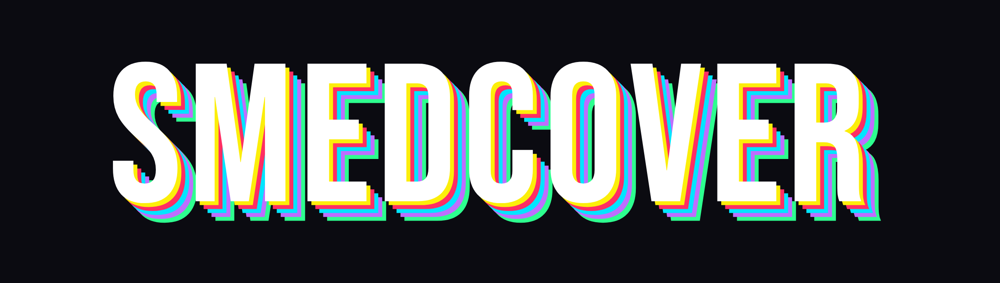
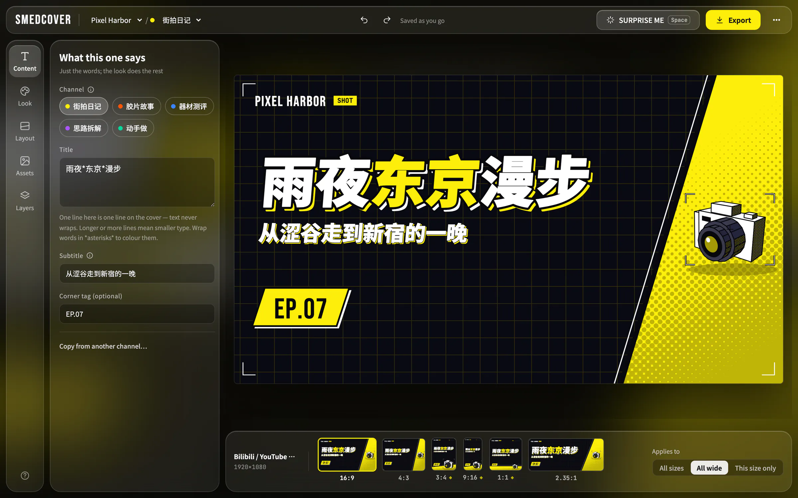

<p align="center">
  
</p>

<p align="center">
  <b>Design the cover once, get every size.</b><br>
  A desktop app for branded video covers · macOS, Windows, Linux · free and open source
</p>

<p align="center">
  <a href="https://github.com/cybertheye/smedcover/releases/latest">Download</a> ·
  <a href="https://www.cybertheye.com/smedcoverapp/">Website</a> ·
  <a href="docs/guide.md">User guide</a> ·
  English · <a href="README.zh-CN.md">中文</a>
</p>



Set up your brand once: its name, channels, colours and graphics. Then, for each video, pick a channel
and type the title, and SmedCover makes the cover at every size Bilibili, YouTube, Douyin, RED,
WeChat Channels and WeChat articles ask for, all at once.

## Features

- **Every size from one design**: 16:9, 4:3, 3:4, 9:16, 1:1, 2.35:1. The layouts keep the words clear of the play counts and durations the platforms lay over a cover.
- **37 looks**, and **Surprise me** (Space) to deal a new look, layout and colours in one go.
- **Photos and cut-outs**: remove the background on this computer (nothing is uploaded), weave the subject in front of or behind the title, crop, or turn a photo in 3D.
- **A canvas to collage on**: layers, text effects, fonts, clipping masks, stickers and your own vector assets.
- **AI, if you want it**: generate or repaint photos with an image model (OpenAI, Gemini, Seedream) and draw vector stickers with a text model. Bring your own key, gateway or local model; SmedCover ships none.
- **Export**: PNG, JPEG or WebP at 1× to 4×, with name patterns; batch export from a CSV, one cover per row.
- **Agents and scripts**: Claude Code, Codex and other agents can work in the window over MCP, and the `smedcover` command line can make covers from a script.

## Quick start

1. [Download](https://github.com/cybertheye/smedcover/releases/latest) the installer for your system. The app updates itself after that.
2. On first launch, type a brand name and pick a starting point.
3. ⋯ → *Brand & channels*: make the channels your own. *Sizes & export*: switch on the sizes you need.
4. In the *Content* sheet, pick a channel and type the title. Every size updates together.
5. Click **Export** (⌘E).

## Agents (MCP)

Settings → *Agents*: turn on *MCP endpoint*, then copy the sentence under *Connect an agent* and send
it to your agent, which adds SmedCover to its own config.

```bash
Add the MCP server smedcover to your user-level config: Streamable HTTP at http://127.0.0.1:25277/mcp, a 1800-second tool timeout; if your environment sets a proxy, keep 127.0.0.1 off it.
```

Then ask it for a cover. Every change is one step of undo in the window. More: [README_MCP.md](README_MCP.md).

## Command line

Settings → *Command line* → *Install* puts `smedcover` on your PATH.

```bash
smedcover render VLOG --size 16:9 -o cover.png
smedcover export --channels all --sizes all --out covers
smedcover batch episodes.csv --sizes 16:9 --out covers
```

More: [README_CLI.md](README_CLI.md).

## Build from source

Needs Rust, Node.js and the [Tauri prerequisites](https://tauri.app/start/prerequisites/).

```bash
npm install          # the Tauri CLI
npm run dev          # development window
npm run build        # installers in target/release/bundle/
npm test             # front-end tests
npm run test:rust    # Rust tests
```

Self-tests, release signing and CI: [Run and build from source](docs/guide.md#run-and-build-from-source).
How it works inside: [ARCHITECTURE.md](ARCHITECTURE.md).

## Licence

The program is under the [GNU AGPL v3 or later](LICENSE); the built-in channel graphics, stickers and
colour block shapes are under [CC BY 4.0](LICENSE-ASSETS.md); the bundled fonts under the SIL Open Font
License. Covers you make with SmedCover need no credit, commercial use included. Details:
[Licences](docs/guide.md#licences).

Copyright © 2026 cybertheye.
