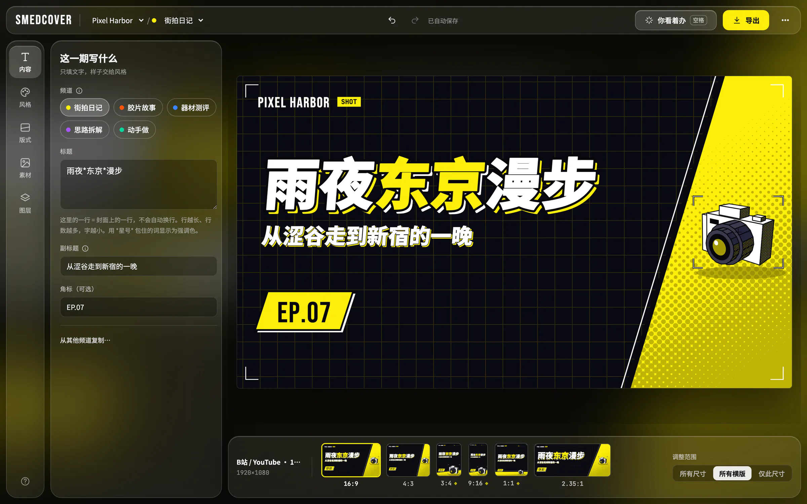

<p align="center">
  
</p>

<p align="center">
  <b>封面做一次，尺寸全出齐。</b><br>
  给自媒体批量做封面的桌面应用 · macOS、Windows、Linux · 免费开源
</p>

<p align="center">
  <a href="https://github.com/cybertheye/smedcover/releases/latest">下载</a> ·
  <a href="https://www.cybertheye.com/smedcoverapp/">项目主页</a> ·
  <a href="docs/guide.zh-CN.md">使用手册</a> ·
  <a href="README.md">English</a> · 中文
</p>



先把品牌设好：名称、频道、颜色、图形。之后每条视频只要选频道、写标题，B站、YouTube、抖音、小红书、视频号、公众号要的尺寸一次出齐。

## 功能

- **一份设计，所有尺寸**：16:9、4:3、3:4、9:16、1:1、2.35:1。版式让文字避开平台叠在封面上的播放量和时长。
- **36 种风格**，再加 **你看着办**（空格键）：一键随机换风格、版式和配色。
- **照片和抠图**：在本机去背景（不上传），让主体和标题前后穿插，裁剪，或者把照片做 3D 旋转。
- **在画布上拼贴**：图层、文字效果、字体、剪切蒙版、贴纸，以及你自己的矢量素材。
- **按需用 AI**：用图片模型（OpenAI、Gemini、Seedream）生成或重绘照片，用文本模型画矢量贴纸。密钥、网关或本地模型自己配，SmedCover 不内置任何模型。
- **导出**：PNG、JPEG、WebP，1× 到 4×，文件名可按规则生成；从 CSV 批量出图，每行一张。
- **Agent 和脚本**：Claude Code、Codex 等 agent 可以通过 MCP 在窗口里做封面；`smedcover` 命令行可以在脚本里出图。

## 快速开始

1. [下载](https://github.com/cybertheye/smedcover/releases/latest)对应系统的安装包。之后应用会自己更新。
2. 第一次启动时，输入品牌名，选一个起点。
3. ⋯ →「品牌与频道」：把频道改成你自己的；「尺寸与导出」：打开需要的尺寸。
4. 在「内容」面板选频道、写标题，所有尺寸一起更新。
5. 点 **导出**（⌘E）。

## Agent 接入（MCP）

设置 →「Agent 接入」：打开「开启 MCP 接口」，然后把「连接 agent」下面那句话复制给你的 agent，它会自己把 SmedCover 写进配置。

```bash
请把 MCP 服务器 smedcover 加到你的用户级配置里：Streamable HTTP，地址 http://127.0.0.1:25277/mcp，工具调用超时 1800 秒；如果你的环境设了代理，让 127.0.0.1 不走代理。
```

然后让它做封面就行。它的每一处改动都是窗口里的一步撤销。详见 [README_MCP.zh-CN.md](README_MCP.zh-CN.md)。

## 命令行

设置 →「命令行工具」→「安装」，把 `smedcover` 放到 PATH 上。

```bash
smedcover render VLOG --size 16:9 -o cover.png
smedcover export --channels all --sizes all --out covers
smedcover batch episodes.csv --sizes 16:9 --out covers
```

详见 [README_CLI.zh-CN.md](README_CLI.zh-CN.md)。

## 从源码构建

需要 Rust、Node.js 和对应平台的 [Tauri 依赖](https://tauri.app/start/prerequisites/)。

```bash
npm install          # Tauri CLI
npm run dev          # 开发窗口
npm run build        # 安装包在 target/release/bundle/
npm test             # 前端测试
npm run test:rust    # Rust 测试
```

自测、发版签名和 CI 见[从源码运行和打包](docs/guide.zh-CN.md#从源码运行和打包)，实现原理见 [ARCHITECTURE.zh-CN.md](ARCHITECTURE.zh-CN.md)。

## 许可

程序以 [GNU AGPL v3 或更高版本](LICENSE) 发布；内置的频道图形、贴纸和色块形状以 [CC BY 4.0](LICENSE-ASSETS.md) 许可；内置字体为 SIL Open Font License。用 SmedCover 做的封面无需署名，商用也可以。详见[许可](docs/guide.zh-CN.md#许可)。

Copyright © 2026 cybertheye.
