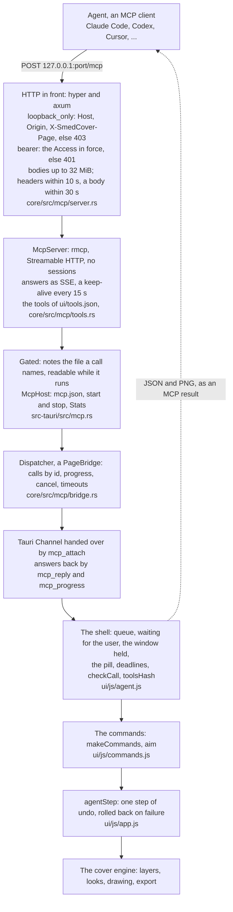

# SmedCover for agents (MCP)

English · [中文](README_MCP.zh-CN.md)

Agents such as Claude Code, Codex, Cursor, Hermes Agent or OpenClaw can make covers in SmedCover's open window over
MCP (the Model Context Protocol). This page covers turning the endpoint on, connecting an agent, the token, how a
session goes, every tool, how it is built, and what to do when something goes wrong. The rest of the app:
[README.md](README.md); how it works inside: [ARCHITECTURE.md](ARCHITECTURE.md).

- [What it is](#what-it-is)
- [Turning it on](#turning-it-on)
- [Connecting an agent](#connecting-an-agent)
- [Require a token](#require-a-token)
- [How a session goes](#how-a-session-goes)
- [Tools](#tools)
- [Architecture](#architecture)
- [Troubleshooting](#troubleshooting)

## What it is

- An agent works in the window you have open: it changes the words and the look, places, adds and removes layers, adds,
  crops and cuts out photos, draws previews, deals hands with Surprise me, exports and makes covers in a batch. You
  watch it work step by step, and each change is one step of undo in the window, so you can take any of it back.
- It reaches the window through an endpoint that listens on this computer only: `http://127.0.0.1:25277/mcp` (MCP's
  Streamable HTTP).
- What an agent reads through it (the cover, previews, photos, what it exports) goes to that agent and to the model it
  uses, as anything else you give it does. A photo it adds by link is downloaded by SmedCover. Nothing else leaves.
- It is in the desktop app now. Planned, not made yet ([TODO.md](TODO.md)): a command line (`smedcover batch`, `render`,
  `export`, `profiles`, `import`) that calls the same tools, and a server with no window (`smedcover serve`) for an agent
  on a server, which always wants a token.

## Turning it on

1. ⋯ → *Agents* (Settings → *Agents*), and turn on *MCP endpoint*.
2. It listens at `http://127.0.0.1:25277/mcp`. To use another port, type it under *Port* (1024–65535) and press
   *Apply* or Enter.
3. Copy the line for your agent from *Connect an agent* (next section).

The page has four cards:

| Card | What is on it |
|---|---|
| *MCP endpoint* | The switch, the state's pill, *Port* with *Apply*, and a line beside it saying what the state means |
| *Require a token* | A second switch, off by default (see [Require a token](#require-a-token)); while it is on, the token with *Show*, *Copy* and *New token* |
| *Connect an agent* | The lines to copy, for the port in force (and with the token while one is required), and a note on proxies |
| *Seen lately* | The agents seen in the last 10 minutes (name, version, number of calls, when; requests that could not be told to be any agent's as one more, *Unidentified agent*), the calls running, the last call (done or failed), and a warning when the window's tools are not those the endpoint lists |

*Seen lately* lists an agent for 10 minutes after its last request or the end of its last call, and for as long as a
call of its runs. An agent of the 2026-07-28 revision says who it is in every request. One of the older revisions
(today's Claude Code, Codex, Cursor and Hermes Agent among them) says so only as it connects, so SmedCover gives it a
session id then (`Mcp-Session-Id`), which it sends back with each request after. SmedCover knows it by that while the
app runs, however long it stays quiet, keeping the ids of the last 256 connections, 8 of any one agent (one that
connects for every call, or to check that the endpoint is there, replaces only its own); the id is used for nothing
else. A request without an id is taken to be the agent that connected with the same `User-Agent` on the same revision,
if only one did; one with an id SmedCover did not give (the app was started again since) only if that agent was seen
lately too, as another may have connected with the same `User-Agent` in between. Else it is taken to be the only agent
of that revision seen lately, unless that one only ever connected with another `User-Agent`; else it is counted under
*Unidentified agent*. So every call that comes in is counted, and *No agent in the last 10 minutes* shows only when
nothing came in that time.

The pill, and the line beside the port:

| State | Pill | The line says |
|---|---|---|
| off | *Off* | The endpoint is off: no agent can reach this window |
| running | *Running* (green) | Running at `http://127.0.0.1:<port>/mcp` |
| switching | *Switching…* (amber) | It is stopping, or moving to the new port |
| error | *Not started* (red) | Why, one of the errors below |

| Error | What happened |
|---|---|
| `port_in_use` | Another program, or another SmedCover, listens on the port. Pick another port, or close that program. |
| `port_forbidden` | The system keeps the port (on Windows, ports reserved for Hyper-V, WSL or Docker). Pick another. |
| `config` | `mcp.json` could not be read (for example, its permissions). The endpoint stays off, and nothing is written over the file; each change on the page reads it again first. |
| `bind_failed` | Anything else, in the system's own words. |

A port that cannot be had leaves the endpoint on but in error. It never moves to another port by itself: pick another
and *Apply*, or free the port and turn the switch off and on again.

Beside *Agents* in Settings' left column is a light: green while the endpoint runs, amber while it switches, red when it
could not start, none while it is off. While it runs, the ⋯ menu's *Agents* line says *On · port 25277*, and the
agents' lamp lights the top bar's edge (a thin dawn-coloured line with a soft glow) and shows *Agent access on* beside
*Surprise me*, after a small turquoise light (the light alone where the bar has no room for the words).

The endpoint starts with the app while it is on and stops when the app quits; the switch is kept, so it is on again at
the next start. On macOS the window keeps drawing while the endpoint runs, even when it is covered or on
another desktop, so an agent's previews and exports do not wait for it to be seen. Windows and Linux have no such
setting (Windows slows a minimised window down): keep the window from being minimised while an agent works.

### `mcp.json`

The endpoint's settings are in `mcp.json` in the data folder (where it is: [README.md](README.md#where-your-data-lives)).
It is there from the first start.

| Field | Meaning | To begin with |
|---|---|---|
| `on` | Whether the endpoint is on | `false` |
| `port` | Its port | `25277` |
| `token` | The token: `smc_` and 43 characters (32 random bytes in base64url) | A new one |
| `requireToken` | Whether an agent must show the token | `false` |

- Only SmedCover writes it, through a temporary file. On macOS and Linux only you can read it (mode 0600).
- The token is made and kept even while none is required, so turning *Require a token* on has one ready.
- A `requireToken` that is not `true` or `false` counts as `true`: a garbled setting fails closed.
- A file that is not JSON is set aside as `mcp.json.bad` and started over (off, a new token).
- It is not part of `custom.json`, of a profile you export, or of a project file.

## Connecting an agent

By default no token is needed, so one line sets an agent up. The lines below use port 25277; if you changed it, the
lines on the *Connect an agent* card have yours.

### Claude Code

```bash
claude mcp add --transport http --scope user smedcover http://127.0.0.1:25277/mcp
```

`--scope user` makes it work in every folder you run Claude Code in.

### Codex

Add to `~/.codex/config.toml`:

```toml
[mcp_servers.smedcover]
url = "http://127.0.0.1:25277/mcp"
tool_timeout_sec = 1800
```

Codex gives a tool 60 seconds by default; `tool_timeout_sec = 1800` gives it half an hour, as long as an export may take.

### Claude Code's `.mcp.json`, Cursor's `mcp.json`

```json
{
  "mcpServers": {
    "smedcover": {
      "type": "http",
      "url": "http://127.0.0.1:25277/mcp"
    }
  }
}
```

### Hermes Agent

Add to `~/.hermes/config.yaml`:

```yaml
mcp_servers:
  smedcover:
    url: "http://127.0.0.1:25277/mcp"
```

Then run `/reload-mcp` in Hermes (no restart needed), and check it from a terminal:

```bash
hermes mcp test smedcover
```

Hermes's tool-call timeout for a server is `timeout`, on the same entry. Its
[docs](https://hermes-agent.nousresearch.com/docs/user-guide/features/mcp) give neither its default nor its unit; if
big batches or exports time out, raise it.

### OpenClaw

```bash
openclaw mcp add smedcover --url http://127.0.0.1:25277/mcp --transport streamable-http
openclaw mcp doctor smedcover --probe
```

OpenClaw waits for a request as long as the server entry's `requestTimeoutMs` says (milliseconds; the
[docs](https://docs.openclaw.ai/tools/mcp)' example is 20000). That is too short for an export, a batch or a cut-out:
raise it, for example to 1800000 (half an hour), by saving the whole entry as JSON:

```bash
openclaw mcp set smedcover '{"url":"http://127.0.0.1:25277/mcp","transport":"streamable-http","requestTimeoutMs":1800000}'
```

### Clients that speak only stdio

Some clients start every MCP server as a local program and cannot use an HTTP address (Claude Desktop's local config,
`claude_desktop_config.json`, for one). Bridge them with `mcp-remote` (it needs Node.js):

```json
{
  "mcpServers": {
    "smedcover": {
      "command": "npx",
      "args": ["-y", "mcp-remote", "http://127.0.0.1:25277/mcp"]
    }
  }
}
```

If it refuses a plain `http://` address, add `"--allow-http"` after the address. A bridge of SmedCover's own,
`smedcover mcp`, is planned.

### Check that it works

In Claude Code, `/mcp` shows `smedcover` connected, with 31 tools. From a terminal, `/health` answers without a token:

```bash
curl http://127.0.0.1:25277/health
# {"name":"smedcover","version":"…","page":"ready"}
```

`page` is `ready` once the window can take calls, `loading` while it starts or reloads. Settings can stay open: an
agent's change waits only for what it waits for anywhere in the window (see [Who waits for whom](#who-waits-for-whom)),
and the page Settings shows is drawn again only when a change touched what it shows. Then ask the agent for something
concrete, for example:

- “Make this week's cover: the title *Rainy Tokyo night walk*, in a night look, and show me a preview.”
- “Put the photo `shot.jpg` from my Desktop on the VLOG channel's cover as the background, cut out the subject so it
  stands in front of the title, and show me the 16:9 and 9:16 sizes.”
- “Deal six hands with Surprise me, keeping the look, and show me the sheet. Then take the one I pick and export every
  size as PNG into a `covers` folder on my Desktop.”

### What works where

- The agent must run on the same computer: the endpoint listens on 127.0.0.1 only.
- An agent on another machine, such as a VPS, cannot reach it. That is what the planned server is for: SmedCover running
  on the same server as the agent.
- An agent client in a Docker Desktop container usually gets 403: it addresses the computer as `host.docker.internal`,
  and the endpoint takes no `Host` but `127.0.0.1`, `localhost` and `[::1]`. That keeps out ordinary clients only: a
  program in the container that sends `Host: 127.0.0.1` itself gets through, which is what *Require a token* is for. On
  Linux, a container on Docker Engine's bridge network cannot reach the endpoint at all; one with `--network host` uses
  it as a program on this computer does.
- An agent on this computer that you talk to through a chat gateway (Hermes with Slack on your phone, for one) works
  today, as long as the computer is awake, SmedCover is open and its endpoint is on.
- It has not been tried with Hermes or OpenClaw yet. The tools' schemas avoid `$ref` and a top-level `anyOf`, but a few
  arguments take one of two forms (`"all"` or a list; a channel's name or its number); whether every model takes them as
  they are (Gemini's stricter JSON Schema, for one) is still to be checked.

## Require a token

The token is a secret an agent shows with every request, as `Authorization: Bearer smc_…`. It is off by default
(Figma's desktop app has its endpoint so too), because:

- The endpoint listens on 127.0.0.1 alone, so other computers, on your Wi-Fi or elsewhere, cannot reach it.
- Web pages cannot use it. It refuses a request whose `Host` or `Origin` is not this computer's (403) and sends no CORS
  headers, so a page's call is refused (403 for a foreign `Origin`, 415 for a loopback one) or never sent.
- SmedCover's own window cannot use it either. Every request the app sends for its page carries `X-SmedCover-Page`,
  which the endpoint refuses, and the app refuses to send the page's requests to this computer at the endpoint's port.

What off lets other programs on this computer do. Any program that can reach 127.0.0.1 can use the endpoint without a
token: yours, and also programs of other accounts on this computer, containers (Docker and the like), virtual machines
and WSL, and sandboxed apps allowed the network. Through it a program can:

- drive the window, with every tool below;
- have SmedCover read any picture or project you can read, by naming its path (`add_photo`, `open_project`);
- write new images into any folder you can write (`export`, `batch_covers`; never over a file);
- have SmedCover fetch links (`add_photo` with a `url`).

Turn it on when:

- The computer is shared: another account is signed in alongside yours (Fast User Switching on a Mac, *Switch user* on
  Windows, another session on Linux); someone signs in remotely with an account of their own (SSH, Remote Desktop,
  Screen Sharing as another user); or services you installed run under accounts of their own (a web server, a
  database), even with nobody signed in.
- It runs containers, virtual machines (or WSL) or apps you do not trust.

Not reasons to turn it on: other people using your own account (they can open SmedCover itself, and read `mcp.json`);
other computers on your Wi-Fi (they cannot reach 127.0.0.1); web pages (kept out either way).

A quick look at the accounts: on macOS, System Settings → Users & Groups; on Windows, Settings → Accounts → Other
users; on Linux, `who` for who is signed in and `getent passwd` for service accounts.

While it is on:

- The token is shown hidden but for its last four characters. *Show* shows it, *Copy* copies it, and *New token* (it asks
  first) makes a new one: the old one stops working at once, and agents set up with it must take the new one.
- It is in force from the next request. The endpoint does not restart, and the calls under way go on.
- *Connect an agent* gives the lines with the token. They are shown with it hidden; *Copy* copies them with the token
  itself.
- Agents set up without the token get 401 and must be set up again. Turned off again, agents set up with it go on
  working (the header is not looked at).

The lines with a token (`smc_…` stands for yours):

```bash
claude mcp add --transport http --scope user smedcover http://127.0.0.1:25277/mcp --header "Authorization: Bearer smc_…"
```

SmedCover's lines have Codex read the token from an environment variable, so it is not kept in `config.toml`:

```toml
[mcp_servers.smedcover]
url = "http://127.0.0.1:25277/mcp"
bearer_token_env_var = "SMEDCOVER_TOKEN"
tool_timeout_sec = 1800
```

```bash
# in ~/.zshrc or ~/.bashrc
export SMEDCOVER_TOKEN="smc_…"
```

On Windows, run once in a Command Prompt:

```bat
setx SMEDCOVER_TOKEN "smc_…"
```

Then start Codex from a new terminal.

The JSON (Claude Code's `.mcp.json`, Cursor's `mcp.json`):

```json
{
  "mcpServers": {
    "smedcover": {
      "type": "http",
      "url": "http://127.0.0.1:25277/mcp",
      "headers": {
        "Authorization": "Bearer smc_…"
      }
    }
  }
}
```

Hermes Agent:

```yaml
mcp_servers:
  smedcover:
    url: "http://127.0.0.1:25277/mcp"
    headers:
      Authorization: "Bearer smc_…"
```

OpenClaw keeps headers on the server entry:

```bash
openclaw mcp set smedcover '{"url":"http://127.0.0.1:25277/mcp","transport":"streamable-http","requestTimeoutMs":1800000,"headers":{"Authorization":"Bearer smc_…"}}'
```

A stdio-only client through `mcp-remote` sends the header with `--header`. Written as below, with no space in `args`
and the token in `env`, it also works where Cursor, Codex CLI and Claude Desktop on Windows mangle spaces in
arguments ([mcp-remote's README](https://github.com/geelen/mcp-remote)):

```json
{
  "mcpServers": {
    "smedcover": {
      "command": "npx",
      "args": ["-y", "mcp-remote", "http://127.0.0.1:25277/mcp", "--header", "Authorization:${SMEDCOVER_AUTH}"],
      "env": {
        "SMEDCOVER_AUTH": "Bearer smc_…"
      }
    }
  }
}
```

A SmedCover server (`smedcover serve`, planned) will always want a token: an endpoint serving a server's tools lets no
one in without one.

## How a session goes

SmedCover tells the agent how it works when it connects (MCP's instructions). A session usually goes:

1. `get_context`: the profiles, channels and sizes, and what the window shows.
2. `get_cover` for the layers and their ids; `list_options` for the looks, text effects, bends and fonts; `list_library`
   for photos and assets.
3. Changes: `set_text`, `set_look`, `place_layer`, `add_photo`, `cut_out`, …
4. `render_preview` to look at the result.
5. `surprise` for ready-made variations, and `pick_hand` to take another.
6. `export`, or `batch_covers` for many covers at once.

### In the window

- A change holds the window while it runs: an overlay covers it, and after 150 ms a pill of glass at the top says what is
  being done (*Changing the words*, *Exporting 3 of 12*…), and the light before *Agent access on* in the top bar
  breathes (it stays still when the system asks for less motion). A press on the window pulses the pill (*One moment —
  almost done*); keys, pastes and the wheel are swallowed, not replayed later.
- After 20 seconds the pill says *Taking longer than usual* and offers *Stop waiting* (or Esc): the window is yours again,
  and the agent is told the step did not finish.
- A change aimed at another profile or channel switches the window there first, as you would, and a toast says where
  (*Now on …*).
- Reads (`get_*`, `list_*`, `render_preview`) never switch the window and do not hold it.

### Who waits for whom

- Calls run one at a time, in the order they came. One waiting behind another tells its agent so every 5 seconds.
- An agent's call waits while you are in the middle of something: a press or a drag, typing, a dialog or a question
  open, Surprise me's window. Typing counts until 1.2 seconds after your last key. A change also waits while the letter,
  crop or weave window or the weave brush is open, while a file or folder is being picked or the colour picker is open,
  while a profile is being made, duplicated, imported or deleted, a logo put in or covers exported from a table, or while
  an export you started runs. A colour field that keeps the focus after its picker is shut holds nothing back.
  It goes ahead once your hands have been off the window for 400 ms. After 30 seconds of waiting (10 for a read) it
  answers `busy`, and the agent tries again shortly.
- Settings open does not hold a change back by itself. The page it shows is drawn again after a change only when the
  change touched what the page shows (a channel renamed, another profile shown), scrolled where it was; the field you
  were in gets its focus and caret back, what you typed in it kept.
- You wait while an agent's step runs: the window takes no input until it is done (keys, pastes and the wheel are
  swallowed, not replayed).

### Undo

- Each call that changes the cover is one step of undo in the window's history; one that changes nothing is none.
- `undo` and `redo` step through that same history, yours and the agent's alike.
- `select_layer` is no step; `export` and `batch_covers` make no step and do not change the covers in the window.
- A call that fails part-way is rolled back: the cover and the history as they were (photos it put in the library
  stay). If it had switched to another channel or profile, the switch stays, and the cover there goes back to how it
  was on arriving.
- A switch to another channel or profile starts that one's own history, as it does when you switch.

### Timeouts, progress and cancelling

Each tool has a time SmedCover waits without a word from the window before it gives the call up. Each word of progress
starts it again; no call takes more than two hours.

| Tools | Waits |
|---|---|
| The reads (`get_context`, `get_cover`, `list_options`, `list_library`, `get_selection`) | 30 s |
| The changes | 1 min |
| `render_preview`, `surprise` | 2 min |
| `cut_out` | 10 min |
| `export`, `batch_covers` | 30 min |

- A call given up is answered as failed, the window given back to you and the next call started. What it had changed
  stays, as one step you can undo, and the agent is told to check with `get_cover` before going on.
- A call that names a `progressToken` is told how it gets on: waiting for you or for another call, each file of an
  export, each hand dealt, a cut-out every 5 seconds.
- When the agent cancels a call, or hangs up: a call still waiting never runs; one running is told at once (an export
  stops between two files) and let go of a second later. Hanging up always cancels. A client of the older revisions
  cancels with `notifications/cancelled` in a request of its own, which, without sessions, is acted on only when it can
  be tied to exactly one call; otherwise it is ignored and the call runs to its end. One carrying the session id is
  looked for among the calls of that connection only.
- While the window is starting or reloading, a call waits up to 30 seconds for it.

### What comes back

- A result has a text block (by default the structured answer as JSON) and `structuredContent`, which the tool's
  `outputSchema` describes.
- `render_preview` and `surprise` return PNG images as image content.
- A failure reaches the agent as a tool error (`isError`) with one sentence for the model. Behind it is one of the
  page's kinds (`invalid_arguments`, `not_allowed`, `busy`, `unavailable`, `failed`) or the endpoint's own: the window
  not ready, gone, quiet past the tool's timeout, or 16 calls already in hand. An unknown tool is a protocol error.

### Protocol

- Streamable HTTP: `POST /mcp` only (`GET` and `DELETE` answer 405), without sessions: the answer to `initialize`
  carries an `Mcp-Session-Id`, but only to tell whose the requests after it are (see *Seen lately*), and a request with
  an id SmedCover did not give is served like any other, never refused. A client holding an id may send `GET /mcp` (to
  listen for the server's own messages) and `DELETE /mcp` (to end its session) with it: both answer 405, which the
  TypeScript, Python and rmcp SDKs take as not offered, and go on. Answers come as server-sent events, a
  keep-alive every 15 seconds once the headers are out, so a long call is not cut off by a client's wait for headers.
  In the 2026-07-28 revision the headers go out early only when the call names a `progressToken`; otherwise they come
  with the result.
- Revisions: 2026-07-28 (`server/discover`, every request on its own), and 2025-03-26, 2025-06-18 and 2025-11-25 through
  `initialize` (a request with no `MCP-Protocol-Version` is taken as 2025-03-26). Not served: 2024-11-05's HTTP with SSE,
  and JSON-RPC batches.
- A request may be up to 32 MiB; a result carries 16 images and 48 MB at most; 16 calls at most are in hand at once.

## Tools

All 31, grouped by what they do. `ui/tools.json` is the definition: it is written from `ui/js/tools.js` by
`npm run tools` (before every build too), and `npm test` fails when the two disagree. Agents read each tool's full
description, its argument schema and its answer's schema from `tools/list`; below is what each is for.

Arguments most tools take:

- `profile`: by id or name; the one shown when left out.
- `channel`: by id, name, code or number from 1; the one shown when left out.
- `layer`: the layer's id, as `get_cover` lists it (the layout's own parts by their type: `title`, `subtitle`, `tag`,
  `brand`, …).
- `size`: its pixels (`"1920x1080"`), its ratio (`"16:9"`) or its name; the one on the canvas when left out.
- `scope`: which sizes a change of place reaches: `all` (the default), `orient` (those facing the same way as `size`)
  or `size` (that one alone).

Arguments in bold are required. A tool that changes something is one step of undo, but for those
[Undo](#undo) names.

### Look (read-only)

| Tool | What it does | Arguments | Marks |
|---|---|---|---|
| `get_context` | What SmedCover has and shows: every profile with its look, channels, sizes and export folder; what the window shows; the export settings; whether undo and redo can go further; what this host can do. Call it first. | none | read-only |
| `get_cover` | A channel's cover: its title, subtitle and tag, the look and theme, and its layers bottom first, each with its id, place and settings. | `profile`, `channel`, `letters` (adds each lettering layer's letter keys, for `weave`), `raw` (adds the cover as stored, for `apply_cover_json`) | read-only |
| `list_options` | The values other tools take: looks, text effects, bends, fonts, platforms and their ratios, size presets, Surprise me's locks. With `look`, that look in full: its settings (`set_look`'s `params`) and its scene objects. | `only` (some groups), `look`, `fontQuery` (installed fonts whose name has it) | read-only |
| `list_library` | Photos in the bitmap library (their pids, for `add_photo`), stickers, graphics and your own assets (their ids, for `add_layer`). | `kind` (`photos`, `stickers`, `graphics`, `mine`), `query`, `limit` (default 100, at most 500) | read-only |
| `render_preview` | Draws a cover as it will be exported and returns a PNG, with where each layer landed; with `all`, every size on one captioned sheet. | `profile`, `channel`, `size`, `all`, `maxSide` (128–2048, default 1024) | read-only |

### Text and look

| Tool | What it does | Arguments | Marks |
|---|---|---|---|
| `set_text` | Sets the title, subtitle and/or tag (at least one). `*Asterisks*` highlight words and `\n` breaks a line, as in the editor; `""` empties one. | `profile`, `channel`, `title`, `subtitle`, `tag` | |
| `set_look` | Sets the profile's look, which all its channels share, and/or its settings. A setting out of range is clamped and said in `warnings`. | `profile`, `look` (one of 35), `params` (the look's settings by key), `theme` (`dark`, `light`), `seed` (0–999999), `resetParams` | |
| `set_channel` | Changes a channel: its name, the line under it, its code, its colour. | `profile`, **`channel`**, `name`, `sub`, `code`, `color` (`#rrggbb`) | |
| `set_layer_effect` | A headline's text effect (the title, the subtitle or a text layer). Effects that need glyph outlines are refused where the host has none. | `profile`, `channel`, **`layer`**, `effect` (one of 19; `auto`: the look's), `amount` (0–2), `reshuffle`, `outline` (0–2), `shadow` (0–2) | |
| `set_layer_font` | A lettering layer's font (installed, bundled or imported; `""` for the look's own), and/or set in columns. | `profile`, `channel`, **`layer`**, `font`, `vertical` | |
| `set_layer_bend` | Bends a headline. | `profile`, `channel`, **`layer`**, **`bend`** (`none`, `arc`, `arcLow`, `circle`, `shell`, `bulge`, `pinch`, `fisheye`, `rise`, `taper`, `wave`, `flag`), `amount` (0–2, default 1) | |
| `set_layer_color` | A layer's colours. `ink` (a lettering layer's words; a photo's outline; a vector asset's colour), `hi` (the highlighted words), `plateInk` (the plate under the words) and `hiPlateInk` (the plates or marks under the highlights): each `#rrggbb` or `auto` (the look's). `plate`: true or false, a plate under a headline's or the channel name's words. `tint`: true or false, a vector asset following the channel colour. `color`: a solid layer's `#rrggbb`. | `profile`, `channel`, **`layer`**, `ink`, `hi`, `plate`, `plateInk`, `hiPlateInk`, `tint`, `color` | |

### Layers

| Tool | What it does | Arguments | Marks |
|---|---|---|---|
| `place_layer` | Moves, scales, turns or stretches a layer as it is at `size`: absolute (`x`, `y`, `scale`, `rotate`, `stretchX`, `stretchY`), relative (`move` `{dx, dy}`, `scaleBy`, `rotateBy`), or `reset` to where it was put on. Not for the background, the frame or a locked layer. | `profile`, `channel`, **`layer`**, `size`, `scope`, `x`, `y`, `scale`, `rotate`, `stretchX`, `stretchY`, `move`, `scaleBy`, `rotateBy`, `reset` | |
| `show_layer` | Shows or hides a layer, sets its opacity, locks it, leaves a layout part out of the cover or brings it back, or keeps it to some sizes. | `profile`, `channel`, **`layer`**, `visible`, `opacity` (0–1), `locked`, `included`, `sizes` (a list, or `"all"`) | |
| `add_layer` | Adds a text layer, a solid colour, an asset (a sticker, a graphic or your own) or a copy of a layer, above `above` (by default the top). The new layer is selected. | `profile`, `channel`, **`kind`** (`text`, `solid`, `asset`, `copy`), `text`, `color`, `asset` (`{kind, id}` from `list_library`), `of` (the layer to copy), `above` (a layer id, or `"top"`), `at` (`{x, y}`, shares of the canvas), `scale` | |
| `remove_layer` | Removes a layer that was added (a photo takes its linked cut-out with it). The layout's own parts cannot be removed: hide them with `show_layer`. | `profile`, `channel`, **`layer`** | destructive |
| `reorder_layer` | Moves a layer in the stack: to the top or bottom, up or down one, or just above another layer (exactly one of `to`, `above`). | `profile`, `channel`, **`layer`**, `to` (`top`, `bottom`, `up`, `down`), `above` | |
| `apply_cover_json` | A last resort: replaces the cover with a whole cover as SmedCover stores it (`get_cover` with `raw: true` gives one to start from), checked as a file read from disk is. Says what was corrected, dropped and put back, and the photos and assets it names that are not here. | `profile`, `channel`, **`cover`** | destructive |

### Photos

| Tool | What it does | Arguments | Marks |
|---|---|---|---|
| `add_photo` | Puts a photo on the cover. `source` is exactly one of `path` (an image file, absolute), `url` (http or https, fetched through the proxy set for image AI), `library` (a pid) or `data` (base64 or a `data:` URL, at most 24 Mi characters; prefer a path or a link). PNG, JPEG, WebP, GIF, HEIC or AVIF, 64 MB at most. `fill` makes it the background; otherwise it is a print at `at`. A new picture joins the library. | `profile`, `channel`, **`source`**, `at`, `fill`, `name` (its name in the library), `above` | fetches links |
| `crop_photo` | Crops a photo or asset layer: exactly one of `crop` (`{x, y, w, h}`, or a free shape `{pts}`), `ratio` or `reset`. Not for a photo filling the canvas. | `profile`, `channel`, **`layer`**, `crop`, `ratio` (`photo`, `1:1`, `4:3`, `3:4`, `16:9`, `9:16`), `reset` | |
| `cut_out` | Cuts the subject out of a photo (on macOS with Vision, elsewhere with the downloaded model) into a layer linked to the photo, above the title. Answers `unavailable` while the model is not downloaded (Settings → AI → *Cut-out*). | `profile`, `channel`, **`layer`**, `size`, `scope` | |
| `weave` | Weaves a cut-out or an asset with the lettering below it: by its head (`line`), by letter (`front`), or by brush (`strokes`); `off` unweaves it. | `profile`, `channel`, **`layer`**, `off`, `by` (`head`, `letters`, `brush`), `with` (the lettering layers), `line` (0.1–0.9), `front`, `strokes` | |

### Surprise

| Tool | What it does | Arguments | Marks |
|---|---|---|---|
| `surprise` | Surprise me: deals variations of the cover (look, lettering, layout) at the size on the canvas and puts the first on it. Returns each hand and, by default, one sheet of them numbered from 1. | `profile`, `channel`, `count` (1–6, default 6), `locks` (`look`, `theme`, `lettering`, `places`, `layout`: kept as they are, this time only), `images` (`sheet`, `each`, `none`) | |
| `pick_hand` | Puts another hand of the last deal on the canvas, on the same step of undo. Refused once the cover has changed since the deal. | **`hand`** (1–6) | |

### Files and batches

| Tool | What it does | Arguments | Marks |
|---|---|---|---|
| `open_project` | Opens a project (`.smedcover.json`: a profile with its covers, photos, assets and fonts): exactly one of `file` (absolute, 128 MB at most; preferred) or `project` (the object or its JSON text, at most 24 Mi characters). Its profile takes it when it is here; otherwise `as` says where. The window switches to it. | `file`, `project`, `as` (`new`, the default, or `current`) | destructive |
| `export` | Writes covers to image files, each named by the export name pattern, never over a file (a name taken gets a number). A `dir` given is not kept for the profile. | `profile`, `channels` (default the one shown; `"all"`), `sizes` (default those ticked in the Export window; `"all"`), `dir` (absolute; default the profile's export folder), `format` (`png`, `jpeg`, `webp`), `scale` (1–4) | writes files |
| `batch_covers` | Makes and exports a cover for each job, as importing a CSV does: each starts from its channel's cover with the words replaced. Exactly one of `jobs` or `csv`. Nothing is written when a job names a channel the profile does not have. | `profile`, `jobs` (`[{channel, title, tag?, subtitle?}]`, at most 500), `csv` (channel, title, tag, subtitle), `sizes` (default every size), `dir`, `format`, `scale` | writes files |

### Desktop only

| Tool | What it does | Arguments | Marks |
|---|---|---|---|
| `get_selection` | What the window shows and has selected: the profile, the channel, the size on the canvas, the scope, the selected layers. | none | read-only, desktop only |
| `select_layer` | Selects a layer (`"bg"`: nothing) or several, and/or shows another size on the canvas, as you would, to show you what it means. No step of undo. | `layer`, `layers`, `size` (at least one; not both `layer` and `layers`) | desktop only |
| `undo` | Undoes the last steps of the window's history, yours and the agent's alike. | `steps` (1–20, default 1) | desktop only |
| `redo` | Redoes steps undone. | `steps` (1–20, default 1) | desktop only |

### Not covered yet

- Making or deleting profiles (`open_project` can bring one in from a project file).
- Adding or removing channels, and changing the profile's list of sizes.
- Importing fonts (planned with the server).
- AI image generation, photo repaint and AI stickers (they cost money; planned for a second version).
- The cover check (`check_cover`, not in the first version).
- Settings: the AI services, and the agents' endpoint itself.
- Reading or writing files directly: by design, an agent works on covers, never on files.

## Architecture



1. The agent posts a JSON-RPC request to `/mcp`. In front of everything, `loopback_only` refuses a `Host` or `Origin`
   that is not `127.0.0.1`, `localhost` or `[::1]` and any request carrying `X-SmedCover-Page`; `bearer` lets the request
   through as the `Access` in force says (open, or the token), and takes the `Authorization` header off.
2. rmcp serves MCP without sessions and lists the tools from the bundled `ui/tools.json`. A tool call goes through
   `Gated`, which notes the file the call names (`add_photo`'s `source.path`, `open_project`'s `file`) for as long as the
   call is in hand: the app's `read_picture` and `read_project` read that file and no other.
3. The `Dispatcher` sends `{kind: "call", id, tool, args, client, timeoutMs}` down the Tauri `Channel` the window handed
   over (`mcp_attach`, with the hash of the tools it was built with), passes progress on, sends `{kind: "cancel", id}`
   when the agent gives up, and gives the call up when the window is quiet for longer than the tool's timeout.
4. In the window, `agent.js` checks the arguments (`checkCall`), queues the call, waits until you are not in the middle of
   something, holds the window and shows the pill. `commands.js` aims the change (`aim`: the profile, channel, size and
   layer found and checked before anything is touched, then the window switched there) and does what the editor does
   for the same change, inside `agentStep`, one step of undo.
5. The answer, `{id, ok, result}` or `{id, ok: false, error}`, goes back by `mcp_reply`: JSON as `structuredContent` and
   text, and PNG images, which the dispatcher checks before rmcp sends them as the call's result.

| File | What it does |
|---|---|
| `core/src/mcp/server.rs` | The HTTP server on 127.0.0.1: `/mcp` and `/health`, the checks in front, `Access`, the limits, the protocol revisions, the clients seen and how they are recognised (`Stats`, the session ids given) |
| `core/src/mcp/bridge.rs` | `PageBridge` and `Dispatcher`: calls handed to the page and their answers back, progress, cancelling, timeouts, results checked |
| `core/src/mcp/tools.rs` | `ToolList`: `ui/tools.json` read for one host (`desktop`, `server`), and its SHA-256 |
| `core/src/mcp/config.rs` | `mcp.json` |
| `core/src/mcp/token.rs` | The token, a `Secret` that never prints itself and is compared in constant time |
| `core/src/mcp/mod.rs` | The module's overview |
| `core/src/net.rs` | The page's own requests, each carrying `X-SmedCover-Page: 1` |
| `core/src/files.rs` | Reading the files an agent names: only pictures and projects, absolute paths, within their limits |
| `src-tauri/src/mcp.rs` | The app's side: `McpHost` (settings, starting, stopping, moving), `Gated` and `NamedFiles`, the `mcp_*` commands, keeping the window drawing, the self-test's endpoint |
| `ui/js/tools.js` | Every tool as data (`TOOLS`), the argument check (`checkCall`), answers (`toResult`), `toolsJson()` |
| `ui/tools.json` | Written by `npm run tools` (`scripts/tools.mjs`) from `tools.js`; the list the endpoint serves |
| `ui/js/commands.js` | What each tool does (`makeCommands`, `aim`) |
| `ui/js/agent.js` | The shell: queue, waiting, holding the window, the pill, the Tauri transport, the setup lines, `toolsHash()` |
| `ui/js/app.js` | `agentStep()`, `userBusy()`, `API`, and Settings → Agents (`agentsTab()`) |
| `ui/js/i18n.js` | The page's strings (`mcp.*`) and the pill's (`agent.*`) |

For the detail: [ARCHITECTURE.md](ARCHITECTURE.md) §9.5 (the Settings page), §10.4 (the page's marker), §10.5 (the
files an agent names), §10.6 (the endpoint), §11.1 (the tools, the commands and the shell) and §13 (tests).

### Tests and the self-test

- `npm test`: the tools' definitions and `ui/tools.json` up to date, the argument check, the commands over a stand-in
  `API`, the queue and the dispatcher (`tests/agent.test.mjs`), the desktop's transport and the setup lines
  (`tests/mcp.test.mjs`).
- `cargo test --workspace` (`npm run test:rust`): the tool list, the token, `mcp.json`, the dispatcher, the app's side;
  and `core/tests/mcp_http.rs`, the endpoint over real HTTP on a free port: both protocol eras, rmcp's own client, the
  token, `Host`, `Origin` and the page's marker, progress, cancelling, bodies, stopping.
- `cargo run -p smedcover-core --example mcp_echo -- [port] [seconds]`, to try a client against: it serves the four
  tools of the test fixture (`core/tests/fixtures/tools.json`), not the app's 31, with a page that says back what it is
  asked, on a free port unless told. It always wants a token: it prints its address and the path of a file only you
  can read that holds the header, for `curl -H @<file>`, and stops after 300 seconds unless told otherwise.
- The self-test, `SMEDCOVER_SELFTEST=<folder>`, with `SMEDCOVER_SELFTEST_AGENT=1` calls the tools through the window's
  dispatcher, and with `SMEDCOVER_SELFTEST_MCP=1` too the app's own endpoint over HTTP, on a free port, with and without a
  token. `SMEDCOVER_SELFTEST_STAY=1` runs no self-test: the app keeps its data in that folder and otherwise runs as
  usual, a way to try the endpoint by hand (with `curl`) without touching your data.

### Server mode (planned)

`smedcover serve` will run the same core with a headless Chromium opening the same `ui/` (the `"server"` host), serving
`/mcp` for agents and `/invoke` for the page's commands, on 127.0.0.1 and always with a token, for an agent on the same
server (talked to from a phone through Slack, say). The desktop-only tools are not offered on a server. See [TODO.md](TODO.md).

## Troubleshooting

| What you see | Why, and what to do |
|---|---|
| 401 `Unauthorized: SmedCover wants the token …` | *Require a token* is on and the agent sent no token, or another one. Set the agent up again with the lines from *Connect an agent* (after *New token*, with the new one). For Codex, check `SMEDCOVER_TOKEN` is set in the terminal Codex starts from. |
| 403 `Forbidden: Host header is not allowed` | The request's `Host` was not `127.0.0.1`, `localhost` or `[::1]`: an agent in a Docker container (`host.docker.internal`), or an address on the network. Run the agent on this computer and use `http://127.0.0.1:<port>/mcp`. |
| 403 `Forbidden: Origin header is not allowed` | A browser page (or a web view) made the request. That is refused by design. |
| 413 `Payload Too Large` | The request was over 32 MiB, usually a photo or a project sent whole. Give `add_photo` a `path` or `url`, and `open_project` a `file`. |
| The page says *Another program uses port …* | Pick another port and *Apply*, then set the agent up again with the new lines; or close the program that has the port. |
| The page says *Its settings could not be read* | `mcp.json` cannot be read (check its owner and permissions in the data folder). Nothing is written over it until it can be; then turn the switch on again. |
| Nothing listens after a restart | The switch is kept in `mcp.json`, so check the page: off means it was turned off (or `mcp.json` was not JSON and was started over, which also made a new token); an error says why. |
| The agent times out on a long call | Raise its timeout: Codex `tool_timeout_sec = 1800`, OpenClaw `requestTimeoutMs`, Hermes `timeout`. When a client gives up, SmedCover cancels the call: what it changed so far stays as one step; have the agent check with `get_cover`. |
| `SmedCover is busy: …` | You were in the middle of something (a dialog, typing, a drag, a file being picked or the colour picker open, a profile being made or imported, the letter, crop or weave window: the message says which) for as long as the call waits: 30 seconds for a change, 10 for a read. Finish it and let the agent try again. |
| `SmedCover's window is not ready …` | The window is starting, reloading or showing the first-start welcome. Finish the welcome, wait a moment, and try again. |
| `… the change may or may not have been applied` | The window reloaded or closed, or went quiet past the tool's timeout, while a call ran. Look at the window (or have the agent call `get_cover`) before going on. |
| *An agent is working…* stays | After 20 seconds the pill offers *Stop waiting* (or press Esc): the window is yours again and the agent is told the step did not finish. A call is also given up by itself when nothing is heard from it for its timeout. What it changed stays as one step: undo it if you do not want it. |
| *This window's tools are not those the endpoint lists* | The window and the endpoint were built with different tool lists (after a reload in development, say). Restart SmedCover. After SmedCover is updated, restart the agent too (or reconnect it from its MCP menu) so it reads the new list. |
| `cut_out` answers `unavailable` | No cut-out engine is ready: off macOS, download the model in Settings → AI → *Cut-out*. |
| Previews or exports stall on Windows | The window is minimised: Windows slows it down. Keep it open on screen while the agent works. |
| The agent cannot connect at all, with a proxy set | A proxy in the agent's environment (`HTTP_PROXY` and the like) must leave this computer out: `NO_PROXY=127.0.0.1,localhost`. |
