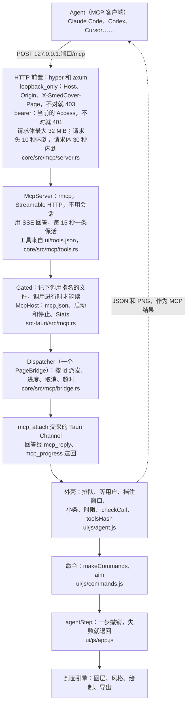

# SmedCover 的 Agent 接入（MCP）

[English](README_MCP.md) · 中文

Claude Code、Codex、Cursor、Hermes Agent、OpenClaw 这类 agent，可以通过 MCP（Model Context Protocol）在你开着的 SmedCover 窗口里做封面。这一页讲怎么打开接口、怎么连接 agent、令牌、一次会话怎么进行、全部工具、实现结构，以及出问题时怎么办。应用的其他部分见 [README.zh-CN.md](README.zh-CN.md)，实现原理见 [ARCHITECTURE.zh-CN.md](ARCHITECTURE.zh-CN.md)。

- [这是什么](#这是什么)
- [打开接口](#打开接口)
- [连接 agent](#连接-agent)
- [要求令牌](#要求令牌)
- [一次会话怎么进行](#一次会话怎么进行)
- [工具](#工具)
- [架构](#架构)
- [排查问题](#排查问题)

## 这是什么

- agent 在你开着的窗口里干活：改文字、换风格，摆放、增删图层，加照片、裁切、抠图，出预览，用「你看着办」抽几手，导出，批量出图。你看着它一步步做。每一处改动都是窗口里的一步撤销，哪一步都能撤回。
- 它通过一个只在这台电脑上监听的接口连进窗口：`http://127.0.0.1:25277/mcp`（MCP 的 Streamable HTTP）。
- agent 经它读到的东西（封面、预览、照片、导出的结果）会交给这个 agent 和它用的模型，和你交给它的其他东西一样。它按链接加的照片由 SmedCover 下载。除此之外什么都不会发出去。
- 现在桌面应用有，命令行 `smedcover`（`batch`、`render`、`export`、`profiles`、`import`、`call`，见 [命令行](README.zh-CN.md#命令行)）底下调的也是同一套工具。计划中、还没做的（见 [TODO.md](TODO.md)）：没有窗口的服务器（`smedcover serve`），给服务器上的 agent 用，一定要令牌。

## 打开接口

1. ⋯ →「Agent 接入」（即「设置 → Agent 接入」），打开「开启 MCP 接口」。
2. 它在 `http://127.0.0.1:25277/mcp` 上等着。要换端口，就在「端口」里填一个（1024–65535），点「应用」或按回车。
3. 在「连接 agent」里复制你那个 agent 的那一段（见下一节）。

这一页有四张卡片：

| 卡片 | 上面有什么 |
|---|---|
| 「开启 MCP 接口」 | 开关、状态小条、「端口」和「应用」，旁边一行字说明当前状态 |
| 「要求令牌」 | 第二个开关，默认关（见[要求令牌](#要求令牌)）；打开时显示令牌，带「显示」「复制」「换新令牌」 |
| 「连接 agent」 | 可以复制的几段配置，用的是当前端口（要求令牌时带上令牌），还有一条关于代理的提示 |
| 「最近」 | 10 分钟内来过的 agent（名字、版本、调用次数、多久以前；认不出是哪个 agent 的请求另算一个，「未识别的 agent」），正在进行的调用，上一次调用（完成还是失败）；窗口的工具和接口列出的不一致时有一条警告 |

一个 agent 最后一次发请求、或者它最后一个调用结束之后的 10 分钟里，以及它有调用正在进行的整段时间里，都列在「最近」里。2026-07-28 版本的 agent 每个请求都说自己是谁；旧版本的（如今的 Claude Code、Codex、Cursor、Hermes Agent 都是）只在连上时说一次，所以 SmedCover 那时给它一个会话 ID（`Mcp-Session-Id`），它之后每个请求都带回来。SmedCover 凭它认出这个 agent，应用开着期间一直认得，不管它多久没动静；最多记最近 256 个连接的 ID，同一个 agent 最多 8 个（每次调用都重新连、或者连上来看看接口在不在的 agent，只会挤掉它自己的）；这个 ID 不作别的用。没带 ID 的请求，算作在同一个协议版本上、用同一个 `User-Agent` 连上的那个 agent（只有一个这样的时）；带的 ID 不是 SmedCover 给的（应用后来重启过），还要那个 agent 最近也来过才这样算，因为中间可能有别的 agent 用同一个 `User-Agent` 连上过。不然算作这个版本上最近来过的唯一一个 agent，除非它一直是用别的 `User-Agent` 连上的；再不然就记在「未识别的 agent」名下。所以进来的调用都会被算上，只有这段时间里什么都没进来时，才显示「10 分钟内没有 agent 来过」。

状态小条，和端口旁边那行字：

| 状态 | 小条 | 那行字 |
|---|---|---|
| off | 「未开启」 | 接口关着，agent 连不上这个窗口 |
| running | 「运行中」（绿） | 运行在 `http://127.0.0.1:<端口>/mcp` |
| switching | 「正在切换…」（黄） | 正在停下，或者换到新端口 |
| error | 「没能启动」（红） | 原因，是下面几种之一 |

| 错误 | 出了什么事 |
|---|---|
| `port_in_use` | 端口被别的程序（或另一个 SmedCover）占着。换一个端口，或者关掉那个程序。 |
| `port_forbidden` | 端口被系统保留了（Windows 上是给 Hyper-V、WSL、Docker 留的）。换一个。 |
| `config` | `mcp.json` 读不了（比如权限不对）。接口一直关着，也不会往这个文件上写任何东西；在页面上每改一次设置，都会先重读一遍。 |
| `bind_failed` | 别的原因，照系统的原话显示。 |

端口拿不到时，接口仍算开着，只是处于出错状态。它不会自己换端口：换一个端口再点「应用」，或者让出端口后把开关关掉再打开。

「设置」左边一列的「Agent 接入」旁边有一盏灯：运行时绿，切换时黄，没能启动时红，关着时不亮。运行时，⋯ 菜单里的「Agent 接入」写着「已开启 · 端口 25277」，agent 的灯点亮顶栏的边框（一圈细细的晨曦色光），「你看着办」左边写着「Agent 已接入」，前面一盏青绿色的小灯（顶栏放不下这几个字时只有灯）。

开着时接口随应用启动，应用退出时停下；开关会记住，下次启动照样开着。在 macOS 上，接口开着时窗口被挡住或在别的桌面上也照样绘制，agent 要的预览和导出不用等窗口露出来。Windows 和 Linux 没有这样的设置（Windows 会让最小化的窗口慢下来）：agent 工作时别把窗口最小化。

### `mcp.json`

接口的设置存在数据目录的 `mcp.json` 里（数据目录在哪里见 [README.zh-CN.md](README.zh-CN.md#数据存在哪里)）。第一次启动就有。

| 字段 | 含义 | 一开始 |
|---|---|---|
| `on` | 接口开没开 | `false` |
| `port` | 端口 | `25277` |
| `token` | 令牌：`smc_` 加 43 个字符（32 个随机字节的 base64url） | 新生成一个 |
| `requireToken` | agent 要不要出示令牌 | `false` |

- 只有 SmedCover 写它，先写临时文件再换上。在 macOS 和 Linux 上只有你自己能读（权限 0600）。
- 不要求令牌时也照样生成并留着令牌，所以一打开「要求令牌」就有现成的。
- `requireToken` 不是 `true` 也不是 `false` 时，按 `true` 算：设置乱了就往严里算。
- 不是 JSON 的文件会改名为 `mcp.json.bad` 放到一边，从头来（关着，新令牌）。
- 它不在 `custom.json` 里，导出档案和工程文件里也没有它。

## 连接 agent

默认不用令牌，一段配置就能连上。下面用的是 25277 端口；如果你改过端口，「连接 agent」卡片上的那几段用的就是你的端口。

### Claude Code

```bash
claude mcp add --transport http --scope user smedcover http://127.0.0.1:25277/mcp
```

`--scope user`：在哪个目录里运行 Claude Code 都能用。

### Codex

加进 `~/.codex/config.toml`：

```toml
[mcp_servers.smedcover]
url = "http://127.0.0.1:25277/mcp"
tool_timeout_sec = 1800
```

Codex 默认只给一个工具 60 秒；`tool_timeout_sec = 1800` 给它半小时，一次导出可能要这么久。

### Claude Code 的 `.mcp.json`、Cursor 的 `mcp.json`

```json
{
  "mcpServers": {
    "smedcover": {
      "type": "http",
      "url": "http://127.0.0.1:25277/mcp"
    }
  }
}
```

### Hermes Agent

加进 `~/.hermes/config.yaml`：

```yaml
mcp_servers:
  smedcover:
    url: "http://127.0.0.1:25277/mcp"
```

然后在 Hermes 里运行 `/reload-mcp`（不用重启），再在终端里检查一下：

```bash
hermes mcp test smedcover
```

Hermes 里，这个服务器的工具调用超时由同一项下的 `timeout` 设定。它的[文档](https://hermes-agent.nousresearch.com/docs/user-guide/features/mcp)没写默认值，也没写单位；批量出图或导出超时的话，就把它调大。

### OpenClaw

```bash
openclaw mcp add smedcover --url http://127.0.0.1:25277/mcp --transport streamable-http
openclaw mcp doctor smedcover --probe
```

OpenClaw 等一个请求的时间由这一项的 `requestTimeoutMs` 决定（毫秒；[文档](https://docs.openclaw.ai/tools/mcp)里的例子是 20000）。这对导出、批量出图和抠图太短了，要调大，比如 1800000（半小时）。做法是把整项用 JSON 存一遍：

```bash
openclaw mcp set smedcover '{"url":"http://127.0.0.1:25277/mcp","transport":"streamable-http","requestTimeoutMs":1800000}'
```

### 只支持 stdio 的客户端

有的客户端只会把 MCP 服务器当成本地程序启动，用不了 HTTP 地址（比如 Claude Desktop 的本地配置 `claude_desktop_config.json`）。这时用 `mcp-remote` 转一下（要装 Node.js）：

```json
{
  "mcpServers": {
    "smedcover": {
      "command": "npx",
      "args": ["-y", "mcp-remote", "http://127.0.0.1:25277/mcp"]
    }
  }
}
```

如果它不接受 `http://` 开头的地址，在地址后面加一项 `"--allow-http"`。SmedCover 自己的转接程序 `smedcover mcp` 还在计划中。

### 确认连上了

在 Claude Code 里运行 `/mcp`，能看到 `smedcover` 已连接，有 31 个工具。也可以在终端里查 `/health`，它不要令牌：

```bash
curl http://127.0.0.1:25277/health
# {"name":"smedcover","version":"…","page":"ready"}
```

窗口能接调用时 `page` 是 `ready`，正在启动或重新加载时是 `loading`。「设置」可以开着：agent 的改动只等它在窗口别处也要等的那些事（见[谁等谁](#谁等谁)），「设置」显示的那一页只在改动碰到它显示的内容时才重画。然后让 agent 做件具体的事，比如：

- 「做这周的封面：标题《雨夜东京漫步》，用夜景风格，给我看个预览。」
- 「把桌面上的 `shot.jpg` 放到 VLOG 频道的封面上当背景，抠出主体让它站在标题前面，给我看 16:9 和 9:16 两个尺寸。」
- 「用『你看着办』抽六手，风格别动，给我看拼图。我挑一手，然后把所有尺寸导出成 PNG，放到桌面的 `covers` 文件夹。」

### 哪些情况能用

- agent 必须在同一台电脑上运行：接口只听 127.0.0.1。
- 别的机器上的 agent（比如 VPS 上的）连不上。计划中的服务器就是为这种情况做的：让 SmedCover 和 agent 跑在同一台服务器上。
- Docker Desktop 容器里的 agent 客户端一般会收到 403：它用 `host.docker.internal` 这个名字称呼这台电脑，而接口只认 `127.0.0.1`、`localhost` 和 `[::1]` 这几个 `Host`。这只挡得住普通的客户端：容器里的程序自己发 `Host: 127.0.0.1` 就能进来，「要求令牌」就是为这种情况准备的。在 Linux 上，Docker Engine 桥接网络里的容器根本连不到接口；用 `--network host` 的容器，和这台电脑上的程序一样能用。
- 在这台电脑上运行、你通过聊天网关和它对话的 agent（比如 Hermes 加手机上的 Slack），现在就能用，只要电脑醒着、SmedCover 开着、接口开着。
- 还没有实际用 Hermes 和 OpenClaw 试过。工具的参数结构没有用 `$ref`，顶层也没有 `anyOf`，但有几个参数可以有两种写法（`"all"` 或一个列表；频道写名字或序号）；每种模型是不是都照单全收（比如 Gemini 对 JSON Schema 的要求更严），还要再查。

## 要求令牌

令牌是 agent 每次请求都要出示的一个密钥，写法是 `Authorization: Bearer smc_…`。默认不要求（Figma 的桌面应用也是这样），因为：

- 接口只听 127.0.0.1，别的电脑（同一个 Wi-Fi 上的也一样）连不上。
- 网页用不了它。`Host` 或 `Origin` 不是这台电脑的请求，它一律拒绝（403）；它也不发 CORS 头，所以网页的调用要么被拒绝（`Origin` 是外面的回 403，是本机的回 415），要么根本发不出来。
- SmedCover 自己的窗口也用不了它。应用替页面发的每个请求都带 `X-SmedCover-Page`，接口一见就拒绝；而且发往这台电脑上接口端口的页面请求，应用根本不发。

不要求令牌时，这台电脑上的其他程序能做什么：凡是能连到 127.0.0.1 的程序，都不用令牌就能用这个接口——你自己的程序，也包括这台电脑上其他账户的程序、容器（Docker 之类）、虚拟机和 WSL，以及允许联网的沙盒应用。通过它，程序能：

- 操作这个窗口，下面的工具都能用；
- 按路径让 SmedCover 读你能读的任何图片或工程（`add_photo`、`open_project`）；
- 往你能写的任何文件夹里写新的图片（`export`、`batch_covers`；从不覆盖已有文件）；
- 让 SmedCover 去下载链接（`add_photo` 的 `url`）。

这些时候请打开：

- 电脑有别人用：另一个账户和你的同时登录着（Mac 上的快速用户切换、Windows 上的「切换用户」、Linux 上的另一个会话）；有人用他自己的账户远程登录（SSH、远程桌面，或以另一个用户身份屏幕共享）；或者你装的服务用它自己的账户运行（比如网站服务器、数据库），哪怕没有人登录。
- 电脑上跑着你不放心的容器、虚拟机（或 WSL）或应用。

这些不是打开的理由：别人用的是你自己的账户（他本来就能打开 SmedCover，也能读 `mcp.json`）；同一个 Wi-Fi 上的其他电脑（它们连不到 127.0.0.1）；网页（不管开不开都进不来）。

查一下有哪些账户：macOS 看「系统设置 → 用户与群组」；Windows 看「设置 → 账户 → 其他用户」；Linux 用 `who` 看谁登录着，用 `getent passwd` 看服务账户。

打开以后：

- 令牌只露出最后四位。「显示」显示全部，「复制」复制它，「换新令牌」（会先问一句）生成一个新的：旧令牌立刻失效，用旧令牌配置过的 agent 要换成新的。
- 从下一个请求起生效。接口不重启，正在进行的调用照常进行。
- 「连接 agent」给出带令牌的几段配置。显示时令牌是遮住的；点「复制」，复制的是带真令牌的那一段。
- 之前没带令牌配置的 agent 会收到 401，要重新配置一次。再关掉时，带令牌配置过的 agent 照样能用（请求头不再看）。

带令牌的配置（`smc_…` 换成你的令牌）：

```bash
claude mcp add --transport http --scope user smedcover http://127.0.0.1:25277/mcp --header "Authorization: Bearer smc_…"
```

SmedCover 给出的配置让 Codex 从环境变量读令牌，所以令牌不写进 `config.toml`：

```toml
[mcp_servers.smedcover]
url = "http://127.0.0.1:25277/mcp"
bearer_token_env_var = "SMEDCOVER_TOKEN"
tool_timeout_sec = 1800
```

```bash
# 加进 ~/.zshrc 或 ~/.bashrc
export SMEDCOVER_TOKEN="smc_…"
```

Windows 上在命令提示符里运行一次：

```bat
setx SMEDCOVER_TOKEN "smc_…"
```

之后要在新开的终端里启动 Codex。

JSON（Claude Code 的 `.mcp.json`、Cursor 的 `mcp.json`）：

```json
{
  "mcpServers": {
    "smedcover": {
      "type": "http",
      "url": "http://127.0.0.1:25277/mcp",
      "headers": {
        "Authorization": "Bearer smc_…"
      }
    }
  }
}
```

Hermes Agent：

```yaml
mcp_servers:
  smedcover:
    url: "http://127.0.0.1:25277/mcp"
    headers:
      Authorization: "Bearer smc_…"
```

OpenClaw 把请求头写在这一项里：

```bash
openclaw mcp set smedcover '{"url":"http://127.0.0.1:25277/mcp","transport":"streamable-http","requestTimeoutMs":1800000,"headers":{"Authorization":"Bearer smc_…"}}'
```

只支持 stdio 的客户端经 `mcp-remote` 连接时，用 `--header` 带上请求头。照下面这样写，`args` 里不留空格，令牌放在 `env` 里，在 Cursor、Codex CLI 和 Windows 上的 Claude Desktop 这些会把参数里的空格弄乱的客户端里也能用（见 [mcp-remote 的 README](https://github.com/geelen/mcp-remote)）：

```json
{
  "mcpServers": {
    "smedcover": {
      "command": "npx",
      "args": ["-y", "mcp-remote", "http://127.0.0.1:25277/mcp", "--header", "Authorization:${SMEDCOVER_AUTH}"],
      "env": {
        "SMEDCOVER_AUTH": "Bearer smc_…"
      }
    }
  }
}
```

SmedCover 的服务器（`smedcover serve`，计划中）会一直要求令牌：提供服务器那套工具的接口，没有令牌谁也进不来。

## 一次会话怎么进行

agent 连上时，SmedCover 会先告诉它怎么用（MCP 的 instructions）。一次会话通常是这样：

1. `get_context`：有哪些档案、频道和尺寸，窗口正显示着什么。
2. `get_cover` 拿到图层和它们的 id；`list_options` 查风格、文字效果、变形和字体；`list_library` 查照片和素材。
3. 改：`set_text`、`set_look`、`place_layer`、`add_photo`、`cut_out`……
4. `render_preview` 看效果。
5. `surprise` 抽几种现成的变化，`pick_hand` 换成另一手。
6. `export` 导出，或者用 `batch_covers` 一次做很多张。

### 窗口里看到什么

- 改动进行时窗口会被挡住：盖上一层，150 毫秒后顶上出现一块玻璃小条，写着正在做什么（「正在改文字」「导出 3/12」……），顶栏「Agent 已接入」前面的小灯一明一暗（系统设置了减少动态效果时不动）。这时点窗口，小条会闪一下（「稍等，这一步做完就好」）；按键、粘贴和滚轮都被吞掉，事后也不会补上。
- 20 秒后小条写「比平常久」，并给出「不等了」（也可以按 Esc）：窗口还给你，agent 会收到这一步没做完。
- 要改别的档案或频道时，窗口先像你自己切换那样切过去，提示条写着切到了哪里（「切到 …」）。
- 读的工具（`get_*`、`list_*`、`render_preview`）从不切换窗口，也不挡住窗口。

### 谁等谁

- 调用一次只做一个，按来的顺序。排在别的调用后面的，每 5 秒告诉 agent 一次它在等。
- 你正忙着的时候，agent 的调用等你：按着、拖着、打字，开着对话框或问题，开着「你看着办」的窗口。打字算到你最后一次按键后 1.2 秒。取色器关上以后，颜色框还留着焦点也不会拦住它。改东西的调用还要等逐字窗口、裁切窗口、穿插窗口和穿插笔刷关掉，等你选完文件或文件夹、关上取色器，等新建、复制、导入、删除档案，上传 Logo，按表格批量导出做完，以及你自己开始的导出做完。你的手离开窗口 400 毫秒后它才开始。等了 30 秒（读的工具等 10 秒）还不行，就回答 `busy`，agent 过一会儿再试。
- 开着「设置」本身不会拦住改动。改动碰到了那一页显示的内容（比如改了频道名、换了档案）时，那一页才重画，停在原来滚到的地方；你刚才在的输入框拿回焦点和光标，打了的字也留着。
- agent 的一步进行时，你等它：这一步做完之前，窗口不接受任何输入（按键、粘贴和滚轮都被吞掉，事后也不补上）。

### 撤销

- 每个改了封面的调用，是窗口历史里的一步撤销；什么都没改的，不算一步。
- `undo` 和 `redo` 走的就是这同一份历史，你的步骤和 agent 的步骤都在里面。
- `select_layer` 不算一步；`export` 和 `batch_covers` 不算一步，也不改窗口里的封面。
- 调用做到一半失败，会退回去：封面和历史都回到之前的样子（它放进位图库的照片留着）。如果它已经切到了别的频道或档案，就留在那里，那里的封面回到刚切过去时的样子。
- 切到别的频道或档案，就从那里自己的历史开始，和你自己切换时一样。

### 超时、进度和取消

每个工具有一个时限：窗口这么久没有任何消息，SmedCover 就放弃这个调用。每来一次进度就重新计时；无论如何，一个调用不会超过两小时。

| 工具 | 等多久 |
|---|---|
| 读的工具（`get_context`、`get_cover`、`list_options`、`list_library`、`get_selection`） | 30 秒 |
| 改的工具 | 1 分钟 |
| `render_preview`、`surprise` | 2 分钟 |
| `cut_out` | 10 分钟 |
| `export`、`batch_covers` | 30 分钟 |

- 被放弃的调用回答失败，窗口还给你，下一个调用开始。它已经改了的留着，算一步，可以撤销；agent 会被提醒先用 `get_cover` 看一下再继续。
- 带了 `progressToken` 的调用会收到进度：在等你或等别的调用、导出的每个文件、抽出的每一手、抠图时每 5 秒一次。
- agent 取消调用或者断开时：还在排队的不再运行；正在运行的马上知道（导出在两个文件之间停下），一秒后不再等它。断开连接一定会取消调用。旧版本协议的客户端另发一个 `notifications/cancelled` 请求来取消，因为不用会话，只有能确定它指的是哪一个调用时才照办，否则不理，那个调用一直做到完。带着会话 ID 的取消，只在那个连接的调用里找。
- 窗口正在启动或重新加载时，调用最多等它 30 秒。

### 返回什么

- 结果里有一段文字（默认是结构化结果的 JSON）和 `structuredContent`，后者的结构由工具的 `outputSchema` 说明。
- `render_preview` 和 `surprise` 还返回 PNG 图片（MCP 的 image content）。
- 失败时，agent 收到的是工具错误（`isError`），附一句给模型看的话。背后是页面的几种情况（`invalid_arguments`、`not_allowed`、`busy`、`unavailable`、`failed`），或者接口自己的：窗口没准备好、窗口没了、沉默超过了工具的时限、手上已经有 16 个调用。给程序判断用的，错误的 `_meta` 里写着是哪种：`{"smedcover/error": {"kind", "message"}}`，`kind` 是 `not_ready`、`gone`、`timeout`、`cancelled`、`too_many`、`malformed`、上面页面的几种之一，或者 `needs_setup`（应用停在首次启动的欢迎页上；只有命令行的入口会这样）。从不放进 `structuredContent`：那是工具的 `outputSchema` 描述的。不存在的工具是协议错误。

### 协议

- Streamable HTTP：只收 `POST /mcp`（`GET`、`DELETE` 回 405），不用会话：`initialize` 的回答里带一个 `Mcp-Session-Id`，但只用来分辨之后的请求是谁发的（见「最近」）；带着不是 SmedCover 给的 ID 的请求照常处理，从不拒绝。拿着 ID 的客户端可能带着它发 `GET /mcp`（收服务器自己发的消息）和 `DELETE /mcp`（结束会话）：两个都回 405，TypeScript、Python 和 rmcp 的 SDK 都当作不提供，接着往下走。回答用服务器推送事件（SSE），响应头发出后每 15 秒一条保活，所以长的调用不会因为客户端等不到响应头而被掐断。在 2026-07-28 版本里，只有带 `progressToken` 的调用响应头才会提前发出；不带的，响应头和结果一起到。
- 支持的版本：2026-07-28（`server/discover`，每个请求各自独立），以及通过 `initialize` 握手的 2025-03-26、2025-06-18、2025-11-25（没带 `MCP-Protocol-Version` 的请求按 2025-03-26 算）。不支持：2024-11-05 的 HTTP+SSE，以及 JSON-RPC 批量请求。
- 一个请求最大 32 MiB；一个结果最多 16 张图、48 MB；同时最多处理 16 个调用。

## 工具

全部 31 个，按用途分组。工具的定义以 `ui/tools.json` 为准：它由 `npm run tools` 从 `ui/js/tools.js` 生成（每次打包前也会生成），两者不一致时 `npm test` 会失败。agent 从 `tools/list` 读到每个工具完整的英文说明、参数结构和返回结构；下面只说每个工具是做什么的。

大多数工具都有的参数：

- `profile`：档案，写 id 或名字；不写就是窗口里显示的那个。
- `channel`：频道，写 id、名字、代号，或从 1 起的序号；不写就是显示的那个。
- `layer`：图层的 id，以 `get_cover` 列出的为准（版式自带的图层用类型名：`title`、`subtitle`、`tag`、`brand`……）。
- `size`：尺寸，写像素（`"1920x1080"`）、比例（`"16:9"`）或名字；不写就是画布上那个。
- `scope`：位置的改动影响哪些尺寸：`all`（默认，全部）、`orient`（和 `size` 同方向的）或 `size`（只有它）。

加粗的参数是必填的。改东西的工具都算一步撤销，例外见[撤销](#撤销)。

### 看（只读）

| 工具 | 做什么 | 参数 | 标记 |
|---|---|---|---|
| `get_context` | SmedCover 有什么、正显示着什么：每个档案的风格、频道、尺寸和导出文件夹；窗口当前显示的；导出设置；还能不能撤销、重做；这个宿主能做什么。第一个调用它。 | 无 | 只读 |
| `get_cover` | 一个频道的封面：标题、副标题、角标，风格和底色，以及从下往上的图层，每层的 id、位置和设置。 | `profile`、`channel`、`letters`（加上每个文字图层的字键，给 `weave` 用）、`raw`（加上存储格式的整张封面，给 `apply_cover_json` 用） | 只读 |
| `list_options` | 其他工具接受的取值：风格、文字效果、变形、字体、平台和它们的比例、尺寸预设、「你看着办」的锁。带 `look` 时给出这个风格的全部：它的设置（`set_look` 的 `params`）和场景物件。 | `only`（只要某几组）、`look`、`fontQuery`（名字里带这个词的已安装字体） | 只读 |
| `list_library` | 位图库里的照片（pid，给 `add_photo` 用），贴纸、图形和你自己的素材（id，给 `add_layer` 用）。 | `kind`（`photos`、`stickers`、`graphics`、`mine`）、`query`、`limit`（默认 100，最多 500） | 只读 |
| `render_preview` | 按导出的样子画一张封面，返回 PNG，以及每个图层落在哪里；带 `all` 时把所有尺寸画在一张带说明的拼图上。 | `profile`、`channel`、`size`、`all`、`maxSide`（128–2048，默认 1024） | 只读 |

### 文字和风格

| 工具 | 做什么 | 参数 | 标记 |
|---|---|---|---|
| `set_text` | 改标题、副标题、角标（至少一个）。和编辑器里一样，`*星号*` 标出强调的词，`\n` 换行；`""` 清空。 | `profile`、`channel`、`title`、`subtitle`、`tag` | |
| `set_look` | 改档案的风格（它的所有频道共用）和/或风格的设置。超出范围的设置会被拉回范围内，并写在 `warnings` 里。 | `profile`、`look`（35 个之一）、`params`（风格自己的设置，按键名）、`theme`（`dark`、`light`）、`seed`（0–999999）、`resetParams` | |
| `set_channel` | 改一个频道：名称、下面那行副名、代号、颜色。 | `profile`、**`channel`**、`name`、`sub`、`code`、`color`（`#rrggbb`） | |
| `set_layer_effect` | 改标题类图层（标题、副标题或文字图层）的文字效果。需要字形轮廓的效果，在没有轮廓的宿主上会被拒绝。 | `profile`、`channel`、**`layer`**、`effect`（19 个之一；`auto` 跟风格走）、`amount`（0–2）、`reshuffle`、`outline`（0–2）、`shadow`（0–2） | |
| `set_layer_font` | 改文字图层的字体（已安装、内置或导入的；`""` 用风格自己的），和/或改成竖排。 | `profile`、`channel`、**`layer`**、`font`、`vertical` | |
| `set_layer_bend` | 给标题类图层变形。 | `profile`、`channel`、**`layer`**、**`bend`**（`none`、`arc`、`arcLow`、`circle`、`shell`、`bulge`、`pinch`、`fisheye`、`rise`、`taper`、`wave`、`flag`）、`amount`（0–2，默认 1） | |
| `set_layer_color` | 改图层的颜色。`ink`（文字图层的字；照片的描边；矢量素材的颜色）、`hi`（强调的词）、`plateInk`（字下面的底板）和 `hiPlateInk`（强调的词下面的底板或标记）：每项写 `#rrggbb` 或 `auto`（跟风格走）。`plate`：true 或 false，标题类图层或频道名的字下面要不要底板。`tint`：true 或 false，矢量素材跟不跟频道色。`color`：纯色图层的 `#rrggbb`。 | `profile`、`channel`、**`layer`**、`ink`、`hi`、`plate`、`plateInk`、`hiPlateInk`、`tint`、`color` | |

### 图层

| 工具 | 做什么 | 参数 | 标记 |
|---|---|---|---|
| `place_layer` | 按图层在 `size` 上的样子移动、缩放、旋转或拉伸：绝对值（`x`、`y`、`scale`、`rotate`、`stretchX`、`stretchY`），相对值（`move` `{dx, dy}`、`scaleBy`、`rotateBy`），或用 `reset` 回到刚放上时的位置。背景、边框和锁住的图层不行。 | `profile`、`channel`、**`layer`**、`size`、`scope`、`x`、`y`、`scale`、`rotate`、`stretchX`、`stretchY`、`move`、`scaleBy`、`rotateBy`、`reset` | |
| `show_layer` | 显示或隐藏图层，改不透明度，锁住，把版式图层从封面上去掉或放回来，或者只在某些尺寸上显示。 | `profile`、`channel`、**`layer`**、`visible`、`opacity`（0–1）、`locked`、`included`、`sizes`（尺寸列表，或 `"all"`） | |
| `add_layer` | 在 `above` 上面（默认最上面）加一个文字图层、一块纯色、一个素材（贴纸、图形或你自己的），或者复制一个图层。新图层会被选中。 | `profile`、`channel`、**`kind`**（`text`、`solid`、`asset`、`copy`）、`text`、`color`、`asset`（`{kind, id}`，来自 `list_library`）、`of`（要复制的图层）、`above`（图层 id，或 `"top"`）、`at`（`{x, y}`，按画布的比例）、`scale` | |
| `remove_layer` | 删掉一个加上去的图层（删照片时，和它关联的抠图一起删）。版式自带的图层删不了，用 `show_layer` 隐藏。 | `profile`、`channel`、**`layer`** | 破坏性 |
| `reorder_layer` | 调整图层顺序：到最上、最下，上移、下移一层，或者放到另一个图层正上方（`to` 和 `above` 二选一）。 | `profile`、`channel`、**`layer`**、`to`（`top`、`bottom`、`up`、`down`）、`above` | |
| `apply_cover_json` | 兜底用：用一整张存储格式的封面替换当前封面（`get_cover` 带 `raw: true` 可以拿到一张作起点），按读文件的规矩检查。返回改正了什么、丢掉了什么、补回了什么，以及它用到但这里没有的照片和素材。 | `profile`、`channel`、**`cover`** | 破坏性 |

### 照片

| 工具 | 做什么 | 参数 | 标记 |
|---|---|---|---|
| `add_photo` | 往封面上加一张照片。`source` 只能是其中一种：`path`（图片文件的绝对路径）、`url`（http 或 https 链接，走图像 AI 设置里的代理下载）、`library`（pid）、`data`（base64 或 `data:` URL，最多 24 Mi 个字符；尽量用路径或链接）。支持 PNG、JPEG、WebP、GIF、HEIC、AVIF，最大 64 MB。`fill` 让它铺满画布当背景，否则作为一张照片放在 `at`。新图片会进位图库。 | `profile`、`channel`、**`source`**、`at`、`fill`、`name`（在图库里的名字）、`above` | 会下载链接 |
| `crop_photo` | 裁切照片或素材图层：`crop`（`{x, y, w, h}`，或自由形状 `{pts}`）、`ratio`、`reset` 三选一。铺满画布的照片不行。 | `profile`、`channel`、**`layer`**、`crop`、`ratio`（`photo`、`1:1`、`4:3`、`3:4`、`16:9`、`9:16`）、`reset` | |
| `cut_out` | 抠出照片的主体（macOS 上用 Vision，其他系统用下载的模型），成为一个和照片关联的图层，放在标题上面。模型没下载时回答 `unavailable`（在「设置 → AI → 抠图」里下载）。 | `profile`、`channel`、**`layer`**、`size`、`scope` | |
| `weave` | 让抠图或素材和下面的文字穿插：按头部（`line`）、逐字（`front`）或笔刷（`strokes`）；`off` 取消穿插。 | `profile`、`channel`、**`layer`**、`off`、`by`（`head`、`letters`、`brush`）、`with`（和哪些文字图层穿插）、`line`（0.1–0.9）、`front`、`strokes` | |

### 你看着办

| 工具 | 做什么 | 参数 | 标记 |
|---|---|---|---|
| `surprise` | 「你看着办」：在画布上的尺寸上抽出几种变化（风格、字效、版式），把第一手放上画布。返回每一手，默认还有一张从 1 编号的拼图。 | `profile`、`channel`、`count`（1–6，默认 6）、`locks`（`look`、`theme`、`lettering`、`places`、`layout`：只这一次保持不动）、`images`（`sheet`、`each`、`none`） | |
| `pick_hand` | 把上一次抽的另一手放上画布，算在同一步撤销里。抽完之后封面改过，就会被拒绝。 | **`hand`**（1–6） | |

### 文件和批量

| 工具 | 做什么 | 参数 | 标记 |
|---|---|---|---|
| `open_project` | 打开工程文件（`.smedcover.json`：一个档案和它的封面、照片、素材、字体）：`file`（绝对路径，最大 128 MB；首选）和 `project`（对象或它的 JSON 文本，最多 24 Mi 个字符）二选一。这里有它的档案就进那个档案，没有就看 `as`。窗口会切过去。 | `file`、`project`、`as`（`new`，默认，或 `current`） | 破坏性 |
| `export` | 把封面写成图片文件，按导出的文件名规则命名，从不覆盖已有文件（重名就加编号）。给的 `dir` 不会记到档案里。 | `profile`、`channels`（默认显示的那个；`"all"` 全部）、`sizes`（默认导出窗口里勾选的；`"all"` 全部）、`dir`（绝对路径；默认档案的导出文件夹）、`format`（`png`、`jpeg`、`webp`）、`scale`（1–4） | 写文件 |
| `batch_covers` | 像导入 CSV 那样，每个任务做一张封面并导出：从那个频道的封面开始，换上文字。`jobs` 和 `csv` 二选一。有任务写了档案里没有的频道，就一张也不写。 | `profile`、`jobs`（`[{channel, title, tag?, subtitle?}]`，最多 500 个）、`csv`（频道、标题、角标、副标题）、`sizes`（默认所有尺寸）、`dir`、`format`、`scale` | 写文件 |

### 只在桌面应用里

| 工具 | 做什么 | 参数 | 标记 |
|---|---|---|---|
| `get_selection` | 窗口显示着什么、选中了什么：档案、频道、画布上的尺寸、作用范围、选中的图层。 | 无 | 只读，只在桌面 |
| `select_layer` | 像你那样选中一个图层（`"bg"` 表示不选）或几个，和/或在画布上换个尺寸，好给你指出它说的是哪个。不算一步撤销。 | `layer`、`layers`、`size`（至少一个；`layer` 和 `layers` 不能同时给） | 只在桌面 |
| `undo` | 撤销窗口历史里的最后几步，你的和 agent 的都算。 | `steps`（1–20，默认 1） | 只在桌面 |
| `redo` | 重做撤销掉的步骤。 | `steps`（1–20，默认 1） | 只在桌面 |

### 还不支持的

- 新建或删除档案（`open_project` 可以从工程文件导入一个）。
- 增删频道，改档案的尺寸列表。
- 导入字体（和服务器一起做）。
- AI 生成图片、照片重绘、AI 贴纸（要花钱，计划放在第二版）。
- 封面检查（`check_cover`，第一版不做）。
- 「设置」里的东西：AI 服务，以及 agent 接口本身。
- 直接读写文件：故意不开放，agent 操作的是封面，不是文件。

## 架构



1. agent 向 `/mcp` 发一个 JSON-RPC 请求。最前面，`loopback_only` 拒绝 `Host` 或 `Origin` 不是 `127.0.0.1`、`localhost`、`[::1]` 的请求，以及带 `X-SmedCover-Page` 的请求；`bearer` 按当前的 `Access`（不要求，或要令牌）决定放不放行，并去掉 `Authorization` 请求头。
2. rmcp 不用会话提供 MCP，工具清单来自随应用打包的 `ui/tools.json`。工具调用先经过 `Gated`：它记下调用指名的文件（`add_photo` 的 `source.path`、`open_project` 的 `file`），只在这个调用进行期间有效；应用的 `read_picture`、`read_project` 只读这个文件，别的不读。
3. `Dispatcher` 把 `{kind: "call", id, tool, args, client, timeoutMs}` 发给窗口交来的 Tauri `Channel`（`mcp_attach`，同时交来它所用工具清单的哈希），把进度转回去；agent 放弃时发 `{kind: "cancel", id}`；窗口沉默超过工具的时限就放弃这个调用。
4. 窗口里，`agent.js` 检查参数（`checkCall`），排队，等你手上没事，挡住窗口，显示小条。`commands.js` 先找准目标（`aim`：动任何东西之前，先找到并检查档案、频道、尺寸和图层，再把窗口切过去），然后照编辑器做同样改动的方式去做，整个包在 `agentStep` 里，算一步撤销。
5. 回答 `{id, ok, result}` 或 `{id, ok: false, error}` 经 `mcp_reply` 送回：JSON 作为 `structuredContent` 和文字，加上 PNG 图片；调度器检查过后，rmcp 把它作为这个调用的结果发出去。

| 文件 | 做什么 |
|---|---|
| `core/src/mcp/server.rs` | 127.0.0.1 上的 HTTP 服务：`/mcp` 和 `/health`，前置检查，`Access`，各种上限，协议版本，见过的客户端和怎么认出它们（`Stats`，发出的会话 ID） |
| `core/src/mcp/bridge.rs` | `PageBridge` 和 `Dispatcher`：把调用交给页面、把回答送回，进度、取消、超时，检查结果 |
| `core/src/mcp/tools.rs` | `ToolList`：为一个宿主（`desktop`、`server`）读 `ui/tools.json`，以及文件的 SHA-256 |
| `core/src/mcp/config.rs` | `mcp.json` |
| `core/src/mcp/token.rs` | 令牌：`Secret`，从不打印自己，用常数时间比较 |
| `core/src/mcp/mod.rs` | 模块总览 |
| `core/src/net.rs` | 替页面发的请求，每个都带 `X-SmedCover-Page: 1` |
| `core/src/files.rs` | 读 agent 指名的文件：只读图片和工程，只认绝对路径，有大小上限 |
| `src-tauri/src/mcp.rs` | 应用这边：`McpHost`（设置、启动、停止、换端口）、`Gated` 和 `NamedFiles`、`mcp_*` 命令、让窗口照样绘制、自检用的接口 |
| `ui/js/tools.js` | 用数据定义每个工具（`TOOLS`）、参数检查（`checkCall`）、回答（`toResult`）、`toolsJson()` |
| `ui/tools.json` | 由 `npm run tools`（`scripts/tools.mjs`）从 `tools.js` 生成；接口提供的就是这份清单 |
| `ui/js/commands.js` | 每个工具具体做什么（`makeCommands`、`aim`） |
| `ui/js/agent.js` | 外壳：排队、等待、挡住窗口、小条、Tauri 传输、接入配置、`toolsHash()` |
| `ui/js/app.js` | `agentStep()`、`userBusy()`、`API`，以及「设置 → Agent 接入」（`agentsTab()`） |
| `ui/js/i18n.js` | 这一页的文字（`mcp.*`）和小条的文字（`agent.*`） |

细节见 [ARCHITECTURE.zh-CN.md](ARCHITECTURE.zh-CN.md) 的 9.5（设置页）、10.4（页面的标记）、10.5（agent 指名的文件）、10.6（接口）、11.1（工具、命令、外壳）和 13（测试）。

### 测试和自检

- `npm test`：工具定义和 `ui/tools.json` 是否最新、参数检查、在替身 `API` 上跑命令、排队和调度器（`tests/agent.test.mjs`），桌面的传输和接入配置（`tests/mcp.test.mjs`）。
- `cargo test --workspace`（`npm run test:rust`）：工具清单、令牌、`mcp.json`、调度器、应用这边；以及 `core/tests/mcp_http.rs`，在一个空闲端口上通过真正的 HTTP 测接口：协议的两个时代、rmcp 自己的客户端、令牌、`Host`、`Origin` 和页面的标记、进度、取消、请求体、停止。
- `cargo run -p smedcover-core --example mcp_echo -- [端口] [秒数]`，可以拿客户端来试：它用一个把问题原样说回来的页面，提供测试用的四个工具（`core/tests/fixtures/tools.json`，不是应用的 31 个），不指定端口就用一个空闲的。它一定要令牌：会打印出地址，以及一个只有你能读、装着请求头的文件的路径，给 `curl -H @<文件>` 用；不另外指定，300 秒后停下。
- 自检 `SMEDCOVER_SELFTEST=<文件夹>`：加 `SMEDCOVER_SELFTEST_AGENT=1` 时经窗口的调度器调用工具，再加 `SMEDCOVER_SELFTEST_MCP=1` 时还在空闲端口上通过 HTTP 调用应用自己的接口，带令牌和不带令牌都试。`SMEDCOVER_SELFTEST_STAY=1` 不跑自检：应用把数据放在那个文件夹里，其余照常运行，可以用 `curl` 手动试接口，不碰你的数据。

### 服务器模式（计划中）

`smedcover serve` 会用同一个核心库，加一个无头 Chromium 打开同一份 `ui/`（`"server"` 宿主），提供给 agent 的 `/mcp` 和给页面命令用的 `/invoke`，只听 127.0.0.1，一定要令牌；给同一台服务器上的 agent 用（比如你在手机上通过 Slack 和它聊）。服务器上不提供只在桌面应用里的工具。见 [TODO.md](TODO.md)。

## 排查问题

| 看到什么 | 原因和办法 |
|---|---|
| 401 `Unauthorized: SmedCover wants the token …` | 打开了「要求令牌」，agent 没带令牌或带错了。用「连接 agent」里的配置重新配置一次（换过新令牌的，用新的）。Codex 要检查启动它的终端里有没有设 `SMEDCOVER_TOKEN`。 |
| 403 `Forbidden: Host header is not allowed` | 请求的 Host 不是 `127.0.0.1`、`localhost` 或 `[::1]`：比如 Docker 容器里的 agent（`host.docker.internal`），或者用了局域网地址。让 agent 在这台电脑上运行，地址用 `http://127.0.0.1:<端口>/mcp`。 |
| 403 `Forbidden: Origin header is not allowed` | 请求来自浏览器里的网页（或某个网页视图）。这是故意拒绝的。 |
| 413 `Payload Too Large` | 请求超过了 32 MiB，通常是整张照片或整个工程直接塞进了请求。`add_photo` 改用 `path` 或 `url`，`open_project` 改用 `file`。 |
| 页面上写「端口 … 已经被别的程序占用了」 | 换一个端口点「应用」，再用新的配置重新配置 agent；或者关掉占着端口的程序。 |
| 页面上写「接口的设置读不了」 | `mcp.json` 读不了（看看数据目录里它的所有者和权限）。能读之前不会往它上面写东西；能读了以后，把开关再打开一次。 |
| 重启之后接口没在听 | 开关记在 `mcp.json` 里，先看页面：如果是「未开启」，说明它被关掉了（或者 `mcp.json` 不是 JSON，被从头来过，这时令牌也换了新的）；如果出错，页面会写原因。 |
| agent 在长的调用上超时 | 调大它的超时：Codex 的 `tool_timeout_sec = 1800`，OpenClaw 的 `requestTimeoutMs`，Hermes 的 `timeout`。客户端放弃时，SmedCover 会取消这个调用：已经改了的留着，算一步；让 agent 先用 `get_cover` 看一下。 |
| `SmedCover is busy: …` | 你手上的事（开着对话框，正在打字、拖动、选文件，开着取色器，正在新建或导入档案，开着逐字、裁切或穿插窗口：消息里会说是哪件）一直没完，超过了调用肯等的时间：改的调用等 30 秒，读的调用等 10 秒。做完它，让 agent 再试。 |
| `SmedCover's window is not ready …` | 窗口正在启动、重新加载，或者显示着第一次启动的欢迎页。完成欢迎页，等一下再试。 |
| `… the change may or may not have been applied` | 调用进行时窗口重新加载或关掉了，或者沉默超过了工具的时限。先看看窗口（或者让 agent 调用 `get_cover`）再继续。 |
| 「Agent 正在操作…」一直不消失 | 20 秒后小条会给出「不等了」（也可以按 Esc）：窗口还给你，agent 会收到这一步没做完。调用在超过时限没有消息时也会自己被放掉。它已经改了的留着，算一步，不想要就撤销。 |
| 「这个窗口的工具和接口列出的不一致，重启 SmedCover 再试」 | 窗口和接口用的不是同一份工具清单（比如开发时重新加载了页面）。重启 SmedCover。SmedCover 更新以后，也重启一下 agent（或者在它的 MCP 菜单里重新连接），让它重新读清单。 |
| `cut_out` 回答 `unavailable` | 没有可用的抠图引擎：不是 macOS 的话，到「设置 → AI → 抠图」里下载模型。 |
| Windows 上预览或导出卡住 | 窗口最小化了，Windows 会让它慢下来。agent 工作时让窗口留在屏幕上。 |
| 设了代理，agent 完全连不上 | agent 所在环境里的代理（`HTTP_PROXY` 之类）要绕开本机：`NO_PROXY=127.0.0.1,localhost`。 |
